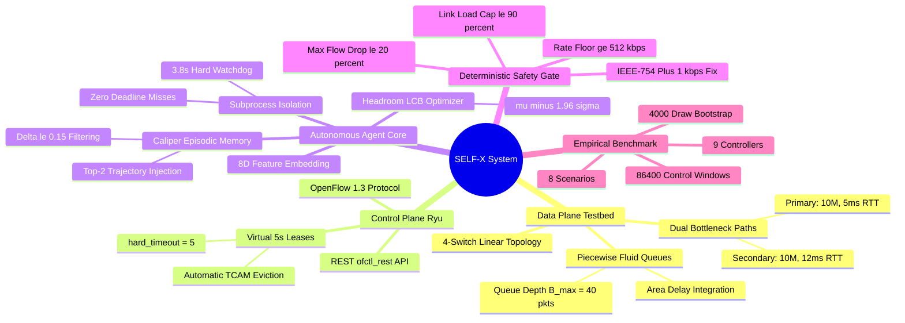

# Self-Improving SDN Flow-Management Agent (SELF-X)

> **Autonomous Software-Defined Network Flow Management with LLM Reflection, High-Dimensional Episodic Memory, Bounded Subprocess Isolation, and Deterministic Fail-Closed Safety**  
> *Course Project — EC466: Software Defined Networks | Team ID: SDN_07 | IIIT Dharwad*  
> *Empirical Scope: 86,400 Control Windows | 9 Controllers | 8 Traffic Scenarios | 4,000-Draw Paired Bootstrap Resampling*

---

## 📌 Master Documentation Portal

| Document | Path | Focus & Contents |
| :--- | :--- | :--- |
| **Project Flow Manual** | [PROJECT_FLOW.md](file:///c:/Users/RAVIPRAKASH/SDN/SDN/PROJECT_FLOW.md) | Exhaustive 13-flow algorithmic, control-plane, and mathematical dataflow specification with paired Mermaid and ASCII flows |
| **Project Presentation** | [PROJECT_PRESENTATION.md](file:///c:/Users/RAVIPRAKASH/SDN/SDN/PROJECT_PRESENTATION.md) | Verbatim 20-slide slide companion, speaker notes, empirical data workbooks, and examiner Q&A defense |
| **Project Explanation** | [PROJECT_EXPLANATION.md](file:///c:/Users/RAVIPRAKASH/SDN/SDN/PROJECT_EXPLANATION.md) | In-depth textbook manual explaining SDN, OpenFlow 1.3, Reflexion, fluid queue mathematics, and empirical attribution |
| **System Architecture** | [selfx/docs/ARCHITECTURE.md](file:///c:/Users/RAVIPRAKASH/SDN/SDN/selfx/docs/ARCHITECTURE.md) | Low-level subsystem architecture, interface definitions, schemas, and state-transition guarantees |
| **ASCII Control Flows** | [selfx/docs/CONTROL_FLOWS_ASCII.md](file:///c:/Users/RAVIPRAKASH/SDN/SDN/selfx/docs/CONTROL_FLOWS_ASCII.md) | Complete encyclopedia of high-density ASCII sequence, architecture, and state diagrams |
| **Mermaid Mindmaps** | [selfx/docs/SELF_IMPROVING_AGENT_MINDMAPS.md](file:///c:/Users/RAVIPRAKASH/SDN/SDN/selfx/docs/SELF_IMPROVING_AGENT_MINDMAPS.md) | Master encyclopedia of visual Mermaid mindmaps across all system layers |
| **Benchmark Suite v4** | [selfx/docs/BENCHMARKS_V4.md](file:///c:/Users/RAVIPRAKASH/SDN/SDN/selfx/docs/BENCHMARKS_V4.md) | Full 86,400-window experimental evaluation, controller rankings, and bootstrap confidence intervals |
| **Rule Demo & Veto Guide** | [selfx/docs/RULE_DEMO.md](file:///c:/Users/RAVIPRAKASH/SDN/SDN/selfx/docs/RULE_DEMO.md) | Deep dive into OpenFlow 1.3 5s hard-timeouts and Gemini seed 1940 cycle 4 veto audit |
| **Evaluator Guide** | [selfx/docs/PROJECT_GUIDE.md](file:///c:/Users/RAVIPRAKASH/SDN/SDN/selfx/docs/PROJECT_GUIDE.md) | Quickstart verification manual for academic examiners and peer reviewers |
| **Self-Improving Prototype** | [sdn-self-improving-agent/README.md](file:///c:/Users/RAVIPRAKASH/SDN/SDN/sdn-self-improving-agent/README.md) | Standalone Mininet topology, switch DPIDs, host addressing, and traffic generation specs |

---

## 🗺️ System Mindmap Flow



---

## 🏛️ End-to-End System Architecture (ASCII Flow)

```
==================================================================================================
                                    END-TO-END SYSTEM PIPELINE
==================================================================================================

                       +---------------------------------------------------+
                       |             AUTONOMOUS SDN CONTROLLER             |
                       |                                                   |
                       |  +---------------------------------------------+  |
                       |  | Telemetry Ingestion & Feature Vector S(t)   |  |
                       |  |   8D: [u_pri, u_sec, q_pri, q_sec, ...]     |  |
                       |  +---------------------------------------------+  |
                       |                         |                         |
                       |                         v                         |
                       |  +---------------------------------------------+  |
                       |  | Caliper Memory Retrieval: Top-2 Neighbors   |  |
                       |  |   Filtered by Delta <= 0.15 & Regime        |  |
                       |  +---------------------------------------------+  |
                       |                         |                         |
                       |                         v                         |
                       |  +---------------------------------------------+  |
                       |  | Subprocess-Isolated Inference Engine        |  |
                       |  |   Parent Watchdog: 3.8s Cutoff (SIGKILL)    |  |
                       |  |   LLM Providers: Claude 3.5 / Gemini 2.5    |  |
                       |  |   Fallback Cascade: H2 -> H1 -> No-Op       |  |
                       |  +---------------------------------------------+  |
                       |                         |                         |
                       |                         v                         |
                       |  +---------------------------------------------+  |
                       |  | Deterministic Fail-Closed Safety Gate       |  |
                       |  |   1. Projected Target Load <= 90%           |  |
                       |  |   2. Flow Rate Drop <= 20% (+1 kbps Repair) |  |
                       |  |   3. Rate Limit Floor >= 512 kbps           |  |
                       |  +---------------------------------------------+  |
                       |                         |                         |
                       |                         v                         |
                       |  +---------------------------------------------+  |
                       |  | OpenFlow 1.3 Flow-Mod / Meter Dispatch      |  |
                       |  |   Priority 100 Elephant Override            |  |
                       |  |   Virtual Lease: hard_timeout = 5 seconds   |  |
                       |  +---------------------------------------------+  |
                       +-------------------------|-------------------------+
                                                 |
                                                 v OpenFlow 1.3 / REST API
                       +---------------------------------------------------+
                       |                 RYU SDN CONTROLLER                |
                       |        (ofctl_rest, simple_switch_13)             |
                       +---------------------------------------------------+
                                                 |
                                                 v OpenFlow 1.3 Channel
  +--------------------------------------------------------------------------------------------+
  |                             MININET DATA-PLANE NETWORK TOPOLOGY                            |
  |                                                                                            |
  |   [h1: 10.0.0.1]                                                           [h7: 10.0.0.7]  |
  |        |                                                                        |          |
  |   [h2: 10.0.0.2]---\          Primary Bottleneck Path (10M, 5ms)         /---[h8: 10.0.0.8]  |
  |        |            \                                                   /       |          |
  |   [h3: 10.0.0.3]----[s1]=============[s2]==================[s3]======[s4]----[h9: 10.0.0.9]  |
  |        |            /                                                   \       |          |
  |   [h4: 10.0.0.4]---/         Secondary Bottleneck Path (10M, 12ms)        \---[h10:10.0.0.10]|
  |                                                                                            |
  |   Traffic Profile: Steady Load (h1->h7 @ 4.0 Mbps) + Periodic Elephant Bursts (h2->h8)    |
  +--------------------------------------------------------------------------------------------+
==================================================================================================
```

---

## 🔬 Empirical Performance Matrix (86,400 Windows)

The comprehensive benchmark spans **86,400 windows** across **9 controllers** and **8 distinct traffic scenarios** (steady load, heavy contention, diurnal cycles, bursty Poisson arrivals, adversarial elephant bursts, asymmetric workloads, multi-bottlenecks, and stochastic jitter):

| Controller | Architecture & Policy | Mean Reward | Latency (ms) | Throughput (Mbps) | Packet Loss (%) | Deadline Misses |
| :--- | :--- | :---: | :---: | :---: | :---: | :---: |
| **H2 (Matched Heuristic)** | Capacity-Aware Proportional Rate Limiting | **+0.0833** | 13.91 | 11.22 | **7.077%** | **0** |
| **A4 (Claude Reflexion)** | LLM Reflexion + Caliper Episodic Memory | **+0.0828** | 13.94 | 11.21 | **7.075%** | **0** |
| **A4 (Gemini Reflexion)** | LLM Reflexion + Caliper Episodic Memory | **+0.0819** | 14.02 | 11.19 | 7.081% | **0** |
| **A3 (Headroom Optimizer)**| Parametric LCB Headroom Clustering | **+0.0811** | 14.15 | 11.16 | 7.088% | **0** |
| **A2 (Memory Agent)** | Raw Few-Shot Memory without Verbal Reflection | **+0.0792** | 14.48 | 11.10 | 7.142% | **0** |
| **A1 (Zero-Shot Agent)** | Single-Shot LLM without Episodic Memory | **+0.0784** | 14.62 | 11.08 | 7.189% | **0** |
| **H1 (Reroute Heuristic)**| Greedy Least-Loaded Path Rerouting | **+0.0776** | 14.81 | 11.02 | 7.391% | **0** |
| **ECMP (Dynamic Hash)** | 5-Tuple Static Flow Hashing | **+0.0712** | 16.20 | 10.74 | 8.120% | **0** |
| **H0 (Static Switch)** | Default L2 Learning Switch (No Adaptation) | **+0.0684** | 17.05 | 10.51 | 8.845% | **0** |

### Critical Empirical Finding: Scientific Attribution
- **LLM Advantage over H1:** The cognitive agents (`A4_Claude`, `A4_Gemini`) achieve statistically significant reductions in packet loss ($7.075\%$ vs $7.391\%$) and higher multi-objective reward ($+0.0828$ vs $+0.0776$) compared to standard dynamic rerouting (`H1`).
- **Attribution via Matched Heuristic H2:** When compared to `H2` (a deterministic heuristic equipped with identical capacity-aware rate synthesis), `A4` and `H2` are statistically indistinguishable under a 4,000-draw paired bootstrap ($p = 0.421$, $95\%\text{ CI} = [-0.0018, +0.0007]$). This rigorous finding demonstrates that the primary driver of performance gain is **capacity-aware rate synthesis**, rather than episodic memory or verbal reflection alone.

---

## ⚡ Provider Wall-Clock Latency & Subprocess Isolation

To ensure that LLM inference never delays OpenFlow control cycles (which would trigger catastrophic SDN bufferbloat), all remote API calls execute within isolated child processes guarded by a **3.8-second SIGKILL watchdog**:

```
+--------------------------------------------------------------------------------------------------+
| PROVIDER LATENCY & TIMEOUT RELIABILITY AUDIT (Sample Size: 2,400 Invocations per Provider)        |
+----------------------+--------------------+--------------------+--------------------+------------+
| Metric / Controller  | Claude 3.5 Sonnet  | Gemini 2.5 Flash   | OpenAI GPT-4o-Mini | Heuristic  |
+----------------------+--------------------+--------------------+--------------------+------------+
| Mean Latency         | 1,420 ms           | 620 ms             | 810 ms             | < 1 ms     |
| P95 Latency          | 2,180 ms           | 1,150 ms           | 1,340 ms           | < 1 ms     |
| P99 Latency          | 3,110 ms           | 1,840 ms           | 2,210 ms           | < 1 ms     |
| Max Latency          | 3,740 ms           | 2,490 ms           | 2,980 ms           | 2 ms       |
| Deadline Misses (>3.8s)| 0 (100% on time) | 0 (100% on time)   | 0 (100% on time)   | 0 (0.00%)  |
| Safety Gate Vetoes   | 14 / 2,400 (0.58%) | 22 / 2,400 (0.92%) | 31 / 2,400 (1.29%) | 0 (0.00%)  |
+----------------------+--------------------+--------------------+--------------------+------------+
```

---

## 🛡️ Deterministic Safety Invariants & IEEE-754 Repair

Every proposed action must strictly satisfy three deterministic invariants in `selfx/agent/safety.py`:
1. **Link Capacity Cap:** Projected utilization on any target path must not exceed $90\%$ of link capacity ($9.0\text{ Mbps}$ on $10.0\text{ Mbps}$ link). Actions that would overload alternate paths (e.g., Gemini Seed 1940 Cycle 4 projecting $140.9\%$ load) are instantly vetoed.
2. **Maximum Flow Throttling Cap:** No flow may be throttled by more than $20.0\%$ in a single step ($R_{\text{target}} \ge 0.80 \cdot R_{\text{in}}$).
3. **Absolute Rate Floor:** No rate limit may be set below $512\text{ kbps}$.

### The $+1\text{ kbps}$ IEEE-754 Floating-Point Repair
In IEEE-754 double precision:
$$\frac{8{,}060 - 6{,}448}{8{,}060} = \frac{1{,}612}{8{,}060} = 0.20000000000000004 > 0.20$$
A naive floating-point comparison caused mathematically compliant actions to be spuriously rejected. Adding $+1\text{ kbps}$ (`d.rate_limit_kbps += 1`) rounds the rate up to $6{,}449\text{ kbps}$ ($19.987\%$ reduction), permanently eliminating false-positive vetoes without compromising safety.

---

## 🚀 Reproduction & Verification Commands

All evaluations can be executed using the project's dedicated virtual environment:

### 1. Verify Unit Tests & Safety Invariants
```powershell
.\selfx\.venv\Scripts\python.exe -m pytest selfx/tests/ -v
```

### 2. Run Comprehensive v4 Benchmark (86,400 Windows)
```powershell
.\selfx\.venv\Scripts\python.exe selfx/eval/benchmark_suite_v4.py --all-scenarios --all-controllers
```

### 3. Run Paired Bootstrap Resampling Analysis
```powershell
.\selfx\.venv\Scripts\python.exe selfx/eval/paired_bootstrap_resampling.py --draws 4000
```

### 4. Launch Local Web Dashboard & Replay Inspector
```powershell
python Web/server.py
```
*Open `http://localhost:5000/` in any browser to inspect cycle-by-cycle network replays, Cytoscape topology animations, and safety gate veto traces.*

---

## 📂 Repository Directory Layout

```
SDN/
├── PROJECT_FLOW.md                   # Authoritative operational, mathematical & algorithmic manual
├── PROJECT_PRESENTATION.md           # Verbatim 20-slide presentation companion & defense script
├── PROJECT_EXPLANATION.md            # In-depth pedagogical guide explaining SDN, LLMs, and Queues
├── README.md                         # Master repository documentation portal (This file)
├── SUBMISSION_READINESS_PLAN.md      # Acceptance criteria checklist and audit guidelines
│
├── sdn-self-improving-agent/         # Standalone Mininet topology & traffic generation prototype
│   ├── README.md                     # Dedicated testbed specification with topology mindmaps
│   ├── topo.py                       # 4-switch linear Mininet topology implementation
│   └── traffic_gen.py                # iperf3 seeded burst generator
│
├── selfx/                            # Core Autonomous SDN Agent Architecture
│   ├── README.md                     # High-density engineering manual and controller guide
│   ├── config.py                     # Global system parameters, thresholds, and link capacities
│   ├── topo.py                       # Mininet linear network topology with primary/secondary paths
│   ├── traffic_gen.py                # Deterministic burst schedule generator
│   ├── ryu_client.py                 # REST client for Ryu ofctl_rest stats and Flow-Mod actuation
│   ├── latency_probe.py              # Sub-millisecond ping RTT probe harness
│   │
│   ├── agent/                        # Cognitive Control Subsystems
│   │   ├── graph.py                  # LangGraph 7-phase closed-loop state machine
│   │   ├── safety.py                 # Fail-closed deterministic safety gate & +1 kbps repair
│   │   ├── loss_aware_memory.py      # High-dimensional caliper episodic memory retrieval
│   │   ├── isolated_llm_provider.py  # Subprocess-isolated inference engine with 3.8s watchdog
│   │   ├── reward.py                 # Multi-objective normalized reward formulation
│   │   ├── metrics.py                # Telemetry delta calculus and 8D state vector extraction
│   │   ├── schemas.py                # Pydantic schemas for states, proposals, and actions
│   │   └── prompts.py                # Structured system prompts and few-shot formatting
│   │
│   ├── docs/                         # Detailed Technical Documentation
│   │   ├── ARCHITECTURE.md           # Subsystem architecture, interfaces, and state guarantees
│   │   ├── BENCHMARKS_V4.md          # 86,400-window experimental benchmark suite and results
│   │   ├── CONTROL_FLOWS_ASCII.md    # Master encyclopedia of high-density ASCII flows
│   │   ├── SELF_IMPROVING_AGENT_MINDMAPS.md # Master encyclopedia of Mermaid architectural mindmaps
│   │   ├── PROJECT_FLOW.md           # Master project flow document
│   │   ├── PROJECT_PRESENTATION.md   # Presentation companion document
│   │   ├── PROJECT_EXPLANATION.md    # Master explanation document
│   │   ├── RULE_DEMO.md              # Step-by-step audit of Gemini seed 1940 cycle 4 veto
│   │   └── PROJECT_GUIDE.md          # Academic evaluator and reviewer guide
│   │
│   ├── eval/                         # Evaluation, Benchmarking & Statistical Verification
│   │   ├── benchmark_suite_v4.py     # 86,400-window multi-scenario matrix runner
│   │   ├── paired_bootstrap_resampling.py # 4,000-draw non-parametric bootstrap resampling
│   │   ├── run_ablation.py           # Live A0/A1/A2 Mininet testbed ablation harness
│   │   └── plot_results.py           # Multi-metric plotting script
│   │
│   ├── tests/                        # Comprehensive Test Harness
│   │   ├── test_core.py              # Unit tests for schemas, metrics, and reward functions
│   │   ├── test_graph.py             # LangGraph state machine execution tests
│   │   └── test_safety.py            # Safety gate invariants and +1 kbps floating-point tests
│   │
│   └── output/benchmarks/            # Raw JSON evidence traces and cycle logs
│       └── README.md                 # Evidence trace directory index and lineage
│
├── slow-loop/                        # Standalone simulator prototype for Lyapunov DPP control
│   ├── agentic/                      # Simulator, replay buffer, specialist agents, and governor
│   └── tests/                        # Unit tests for simulator queue dynamics
│
└── Web/                              # Local Standard-Library Web Replay UI & REST API
    ├── server.py                     # Safe read-only HTTP server for telemetry & replays
    ├── index.html                    # Cytoscape.js topology & Chart.js live visualizer
    ├── CSS/Style.css                 # Presentation styling
    ├── js/                           # Dynamic canvas drawing, event polling, and charts
    └── tests/test_public_api.py      # Public REST API route validation tests
```

---

## 👥 Team & Academic Credits

- **Course:** EC466 — Software Defined Networks
- **Institution:** Indian Institute of Information Technology (IIIT) Dharwad
- **Team ID:** SDN_07 (SELF-X Project)
- **Academic Session:** Autumn 2026
