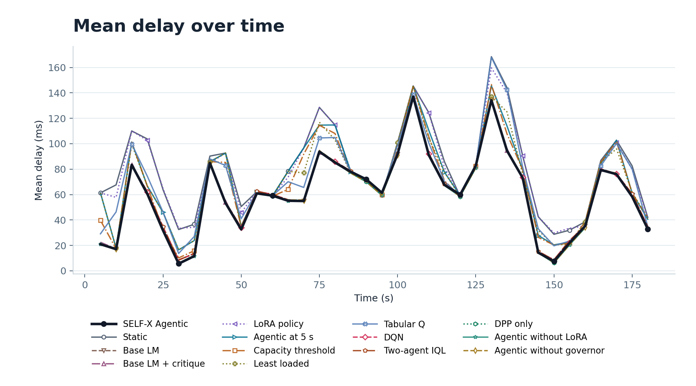

# SELF-X SDN controller evaluation

Open the [graph gallery](paper/comparison/index.html) in a browser. It shows **13 XY graphs** with all **14 controller configurations** and a table of Agentic effects. The same results are available in the [PDF atlas](paper/comparison/SELF_X_Algorithm_Comparison.pdf), [effects CSV](paper/comparison/effects.csv) and [implementation audit](paper/COMPARISON.md). In the local dashboard, select **Algorithm Comparison**.



## Reproduce from the repository root

Install [uv](https://docs.astral.sh/uv/) and run this from the folder containing this README.

```text
uv run --python 3.12 --index-strategy unsafe-best-match --with-requirements requirements-comparison.txt python -m selfx.eval.run_audited_comparison
```

The first run sets up the CPU dependencies, downloads the pinned SmolLM2 base weights (about 269 MB), and uses the included LoRA checkpoint. It trains DQN and two-agent Q-learning, evaluates all controllers on matched traffic, and writes the gallery, PDF, PNGs, effects table and raw measurements to `paper/comparison/`. No API key, Mininet or switch is required. To redraw the figures from the saved measurements, replace `run_audited_comparison` in the command with `plot_audited_comparison`.

The earlier PDFs, slides and saved Table II/V results predate this evaluation. Their DQN and MARL labels refer to randomized heuristic proxies, and the early ablation labels do not demonstrate execution of the claimed AI components. Use the atlas and the revised evaluation for performance and attribution claims.
