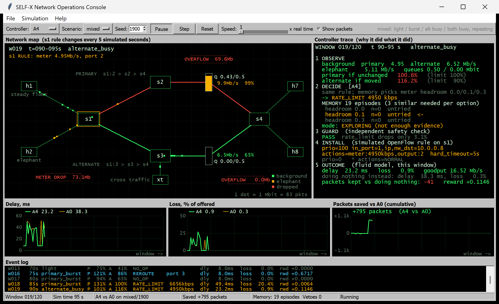
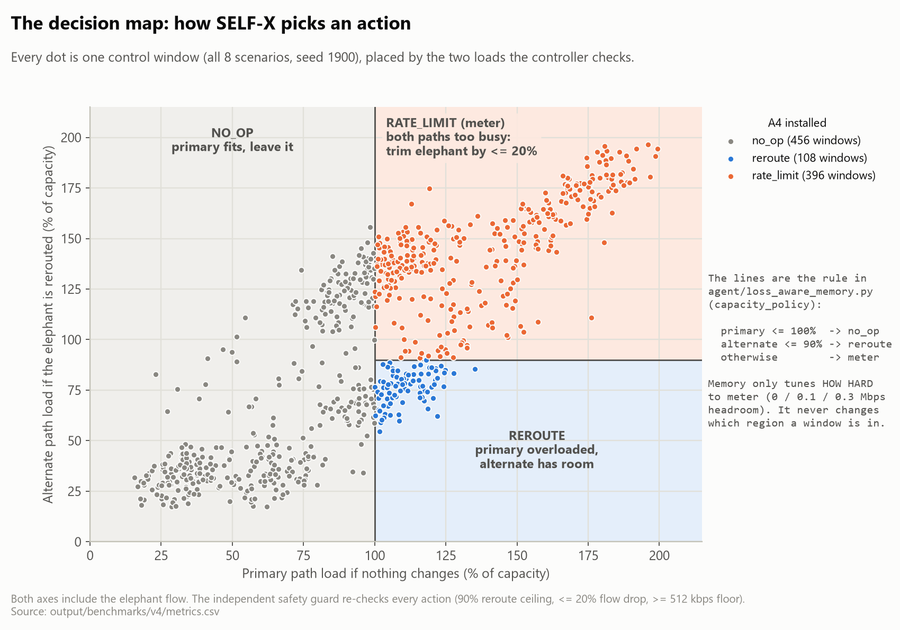
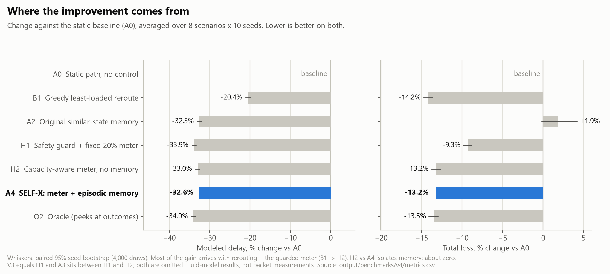
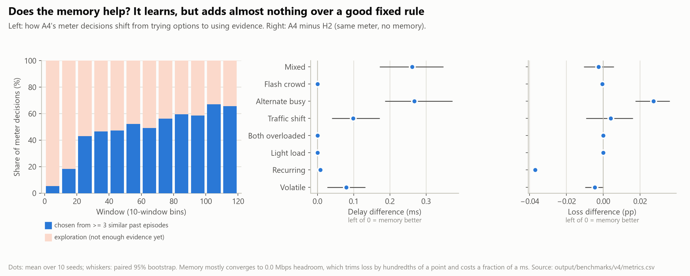
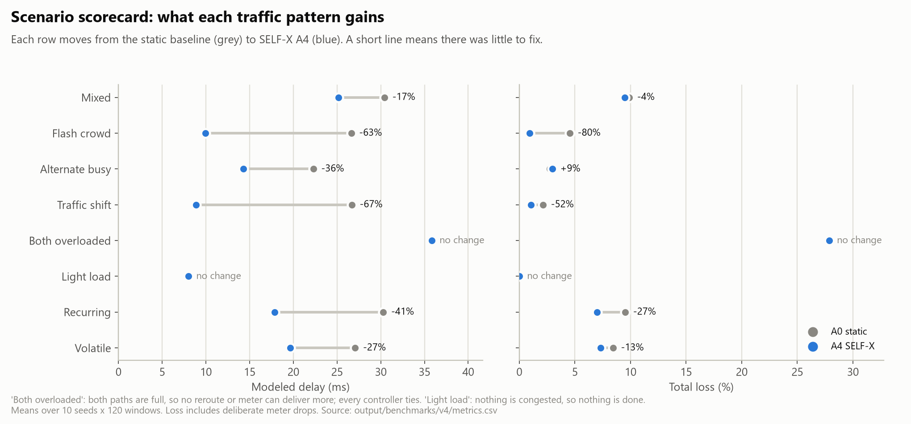
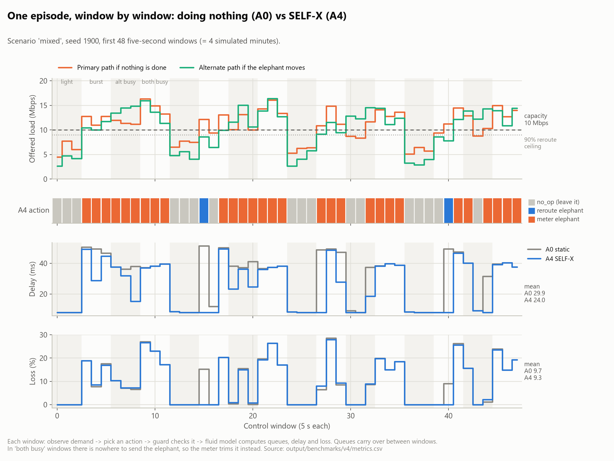
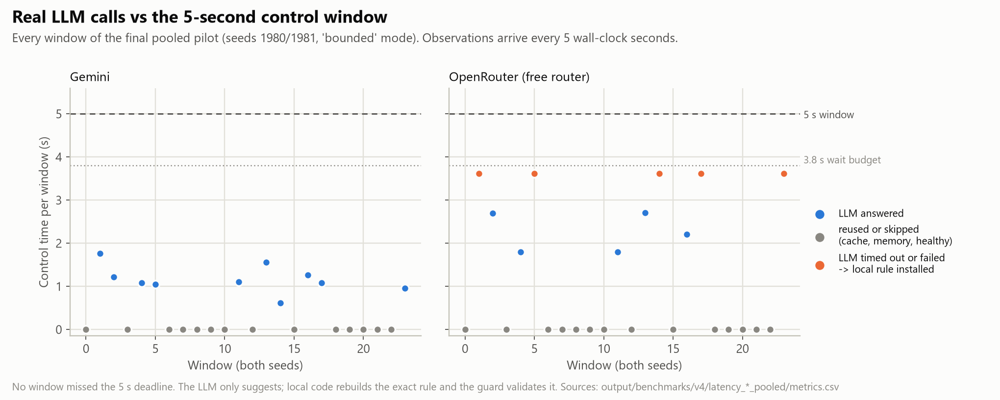

# SELF-X: a self-improving traffic manager for a software-defined network

Course project for EC466 Software Defined Networks at IIIT Dharwad, team SDN_07 (Aug to Nov 2026).

SELF-X watches traffic in a small network and decides, every five seconds, whether a large
burst of traffic should be left alone, moved to a second path, or slowed down. Every
decision passes an independent safety check before it is applied. The system remembers
what happened after each decision and uses that record to choose better next time. An
AI language model (Gemini or OpenRouter) can be asked for a suggestion, but it can only
suggest. Ordinary code always checks the suggestion and builds the final rule.



*The simulator console (`.\run.ps1 simulator`). Coloured dots are traffic moving through
the network. The right panel explains, step by step, why the controller did what it did.
The graphs at the bottom compare SELF-X with a network that never reacts.*

---

## The idea in one minute

In an ordinary network, every switch decides on its own where to send traffic. In a
**software-defined network (SDN)**, the switches only forward traffic, and one central
program, the *controller*, tells all of them what to do. That makes it possible to write
software that looks at the whole network and changes its behaviour on the fly.


*How SDN is usually organised. Applications at the top say what they want, the
controller in the middle turns that into instructions, and the switches at the bottom
carry them out. SELF-X is one of those applications. Image: Open Networking Foundation,
"SDN Architecture Overview" v1.0 (2013), via
[Wikimedia Commons](https://commons.wikimedia.org/wiki/File:SDN-architecture-overview-transparent.png),
licensed CC BY-SA 3.0.*

Our test network is deliberately small. Two senders reach two receivers through four
switches. Between the first and last switch there are two routes, a main path and a
backup path, each able to carry 10 megabits per second. Most of the time, steady traffic
uses the main path. Now and then one sender starts a very large transfer (we call it an
*elephant flow*) and the main path fills up. Packets then wait in a queue, which adds
delay, and when the queue is full they are thrown away, which is loss.

SELF-X has three possible responses:

- **Do nothing** when everything fits.
- **Move the large transfer** to the backup path, if the backup has room.
- **Slow the large transfer down** to a safe rate, if neither path has room. This drops
  some of that transfer on purpose so that everyone else stops waiting.

## What happens every five seconds

1. **Look.** Read how busy each path is and how full its queue is.
2. **Decide.** Apply a simple capacity rule. If it says "slow down", the memory picks how
   much spare room to leave, based on how similar past situations turned out.
3. **Check.** A separate safety guard refuses anything risky. It never allows more than
   20% of a flow to be dropped, more than 90% use of a path, or a speed limit below
   512 kilobits per second.
4. **Apply.** Install the rule on the first switch for the next five seconds.
5. **Learn.** Measure what happened, compare it with what doing nothing would have
   given in the same five seconds, and store the result in memory.


One small detail in step 3 caught us out. Computers store decimals slightly
inaccurately, so a slow-down of exactly 20% could be measured as 20.000000000000004%
and wrongly refused. The rule now rounds its speed limit up by 1 kilobit per second
when needed, so it always stays inside the guard's limit. The guard itself was not
loosened, and the results from before this fix are kept in
`selfx/output/benchmarks/v4/pre_numeric_repair/`.

The rule that drives step 2 is easier to see as a picture. Each dot is one decision
SELF-X made in the benchmark:



## Results

All network numbers below come from a **computer model of the network**, not from real
switches. The model is described under "What is real and what is simulated" further down.
Each controller was tested on 8 traffic patterns, 10 random seeds each, and 120
five-second windows per run (10 simulated minutes).

| Controller | What it does | Average delay | Change | Average loss | Change |
|---|---|---:|---:|---:|---:|
| A0 | Never reacts (the starting point) | 25.90 ms | | 8.15% | |
| B1 | Moves traffic to whichever path is emptier | 20.61 ms | -20.4% | 7.00% | -14.1% |
| H1 | Safety guard plus a fixed slow-down | 17.13 ms | -33.9% | 7.39% | -9.3% |
| H2 | SELF-X's rule without memory | 17.36 ms | -33.0% | 7.08% | -13.2% |
| **A4** | **SELF-X: the rule plus memory** | **17.45 ms** | **-32.6%** | **7.08%** | **-13.2%** |
| O2 | "Cheating" reference that sees the future | 17.10 ms | -34.0% | 7.05% | -13.5% |

Compared with doing nothing, SELF-X cuts modelled delay by about a third and loss by
about an eighth. The project goal was at least 20% less delay. It is also close to the
"cheating" reference, which tries every action on the model and keeps the best one:
only 0.36 ms more delay and 0.03 points more loss.



### What the results do and do not show

- **The gain comes from the rule, not the memory.** H2 uses the same rule with no
  memory, and it does just as well as A4 (very slightly better on reward). With only
  three slow-down settings to choose from, the memory learns the right one, but a good
  fixed setting is already close to it.

  

- **Some situations cannot be helped.** When both paths are overloaded, every controller
  gives the same result, because there is nowhere left to put the traffic. When the
  network is lightly loaded, there is nothing to fix.

- **Slowing traffic down counts as loss.** In the "backup path busy" pattern, SELF-X
  lowers delay by 36% but raises loss by 9%, because it chooses to drop part of the
  large transfer rather than let everyone queue.

  

Here is one run, window by window. Grey means "do nothing", blue means "moved to backup",
orange means "slowed down". Delay falls wherever SELF-X acts.



### Does the AI model answer in time?

Each decision has a five-second window. Before asking the AI model, SELF-X skips the call
when the network is healthy, when its memory already knows the answer, or when it has seen
the exact situation recently. When it does ask, it gives the model 3.8 seconds, and falls
back to its own rule if no valid answer arrives.



Gemini answered all 10 questions it was asked, in about half a second on average.
OpenRouter's free service answered 5 of 10, and the other 5 ran out of time and fell back
safely. No five-second window was missed. These are real internet calls. The large
benchmark above uses the built-in rule only, so it measures the control design and not
the AI model.

Detailed results for every controller, and how the statistics were done, are in [`selfx/docs/BENCHMARKS_V4.md`](selfx/docs/BENCHMARKS_V4.md).

## What is real and what is simulated

| Part | Real or simulated |
|---|---|
| Network traffic, queues, delay and loss | Simulated by a fluid model: traffic is treated as a smooth flow, five seconds at a time, on two 10 Mbps paths with a fixed queue size |
| Decision rule, safety guard, memory, reward | Real code, the same code that would run against a real network |
| Calls to Gemini and OpenRouter | Real, over the internet, with real timings |
| Switch rules | Written in the same format a real switch would receive, but not sent to a switch |
| Mininet and Ryu testbed (a virtual network and controller for Linux) | Code is included in `selfx/`, but no measured results from it are in this repository |

## How the repository is organised

The repository holds four pieces of work that grew over the semester.

**`selfx/`** is the main project and where almost all results come from. The top-level
files hold settings, the safety guard and the Linux testbed scripts (network layout,
traffic generator and the connection to the Ryu controller). The `agent` folder holds
the decision-making: the capacity rule, the memory, the reward, and the code that asks
an AI model and enforces its time limit. The `eval` folder holds the network model and
the benchmark programs that produced the results above. The `live` folder is the
simulator console. The `web` folder and `app.py` are a review dashboard for saved runs.
The `scripts` folder rebuilds charts, reports and slides. The `tests` folder checks all
of this. The `output` folder holds every saved result, including raw data, charts, the
written report and the presentation. The `docs` folder explains the design and each
benchmark round in more depth, and also holds the IEEE-style project report.

**`slow-loop/`** is a separate prototype of a larger idea from the revised problem
statement. A slower AI "governor" adjusts the settings of a fast, maths-based controller
once a minute, instead of choosing actions directly. It runs on its own small simulator
with a stand-in AI model, and is not connected to `selfx/`. In its own test, the tuned
settings brought delay from 10.76 ms to 5.66 ms and loss from 12.93% to 0%.

**`Web/`** is a public, read-only dashboard that gives an overview of the project and
serves saved results. Its "Simulation Mode" is an illustration with fixed numbers, not
the network model; use the console in `selfx/` to see the real model at work.

**`sdn-self-improving-agent/`** is the very first prototype (network layout and traffic
generator), kept for reference.

**`visualizations/`** holds the overview diagrams shown in the Web dashboard. The two
problem statements are at the top level: `PS_01_Problem_Statement.pdf` (first version)
and `SELF-X_Problem_Statement_v2_Revised.docx` (the revised one).

## Running it

The main project runs on Windows with Python installed. From the `selfx` folder:

```powershell
.\setup.ps1              # one time: creates a private Python environment and installs packages
.\run.ps1 simulator      # opens the simulator console
.\run.ps1 test           # runs the automatic checks
.\run.ps1 dashboard      # review dashboard at http://127.0.0.1:8765
.\run.ps1 benchmark      # reruns the full benchmark (overwrites the saved results)
.\run.ps1 figures        # redraws the charts in this README from the saved results
```

In the console, press Space to run or pause, N to step one window, R to reset and F1 for
help. Choose a controller, traffic pattern and seed from the toolbar. The console runs
the same code as the benchmark, and an automatic check replays saved benchmark runs
through it and requires identical results.

To use the AI model, put a `GEMINI_API_KEY` or `OPENROUTER_API_KEY` in `selfx/.env`
(this file is ignored by git and must never be committed), then run `.\run.ps1 gemini`
or `.\run.ps1 openrouter`. Everything else works without a key.

The public dashboard needs nothing beyond Python. From the repository root:

```powershell
python Web/server.py                              # http://localhost:5000
python -m unittest discover -s Web/tests -v       # its checks
```

The slow-loop prototype, from the `slow-loop` folder:

```powershell
python run_benchmark.py --mock --episodes 10 --mode multi
python -m unittest discover -s tests -t .
```

**Linux testbed (optional, not verified here).** On Ubuntu with Mininet, Open vSwitch,
iperf3 and Ryu installed, start the controller with
`ryu-manager --ofp-tcp-listen-port 6653 ryu.app.simple_switch_13 ryu.app.ofctl_rest`,
start the network from `selfx` with `sudo -E python3 topo.py`, and run the comparison
with `sudo -E python3 -m eval.run_ablation --duration 600`. This installs real rules on
the virtual switches.

## What is finished and what is not

| Goal from the revised problem statement | Status |
|---|---|
| At least 20% less delay than a network that never reacts | Met in the model: 32.6% less |
| Safety check on every action | Done, with an independent guard |
| Learning from past outcomes (memory and reflection) | Done, though it adds little over the fixed rule here |
| AI model suggestions within the time limit | Done for Gemini and OpenRouter, with a safe fallback |
| Step-by-step comparison of controllers | Done: 9 controllers in the network model |
| Fast maths-based controller tuned by AI specialists | Prototype only, in `slow-loop/` |
| Results from Mininet and Ryu | Not done; testbed code exists |
| Proof that queues stay bounded, and fine-tuning the AI model | Not done |

## Credits

EC466 Software Defined Networks, IIIT Dharwad. Team SDN_07. The SDN architecture diagram
is by the Open Networking Foundation, used under CC BY-SA 3.0 via Wikimedia Commons. All
other images were produced by this project's own code.
