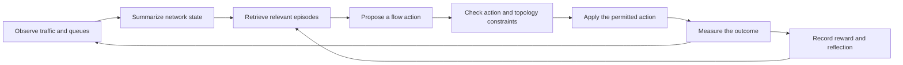

# SELF-X · Self-Improving SDN Flow Management

## About the project

SELF-X is a software-defined networking (SDN) project that manages congestion by observing traffic, proposing flow changes, and checking each proposed intervention against network constraints before it takes effect.
It can keep the current forwarding, move a large flow to an alternate path, or cap that flow's rate with a meter.
After a control window, the agent can record the action, its outcome, and a reflection for use when similar conditions recur.

SDN gives a controller a view of traffic across multiple switches and a way to change how they forward traffic.
That makes it possible to respond when a burst fills a queue or when an alternate path has spare capacity.
Each intervention has a cost. Rerouting can overload the alternate path, and metering can discard traffic at ingress.
SELF-X makes those trade-offs visible through the proposed action, the safety verdict, the applied action, and the resulting traffic measurements.

The repository includes a browser dashboard, a Python fluid-network simulator with a desktop console, and components for a Linux Mininet and Open vSwitch lab.
It also includes a two-timescale controller, episodic memory for recurring traffic conditions, and a local LoRA adapter lifecycle for updating a model policy.
The project was developed for EC466 Software Defined Networks by team SDN_07.

## Contents

- [Quick start](#quick-start)
- [Dashboard walkthrough](#dashboard-walkthrough)
- [System architecture](#system-architecture)
- [Flow actions and safety](#flow-actions-and-safety)
- [Fast control and slow governance](#fast-control-and-slow-governance)
- [Episodic memory and policy updates](#episodic-memory-and-policy-updates)
- [Network topologies and traffic](#network-topologies-and-traffic)
- [Desktop simulator](#desktop-simulator)
- [Live lab integration](#live-lab-integration)
- [Configuration and API](#configuration-and-api)
- [Model backends and API keys](#model-backends-and-api-keys)
- [Install and run SmolLM2 locally](#install-and-run-smollm2-locally)
- [Repository layout](#repository-layout)
- [Troubleshooting](#troubleshooting)

## Quick start

Use Python 3.12 and a web browser. Run the dashboard command from the repository root, which contains both `Web/` and `selfx/`.
The dashboard server and browser simulation need only Python's standard library and the files in this repository.

```console
python Web/server.py
```

Open [the dashboard on port 5000](http://127.0.0.1:5000/).
The mode banner identifies browser simulation or a connected testbed.
A fresh setup can run the simulation with no credentials, Mininet installation, or connected switch.

For an alternate port, set `SDN_WEB_PORT` before starting the server.

```powershell
$env:SDN_WEB_PORT = '5050'
python Web/server.py
```

```bash
SDN_WEB_PORT=5050 python Web/server.py
```

Open [port 5050](http://127.0.0.1:5050/) when using either example.
Keep the terminal running while you use the dashboard. Stop the server with `Ctrl+C`.

## Dashboard walkthrough

### Follow a single control cycle

1. Open the dashboard and confirm that the banner says **Simulation mode**.
2. Click **Pause Loop** if playback is running.
3. In **Topology & Multi-Fabric**, select the default linear topology.
4. Toggle **Steady Load (3M)** or add **Burst Elephant (12M)** to change the simulated demand.
5. Click **Step Loop** to advance one browser simulation cycle.
6. Open **Agent Cognition Loop** to see the observation and the action the simulated agent selected.
7. Open **Safety Gate & Rules** to inspect the guard and the simulated forwarding or meter state.
8. Open **Real-Time Charts** to see how the current session's delay, throughput, and loss evolve.

The topology canvas lets you select a host or switch to inspect its links and counters.
The traffic matrix and flow list identify which hosts are exchanging traffic.
Select a workload in **Workload Schedule** to see its scheduled demand on the topology view.

### Inspect memory and forwarding

The **Episodic Memory Bank** displays retained episode records and can export them as JSON.
Use it alongside the cognition trace to see what evidence is available for later decisions.
The safety view exposes the configured guardrails and the dashboard's OpenFlow-style tables.

The **Reroute Flow** and **Rate Limit (Meter)** controls operate in browser simulation.
Use **Reset** to restore the local simulation state and begin a fresh walkthrough.
Choose **Live Network** in the header to request read-only Ryu status and see the connected switch count.

### Read the telemetry

| Signal | What it represents |
| --- | --- |
| Offered load | Traffic demand before metering or link service |
| Throughput | Traffic delivered over the measured or simulated interval |
| Link utilization | Traffic rate relative to a link's capacity |
| Queue backlog | Traffic waiting for service at the end of a window |
| Delay | Propagation and queueing time in the simulated path |
| Loss | Traffic discarded by a meter or by buffer overflow in the fluid model |
| Reward | A controller score derived from changes in delay, throughput, and loss |

A flow can offer more traffic than a link delivers. The difference can remain queued or be discarded.
Metering can move loss from the bottleneck to ingress, so read the delivered rate and total loss alongside the queue.
In **Live Network** mode, the dashboard reports connectivity and leaves the metric cards empty.

## System architecture

The Python control graph follows a closed loop from observation to reflection.
The simulation has a traffic source and a queue model. In a lab integration, switch counters and flow statistics supply observations through the Ryu client.



### Observation and decision

- `metrics.py` summarizes observations and calculates throughput and loss from telemetry.
- `schemas.py` defines structured decisions with fields for the action, target, and rationale.
- `graph.py` connects observation, decision, actuation, a wait interval, measurement, and reflection.
- `bounded_control.py` can bypass remote calls on healthy traffic, use supported memory, and reuse cached suggestions for matching contexts.
- `deadline_provider.py` runs provider work in a subprocess with a bounded wait.
- `providers.py` handles structured responses from configured model backends.

A model-assisted policy proposes an action. The bounded simulation controller builds flow parameters locally and validates the result against the current demand.
If the provider fails or exceeds its deadline, the bounded controller can use its local capacity-aware recommendation.
The graph and the simulation paths expose the decision and guard result for inspection. [Control graph](selfx/agent/graph.py) · [Bounded controller](selfx/agent/bounded_control.py)

### Fluid network model

The desktop simulator models two parallel logical paths using traffic volumes, service rates, and finite queues.
Each path has a 10 Mbps bottleneck and a 0.5 Mbit buffer in this simulator.
A desktop step advances five simulated seconds. Any backlog at the end of a window carries into the next window.
Demand can include background traffic on both paths and a larger flow whose path or rate the controller can change.

The simulator tracks traffic admitted after metering, traffic delivered by the link, and traffic discarded when the buffer fills.
These counters help explain why a short queue can coexist with high loss.
The topology manifests describe network fabrics and have their own link and queue settings. [Fluid network](selfx/eval/simulator.py) · [Topology definitions](selfx/topo.py)

## Flow actions and safety

| Action | Effect | What the controller needs |
| --- | --- | --- |
| `no_op` | Preserve default or current forwarding for the control path | No new forwarding or meter rule |
| `reroute` | Move the selected flow to an alternate output | A known flow, an allowed alternate path, and sufficient capacity |
| `rate_limit` | Cap the selected flow's admitted traffic | An observed flow rate and a permitted meter rate |

### Flow-management guardrails

The flow-management guard in `selfx/safety.py` uses defaults defined in `selfx/config.py`.

| Constraint | Default | Applied to |
| --- | ---: | --- |
| Maximum projected target-link utilization | 90% | A reroute after adding the selected flow's measured rate |
| Maximum reduction from the observed flow rate | 20% | A proposed meter |
| Minimum meter rate | 512 kbps | A proposed meter |

A reroute needs a known link capacity so the guard can compute projected utilization.
The control graph also checks whether the selected egress port is allowed for the flow.
A meter needs a measured flow rate and a configured ceiling. The graph checks that it can preserve the flow's observed output instructions when adding the meter.
A rejected intervention resolves to `no_op` in the graph. [Safety guard](selfx/safety.py) · [Configuration](selfx/config.py)

### Rule lifetime

A meter sets a rate ceiling. Packets within that ceiling still need forwarding instructions.
In the Python control graph, a metered flow keeps its observed forwarding output and uses a hard timeout based on the control interval.
The rule demonstration shows the relationship between a temporary intervention, expiry, and default forwarding.
Rule lifetimes depend on the control path. [Ryu client](selfx/ryu_client.py) · [Rule demonstration](selfx/docs/RULE_DEMO.md)

## Fast control and slow governance

### Fast decisions

The Lyapunov drift-plus-penalty (DPP) controller scores candidate actions using the current queue backlogs and a weighted cost.
Drift describes the predicted change in queue pressure. The penalty represents configured operating costs.
The controller chooses the lowest-scoring action from the current policy's action mask.
The weight `V` controls how much the penalty contributes relative to the drift term.

An action mask lists the choices available to the controller for that policy.
A topology action gateway compiles supported selections into OpenFlow-style instructions.
The Python scheduler defaults to a 100 ms fast interval and a 30 s slow interval. The desktop console uses its separate five-second model.
[DPP controller](selfx/agent/dpp_controller.py) · [Two-timescale scheduler](selfx/agent/two_timescale_scheduler.py)

### Policy updates

The standalone slow-loop package works with aggregated telemetry such as backlog, delivered traffic, delay, and loss.
Its specialist roles cover flow sizing, routing, congestion anomalies, security constraints, and service slicing.
An orchestrator uses their structured opinions to form a candidate policy update.

A policy update can adjust `V`, objective weights, or the allowed action mask.
The governance layer validates candidate settings before handing a policy to fast control.
The versioned policy bridge tracks the incumbent and records accepted or rejected updates. It can restore a previous policy.
[Slow-loop components](slow-loop/README.md) · [Versioned policy bridge](selfx/agent/delta_pi_bridge.py)

## Episodic memory and policy updates

### Runtime memory

An episode ties a network observation to an applied action and its measured outcome.
The agent can store the action parameters, reward, and a short reflection with that episode.
Later decisions can retrieve nearby observations to see which actions worked under similar demand and queue conditions.

Loss-aware memory uses traffic features and prior action outcomes to compare candidate meter settings.
Capacity-aware logic can provide a decision when the available episodes have little support.
The selected action still passes through the guard using the current network state.
The desktop console starts each session with its own temporary memory. [Loss-aware memory](selfx/agent/loss_aware_memory.py)

### Local adapter lifecycle

LoRA is low-rank adaptation. SELF-X uses it to train small adapter matrices while keeping the underlying language-model weights frozen.
The adapter policy learns from completed replay episodes and proposes an action from a constrained vocabulary.
The surrounding software constructs any path and meter parameters that the action requires.

1. Collect completed episodes with observation, action, outcome, reward, and provenance.
2. Validate the source data and prepare the eligible training examples.
3. Train a candidate adapter and retain its model and dataset identity.
4. Check the candidate against the current policy before changing the active registry entry.
5. Activate an approved artifact through the versioned registry.
6. Restore the previous adapter through rollback when required.

The registry stores adapter artifacts and the active adapter's identity. A promoted adapter can be selected through the `local_lora` backend.
See the component guide for CPU dependencies, registry commands, and deployment details. [Adapter lifecycle](selfx/docs/SELF_IMPROVEMENT.md)

## Network topologies and traffic

### Topology manifests

| ID | Fabric | Structure |
| --- | --- | --- |
| `linear` | Four-switch linear network | Eight hosts and two parallel core links between the middle switches |
| `leaf_spine` | Two-spine, four-leaf fabric | Eight hosts and an uplink from each leaf to each spine |
| `unseen_mesh` | Augmented six-switch mesh | Eight hosts on a ring with two cross-links |

A manifest describes switches, hosts, links, bandwidth, and delay. Some links also specify port numbers or queue sizes.
Use the fabric selector in the dashboard to inspect the checked-in manifests.
To view a topology summary or regenerate all three manifest files, run these commands from the repository root.

```console
python selfx/topo.py --topology leaf_spine
python selfx/topo.py --export-manifests
```

The export writes JSON to `selfx/output/topologies/`.
The topology command prints a summary. The Mininet builder is a separate function in the same module. [Topology code](selfx/topo.py)

### Workload schedules

| Profile | Traffic pattern |
| --- | --- |
| `steady_bursty` | Steady background traffic with intermittent larger flows |
| `flash_crowd` | Overlapping arrivals that concentrate demand |
| `volatile_dpp` | Demand that changes over short intervals |

Generate a schedule by specifying its profile, duration in seconds, and random seed.

```console
python selfx/traffic_gen.py --profile flash_crowd --duration 60 --seed 42
```

The command writes a JSON manifest under `selfx/output/traffic/`.
Use `--export-all` to generate all three profiles for the supplied duration and seed.
Schedule records carry the endpoints, start time, duration, and offered rate of each event.
The dashboard serves the checked-in schedule files and can display them in the topology view. [Traffic generator](selfx/traffic_gen.py)

## Desktop simulator

The Tkinter console runs the Python fluid network one window at a time and displays path loads, queue state, decisions, and losses.
From the repository root, create a virtual environment with Python 3.12. On Windows, use the command for your Python 3.12 installation if python points to another version.

### Windows PowerShell

```powershell
python -m venv .venv
.\.venv\Scripts\python.exe -m pip install numpy "pydantic>=2.7,<3" requests
Set-Location selfx
..\.venv\Scripts\python.exe -m live
```

### Linux or macOS

```bash
python3.12 -m venv .venv
.venv/bin/python -m pip install numpy 'pydantic>=2.7,<3' requests
cd selfx
../.venv/bin/python -m live
```

With Tkinter installed, select a controller, scenario, and seed in the toolbar.
Click **Step** to see one window or **Run** to play the session. The speed slider controls playback.
Inspect the requested action and guard result alongside the path and queue panels.
Use **File → Export run log (CSV)** to save the current session.

### Headless session

Use the same virtual environment's Python from `selfx/` to step the model without Tkinter.

```python
from live.engine import Session

session = Session(controller="A4", scenario="mixed", seed=1900, cycles=3)
try:
    while not session.done:
        window = session.step()
        print(window.cycle, window.installed.action, window.guard_reason)
finally:
    session.close()
```

The returned window includes the demand, requested and installed actions, per-path queue state, meter loss, and reward.
[Session engine](selfx/live/engine.py) · [Desktop console](selfx/live/console.py)

### Local rule replay

The project also provides a loopback dashboard for stepping through saved rule traces.
From `selfx/`, use the same virtual environment as the desktop console.

```console
python app.py --port 8765
```

Open [the local replay dashboard](http://127.0.0.1:8765/) and select a trace in the rule demonstration.

## Live lab integration

The Mininet builder uses Open vSwitch and OpenFlow 1.3. It requires a Linux host with Mininet and Open vSwitch installed, plus privileges to create the virtual network.
An external Ryu controller supplies the OpenFlow endpoint and the `ofctl_rest` API.
The topology builder defaults to OpenFlow port `6653`. The dashboard's default Ryu REST endpoint uses port `8080`.

- `selfx/topo.py` builds the Mininet network from a topology manifest.
- `selfx/traffic_gen.py` includes `iperf3` helpers for generating traffic inside Mininet.
- `selfx/ryu_client.py` reads switch and port statistics and implements flow and meter operations for lab integrations.
- `selfx/agent/graph.py` accepts telemetry, actuation, and timing functions through its dependency object.
- `Web/server.py` checks controller reachability and reports the switch list through a read-only status route.

Use the dashboard status to verify Ryu connectivity. For lab reroutes, supply a function that returns allowed egress ports for each flow.
The browser's flow buttons apply to the browser simulation. The Python graph is the integration point for lab control.
[Mininet builder](selfx/topo.py) · [Ryu client](selfx/ryu_client.py) · [Dashboard bridge](Web/server.py)

## Configuration and API

### Environment variables

| Variable | Scope | Purpose |
| --- | --- | --- |
| `SDN_WEB_PORT` | Web bridge | Dashboard port, default `5000` |
| `RYU_REST_BASE` | Web bridge | Ryu base URL, default `http://127.0.0.1:8080` |
| `RYU_REST_HOST` and `RYU_REST_PORT` | Python Ryu client | REST host and port used by the control code |
| `SDN_AGENT_MEMORY_PATH` | Python agent | Override for the agent's JSON memory path |
| `GEMINI_API_KEY` and `GEMINI_MODEL` | Provider integration | Credentials and model ID for Gemini |
| `OPENROUTER_API_KEY` and `OPENROUTER_MODEL` | Provider integration | Credentials and model ID for OpenRouter |
| `SDN_LORA_REGISTRY` | Local adapter backend | Registry used to locate the active adapter |

The web bridge reads variables from the process environment.
See [Create the .env file](#create-the-env-file) to configure a model provider or a local registry.
The [environment example](selfx/.env.example) provides the available fields with empty credential values.

### Dashboard routes

| GET route | Response |
| --- | --- |
| `/api/status` | Dashboard state, Ryu connectivity, and connected switch IDs |
| `/api/memory` | Agent memory when the server finds an available source |
| `/api/topologies` | Available topology IDs and counts for switches, hosts, and links |
| `/api/topologies/linear` | Manifest for the default linear topology |
| `/api/traffic/schedules` | Index of available workload schedules |

With the dashboard running, open [the status response](http://127.0.0.1:5000/api/status) to check connectivity or [the topology index](http://127.0.0.1:5000/api/topologies) to inspect available fabrics.
Use the port configured for your session when it differs from `5000`.

## Model backends and API keys

| Option | What runs the decisions | Credentials |
| --- | --- | --- |
| Browser simulation | JavaScript in the dashboard | None |
| `offline` | Local Python rules and episodic memory | None |
| `gemini` | Google Gemini API | `GEMINI_API_KEY` |
| `openrouter` | OpenRouter's free router or a named free model | `OPENROUTER_API_KEY` |
| `auto` | Gemini first, then OpenRouter in the structured decision path | A key for each provider you want to use |
| `local_lora` | SmolLM2 on your machine, with the active adapter if one is registered | None |

The backend flag applies to the Python simulator. Use the browser dashboard for the interactive JavaScript simulation.

### Prepare the Python environment

Use Python 3.12 and start from the repository root. Reuse the virtual environment from [Desktop simulator](#desktop-simulator) if you already created one.
Otherwise, create it with a Python 3.12 interpreter before activating it.

```console
python --version
python -m venv .venv
```

In PowerShell, activate it with `.\.venv\Scripts\Activate.ps1`.
If PowerShell blocks the activation script, call `.\.venv\Scripts\python.exe` from the root or `..\.venv\Scripts\python.exe` from `selfx/`.
In Bash or Zsh, use `source .venv/bin/activate`. The examples below use `python` from that environment.

```console
python -m pip install "pydantic>=2.7,<3" requests python-dotenv
```

### Create the .env file

From the repository root, copy the example if `selfx/.env` does not exist yet. Edit any existing file in place.

```powershell
if (-not (Test-Path -LiteralPath selfx/.env)) { Copy-Item selfx/.env.example selfx/.env }
notepad selfx/.env
```

```bash
test -f selfx/.env || cp selfx/.env.example selfx/.env
```

Open `selfx/.env` in a text editor and use the fields for the provider you chose.
Here is a minimal example. Fill in the key for your provider and leave the other key empty.

```dotenv
GEMINI_API_KEY=
GEMINI_MODEL=gemini-3.5-flash-lite
OPENROUTER_API_KEY=
OPENROUTER_MODEL=openrouter/free
```

The Python agent loads `selfx/.env` when `python-dotenv` is installed. Variables already set in the process take precedence.
Choose the backend with `--provider` when you launch the simulator. That command does not read `SELFX_DECISION_PROVIDER`.
Keep keys in `selfx/.env` or your shell environment. Git ignores `.env` files. Commit only the example with empty key fields.
Run `git check-ignore selfx/.env` from the root to check the ignore rule without showing the file contents.
If a key is exposed, revoke it at the provider and replace it locally.

### Set a key for one terminal session

Use a shell variable if you prefer to keep the key out of the file.
These examples prompt for the key without putting it in the command you type. The PowerShell example requires version 7.2 or later.

```powershell
$env:GEMINI_API_KEY = Read-Host -MaskInput 'Gemini API key'
```

```bash
read -rs -p 'Gemini API key: ' GEMINI_API_KEY
export GEMINI_API_KEY
```

For OpenRouter, use `OPENROUTER_API_KEY` in place of `GEMINI_API_KEY`. Close the shell to discard the session variable.

### Get a Gemini API key

1. Sign in to [Google AI Studio's API Keys page](https://aistudio.google.com/apikey).
2. Copy the key shown for your project, or choose **Create API key** and select or create a project.
3. Paste the key after `GEMINI_API_KEY=` in `selfx/.env`.
4. Set `GEMINI_MODEL=gemini-3.5-flash-lite` or choose a compatible text model available to your project.

Check your project's access, quota, and billing tier in AI Studio before running longer sessions.
[Gemini API key guide](https://ai.google.dev/gemini-api/docs/api-key) · [Gemini model catalog](https://ai.google.dev/gemini-api/docs/models)

### Get an OpenRouter API key

1. Sign in to [OpenRouter's API Keys page](https://openrouter.ai/settings/keys).
2. Create a key, give it a name such as `SELF-X local`, and review the credit limit options.
3. Copy the issued key into `OPENROUTER_API_KEY` in `selfx/.env`.
4. Set `OPENROUTER_MODEL=openrouter/free` to let OpenRouter select a free model, or use an available model ID ending in `:free`.

The SELF-X REST adapter accepts those two forms. Free models have rate limits, and the available model list can change.
[OpenRouter authentication guide](https://openrouter.ai/docs/api/reference/authentication) · [Free model catalog](https://openrouter.ai/collections/free-models)

### Run a short simulation with the selected backend

From the repository root, change to `selfx/` with the environment active. Each command writes to a separate scratch folder under `selfx/tmp/`.

```console
cd selfx
python -m eval.run_simulation --provider offline --conditions A0 A1 --cycles 2 --seeds 1729 --out-dir tmp/offline-demo
python -m eval.run_simulation --provider gemini --conditions A0 A1 --cycles 2 --seeds 1729 --out-dir tmp/gemini-demo
python -m eval.run_simulation --provider openrouter --conditions A0 A1 --cycles 2 --seeds 1729 --out-dir tmp/openrouter-demo
```

Run the line for the backend you configured. For fallback between Gemini and OpenRouter, pass `--provider auto` with `--conditions A0 A1` and set both providers' keys and model IDs.
A two-window hosted run can make multiple requests because the agent also requests a reflection.
Check `provider_calls.json` in the output folder for request status and `trace.jsonl` for the decision and fallback used in each window.
A completed simulation can include a fallback when the provider is unavailable.

| Provider error | What to check |
| --- | --- |
| `missing_credential` | Confirm the correct variable name, the `selfx/.env` path, and `python-dotenv` in the active environment. |
| `http_401` or `http_403` | Check whether the key is active and whether its project or workspace can access the model. |
| `http_404` | Compare the configured model ID with the provider's catalog. |
| `http_429` | Check quota and retry after it resets, or use `offline` or local SmolLM2. |
| `paid_model_blocked_use_free_suffix` | Select `openrouter/free` or a model whose ID ends in `:free`. |

## Install and run SmolLM2 locally

SELF-X pins `HuggingFaceTB/SmolLM2-135M-Instruct` to revision `12fd25f77366fa6b3b4b768ec3050bf629380bac`.
The policy runs on CPU. The first download needs Internet access and no Hugging Face key.
[Files for the pinned model revision](https://huggingface.co/HuggingFaceTB/SmolLM2-135M-Instruct/tree/12fd25f77366fa6b3b4b768ec3050bf629380bac)

### Install the CPU dependencies

With the Python environment active, run these commands from the repository root on Windows or Linux.

```console
python -m pip install numpy "pydantic>=2.7,<3" requests python-dotenv
python -m pip install torch==2.8.0 --index-url https://download.pytorch.org/whl/cpu
python -m pip install -r selfx/requirements-lora.txt
```

On macOS with Apple silicon, use `python -m pip install torch==2.8.0` for the PyTorch line.
Check platform-specific wheels if the install reports that it cannot find a compatible distribution. [PyTorch version and platform instructions](https://pytorch.org/get-started/previous-versions/#v280)

### Download ahead of time or let SELF-X download on first use

From the repository root, enter `selfx/` and call the project helper to fetch the tokenizer, configuration, and weights.

```console
cd selfx
python -c "from agent.self_improvement.policy import ensure_model; print(ensure_model())"
```

The helper puts the files in `selfx/.models/smollm2-135m-instruct-12fd25f7/` and verifies their recorded hashes on subsequent loads.
Starting the local policy also downloads the same pinned files when they are missing.
For offline use, install the dependencies in advance and copy the complete verified model folder, including `download_manifest.json`, into the same project-relative location.
If validation reports a hash mismatch, restore a verified copy of the full folder or move the cache aside and let the helper download it again.

### Option 1 · Use the base model directly

From `selfx/`, load the base policy and ask it to score the three action tokens for one simulator observation.

```python
from agent.self_improvement.dataset import observation
from agent.self_improvement.policy import LoRAPolicy
from eval.simulator import FluidNetwork, traffic_trace

demand = traffic_trace(seed=1729, cycles=1)[0]
network = FluidNetwork()
state = network.summary(demand)
policy = LoRAPolicy()
prediction = policy.predict([observation(state)], adapter="base")[0]
print(prediction["action"], prediction["probabilities"])
```

This checks the model and tokenizer without training an adapter. The printed action is the model's suggestion.
Use the simulation runner below to have SELF-X validate and apply the suggested action.

### Option 2 · Run with a registered LoRA policy

From `selfx/`, train and register a candidate in a new folder. If you already have a registry from an earlier run, use its path and start with the `status` command.

```console
python -m agent.self_improvement run --output tmp/local-policy --steps 120 --cycles 48
python -m agent.self_improvement status --registry tmp/local-policy/registry
```

An approved candidate becomes the active adapter. A registry that still points to version zero uses the base model.
Use `--model` with `local_lora` to pass the registry directory.

```console
python -m eval.run_simulation --provider local_lora --model tmp/local-policy/registry --conditions A0 A1 A2 --cycles 2 --seeds 1729 --out-dir tmp/local-model-demo
```

Alternatively, set `SDN_LORA_REGISTRY` to the absolute registry path in `selfx/.env` and omit `--model`.
The argument takes precedence over the environment setting. The runner requires `A0` for static forwarding. Add `A1`, `A2`, or both for local model decisions. [Adapter lifecycle](selfx/docs/SELF_IMPROVEMENT.md)

### Option 3 · Try other SmolLM2 sizes in a standalone script

Hugging Face also publishes [SmolLM2-360M-Instruct](https://huggingface.co/HuggingFaceTB/SmolLM2-360M-Instruct) and [SmolLM2-1.7B-Instruct](https://huggingface.co/HuggingFaceTB/SmolLM2-1.7B-Instruct).
These use more memory than 135M. To try either size with Transformers, follow its model card's text generation example and use its model ID.
SELF-X's action-token policy and registry are tied to the pinned 135M revision. Using a different size in the controller requires changes to the model loader and compatible adapter artifacts.

## Repository layout

| Path | Responsibility |
| --- | --- |
| [Web/](Web/) | Browser interface, simulator, static assets, and HTTP bridge |
| [selfx/agent/](selfx/agent/) | Control graph, policies, provider interface, memory, and rule handling |
| [selfx/agent/self_improvement/](selfx/agent/self_improvement/) | Replay preparation, LoRA fitting, registry, and rollback |
| [selfx/live/](selfx/live/) | Desktop simulator and step-by-step session engine |
| [selfx/topo.py](selfx/topo.py) | Topology manifests and Mininet construction |
| [selfx/traffic_gen.py](selfx/traffic_gen.py) | Traffic schedules and lab traffic helpers |
| [slow-loop/](slow-loop/) | Governor, policy safety, experience replay, and scheduler support |
| [selfx/docs/](selfx/docs/) | Architecture and component documentation |

## Troubleshooting

| Symptom | Check |
| --- | --- |
| Python cannot open `Web/server.py` | Start in the directory containing `Web/` and `selfx/`. |
| The dashboard port is already in use | Set `SDN_WEB_PORT` to an available port and update the browser URL. |
| The dashboard reports Ryu offline | Use browser simulation, or check the Ryu process and `RYU_REST_BASE` for a live lab. |
| A topology or workload list is empty | Check the JSON manifests under `selfx/output/topologies/` and `selfx/output/traffic/`. |
| `python -m live` cannot find the module | Run from `selfx/` with the project environment's interpreter. |
| Tkinter fails to initialize | Check that Tkinter is installed and that the Python process has a graphical display. |
| An intervention is vetoed | Read the safety verdict and check the target flow, alternate-path load, or proposed meter rate. |

For implementation details, see the [control architecture](selfx/docs/ARCHITECTURE.md), [dashboard bridge guide](Web/README.md), and [DPP derivation](selfx/docs/DPP_FORMAL_DERIVATION.md).
