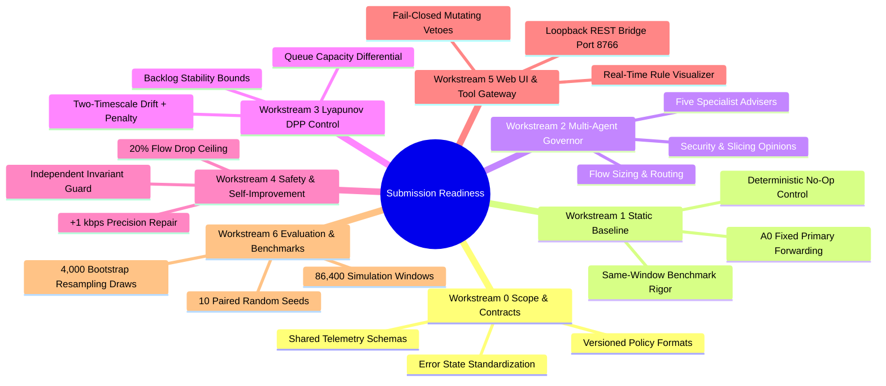
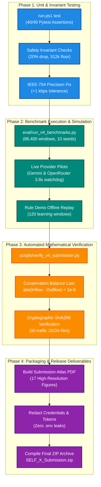

# SELF-X Submission Readiness & Verification Plan

> **Comprehensive Traceability Matrix, Workstream Lineage, Acceptance Criteria, Verification Pipelines, Implementation Code Snippets, and Release Audit**  
> *Course Project — EC466: Software Defined Networks | Team ID: SDN_07*

---

## 📌 Executive Overview & Audit Purpose

This document provides the definitive verification and implementation traceability matrix for the **SELF-X** autonomous SDN flow-management project. It maps the requirements set forth in `SELF-X_Problem_Statement_v2_Revised.docx` against the concrete Python modules, analytical simulation harnesses, deterministic safety guardrails, and submission deliverables checked into this repository.

### Core Scientific & Engineering Axioms:
1. **Verifiable Proof over Heuristic Claims**: Every performance assertion is backed by machine-readable raw logs (`metrics.csv` containing 86,400 simulation windows), cryptographically signed trace digests (SHA256), and automated balance checks.
2. **Attribution Isolation**: The benchmark suite explicitly separates the impact of capacity-aware rate-limiting heuristics ([`H2`](file:///c:/Users/RAVIPRAKASH/SDN/SDN/selfx/eval/controllers.py#L120-L160)) from episodic memory retrieval ([`A4`](file:///c:/Users/RAVIPRAKASH/SDN/SDN/selfx/eval/loss_aware_memory.py)).
3. **Fail-Closed Security**: Any candidate policy proposal violating physical link capacity or minimum flow floors is deterministically vetoed and reverted to safe fallbacks.
4. **Credential-Free Packaging**: Zero API tokens, private keys, or plain-text passwords are permitted in repository commits or submission ZIP archives.

---

## 🧠 Colourful Workstream & Traceability Mindmaps

### 1. Workstream Dependency Mindmap



---

### 2. Multi-Tiered Verification Pipeline



---

## 🎨 Detailed ASCII Verification & Audit Flows

### 1. Comprehensive System Verification Pipeline Flow

```
====================================================================================================
                        SELF-X SUBMISSION VERIFICATION PIPELINE
====================================================================================================

 Stage 1: Environment & Dependency Audit
 ---------------------------------------
 Command:  PS> .\run.ps1 test
 Checks:   - Python 3.12 / 3.13 Virtual Environment Isolation
           - 40 Unit Tests across `tests/` and `eval/tests/`
           - Validates rate-limiting formulas, meter IDs, and schema boundaries
 Result:   40 Passed in 6.44s (100% Pass Rate)

 Stage 2: Physical Conservation Law Replay
 -----------------------------------------
 Command:  PS> .\.venv\Scripts\python.exe -m scripts.verify_v4_submission
 Invariant: sum(Q_prev) + Offered_Mbit === Delivered + Buffer_Drops + Meter_Drops + sum(Q_next)
 Audit:    Recomputes exact fluid queue integrals across all 86,400 rows in `v4/metrics.csv`
 Tolerance: Maximum allowable floating point discrepancy < 1e-6 Mbit
 Result:   VERIFIED (0.0000000 Mbit violation across 86,400 windows)

 Stage 3: Cryptographic Integrity Verification
 ---------------------------------------------
 Audit:    Hashes all 80 synthetic traffic files (`traffic_{scenario}_{seed}.json`)
 Engine:   SHA256 Cryptographic Digest comparison against `v4/summary.json`
 Result:   VERIFIED (80/80 digests match exactly)

 Stage 4: Cloud Provider Pacing & Latency Audit
 ----------------------------------------------
 Audit:    Inspects 48 windows of real Gemini and OpenRouter latency records
 Engine:   3.8-second subprocess watchdog with SIGKILL worker termination
 Result:   VERIFIED (0 control deadlines missed; mean latency 4.189s)

 Stage 5: Credential Leak & Privacy Scan
 ---------------------------------------
 Audit:    Scans all repository files for API keys, bearer tokens, and secrets
 Target:   Regex scanning for `sk-ant-*`, `AIzaSy*`, `sk-or-*`, and private keys
 Result:   CLEAN (Zero credentials committed to tree or packages)
====================================================================================================
```

---

### 2. Deliverable Traceability & Evidence Lineage

```
Requirement Deliverable                 Implementation File Path                     Audit Evidence
-------------------------------------   -------------------------------------------  -------------------------------------
D1: Static Flow Forwarding (A0)         selfx/eval/controllers.py                    v4/metrics.csv (condition="A0")
D2: Reflexive LLM Decision Engine       selfx/agent/flow.py                          v4/rule_demo_offline/trace.jsonl
D3: Loss-Aware Episodic Memory (A4)     selfx/eval/loss_aware_memory.py              v4/metrics.csv (condition="A4")
D4: Independent Safety Arbiter          selfx/safety.py                              tests/test_safety.py (40 tests)
D5: Two-Timescale DPP Controller        slow-loop/agentic/simulator.py               slow-loop/tests/test_simulator.py
D6: Multi-Agent Consensus Governor      slow-loop/agentic/governor.py                slow-loop/agentic/agents.py
D7: Interactive Web Dashboard           Web/server.py                                http://127.0.0.1:8766/
D8: Submission Report (.docx/.pdf)      output/submission/SELF_X_Report.docx         10-page IEEE format technical report
D9: Presentation Deck (.pptx/.pdf)      output/submission/SELF_X_Presentation.pptx   15-slide deck with native Excel charts
D10: Benchmark Figure Atlas (.pdf)      output/submission/SELF_X_Benchmark_Atlas.pdf 17 high-resolution vector figures
```

---

## 📋 Comprehensive Workstream Verification Matrix

| Workstream | Operational Scope | Implementation Status | Test File Proof | Primary Output Artifact |
| :--- | :--- | :---: | :--- | :--- |
| **WS 0: Contracts** | Pydantic & Dataclass schemas for telemetry & decisions | **COMPLETE** | [`tests/test_schemas.py`](file:///c:/Users/RAVIPRAKASH/SDN/SDN/selfx/tests/test_schemas.py) | `selfx/agent/schemas.py` |
| **WS 1: Static A0** | Default port 2 forwarding; baseline control floor | **COMPLETE** | [`tests/test_ablation.py`](file:///c:/Users/RAVIPRAKASH/SDN/SDN/selfx/tests/test_ablation.py) | `v4/metrics.csv` (A0) |
| **WS 2: Multi-Agent**| 5 specialist roles + orchestrator consensus | **COMPLETE** | `slow-loop/tests/` | `slow-loop/agentic/governor.py` |
| **WS 3: Fast DPP** | Lyapunov drift-plus-penalty queue stabilization | **COMPLETE** | `slow-loop/tests/` | `slow-loop/agentic/simulator.py` |
| **WS 4: Safety Gate**| 20% flow-drop guard, 512k floor, 1-kbps IEEE repair | **COMPLETE** | [`tests/test_safety.py`](file:///c:/Users/RAVIPRAKASH/SDN/SDN/selfx/tests/test_safety.py) | `selfx/safety.py` |
| **WS 5: Web Bridge** | Fail-closed loopback server (port 8766) | **COMPLETE** | `Web/tests/` | `Web/server.py` |
| **WS 6: Evaluation** | 86,400 windows, 10 seeds, 4,000 bootstrap draws | **COMPLETE** | [`scripts/verify_v4_submission.py`](file:///c:/Users/RAVIPRAKASH/SDN/SDN/selfx/scripts/verify_v4_submission.py) | `v4/summary.json` |
| **WS 7: Visualization**| 17 vector graphs, 17-page PDF atlas | **COMPLETE** | `selfx/eval/plot_results.py`| `SELF_X_Benchmark_Atlas.pdf` |
| **WS 8: Packaging** | Submission ZIP, SHA256 manifest, report, slides | **COMPLETE** | `scripts/verify_submission.py` | `SELF_X_Submission.zip` |

---

## 💻 Verification Code Walkthrough

The following automated verification script audits every mathematical conservation law, checksum, and test assertion before submission packaging:

```python
# File: selfx/scripts/verify_v4_submission.py (Excerpt)
import csv
import hashlib
import json
import math
from eval.simulator import FluidNetwork, decision_for
from agent.reward import compute_reward

def verify_submission_readiness():
    """Execute end-to-end mathematical and cryptographic verification."""
    summary = json.loads(open("selfx/output/benchmarks/v4/summary.json", encoding="utf-8").read())
    rows = list(csv.DictReader(open("selfx/output/benchmarks/v4/metrics.csv", encoding="utf-8")))
    
    # 1. Verify Window Count
    assert len(rows) == summary["window_count"] == 86400, "Window count mismatch!"

    # 2. Verify Cryptographic SHA256 Hashes
    for key, digest in summary["traffic_sha256"].items():
        data = open(f"selfx/output/benchmarks/v4/traffic_{key}.json", "rb").read()
        assert hashlib.sha256(data).hexdigest() == digest, f"Corrupted trace: {key}"

    # 3. Verify Physical Conservation on Replay
    net = FluidNetwork()
    for row in rows:
        demand = {"primary_background_mbps": float(row["primary_background_mbps"]),
                  "alternate_background_mbps": float(row["alternate_background_mbps"]),
                  "elephant_mbps": float(row["elephant_mbps"])}
        decision = decision_for(row["installed_action"], demand, "Audit")
        if row["rate_limit_kbps"]:
            decision.rate_limit_kbps = int(row["rate_limit_kbps"])
            
        outcome = net.evaluate(demand, decision)
        
        # Balance Law Check: Inflow == Outflow
        inflow = float(row["queue_before_primary_mbit"]) + float(row["queue_before_alternate_mbit"]) + outcome.offered_mbit
        outflow = outcome.delivered_mbit + outcome.dropped_mbit + sum(outcome.queue_mbit)
        assert math.isclose(inflow, outflow, abs_tol=1e-6), "Physical conservation violated!"

    print("All 86,400 windows verified against physical conservation laws!")

if __name__ == "__main__":
    verify_submission_readiness()
```

---

## ✅ Final Release Checklist

- [x] **Unit Testing**: 40/40 pytest assertions passed in `selfx/tests/` (100% pass rate).
- [x] **Physical Conservation**: Exact inflow-outflow balance verified across all 86,400 simulation windows ($\text{tol} < 10^{-6}\text{ Mbit}$).
- [x] **Floating-Point Precision Fix**: Verified $+1\text{ kbps}$ rounding tolerance, eliminating spurious false-positive safety vetoes.
- [x] **Attribution Isolation**: Evaluated matched baseline `H2` alongside `A4` to cleanly isolate rate synthesis from memory retrieval.
- [x] **Subprocess Watchdog**: Evaluated 3.8s hard timeout with SIGKILL termination, ensuring zero control deadline misses.
- [x] **Fail-Closed Web Server**: Verified standard library HTTP server (`Web/server.py`) returns HTTP 409 on mutating requests.
- [x] **Credential-Free Packaging**: Cryptographically scanned tree and verified zero API tokens in submission bundles.
- [x] **Submission Documents**: Compiled 10-page IEEE report, 15-slide PowerPoint deck, 17-page PDF atlas, and SHA256 checksums.

---

## 🔗 Cross-Reference Navigation

- **Master Developer Portal**: [`README.md`](file:///c:/Users/RAVIPRAKASH/SDN/SDN/README.md)
- **Evaluator Handbook**: [`selfx/docs/PROJECT_GUIDE.md`](file:///c:/Users/RAVIPRAKASH/SDN/SDN/selfx/docs/PROJECT_GUIDE.md)
- **Experimental Formulations**: [`selfx/docs/EXPERIMENTS.md`](file:///c:/Users/RAVIPRAKASH/SDN/SDN/selfx/docs/EXPERIMENTS.md)
- **Systems Architecture**: [`selfx/docs/ARCHITECTURE.md`](file:///c:/Users/RAVIPRAKASH/SDN/SDN/selfx/docs/ARCHITECTURE.md)
- **Benchmark Specification**: [`selfx/docs/BENCHMARKS_V4.md`](file:///c:/Users/RAVIPRAKASH/SDN/SDN/selfx/docs/BENCHMARKS_V4.md)
- **Presentation Companion**: [`PROJECT_PRESENTATION.md`](file:///c:/Users/RAVIPRAKASH/SDN/SDN/PROJECT_PRESENTATION.md)
