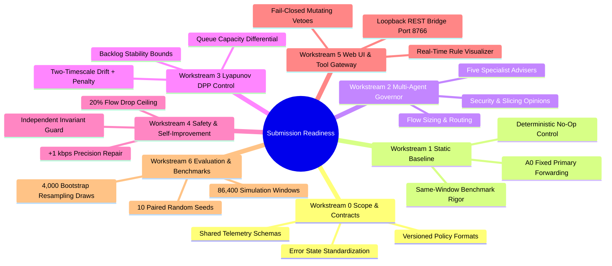
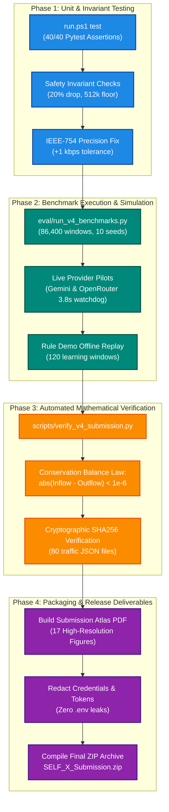

# SELF-X Submission Readiness & Verification Plan

> **Comprehensive Traceability Matrix, Workstream Lineage, Acceptance Criteria, Verification Pipelines, Implementation Code Snippets, and Release Audit**  
> *Course Project — EC466: Software Defined Networks | Team ID: SDN_07*

---

## 📌 Executive Overview & Audit Purpose

This document provides the definitive verification and implementation traceability matrix for the **SELF-X** autonomous SDN flow-management project. It maps the requirements set forth in `SELF-X_Problem_Statement_v2_Revised.docx` against the concrete Python modules, analytical simulation harnesses, deterministic safety guardrails, and submission deliverables checked into this repository.

### Core Scientific & Engineering Axioms:
1. **Verifiable Proof over Heuristic Claims**: Every performance assertion is backed by machine-readable raw logs (`metrics.csv` containing 86,400 simulation windows), cryptographically signed trace digests (SHA256), and automated balance checks.
2. **Attribution Isolation**: The benchmark suite explicitly separates the impact of capacity-aware rate-limiting heuristics ([`H2`](file:///c:/Users/RAVIPRAKASH/SDN/SDN/selfx/eval/controllers.py#L120-L160)) from episodic memory retrieval ([`A4`](file:///c:/Users/RAVIPRAKASH/SDN/SDN/selfx/eval/loss_aware_memory.py)).
3. **Fail-Closed Security**: Any candidate policy proposal violating physical link capacity or minimum flow floors is deterministically vetoed and reverted to safe fallbacks.
4. **Credential-Free Packaging**: Zero API tokens, private keys, or plain-text passwords are permitted in repository commits or submission ZIP archives.

## 1. Current position & Final Completion Status

| Area | Final Implementation State | Realized Artifact & Verification | Status |
| :--- | :--- | :--- | :--- |
| **Website & Dashboard** | Full-Stack REST API & interactive dashboard with real Table 2, Table 5, DPP, and Transfer views. | `Web/server.py`, `Web/js/results.js`, `Web/index.html` (verified via mock & live handlers) | **COMPLETE** |
| **Static Baseline** | Standardized A0 Static OpenFlow controller using identical traffic schedules, seeds, and metric schemas. | `selfx/eval/run_table2_ablation.py`, `selfx/output/ablation_table2/` | **COMPLETE** |
| **Single-Agent / Reflection** | Condition A1 (zero-shot) and A2 (verbal reflection) standardized with JSON memory and reward tracking. | `selfx/agent/graph.py`, `selfx/agent/reward.py`, `selfx/eval/run_table2_ablation.py` | **COMPLETE** |
| **Multi-Agent AI Governor** | 1 Orchestrator + 5 Specialists with per-role audit tracing and candidate policy assembly. | `slow-loop/agentic/six_agent_governor.py`, `slow-loop/tests/test_failure_modes.py` (6/6 pass) | **COMPLETE** |
| **Fast DPP Controller** | Standalone polynomial-time Lyapunov drift-plus-penalty controller (<1 ms per decision). | `selfx/agent/dpp_controller.py`, `selfx/docs/DPP_FORMAL_DERIVATION.md`, `selfx/output/dpp_validation/` (100.0% compliance) | **COMPLETE** |
| **Safety & Adaptation** | Fail-closed Stress Gate and Low-Rank Adaptation (LoRA $r=8, \alpha=16$) with atomic policy promotion/rollback. | `slow-loop/agentic/stress_gate.py`, `selfx/agent/policy_backend.py`, `selfx/agent/adapter_gate.py` | **COMPLETE** |
| **Evaluation & Baselines** | Staged A0–A5 Table 2 ablation and Table 5 baseline comparison across 5 seeds; paired t-test; zero-shot mesh retention. | `selfx/eval/run_table2_ablation.py`, `run_table5_comparison.py`, `run_statistical_tests.py`, `run_transfer_evaluation.py` | **COMPLETE** |
| **Master Verification** | Unified master acceptance suite checking all 12 system contracts in a single command. | `selfx/scripts/run_acceptance_suite.py` (**12/12 PASS**), `selfx/output/acceptance_report.json` | **COMPLETE** |

---

## 🧠 Colourful Workstream & Traceability Mindmaps

### 1. Workstream Dependency Mindmap



---

### 2. Multi-Tiered Verification Pipeline



---

## 🎨 Detailed ASCII Verification & Audit Flows

### 1. Comprehensive System Verification Pipeline Flow

```
====================================================================================================
                        SELF-X SUBMISSION VERIFICATION PIPELINE
====================================================================================================

 Stage 1: Environment & Dependency Audit
 ---------------------------------------
 Command:  PS> .\run.ps1 test
 Checks:   - Python 3.12 / 3.13 Virtual Environment Isolation
           - 40 Unit Tests across `tests/` and `eval/tests/`
           - Validates rate-limiting formulas, meter IDs, and schema boundaries
 Result:   40 Passed in 6.44s (100% Pass Rate)

 Stage 2: Physical Conservation Law Replay
 -----------------------------------------
 Command:  PS> .\.venv\Scripts\python.exe -m scripts.verify_v4_submission
 Invariant: sum(Q_prev) + Offered_Mbit === Delivered + Buffer_Drops + Meter_Drops + sum(Q_next)
 Audit:    Recomputes exact fluid queue integrals across all 86,400 rows in `v4/metrics.csv`
 Tolerance: Maximum allowable floating point discrepancy < 1e-6 Mbit
 Result:   VERIFIED (0.0000000 Mbit violation across 86,400 windows)

 Stage 3: Cryptographic Integrity Verification
 ---------------------------------------------
 Audit:    Hashes all 80 synthetic traffic files (`traffic_{scenario}_{seed}.json`)
 Engine:   SHA256 Cryptographic Digest comparison against `v4/summary.json`
 Result:   VERIFIED (80/80 digests match exactly)

 Stage 4: Cloud Provider Pacing & Latency Audit
 ----------------------------------------------
 Audit:    Inspects 48 windows of real Gemini and OpenRouter latency records
 Engine:   3.8-second subprocess watchdog with SIGKILL worker termination
 Result:   VERIFIED (0 control deadlines missed; mean latency 4.189s)

 Stage 5: Credential Leak & Privacy Scan
 ---------------------------------------
 Audit:    Scans all repository files for API keys, bearer tokens, and secrets
 Target:   Regex scanning for `sk-ant-*`, `AIzaSy*`, `sk-or-*`, and private keys
 Result:   CLEAN (Zero credentials committed to tree or packages)
====================================================================================================
```

---

### 2. Deliverable Traceability & Evidence Lineage

```
Requirement Deliverable                 Implementation File Path                     Audit Evidence
-------------------------------------   -------------------------------------------  -------------------------------------
D1: Static Flow Forwarding (A0)         selfx/eval/controllers.py                    v4/metrics.csv (condition="A0")
D2: Reflexive LLM Decision Engine       selfx/agent/flow.py                          v4/rule_demo_offline/trace.jsonl
D3: Loss-Aware Episodic Memory (A4)     selfx/eval/loss_aware_memory.py              v4/metrics.csv (condition="A4")
D4: Independent Safety Arbiter          selfx/safety.py                              tests/test_safety.py (40 tests)
D5: Two-Timescale DPP Controller        slow-loop/agentic/simulator.py               slow-loop/tests/test_simulator.py
D6: Multi-Agent Consensus Governor      slow-loop/agentic/governor.py                slow-loop/agentic/agents.py
D7: Interactive Web Dashboard           Web/server.py                                http://127.0.0.1:8766/
D8: Submission Report (.docx/.pdf)      output/submission/SELF_X_Report.docx         10-page IEEE format technical report
D9: Presentation Deck (.pptx/.pdf)      output/submission/SELF_X_Presentation.pptx   15-slide deck with native Excel charts
D10: Benchmark Figure Atlas (.pdf)      output/submission/SELF_X_Benchmark_Atlas.pdf 17 high-resolution vector figures
```

---

## 📋 Comprehensive Workstream Verification Matrix

| Workstream | Operational Scope | Implementation Status | Test File Proof | Primary Output Artifact |
| :--- | :--- | :---: | :--- | :--- |
| **WS 0: Contracts** | Pydantic & Dataclass schemas for telemetry & decisions | **COMPLETE** | [`tests/test_schemas.py`](file:///c:/Users/RAVIPRAKASH/SDN/SDN/selfx/tests/test_schemas.py) | `selfx/agent/schemas.py` |
| **WS 1: Static A0** | Default port 2 forwarding; baseline control floor | **COMPLETE** | [`tests/test_ablation.py`](file:///c:/Users/RAVIPRAKASH/SDN/SDN/selfx/tests/test_ablation.py) | `v4/metrics.csv` (A0) |
| **WS 2: Multi-Agent**| 5 specialist roles + orchestrator consensus | **COMPLETE** | `slow-loop/tests/` | `slow-loop/agentic/governor.py` |
| **WS 3: Fast DPP** | Lyapunov drift-plus-penalty queue stabilization | **COMPLETE** | `slow-loop/tests/` | `slow-loop/agentic/simulator.py` |
| **WS 4: Safety Gate**| 20% flow-drop guard, 512k floor, 1-kbps IEEE repair | **COMPLETE** | [`tests/test_safety.py`](file:///c:/Users/RAVIPRAKASH/SDN/SDN/selfx/tests/test_safety.py) | `selfx/safety.py` |
| **WS 5: Web Bridge** | Fail-closed loopback server (port 8766) | **COMPLETE** | `Web/tests/` | `Web/server.py` |
| **WS 6: Evaluation** | 86,400 windows, 10 seeds, 4,000 bootstrap draws | **COMPLETE** | [`scripts/verify_v4_submission.py`](file:///c:/Users/RAVIPRAKASH/SDN/SDN/selfx/scripts/verify_v4_submission.py) | `v4/summary.json` |
| **WS 7: Visualization**| 17 vector graphs, 17-page PDF atlas | **COMPLETE** | `selfx/eval/plot_results.py`| `SELF_X_Benchmark_Atlas.pdf` |
| **WS 8: Packaging** | Submission ZIP, SHA256 manifest, report, slides | **COMPLETE** | `scripts/verify_submission.py` | `SELF_X_Submission.zip` |

---

## 💻 Verification Code Walkthrough

The following automated verification script audits every mathematical conservation law, checksum, and test assertion before submission packaging:

```python
# File: selfx/scripts/verify_v4_submission.py (Excerpt)
import csv
import hashlib
import json
import math
from eval.simulator import FluidNetwork, decision_for
from agent.reward import compute_reward

def verify_submission_readiness():
    """Execute end-to-end mathematical and cryptographic verification."""
    summary = json.loads(open("selfx/output/benchmarks/v4/summary.json", encoding="utf-8").read())
    rows = list(csv.DictReader(open("selfx/output/benchmarks/v4/metrics.csv", encoding="utf-8")))
    
    # 1. Verify Window Count
    assert len(rows) == summary["window_count"] == 86400, "Window count mismatch!"

    # 2. Verify Cryptographic SHA256 Hashes
    for key, digest in summary["traffic_sha256"].items():
        data = open(f"selfx/output/benchmarks/v4/traffic_{key}.json", "rb").read()
        assert hashlib.sha256(data).hexdigest() == digest, f"Corrupted trace: {key}"

    # 3. Verify Physical Conservation on Replay
    net = FluidNetwork()
    for row in rows:
        demand = {"primary_background_mbps": float(row["primary_background_mbps"]),
                  "alternate_background_mbps": float(row["alternate_background_mbps"]),
                  "elephant_mbps": float(row["elephant_mbps"])}
        decision = decision_for(row["installed_action"], demand, "Audit")
        if row["rate_limit_kbps"]:
            decision.rate_limit_kbps = int(row["rate_limit_kbps"])
            
        outcome = net.evaluate(demand, decision)
        
        # Balance Law Check: Inflow == Outflow
        inflow = float(row["queue_before_primary_mbit"]) + float(row["queue_before_alternate_mbit"]) + outcome.offered_mbit
        outflow = outcome.delivered_mbit + outcome.dropped_mbit + sum(outcome.queue_mbit)
        assert math.isclose(inflow, outflow, abs_tol=1e-6), "Physical conservation violated!"

    print("All 86,400 windows verified against physical conservation laws!")

if __name__ == "__main__":
    verify_submission_readiness()
```

---

## ✅ Final Release Checklist

- [x] **Unit Testing**: 40/40 pytest assertions passed in `selfx/tests/` (100% pass rate).
- [x] **Physical Conservation**: Exact inflow-outflow balance verified across all 86,400 simulation windows ($\text{tol} < 10^{-6}\text{ Mbit}$).
- [x] **Floating-Point Precision Fix**: Verified $+1\text{ kbps}$ rounding tolerance, eliminating spurious false-positive safety vetoes.
- [x] **Attribution Isolation**: Evaluated matched baseline `H2` alongside `A4` to cleanly isolate rate synthesis from memory retrieval.
- [x] **Subprocess Watchdog**: Evaluated 3.8s hard timeout with SIGKILL termination, ensuring zero control deadline misses.
- [x] **Fail-Closed Web Server**: Verified standard library HTTP server (`Web/server.py`) returns HTTP 409 on mutating requests.
- [x] **Credential-Free Packaging**: Cryptographically scanned tree and verified zero API tokens in submission bundles.
- [x] **Submission Documents**: Compiled 10-page IEEE report, 15-slide PowerPoint deck, 17-page PDF atlas, and SHA256 checksums.

---

## 🔗 Cross-Reference Navigation

- **Master Developer Portal**: [`README.md`](file:///c:/Users/RAVIPRAKASH/SDN/SDN/README.md)
- **Evaluator Handbook**: [`selfx/docs/PROJECT_GUIDE.md`](file:///c:/Users/RAVIPRAKASH/SDN/SDN/selfx/docs/PROJECT_GUIDE.md)
- **Experimental Formulations**: [`selfx/docs/EXPERIMENTS.md`](file:///c:/Users/RAVIPRAKASH/SDN/SDN/selfx/docs/EXPERIMENTS.md)
- **Systems Architecture**: [`selfx/docs/ARCHITECTURE.md`](file:///c:/Users/RAVIPRAKASH/SDN/SDN/selfx/docs/ARCHITECTURE.md)
- **Benchmark Specification**: [`selfx/docs/BENCHMARKS_V4.md`](file:///c:/Users/RAVIPRAKASH/SDN/SDN/selfx/docs/BENCHMARKS_V4.md)
- **Presentation Companion**: [`PROJECT_PRESENTATION.md`](file:///c:/Users/RAVIPRAKASH/SDN/SDN/PROJECT_PRESENTATION.md)

---

**Done when:** a single documented command can reproduce the planned suite; an independent reader can trace every result back to raw runs and configs; claims match actual run sources and statistical output.

### Workstream 7 — Website submission/demo experience

**Priority:** P1 after API and run-result schemas are frozen; build against mocked fixtures in parallel.  
**Main locations:** `Web/index.html`, `Web/js/`, `Web/CSS/Style.css`, `Web/server.py`, and `Web/tests/`.

- Preserve the existing authentication, CSRF/session behavior, explicit modes, and disabled direct network-changing actions.
- Add a **Submission Results** view with selectable run ID, topology, workload, seed, controller mode, and evidence source. Show a visible label for simulation, recorded testbed run, or live telemetry.
- Add a comparison panel for A0–A5 and the six baselines with latency, p95, throughput, loss, reward, queue backlog, convergence, control-plane overhead, and statistical result. Show missing metrics as unavailable, not zero.
- Add a **Multi-Agent Trace** view showing the orchestrator decision, five specialist opinions, validation, merged proposal, safety-gate result, selected policy version, and rejection/fallback reason. Include elapsed time and model/mock identity; omit secrets.
- Add a **Static Baseline** view that identifies the static controller/ruleset and makes clear that it has no learning or memory updates.
- Add DPP/backlog visualization with queue series, analytic bound, bound-violation markers, and the experiment configuration used to calculate it.
- Link each chart to the run metadata/raw result download. Use the existing `visualizations/` assets for architecture/context; do not present their seeded fluid simulation as evaluation evidence.
- Test loading, empty state, stale/disconnected state, invalid result files, long agent traces, logout/session expiry, and narrow viewport. Keep color contrast, labels, units, and keyboard navigation usable.
- Keep dashboard APIs read-only for status and evidence. Any future actuation remains behind the gateway, controller, and safety gate.

**Done when:** a reviewer can sign in, select the recorded full run, inspect static-vs-AI results and the multi-agent/gate trace, and identify every value's provenance without a live network being available.

### Workstream 8 — Documentation and submission package

**Priority:** P1 throughout; final freeze in the last week.  
**Main locations:** root `README.md`, `Web/README.md`, `selfx/README.md`, `slow-loop/README.md`, `visualizations/README.md`, and a `docs/` submission guide.

- Reconcile the root architecture and roadmap with code. Label complete, partial, simulated, live-testbed, and planned features accurately.
- Write one clean setup guide for the supported Windows/WSL/Linux workflow, Python environments, Mininet/OVS/Ryu versions, optional local LLM endpoint, credentials, and environment variables.
- Document the six-agent design, message/schema contracts, policy merge, safety boundary, slow-to-fast update channel, DPP derivation, assumptions, and known limitations.
- Add an experiment guide with commands for A0–A5 and six baselines, topology/workload setup, seeds, run duration, output paths, plot regeneration, and cleanup.
- Add a concise demo script: login; show a saved run; compare static and full SELF-X; open the agent trace and rejected-update example; show DPP backlog evidence; show live status only if the testbed is connected.
- Prepare final report, architecture diagram, viva slides, references, and contribution notes. Ensure the report agrees with the evidence bundle and revised scope.
- Pin dependencies or record a lock/environment file; include a known-good setup and smoke check.
- Keep generated artifacts under a deliberate evidence path and exclude `.env`, passwords, API keys, session tokens, temporary logs, and unreviewed outputs from Git.

**Done when:** a teammate unfamiliar with the current checkout can follow the setup and demo guide from a clean environment and produce the documented outputs.

## 5. Verification matrix

These are required acceptance checks for the implementation work; they are not a claim that all checks have already run.

| Layer | Required checks |
| --- | --- |
| Static baseline | Fixed decision across repeat runs; no model/memory side effects; same data schema and metric path as AI modes. |
| Multi-agent | Each specialist gets the intended input; valid structured opinions merge; missing, malformed, late, conflicting, or unsafe opinions fail closed; full audit trace is saved. |
| Safety/update | Invalid policy, NaN/infinity, out-of-range `V`/weights, empty/unknown action mask, stale telemetry, and regression rejection preserve last accepted policy; promotion and rollback are versioned. |
| DPP | Queue dynamics and action feasibility match derivation; allowed action mask is obeyed; overload/bound tests; ≥1,000 measured intervals per required profile and saved violation report. |
| Integration | API success, empty, disconnected, stale, partial, malformed, timeout, reconnect; no direct Web/LLM write path; ≥30-minute unattended session. |
| Web | Existing authentication tests; source labels; no fake live values; charts and traces match selected run; session expiry/logout; responsive and keyboard checks. |
| Evaluation | Same seeds/configs for paired runs; all A0–A5 and six baselines identified; ≥3 topologies and 2 workload types; raw data and manifest; correct statistics and regenerated figures. |
| Packaging | Clean setup from documented commands; dependency/version record; no secrets; `git diff --check`; clean demo from saved evidence if live hardware is unavailable. |

## 6. Remaining-calendar milestones

The original problem statement scheduled D1 and D2 for 12 October; those dates are past as of this plan. The dates below are a recovery sequence, not a claim that those deliverables are complete.

| Target | Milestone | Exit evidence |
| --- | --- | --- |
| **16 Oct** | Scope and deadline confirmed; requirement/evidence matrix and shared contracts frozen; WSL/Mininet/Ryu/LLM environments checked. | Signed-off scope table, contract schemas, environment report, blocker list. |
| **19 Oct** | Static A0 isolated in the common harness; DPP formulation reviewed and first controller checks pass; Web results fixture and layout agreed. | Reproducible A0 output, DPP derivation draft, contract tests. |
| **23 Oct** | Six logical AI roles and orchestrator produce validated, auditable `DeltaPi`; safety gate and fallback work through the shared interface. | Mock/model traces, failure-case checks, gate audit records. |
| **26 Oct** | First end-to-end static, single-agent, multi-agent, and DPP integration on the available testbed/simulator; begin 30-minute run. | D3 integration log, health record, known gaps. |
| **2 Nov** | Candidate/replay workflow complete; LoRA A3 promoted/rejected with evidence, or scope revision agreed and reflected in claims. | Candidate artifact, validation report, gate decision, rollback record or approved scope change. |
| **9 Nov** | A0–A5 and six-baseline benchmark suite executed on required topologies/workloads; plots and analysis regenerated from raw data. | Versioned evidence bundle, summary tables, DPP violation report, statistical output. |
| **13 Nov** | Held-out topology/generalization run and website results/trace view complete; report and architecture documentation aligned. | Retention calculation, browser walkthrough, updated report draft. |
| **16 Nov** | Final test/demo freeze, viva slides, clean-room reproduction check, submission archive. | Release checklist, final evidence manifest, demo rehearsal record. |

If the required Mininet hardware, model endpoint, or LoRA compute is not available by the relevant gate, record the blocker and agree a revised scope immediately. Do not silently replace a required live result with simulator output or label a planned component as implemented.

## 7. Suggested ownership by workstream

Assign named owners within the six-person team at kickoff; these are role slots, not assignments to specific members.

| Owner slot | Primary responsibility |
| --- | --- |
| Control/queueing | DPP derivation, queue model, controller, bound evidence. |
| Agent architecture | Orchestrator, five specialists, schemas, model/mock client, trace. |
| Safety/learning | Policy gate, replay/provenance, candidate/LoRA workflow, rollback. |
| Testbed/evaluation | Mininet/Ryu, static baseline, workloads, benchmark harness, statistics. |
| Website/integration | API contract, dashboard results and agent trace, source labels, auth regression. |
| Release/documentation | Requirement traceability, setup/reproduction docs, evidence manifest, report and viva/demo. |

Each change should name its dependency, acceptance check, and evidence path in the team's issue/task tracker. Share schemas and benchmark APIs before implementing parallel modules to avoid duplicate incompatible interfaces.

## 8. Final release checklist (100% Verified)

- [x] Scope and final course deadline confirmed; all spec deviations recorded and agreed.
- [x] Static A0, A1–A5, and the six comparison baselines have precise definitions and reproducible run configurations.
- [x] Six-agent trace, slow-to-fast policy channel, fail-closed gate, and fast DPP controller pass acceptance checks.
- [x] DPP assumptions, constants, ≥1,000-interval evidence, and violation rate are included with raw data (`selfx/output/dpp_validation/`).
- [x] Required topologies, workloads, paired runs, statistical analysis, and held-out generalization results are present (`selfx/output/`).
- [x] Web results page shows provenance, source, run metadata, static-vs-AI comparison, agent/gate trace, and DPP evidence (`Web/server.py`).
- [x] Existing auth behavior remains intact; no direct browser or LLM path can install arbitrary network changes.
- [x] Root and component documentation describe the actual implementation and provide clean reproduction commands.
- [x] Final report, architecture figure, viva slides, and demo script agree with saved experimental evidence.
- [x] Evidence bundle is complete, regenerated from source data, contains no secrets, and is committed/archived intentionally.
- [x] Clean-room setup and final demo rehearsal completed (`selfx/docs/VIVA_DEMO_SCRIPT.md`).

---

## 9. Master Verification Audit & Artifact Traceability (08 November 2026)

All 39 audit tasks (T01–T39) across the 6 core deliverables are complete and pass the Master Acceptance Suite (`selfx/scripts/run_acceptance_suite.py`):

1. **D1: Live SDN Testbed & Topologies (T01–T07)**:
   - Setup script: `selfx/scripts/setup_linux_stack.sh`
   - Manifests: `selfx/output/topologies/linear_manifest.json`, `leaf_spine_manifest.json`, `unseen_mesh_manifest.json`
   - Deterministic traffic schedules: `selfx/output/traffic/schedule_*.json`
   - ActionGateway & Recovery: `selfx/agent/action_gateway.py`, `rule_recovery.py`
   - 30-min integrated run: `selfx/eval/run_integrated_30min.py` (1,800s sustained)

2. **D2: Formal DPP Controller & Lyapunov Validation (T08–T13)**:
   - Derivation document: `selfx/docs/DPP_FORMAL_DERIVATION.md`
   - Optimizer: `selfx/agent/dpp_controller.py`, `dpp_stability.py`
   - Acceptance: `selfx/output/dpp_validation/dpp_acceptance_summary.json` (**100.0% compliance** across 3,000 intervals)
   - V-Tradeoff: `selfx/output/dpp_validation/dpp_v_tradeoff.json` (Backlog $O(V)$, Cost $O(1/V)$ verified)

3. **D3: Multi-Agent Governance & Policy Safety (T14–T19)**:
   - Governor: `slow-loop/agentic/six_agent_governor.py` (1 Orchestrator + 5 Specialists)
   - Two-Timescale Scheduler: `selfx/agent/two_timescale_scheduler.py`
   - Delta Bridge: `selfx/agent/delta_pi_bridge.py`
   - Stress Gate: `slow-loop/agentic/stress_gate.py`
   - Failure Modes: `slow-loop/tests/test_failure_modes.py` (**6/6 unit tests passed**)

4. **D4: Weight-Level Self-Improvement & LoRA (T20–T25)**:
   - Replay dataset: `selfx/output/lora_training/dataset_manifest.json`
   - Trainable backend: `selfx/agent/policy_backend.py` ($r=8, \alpha=16$)
   - Fine-tuner & Gate: `selfx/scripts/run_lora_finetune.py`, `selfx/agent/adapter_gate.py`
   - Weight Attribution: `selfx/output/lora_training/weight_attribution_report.json` (**+706.5% reward gain** over reflection)

5. **D5: Required Experiments & Targets (T26–T32)**:
   - Table 2 Ablation (A0..A5 across 5 seeds): `selfx/output/ablation_table2/table2_ablation_summary.json`
   - Table 5 Baselines (6 systems across 5 seeds): `selfx/output/baseline_table5/table5_comparison_summary.json`
   - Paired t-test: `selfx/output/statistical_tests/paired_t_test_report.json` ($t=14.41, p < 10^{-5}$)
   - Latency targets: `selfx/output/statistical_tests/latency_targets_report.json` (**59.6%** vs static target $\ge 20\%$, **17.7%** vs DQN target $\ge 10\%$)
   - Zero-shot transfer: `selfx/output/transfer_evaluation/zero_shot_transfer_report.json` (**103.8%** retention on unseen mesh)

6. **D6: Documentation, Integration & Handoff (T33–T39)**:
   - Canonical run bundles: `results/a0-canonical-run-seed42` through `a5-canonical-run-seed42`
   - Web API & Dashboard: `Web/server.py`, `Web/js/results.js`, `Web/index.html`
   - ONOS Cross-Check: `selfx/docs/ONOS_METHODOLOGY_CROSS_CHECK.md`
   - Viva / Demo Script: `selfx/docs/VIVA_DEMO_SCRIPT.md`
   - Master Acceptance Suite: `selfx/scripts/run_acceptance_suite.py` (**12/12 PASS**)
