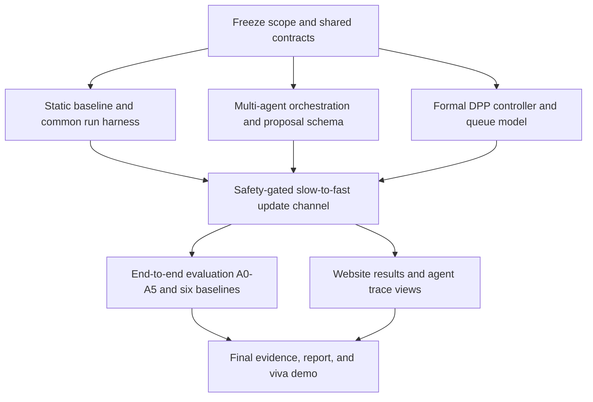

# SELF-X Submission Readiness Plan

**Purpose:** turn the current SELF-X prototype into a reproducible course-project submission and demo across the authenticated website, the static baseline, the multi-agent AI governor, and the fast controller.

**Planning date:** 15 October 2026  
**Source of requirements:** `SELF-X_Problem_Statement_v2_Revised.docx`  
**Target internal freeze:** 16 November 2026 (confirm the actual course deadline with the course portal/team).

This plan treats the revised problem statement as the target. The repository already has useful components, but they are separate prototypes today. Submission readiness means wiring them through shared interfaces, measuring the required behaviors, and saving evidence for every claim. A simulator run, a dashboard mock value, or a code module by itself does not count as live-testbed or stability evidence.

## 1. Current position

| Area | Present state | Work still needed |
| --- | --- | --- |
| Website | Authenticated dashboard, explicit Simulation and Live Network modes, disabled network-changing actions, and a Project Visualizations tab. | Surface reproducible A0–A5 run results and multi-agent decisions; distinguish recorded, simulated, and live-testbed evidence; provide a submission/demo path. |
| Static baseline | `selfx/eval/run_ablation.py` has an A0 condition using Ryu's static `simple_switch_13` behavior. | Make A0 use the same workload, metrics, run metadata, and output schema as the other stages and baselines. |
| Single-agent/reflection | `selfx/` contains the LangGraph single-agent MVP and the current live-testbed A0/A1/A2 harness. | Preserve this as the A1/A2 comparison; improve reproducibility and produce saved, reviewable runs. |
| Multi-agent AI | `slow-loop/agentic/` has a deterministic mock and an OpenAI-compatible client. `mode="multi"` collects opinions from five specialist roles and merges them. | Add an explicit orchestrator boundary, shared contracts, complete per-role audit records, and integration with the fast controller and Web API. Current operation is simulator-only and separate from `selfx/` and Ryu. |
| Fast controller | `slow-loop/agentic/simulator.py` is a bounded fluid-queue simulator with a heuristic drift-plus-penalty score. | Derive and implement the specified DPP controller, document its assumptions and constants, and validate the backlog bound. Do not describe the current heuristic as a proven controller. |
| Safety and adaptation | `slow-loop/agentic/safety.py` checks proposed policy steps; `selfx/` has reflection and JSON memory. | Add candidate/promotion records, a shared safety gate, non-regression campaigns, and LoRA only if the candidate training and validation workflow can be run and evidenced. |
| Evaluation | The live-testbed harness covers A0/A1/A2. The slow-loop benchmark is a separate simulator comparison. No saved live evaluation results are currently recorded. | Build one staged harness for A0–A5 and the six specified baselines; run the required topologies/workloads; save raw data, configurations, analysis, and plots. |
| Documentation | Root, Web, `selfx`, `slow-loop`, and visualization READMEs describe separate tracks and current limitations. | Align setup, architecture, safety boundaries, tests, evaluation claims, demo steps, and evidence links in one submission guide. |

## 2. Submission-ready definition

The project is ready to submit when all of these are true:

1. A reviewer can install the documented environments and reproduce a static run, a single-agent run, a multi-agent run, and the full integrated run from versioned commands and configuration.
2. The static baseline, AI governor, safety gate, and fast controller share versioned telemetry, policy, action, and result records. Invalid or unavailable AI proposals fail closed and leave the accepted policy unchanged.
3. The DPP controller has a written derivation with stated queue, arrival, service, cost, boundedness, and capacity assumptions. Its constants and measured backlog-bound violation rate are saved with raw interval data.
4. Website values identify their provenance. A disconnected live controller is shown as disconnected/empty; simulation and recorded benchmark values are never presented as live telemetry.
5. Each reported result has its raw data, run configuration, software/environment versions, seed, logs, analysis, and generated figure in the evidence bundle.
6. The report and viva/demo describe the implementation that exists and the experiments that ran. Any unimplemented or unmeasured target is marked as such, or the team obtains agreement for a narrower project scope before making a narrower claim.

## 3. Dependency order

Freeze the shared data contracts first. The static baseline, specialist agents, and fast controller can then be implemented in separate modules against those contracts. Integrate and benchmark only after each module passes its own checks.

## 4. Work plan

### Workstream 0 — Scope, claims, and contracts

**Priority:** P0; start immediately.  
**Main locations:** `README.md`, `selfx/`, `slow-loop/agentic/`, `Web/server.py`, a new shared schema/module, and `docs/` or equivalent project documentation.

- Convert the revised problem statement's deliverables into a traceability checklist: D1–D6, A0–A5, the six Table 3 baselines, the evaluation metrics, and the generalization target.
- Mark each line as implemented, partial, missing, or blocked. Record the evidence path for every item already claimed as implemented.
- Confirm whether the course requires the full v2.0 scope, including LoRA and all six baselines. The original D1/D2 target date of 12 October has passed; agree the recovery order and confirm the final submission date.
- Define versioned records for `TelemetryWindow`, `Policy/DeltaPi`, specialist opinion, gate decision, selected action, controller observation, experiment configuration, and `RunResult`.
- Add stable fields for `schema_version`, `run_id`, timestamp/window, topology, traffic profile, seed, controller mode, policy version, source (`simulation`, `recorded`, or `live`), and correlation ID.
- Define error states consistently: unavailable, stale, invalid, timed out, rejected, accepted, and fallback. An error must not be converted to a plausible metric or accepted update.
- Freeze a common experiment interface so each mode takes the same topology, workload, seed, window length, telemetry schema, metric definitions, and output schema.

**Done when:** a requirement-to-code-to-evidence matrix is checked in, and contract tests show each component can read/write the same versioned records.

### Workstream 1 — Static agent and A0 baseline

**Priority:** P0; establishes the reference floor for all AI comparisons.  
**Main locations:** `selfx/eval/run_ablation.py`, a static policy module, shared schemas, and benchmark tests.

- Define “static agent” for the submission as A0: fixed, documented rules with no LLM, reflection, memory updates, fine-tuning, or policy adaptation. Keep the label distinct from `simple_switch_13` if the experiment uses more than one static controller.
- Move baseline selection behind the common controller/agent interface. It should accept a telemetry window and return a fixed action/policy decision plus an audit record, without changing its policy across episodes.
- Preserve the specified static Ryu/POX comparison. Record the exact switch/controller app, installed rules, priority, timeouts, and any traffic-engineering rules used.
- Ensure A0 receives the same topology, traffic schedule, seed, warm-up, measurement windows, and metric calculations as A1–A5 and other baseline methods.
- Include static-baseline metadata in the results: controller/software version, config hash, traffic generator, topology, and run seed.
- Add checks for determinism, no model calls, no memory writes, unchanged policy across windows, and correct behavior when telemetry is missing or malformed.

**Done when:** a clean A0 run produces the same `RunResult`/raw telemetry format as other stages and can be replayed from its saved configuration.

### Workstream 2 — Six-agent AI governor and multi-agent mode

**Priority:** P0; use deterministic mock mode first, then run a configured model if available.  
**Main locations:** `slow-loop/agentic/agents.py`, `governor.py`, `schemas.py`, `prompts.py`, `model_client.py`, plus a shared integration module.

- Implement the six logical roles defined by the specification: one orchestrator and five specialists—flow-sizing, routing/traffic-engineering, anomaly, security, and slicing. The orchestrator owns intent decomposition, specialist dispatch, conflict handling, and final proposal assembly.
- Keep specialists advisory. They may return structured opinions about `V`, objective weights, and the action mask; they must not issue flow-mods or bypass the fast controller.
- Make each response schema-validated and bounded. Validate role identity, numeric finiteness/ranges, weight sum, allowed actions, maximum policy step, proposal expiry, and policy version before merge.
- Make failures explicit and fail closed: malformed JSON, timeout, unavailable model, missing role response, disagreement beyond policy, or unknown action must preserve the previous accepted policy and be recorded.
- Persist the complete trace for each cycle: telemetry reference, intent, role prompt/model/version, role response, validation outcome, merge result, gate decision, selected policy version, fallback reason, and elapsed time. Redact secrets and avoid storing credentials.
- Keep deterministic mock responses for repeatable tests. Document model endpoint/model name, temperature, timeout, and key configuration for real-model runs; keep keys in environment configuration only.
- Report per-cycle call count, valid-response rate, rejected-response rate, end-to-end governor latency, and accepted-update rate. Do not compare AI quality without the same workloads/seeds and metric calculation.
- Add tests for specialist isolation, all-five-role dispatch, aggregation, conflicting opinions, missing roles, malformed outputs, out-of-range proposals, timeouts, and preservation of the current policy on every failure case.

**Done when:** `single` and `multi` modes run through the same contract; `multi` yields an auditable six-agent trace and a validated `DeltaPi` proposal with deterministic mock mode and a configured-model mode.

### Workstream 3 — Fast-timescale DPP controller

**Priority:** P0 and on the critical path; the original 12 October target has passed.  
**Main locations:** a dedicated DPP controller module, `slow-loop/agentic/simulator.py` as a prototype reference, and new unit/evaluation coverage.

- State the queue model and units. Specify per-flow/per-switch queue identity, arrivals `λ`, service `μ`, action set, capacity, and update interval.
- Derive the quadratic Lyapunov function and the drift-plus-penalty minimization used for the selected actions. State all assumptions required for the bound to apply, including bounded arrivals/services and feasible stabilizing service.
- Derive or calculate `B`, `C`, and `ε` from the implemented model and document the units and source of each constant. Do not copy numeric values from an unvalidated prototype.
- Implement the decision rule as an independent fast module. It consumes the latest accepted `DeltaPi` and queue state; it cannot change `V`, weights, or the Lyapunov math itself.
- Define stale/missing telemetry behavior, action feasibility, tie breaking, queue caps, and the safe fallback action. Record selected action and the score/terms that led to it.
- Add deterministic tests for queue updates, empty/full queues, overload, infeasible actions, the `V` trade-off, action-mask enforcement, and bounded policy updates.
- Run at least 1,000 control intervals over the three specified traffic profiles and report the empirical bound-violation rate. The acceptance target is at least 95% within the stated bound, with interval-level raw data saved. Investigate and explain any violations rather than filtering them.

**Done when:** the implemented controller matches the documented decision law, and the raw validation run supports the reported bound claim under the stated assumptions.

### Workstream 4 — Shared safety gate, update channel, and self-improvement

**Priority:** P0 for safe integration; LoRA scope is high risk.  
**Main locations:** `slow-loop/agentic/safety.py`, `governor.py`, replay/reward modules, and new candidate/versioning modules.

- Build one gate for all slow-to-fast updates. It checks schema, range, action mask, policy step, telemetry freshness, hard safety constraints, and benchmark/regression results before issuing an accepted policy version.
- Make the fast loop use only the last accepted policy. Rejected, expired, partial, or unreviewed candidates must never reach the fast controller.
- Store every candidate and decision with before/after policy, candidate identifier, test data/configuration, gate reasons, and rollback target.
- Normalize experience records and provenance so simulated, recorded, and live experiences cannot silently mix. Include workload, topology, controller mode, policy version, reward breakdown, and reflection.
- For the specified A3 LoRA stage, implement isolated candidate training, adapter/version storage, training-data provenance, a fixed validation suite, hard-safety checks, non-regression stress runs, automatic promote/reject, and rollback. A policy prompt change or deterministic rules are not LoRA fine-tuning.
- If the team cannot run and validate LoRA within the available environment/time, raise the scope decision early and request instructor/team agreement to revise the claim and ablation. Do not label A3 as complete based on a simulated or unexecuted training path.
- Add tests proving rejected/failed candidates cannot mutate the current policy, and that rollback restores the last accepted version.

**Done when:** every policy change is auditable and fail-closed; the LoRA acceptance test either has an actual promoted/rejected candidate run with evidence or the agreed submission scope explicitly excludes that claim.

### Workstream 5 — Integration and tool gateway

**Priority:** P0 after the component contracts are stable.  
**Main locations:** `selfx/ryu_client.py`, `Web/server.py`, new gateway/integration modules, and Mininet/Ryu launch scripts.

- Define one authenticated, versioned telemetry API for the agent/controller/dashboard boundary. Cover connected, disconnected, empty, stale, malformed, and partial responses.
- Add a narrow tool gateway for read-only telemetry and approved control requests. Put authentication, allow-listed operations, request validation, timeouts, idempotency/correlation IDs, and audit logging at this boundary.
- Route all network-changing actions through the fast controller and safety gate. The LLM and Web UI must not post arbitrary OpenFlow writes.
- Make simulation, recorded-result, and live-testbed backends explicit configuration choices. Never infer source from URL, presence of data, or browser state.
- Add launch scripts and health checks for the controller, Mininet topology, model client, API, and dashboard. Fail startup with a clear explanation when a required dependency is absent.
- Run an unattended integration session for at least the specified 30 minutes. Save health transitions, controller reconnect behavior, queue/flow telemetry, errors, and policy-update audit trail.

**Done when:** a clean end-to-end run consumes telemetry, proposes and gates a `DeltaPi`, selects a fast action, records the result, and exposes it read-only to the dashboard without an unsafe bypass.

### Workstream 6 — Evaluation, ablation, and evidence

**Priority:** P0; this work creates the submission's quantitative evidence.  
**Main locations:** `selfx/eval/`, `slow-loop/agentic/benchmark.py`, a shared experiment runner, and a dedicated `results/` evidence directory.

- Extend the current A0/A1/A2 live harness into the six specified staged configurations:
  - **A0:** static Ryu/POX rules.
  - **A1:** one non-specialist LLM agent, no reflection.
  - **A2:** A1 plus self-critique/reflection, without weight updates.
  - **A3:** A2 plus safety-gated LoRA fine-tuning.
  - **A4:** A3 plus the six-agent orchestrator/specialist design.
  - **A5:** A4 plus the fast Lyapunov DPP loop.
- Implement the six specified benchmark systems: static Ryu/POX, DQN with the same reward, two-agent DQN/MARL, single reflexive LLM, SELF-X without DPP, and full SELF-X. Record an explicit implementation/configuration for each so the comparison is not just a label.
- Build the required topologies: linear, leaf-spine, and one held-out topology. Keep the held-out topology out of tuning and use it only for the generalization run.
- Include both required workload types: iperf3 and bursty/elephant-flow traffic. Pin workload parameters and use identical traffic traces/seeds for paired comparisons.
- Produce per-window raw data for latency, p95 latency, throughput, packet loss, queue backlog, energy/resource cost where measurable, SLA violations, convergence time, control-plane overhead, packet-in count, controller CPU, agent latency/calls, reward, and selected actions.
- Predeclare the number of paired seeds and statistical method. Report distributions, confidence intervals, paired test result, and effect size; use the specified paired t-test with `p < 0.05` where its assumptions are met. Preserve all runs, including regressions and failed attempts.
- Measure DPP backlog-bound violations over at least 1,000 intervals in each of three traffic profiles and show the bound and empirical backlog distribution together.
- Run the held-out topology/traffic transfer experiment and calculate performance retention against the training-topology gain. The stated target is at least 90% retention.
- Generate machine-readable summaries and plots from the saved raw run files. Do not use manually copied values in the report or website.
- For each run, save `run.json`/manifest, environment and dependency versions, commit identifier, configuration, seed, raw telemetry, logs, summary table, and generated plots. Keep credentials and sensitive environment values out of the evidence bundle.

**Done when:** a single documented command can reproduce the planned suite; an independent reader can trace every result back to raw runs and configs; claims match actual run sources and statistical output.

### Workstream 7 — Website submission/demo experience

**Priority:** P1 after API and run-result schemas are frozen; build against mocked fixtures in parallel.  
**Main locations:** `Web/index.html`, `Web/js/`, `Web/CSS/Style.css`, `Web/server.py`, and `Web/tests/`.

- Preserve the existing authentication, CSRF/session behavior, explicit modes, and disabled direct network-changing actions.
- Add a **Submission Results** view with selectable run ID, topology, workload, seed, controller mode, and evidence source. Show a visible label for simulation, recorded testbed run, or live telemetry.
- Add a comparison panel for A0–A5 and the six baselines with latency, p95, throughput, loss, reward, queue backlog, convergence, control-plane overhead, and statistical result. Show missing metrics as unavailable, not zero.
- Add a **Multi-Agent Trace** view showing the orchestrator decision, five specialist opinions, validation, merged proposal, safety-gate result, selected policy version, and rejection/fallback reason. Include elapsed time and model/mock identity; omit secrets.
- Add a **Static Baseline** view that identifies the static controller/ruleset and makes clear that it has no learning or memory updates.
- Add DPP/backlog visualization with queue series, analytic bound, bound-violation markers, and the experiment configuration used to calculate it.
- Link each chart to the run metadata/raw result download. Use the existing `visualizations/` assets for architecture/context; do not present their seeded fluid simulation as evaluation evidence.
- Test loading, empty state, stale/disconnected state, invalid result files, long agent traces, logout/session expiry, and narrow viewport. Keep color contrast, labels, units, and keyboard navigation usable.
- Keep dashboard APIs read-only for status and evidence. Any future actuation remains behind the gateway, controller, and safety gate.

**Done when:** a reviewer can sign in, select the recorded full run, inspect static-vs-AI results and the multi-agent/gate trace, and identify every value's provenance without a live network being available.

### Workstream 8 — Documentation and submission package

**Priority:** P1 throughout; final freeze in the last week.  
**Main locations:** root `README.md`, `Web/README.md`, `selfx/README.md`, `slow-loop/README.md`, `visualizations/README.md`, and a `docs/` submission guide.

- Reconcile the root architecture and roadmap with code. Label complete, partial, simulated, live-testbed, and planned features accurately.
- Write one clean setup guide for the supported Windows/WSL/Linux workflow, Python environments, Mininet/OVS/Ryu versions, optional local LLM endpoint, credentials, and environment variables.
- Document the six-agent design, message/schema contracts, policy merge, safety boundary, slow-to-fast update channel, DPP derivation, assumptions, and known limitations.
- Add an experiment guide with commands for A0–A5 and six baselines, topology/workload setup, seeds, run duration, output paths, plot regeneration, and cleanup.
- Add a concise demo script: login; show a saved run; compare static and full SELF-X; open the agent trace and rejected-update example; show DPP backlog evidence; show live status only if the testbed is connected.
- Prepare final report, architecture diagram, viva slides, references, and contribution notes. Ensure the report agrees with the evidence bundle and revised scope.
- Pin dependencies or record a lock/environment file; include a known-good setup and smoke check.
- Keep generated artifacts under a deliberate evidence path and exclude `.env`, passwords, API keys, session tokens, temporary logs, and unreviewed outputs from Git.

**Done when:** a teammate unfamiliar with the current checkout can follow the setup and demo guide from a clean environment and produce the documented outputs.

## 5. Verification matrix

These are required acceptance checks for the implementation work; they are not a claim that all checks have already run.

| Layer | Required checks |
| --- | --- |
| Static baseline | Fixed decision across repeat runs; no model/memory side effects; same data schema and metric path as AI modes. |
| Multi-agent | Each specialist gets the intended input; valid structured opinions merge; missing, malformed, late, conflicting, or unsafe opinions fail closed; full audit trace is saved. |
| Safety/update | Invalid policy, NaN/infinity, out-of-range `V`/weights, empty/unknown action mask, stale telemetry, and regression rejection preserve last accepted policy; promotion and rollback are versioned. |
| DPP | Queue dynamics and action feasibility match derivation; allowed action mask is obeyed; overload/bound tests; ≥1,000 measured intervals per required profile and saved violation report. |
| Integration | API success, empty, disconnected, stale, partial, malformed, timeout, reconnect; no direct Web/LLM write path; ≥30-minute unattended session. |
| Web | Existing authentication tests; source labels; no fake live values; charts and traces match selected run; session expiry/logout; responsive and keyboard checks. |
| Evaluation | Same seeds/configs for paired runs; all A0–A5 and six baselines identified; ≥3 topologies and 2 workload types; raw data and manifest; correct statistics and regenerated figures. |
| Packaging | Clean setup from documented commands; dependency/version record; no secrets; `git diff --check`; clean demo from saved evidence if live hardware is unavailable. |

## 6. Remaining-calendar milestones

The original problem statement scheduled D1 and D2 for 12 October; those dates are past as of this plan. The dates below are a recovery sequence, not a claim that those deliverables are complete.

| Target | Milestone | Exit evidence |
| --- | --- | --- |
| **16 Oct** | Scope and deadline confirmed; requirement/evidence matrix and shared contracts frozen; WSL/Mininet/Ryu/LLM environments checked. | Signed-off scope table, contract schemas, environment report, blocker list. |
| **19 Oct** | Static A0 isolated in the common harness; DPP formulation reviewed and first controller checks pass; Web results fixture and layout agreed. | Reproducible A0 output, DPP derivation draft, contract tests. |
| **23 Oct** | Six logical AI roles and orchestrator produce validated, auditable `DeltaPi`; safety gate and fallback work through the shared interface. | Mock/model traces, failure-case checks, gate audit records. |
| **26 Oct** | First end-to-end static, single-agent, multi-agent, and DPP integration on the available testbed/simulator; begin 30-minute run. | D3 integration log, health record, known gaps. |
| **2 Nov** | Candidate/replay workflow complete; LoRA A3 promoted/rejected with evidence, or scope revision agreed and reflected in claims. | Candidate artifact, validation report, gate decision, rollback record or approved scope change. |
| **9 Nov** | A0–A5 and six-baseline benchmark suite executed on required topologies/workloads; plots and analysis regenerated from raw data. | Versioned evidence bundle, summary tables, DPP violation report, statistical output. |
| **13 Nov** | Held-out topology/generalization run and website results/trace view complete; report and architecture documentation aligned. | Retention calculation, browser walkthrough, updated report draft. |
| **16 Nov** | Final test/demo freeze, viva slides, clean-room reproduction check, submission archive. | Release checklist, final evidence manifest, demo rehearsal record. |

If the required Mininet hardware, model endpoint, or LoRA compute is not available by the relevant gate, record the blocker and agree a revised scope immediately. Do not silently replace a required live result with simulator output or label a planned component as implemented.

## 7. Suggested ownership by workstream

Assign named owners within the six-person team at kickoff; these are role slots, not assignments to specific members.

| Owner slot | Primary responsibility |
| --- | --- |
| Control/queueing | DPP derivation, queue model, controller, bound evidence. |
| Agent architecture | Orchestrator, five specialists, schemas, model/mock client, trace. |
| Safety/learning | Policy gate, replay/provenance, candidate/LoRA workflow, rollback. |
| Testbed/evaluation | Mininet/Ryu, static baseline, workloads, benchmark harness, statistics. |
| Website/integration | API contract, dashboard results and agent trace, source labels, auth regression. |
| Release/documentation | Requirement traceability, setup/reproduction docs, evidence manifest, report and viva/demo. |

Each change should name its dependency, acceptance check, and evidence path in the team's issue/task tracker. Share schemas and benchmark APIs before implementing parallel modules to avoid duplicate incompatible interfaces.

## 8. Final release checklist

- [ ] Scope and final course deadline confirmed; all spec deviations recorded and agreed.
- [ ] Static A0, A1–A5, and the six comparison baselines have precise definitions and reproducible run configurations.
- [ ] Six-agent trace, slow-to-fast policy channel, fail-closed gate, and fast DPP controller pass acceptance checks.
- [ ] DPP assumptions, constants, ≥1,000-interval evidence, and violation rate are included with raw data.
- [ ] Required topologies, workloads, paired runs, statistical analysis, and held-out generalization results are present or explicitly scoped out by agreement.
- [ ] Web results page shows provenance, source, run metadata, static-vs-AI comparison, agent/gate trace, and DPP evidence.
- [ ] Existing auth behavior remains intact; no direct browser or LLM path can install arbitrary network changes.
- [ ] Root and component documentation describe the actual implementation and provide clean reproduction commands.
- [ ] Final report, architecture figure, viva slides, and demo script agree with saved experimental evidence.
- [ ] Evidence bundle is complete, regenerated from source data, contains no secrets, and is committed/archived intentionally.
- [ ] Clean-room setup and final demo rehearsal completed.
