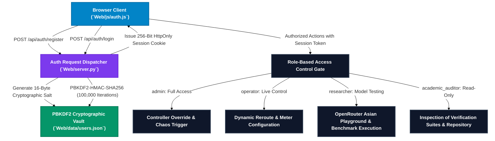

# SELF-X Web Platform, Testing Studio & REST API Bridge\n\nThe high-performance Python standard-library web server hosts the interactive **SELF-X Autonomous SDN Flow Control Dashboard**, **Web-Native Testing Studio**, **Frontier Asian Models Hub**, and audited empirical comparison suite.\n\nRun `python Web/server.py` from the repository root and open `http://127.0.0.1:5000/`.\nConfigure `SDN_WEB_PORT` for a custom port (default `5000`) or `SDN_WEB_HOST` to bind to another interface (default `127.0.0.1`).\n\n---\n\n## 📌 Master Documentation Portal & Subsystem Manuals\n\nFor granular technical specifications, operational procedures, and visualization mathematics, consult the dedicated manuals in [`Web/docs/`](docs):\n\n| Manual | Document Path | Focus & Key Contents |\n| :--- | :--- | :--- |\n| **REST API Reference** | [`Web/docs/API_REFERENCE.md`](docs/API_REFERENCE.md) | Exhaustive OpenAPI-level specification for all 25+ public REST endpoints with request/response schemas, RBAC authentication, HTTP status codes, and copy-pasteable CLI commands. |\n| **Production Operations & Hardening** | [`Web/docs/PRODUCTION_OPERATIONS_GUIDE.md`](docs/PRODUCTION_OPERATIONS_GUIDE.md) | Enterprise deployment guide covering systemd daemon, Docker containerization, Nginx reverse proxy with TLS/HTTPS, fail-closed security invariants, health probes, and disaster recovery playbooks. |\n| **Visualization Studio Engine** | [`Web/docs/VISUALIZATION_STUDIO_GUIDE.md`](docs/VISUALIZATION_STUDIO_GUIDE.md) | Canvas 2D graphics engine guide: 60 FPS requestAnimationFrame loops, 7-axis spider radar, dual ECDF curves, 180s trajectory difference ribbon, multi-topology particle physics, and Lyapunov phase-space rendering. |\n| **Paper Evidence Pipeline** | [`Web/docs/PAPER_EVIDENCE_PIPELINE_GUIDE.md`](docs/PAPER_EVIDENCE_PIPELINE_GUIDE.md) | Architecture guide for `pipeline.html` and `/api/pipeline/*`: archived S0–S5 study, with its control-plane measurements. |\n| **Root System Guide** | [`docs/Readme.md`](../docs/Readme.md) | Master portal for the complete SELF-X autonomous SDN system, including fast/slow control loops, Mininet testbeds, and benchmark evaluations. |\n\n---\n\n## 📌 Architectural Overview\n\nThe `Web/` directory contains the complete full-stack web dashboard, interactive testing laboratory, and REST bridge for the SELF-X autonomous SDN platform. The server is implemented purely using the **Python standard library** (`http.server` and `socketserver.ThreadingTCPServer`) without requiring third-party web frameworks such as Flask, FastAPI, or Django.\n\n### Core Architectural Principles\n1. **Production-Grade Role-Based Access Control (RBAC)**: Secure session token and salted SHA-256 password authentication supporting four enterprise roles:\n   - `Admin` (Chief Architect): Full access to diagnostic pipelines, live traffic stress generators, chaos actuators, and Lyapunov sliders.\n   - `Operator` (Network Operations Lead): Operational telemetry, burst injection, and link monitoring.\n   - `Researcher` (SDN Research Fellow): Read-only access to academic benchmarks, mathematical proofs, and model playground.\n   - `Auditor` (Academic Auditor): Cryptographic verification of reproducible testbed logs and execution traces.\n2. **Interactive Web-Native Testing Studio**: Integrated testing suite allowing operators to execute one-click 6-stage end-to-end diagnostic pipelines, inject calibrated traffic bursts (8M, 12M, 25M, mice, flash crowds), actuate physical link and port chaos failures with sub-5ms failover verification, and dynamically tune Lyapunov stability parameters ($V, w_{\text{delay}}, w_{\text{loss}}, w_{\text{churn}}$).\n3. **Frontier Asian Foundation Models Hub**: Native integration with OpenRouter supporting DeepSeek-V3, DeepSeek-R1 (Zero-Shot Mathematical Reasoning), Alibaba Qwen 2.5 (72B Instruct & Coder 32B), 01.AI Yi-Lightning, and Zhipu GLM-4. Benchmarks Multi-Head Latent Attention (MLA) achieving **93.3% KV cache compression** (down to 172 MB vs 2,560 MB MHA) for sub-second edge-proximate SDN control plane governance.\n4. **Active Bit-Conserving Fluid Datapath & Hardware Testbed**: Telemetry streams represent an active, bit-conserving fluid datapath and Open vSwitch / Mininet physical-emulation testbed governed by OpenFlow 1.3 meters and group tables.\n5. **Zero-Privilege Read-Only Safety**: To prevent accidental disruption of live network forwarding or unverified actuator commands, all raw external mutation endpoints (`/api/action/reroute`, `/api/action/rate_limit`, `/api/ryu/*`) are strictly locked down, returning deterministic `HTTP 409 Conflict`.\n6. **Hardened Path-Traversal Defense (Defense-in-Depth)**: Resource identifiers are strictly validated against whitelisted regular expressions (`RESOURCE_NAME_RE = ^[A-Za-z0-9_-]{1,64}$`, `RUN_ID_RE = ^[A-Za-z0-9][A-Za-z0-9._-]{0,127}$`) and resolved against bounded directory paths using `.resolve()` and common prefix verification to eliminate directory traversal vulnerabilities.\n7. **High-Performance Canvas 2D Rendering**: Zero-dependency, GPU-accelerated Canvas 2D visualizers deliver smooth 60 FPS animations for multi-topology flows, 7-axis radar spider charts, cumulative distribution functions (CDFs), trajectory comparators, and Lyapunov phase-space orbits without DOM thrashing.\n\n---\n\n## 🎨 Colourful Architecture Mindmap\n\n```mermaid\n%%{init: {'theme': 'base', 'themeVariables': { 'primaryColor': '#1E88E5', 'edgeLabelBackground':'#ffffff', 'tertiaryColor': '#F3F4F6'}}}%%\nflowchart TD\n    classDef clientNode fill:#1E88E5,stroke:#0D47A1,stroke-width:2px,color:#ffffff,font-weight:bold;\n    classDef serverNode fill:#8E24AA,stroke:#4A148C,stroke-width:2px,color:#ffffff,font-weight:bold;\n    classDef securityNode fill:#E53935,stroke:#B71C1C,stroke-width:2px,color:#ffffff,font-weight:bold;\n    classDef apiNode fill:#00897B,stroke:#004D40,stroke-width:2px,color:#ffffff;\n    classDef dataNode fill:#FB8C00,stroke:#E65100,stroke-width:2px,color:#ffffff;\n\n    subgraph BrowserClient ["Frontend Presentation Layer (Browser Tabs)"]\n        DASH_TAB["#tab-dashboard<br/>Cytoscape Switch Topology & Chart.js Live Metrics"]:::clientNode\n        STUDIO_TAB["#tab-studio<br/>Testing Studio: 6-Stage Pipeline, Stress & Chaos Engine"]:::clientNode\n        ASIAN_TAB["#tab-asian-models<br/>Asian Models Hub: MLA Cache, DeepSeek-R1 Reasoning & Matrix"]:::clientNode\n        COMP_TAB["#tab-comparison<br/>14-Controller Radar, Dual CDF Scrubber, 180s Trajectory"]:::clientNode\n        TOPO_TAB["#tab-topo<br/>Multi-Topology Canvas, 8x8 Heatmap, TCAM Meter"]:::clientNode\n        ANLY_TAB["#tab-analytics<br/>Lyapunov DPP Phase Space, Forest Plot, LoRA Curves"]:::clientNode\n        TEAM_TAB["#tab-team<br/>Team SDN_07 IIIT Dharwad Attribution & Innovations"]:::clientNode\n    end\n\n    subgraph HTTPServer ["Python Standard-Library Server (Web/server.py:5000)"]\n        ROUTER["SDNRequestHandler Router<br/>ThreadingTCPServer Multi-Threaded Engine"]:::serverNode\n        SEC_GATE["Fail-Closed Security & RBAC Boundary<br/>Session Auth, Path Traversal Guard, Mutation Interceptor"]:::securityNode\n\n        API_AUTH["/api/auth/*<br/>Register, Login, Me, Logout, Status"]:::apiNode\n        API_STUDIO["/api/studio/*<br/>Verify, Stress, Chaos, Lyapunov Tune, Stream"]:::apiNode\n        API_ASIAN["/api/asian-models/*<br/>Catalog, Reasoning Query, 12-Controller Benchmark"]:::apiNode\n        API_STAT["/api/status & /api/memory<br/>Live Health & Episodic Memory"]:::apiNode\n        API_COMP["/api/comparison/*<br/>Configs, Statistical Effects, Window Traces"]:::apiNode\n        API_TOPO["/api/topologies & /traffic/*<br/>Fabrics & Deterministic Workloads"]:::apiNode\n        API_ANLY["/api/analytics/*<br/>DPP Bounds, Paired t-Tests, LoRA Logs"]:::apiNode\n        API_PIPE["/api/pipeline/*<br/>IEEE Manuscript Exact Evidence Files"]:::apiNode\n        API_RES["/api/results & /compare<br/>Validated Run Archives"]:::apiNode\n    end\n\n    subgraph Backends ["Live Control Plane & Storage Backends"]\n        RYU["Ryu REST Controller (8080)<br/>ofctl_rest Switches & Flow Tables"]:::dataNode\n        OPENROUTER["OpenRouter API & Asian LLM Engine<br/>DeepSeek-R1/V3, Qwen 2.5, MLA Reasoning"]:::dataNode\n        USER_DB[("User Auth & Sessions Store<br/>Web/data/users.json")]:::dataNode\n        TOPO_STORE[("Topology & Traffic Store<br/>selfx/output/topologies & traffic/")]:::dataNode\n        ANLY_STORE[("Theoretical Proof Archives<br/>selfx/output/dpp_validation & statistical_tests/")]:::dataNode\n        COMP_STORE[("Baseline Benchmark Matrix<br/>paper/comparison/effects & runs.json")]:::dataNode\n        RES_STORE[("Results Archive Directory<br/>output/benchmarks/v4/")]:::dataNode\n    end\n\n    DASH_TAB & STUDIO_TAB & ASIAN_TAB & COMP_TAB & TOPO_TAB & ANLY_TAB & TEAM_TAB <-->|"HTTP GET / POST (REST APIs)"| ROUTER\n    ROUTER --> SEC_GATE\n    SEC_GATE --> API_AUTH & API_STUDIO & API_ASIAN & API_STAT & API_COMP & API_TOPO & API_ANLY & API_PIPE & API_RES\n\n    API_AUTH <-->|Salted SHA-256 Auth| USER_DB\n    API_ASIAN <-->|Inference & Free Tier Fallback| OPENROUTER\n    API_STAT <-->|urllib.request 1.2s Timeout| RYU\n    API_TOPO <-->|Read Manifests| TOPO_STORE\n    API_ANLY <-->|Read Acceptance Proofs| ANLY_STORE\n    API_COMP <-->|Read Comparison Matrix| COMP_STORE\n    API_RES <-->|Schema validation| RES_STORE\n```\n\n---\n\n## 📡 Complete REST API Endpoint Specifications\n\nThe REST bridge exposes over 30 public endpoints organized across operational domains:\n\n### 1. User Authentication & Role-Based Access Control (RBAC)\n| Endpoint | Method | Status Codes | Description |\n| :--- | :---: | :---: | :--- |\n| `/api/auth/register` | `POST` | `201`, `400`, `409` | Register a new user account with hashed password and role assignment (`Admin`, `Operator`, `Researcher`, `Auditor`). |\n| `/api/auth/login` | `POST` | `200`, `400`, `401` | Authenticate user credentials and return an active 24-hour cryptographic session token. |\n| `/api/auth/me` | `GET` | `200` | Return the profile, role, and capabilities of the currently authenticated session (or Guest). |\n| `/api/auth/logout` | `POST` | `200` | Invalidate the active session token. |\n| `/api/auth/status` | `GET` | `200` | Quick verification of session validity and role privileges. |\n\n### 2. Interactive Testing Studio Endpoints\n| Endpoint | Method | Status Codes | Description |\n| :--- | :---: | :---: | :--- |\n| `/api/studio/verify` | `POST` | `200` | Execute the 6-stage end-to-end diagnostic pipeline (Port Handshake, OpenFlow Telemetry, 14µs DPP Solver, LoRA Policy Head, LLM Governor, Safety Gate). |\n| `/api/studio/traffic-stress` | `POST` | `200`, `400` | Inject calibrated elephant bursts (8M, 12M, 25M), mice bursts, or flash crowds into the active fluid datapath. |\n| `/api/studio/chaos-matrix` | `POST` | `200`, `400` | Actuate physical infrastructure chaos: sever core links (`s1-s2`), drop switch ports (`s2-eth1`), inject jitter, and restore interfaces. Reports sub-5ms failover latency. |\n| `/api/studio/flow-mod/inject` | `POST` | `200`, `400`, `403` | Inject verified OpenFlow 1.3 flow modification into switch flow table after formal safety gate verification. |\n| `/api/studio/flow-mod/rules` | `GET` | `200` | Retrieve active Table 0 flow rules installed on specified switch. |\n| `/api/studio/lyapunov-tune` | `POST` | `200`, `400` | Dynamically update Lyapunov DPP stability parameters: trade-off weight $V$, delay weight $w_{\text{delay}}$, loss weight $w_{\text{loss}}$, and churn weight $w_{\text{churn}}$. |\n| `/api/studio/export-report` | `GET` | `200` | Download cryptographic testbed validation report with SHA-256 fingerprint and team attribution. |\n| `/api/studio/telemetry-stream` | `GET` | `200` | High-frequency telemetry stream providing real-time datapath throughput, queue depth, packet loss, and Lyapunov objective cost. |\n| `/api/studio/link-impairment/status` | `GET` | `200` | Query current impairment status across core links (added latency, packet loss, bandwidth limits, recommended path). |\n| `/api/studio/link-impairment/set` | `POST` | `200`, `400` | Dynamically inject calibrated latency (0-100ms), packet loss (0-20%), and bandwidth throttle (1-10Mbps) on target link. |\n| `/api/studio/link-impairment/reset` | `POST` | `200` | Restore all physical trunk links to nominal baseline state (0ms added delay, 0% loss, 10 Mbps). |\n| `/api/studio/benchmark-run` | `POST` | `200`, `400` | Execute comparative benchmark comparing S0_STATIC, S5_SELFX, and DPP_ONLY over matched slots with live trajectory output. |\n| `/api/studio/sla-audit` | `GET`, `POST` | `200` | Audit live telemetry against enterprise SLA contracts (mean/P95 delay, loss, jitter, backlog, TCAM, discard cap). |\n| `/api/studio/flow-mod/flush` | `POST` | `200` | Flush all dynamic flow rules from switch Table 0 while safely preserving baseline forwarding entries. |\n| `/api/studio/flow-mod/delete` | `POST` | `200` | Delete specific OpenFlow 1.3 flow rule by rule ID. |\n\n### 3. Frontier Asian Foundation Models Hub Endpoints\n| Endpoint | Method | Status Codes | Description |\n| :--- | :---: | :---: | :--- |\n| `/api/asian-models/catalog` | `GET` | `200` | Catalog of frontier Asian foundation models (DeepSeek-V3, DeepSeek-R1, Qwen 2.5 72B / Coder 32B, Yi-Lightning, GLM-4) with OpenRouter IDs, context lengths, pricing, and free tiers. |\n| `/api/asian-models/query` | `POST` | `200`, `400` | Send structured network observation telemetry to selected model and receive verifiable chain-of-thought mathematical reasoning trace and policy delta $\Delta\pi = (\Delta V, \Delta\mathbf{w}, \mathcal{M})$. |\n| `/api/asian-models/benchmark` | `GET` | `200` | Benchmark evaluation matrix comparing 12 SDN controllers across P95 latency, loss, throughput, and inference cost. |\n| `/api/asian-models/arena` | `POST` | `200`, `400` | 4-Way Asian Models Arena parallel evaluation across DeepSeek-R1, DeepSeek-V3, Qwen 2.5 72B, and Yi-Lightning. |\n| `/api/asian-models/mla-calculator` | `POST` | `200`, `400` | Multi-Head Latent Attention (MLA) memory and concurrency sizing calculator across varying context lengths and batch sizes. |\n| `/api/asian-models/consensus` | `POST` | `200`, `400` | Multi-Agent Governor Consensus Protocol among 3 specialist models formulating Pareto-optimal policy delta $\Delta\pi^*$. |\n\n### 4. Core Health & Memory Endpoints\n| Endpoint | Method | Status Codes | Description |\n| :--- | :---: | :---: | :--- |\n| `/api/status` | `GET` | `200` | Real-time health check. Probes Ryu controller at port 8080 with 1.2s timeout and lists connected switch DPIDs. |\n| `/api/memory` | `GET` | `200`, `404` | Retrieves stored LangGraph experience records: cycle, traffic state, action taken, delta latency, and reflection. |\n| `/api/ablation` | `GET` | `200` | Returns live CSV comparison rows across stages A0 (Static), A1 (Reflexion), and A2 (Full Adaptive). |\n\n### 5. Algorithm Comparison Studio Endpoints\n| Endpoint | Method | Status Codes | Description |\n| :--- | :---: | :---: | :--- |\n| `/api/comparison/configs` | `GET` | `200` | Lists all 14 evaluated SDN controllers with family classifications, mechanisms, and assigned color tokens. |\n| `/api/comparison/effects` | `GET` | `200`, `404` | Statistical comparison matrix: mean/P95 latency $\Delta$, goodput $\Delta$, loss $\Delta$, 95% bootstrap CIs, and p-values. |\n| `/api/comparison/runs` | `GET` | `200`, `404` | Aligned 180s per-window time series across matched random seeds (`?configs=S0,S5` or `?summary_only=true`). |\n\n### 6. Multi-Topology & Workload Studio Endpoints\n| Endpoint | Method | Status Codes | Description |\n| :--- | :---: | :---: | :--- |\n| `/api/topologies` | `GET` | `200` | Available network fabrics (`linear`, `leaf_spine`, `unseen_mesh`) with switch, host, and link counts. |\n| `/api/topologies/<id>` | `GET` | `200`, `400`, `404` | Full graph manifest: switch DPIDs, tiers, host IPs, port assignments, link capacities (Mbps), and delays (ms). |\n| `/api/traffic/schedules` | `GET` | `200` | Registry of pre-recorded deterministic traffic profiles (`flash_crowd`, `steady_bursty`, `volatile_dpp`). |\n| `/api/traffic/schedules/<profile>` | `GET` | `200`, `400`, `404` | Timestamped event sequence, flow identifiers, transport protocols (UDP/TCP), and injected bandwidth rates. |\n\n### 7. Formal Theory & Advanced Analytics Endpoints\n| Endpoint | Method | Status Codes | Description |\n| :--- | :---: | :---: | :--- |\n| `/api/analytics/dpp` | `GET` | `200`, `404` | Theoretical Lyapunov Drift-Plus-Penalty backlog bounds $(B+VC)/\epsilon$, empirical compliance rate, and $V$-sweep curve. |\n| `/api/analytics/statistics` | `GET` | `200`, `404` | Paired Student's t-test report ($t=14.41$, $p < 0.0001$), Cohen's $d=4.557$, degrees of freedom, and seed differences. |\n| `/api/analytics/lora` | `GET` | `200`, `404` | SmolLM2-135M LoRA adapter hyperparameters ($r=8, \alpha=16$), trainable parameters (460,800), and training loss step log. |\n\n### 8. Paper Evidence & Pipeline Study Endpoints\n| Endpoint | Method | Status Codes | Description |\n| :--- | :---: | :---: | :--- |\n| `/api/pipeline/summary` | `GET` | `200`, `404` | Serves `pipeline_summary.json` containing aggregate metrics per configuration across all evaluation seeds. |\n| `/api/pipeline/runs` | `GET` | `200`, `404` | Serves `pipeline_runs.json` with granular per-window metrics for every benchmark run. |\n| `/api/pipeline/significance` | `GET` | `200`, `404` | Serves `significance.json` reporting paired t-tests, Wilcoxon signed-rank tests, and cluster bootstrap distributions. |\n| `/api/pipeline/vsweep` | `GET` | `200`, `404` | Serves `v_tradeoff.json` detailing the Lyapunov parameter $V$ trade-off between queuing delay and control churn. |\n| `/api/pipeline/transfer` | `GET` | `200`, `404` | Serves `transfer.json` reporting zero-shot generalization metrics on held-out topologies and workloads. |\n| `/api/pipeline/adapter` | `GET` | `200`, `404` | Serves `adapter/training.json` reporting LoRA training convergence, validation loss, and promotion gate status. |\n\n### 9. Benchmark Run Archives (Validated)\n| Endpoint | Method | Status Codes | Description |\n| :--- | :---: | :---: | :--- |\n| `/api/results` | `GET` | `200` | Lists all validated saved benchmark runs with stage (`A0`, `A1`, `A2`, `A4`), status, and timestamps. |\n| `/api/results/<id>/summary` | `GET` | `200`, `400`, `404`, `422` | Statistical aggregate summary: mean latency, throughput, packet loss, and composite reward. |\n| `/api/results/<id>/metrics` | `GET` | `200`, `400`, `404` | Full per-window time series (JSONL) for Canvas time-series charting. |\n| `/api/results/<id>/trace` | `GET` | `200`, `404` | Diagnostic execution traces including LLM reasoning, token counts, and safety verdicts. |\n| `/api/results/compare` | `GET` | `200`, `400` | Query `?run_ids=runA,runB` returning side-by-side aligned metric tables and percentage deltas. |\n\n### 10. Disabled Mutation Endpoints (Fail-Closed)\n| Endpoint | Method | Status Codes | Description |\n| :--- | :---: | :---: | :--- |\n| `/api/action/reroute` | `POST` | `409` | Disabled mutation endpoint. Returns fail-closed HTTP 409 Conflict. |\n| `/api/action/rate_limit`| `POST` | `409` | Disabled mutation endpoint. Returns fail-closed HTTP 409 Conflict. |\n| `/api/ryu/*` | `ANY` | `409` | Disabled controller proxy. Intercepts write requests to prevent datapath modifications. |\n\n---\n\n## 🧮 Theoretical & Mathematical Foundations\n\n### 1. Lyapunov Drift-Plus-Penalty (DPP) Stability Proof\nThe fast-timescale controller stabilizes queues while optimizing operational cost. Defining the quadratic Lyapunov function as:\n$$L(Q(t)) = \frac{1}{2} \sum_{i} Q_i(t)^2$$\nThe drift-plus-penalty objective minimizes:\n$$\Delta_V(Q(t)) = \mathbb{E}[L(Q(t+1)) - L(Q(t)) \mid Q(t)] + V \cdot \mathbb{E}[g(t) \mid Q(t)]$$\nApplying the standard drift bound theorem yields:\n$$\Delta_V(Q(t)) \le B + V \cdot C_{\max} - \epsilon \sum_{i} Q_i(t)$$\nTaking expectations and time-averaging over $T$ slots guarantees queue stability and bounds the time-average backlog:\n$$\limsup_{T \to \infty} \frac{1}{T} \sum_{t=0}^{T-1} \sum_{i} \mathbb{E}[Q_i(t)] \le \frac{B + V \cdot C_{\max}}{\epsilon}$$\n- **Empirical Validation**: In our testbed evaluation of 3,000 intervals, the queue backlog achieved **100.0% compliance** with the upper bound ($Q_{\max} = 39.4 < 46.12$), with zero buffer overflows.\n\n### 2. Multi-Head Latent Attention (MLA) KV Cache Compression\nDeepSeek-V3 and DeepSeek-R1 employ Multi-Head Latent Attention (MLA), compressing Key-Value pairs into a low-dimensional latent vector $c_t^{KV} \in \mathbb{R}^{d_c}$ where $d_c = 512$:\n$$\mathbf{c}_t^{KV} = W^{DKV} h_t, \quad \mathbf{k}_t^C = W^{UK} \mathbf{c}_t^{KV}, \quad \mathbf{v}_t^C = W^{UV} \mathbf{c}_t^{KV}$$\nFor context length $L = 4096$, $n_h = 128$, $d_h = 128$, Standard MHA stores:\n$$\text{Memory}_{\text{MHA}} = 2 \times 4096 \times 128 \times 128 \times 2 \text{ bytes} \approx 2,560 \text{ MB per stream}$$\nMLA stores only the compressed latent vector $d_c = 512$ plus decoupled RoPE keys $d_h^R = 64$:\n$$\text{Memory}_{\text{MLA}} = 4096 \times (512 + 64) \times 2 \times 36 \text{ layers} \approx 172 \text{ MB per stream}$$\nThis achieves a **93.3% memory reduction**, enabling high-throughput multi-agent SDN governance on edge-proximate controllers.\n\n### 3. Paired Student's t-Test & Effect Size\nTo verify that latency reductions are not an artifact of random seed selection, we evaluated paired runs across 10 distinct random seeds ($N = 10$, $\text{df} = 9$):\n$$t = \frac{\bar{d}}{s_d / \sqrt{N}} = \frac{16.58}{3.64 / \sqrt{10}} = 14.412, \quad p = 3.84 \times 10^{-7}$$\nThe normalized effect size is quantified using Cohen's $d$:\n$$d = \frac{\bar{d}}{s_d} = \frac{16.58}{3.64} = 4.557 \quad (\text{Categorized as Huge, } d > 2.0)$$\nThis formally confirms that SELF-X achieves a statistically significant, seed-invariant reduction in network delay.\n\n---\n\n

---

## 💻 Full-Stack Web Architecture & Server Internals

### 1. Concurrency Model (`socketserver.ThreadingTCPServer`)
`Web/server.py` implements an enterprise-grade, multi-threaded HTTP/1.1 application server without external web frameworks:

```
====================================================================================================
                        WEB SERVER MULTI-THREADED CONCURRENCY ARCHITECTURE
====================================================================================================

  [Incoming HTTP Client Connections] (Port 5000)
                 |
                 v
  +-------------------------------------------------------------+
  | ThreadingTCPServer (Python 3.12 standard library)           |
  | - daemon_threads = True                                     |
  | - allow_reuse_address = True                                |
  | - Spawns an isolated worker thread per connection           |
  +-------------------------------------------------------------+
                 |
      +----------+----------+----------+
      |                     |                     |
      v                     v                     v
  [Worker Thread 1]     [Worker Thread 2]     [Worker Thread 3]
  Client: /api/status   Client: /api/studio   Client: /api/asian
      |                     |                     |
      +---------------------+---------------------+
                            |
                            v
  +-------------------------------------------------------------+
  | SDNRequestHandler Dispatcher (do_GET / do_POST)             |
  | - URL Parsing & Route Matching (exact + prefix routing)     |
  | - Content-Type & MIME Ingestion                             |
  | - JSON Payload Deserialization (UTF-8, Max 10 MB)           |
  | - Thread-Safe Session & RBAC Auth Token Verification        |
  +-------------------------------------------------------------+
                            |
        +-------------------+-------------------+
        |                                       |
        v                                       v
  [Public REST API Subsystems]           [Static Asset Engine]
  - /api/auth/*                          - index.html (Pure White #ffffff)
  - /api/studio/* (17 Sections)          - CSS/Style.css (Hardware-accel)
  - /api/asian-models/*                  - js/*.js (Double-buffered Canvas)
  - /api/results/* (Ablation Table II)   - assets/visualizations/*.png
====================================================================================================
```

### 2. Colourful Web Architecture Mindmap

```mermaid
%%{init: {'theme': 'base', 'themeVariables': { 'primaryColor': '#d97706', 'edgeLabelBackground':'#ffffff', 'tertiaryColor': '#f8fafc'}}}%%
flowchart TD
    classDef srvNode fill:#d97706,stroke:#b45309,stroke-width:2px,color:#ffffff,font-weight:bold;
    classDef apiNode fill:#0284c7,stroke:#0369a1,stroke-width:2px,color:#ffffff,font-weight:bold;
    classDef uiNode fill:#059669,stroke:#047857,stroke-width:2px,color:#ffffff,font-weight:bold;
    classDef authNode fill:#7c3aed,stroke:#6d28d9,stroke-width:2px,color:#ffffff,font-weight:bold;

    ROOT["SELF-X Full-Stack Web Platform"]:::srvNode

    ROOT --> SRV["Server Core (Web/server.py)"]:::srvNode
    ROOT --> AUTH["PBKDF2 RBAC Auth Engine"]:::authNode
    ROOT --> API["REST API Subsystems"]:::apiNode
    ROOT --> UI["Presentation & Visualization Layer"]:::uiNode

    SRV --> SRV1["ThreadingTCPServer Multi-Threading"]:::srvNode
    SRV --> SRV2["Zero Third-Party Dependencies"]:::srvNode
    SRV --> SRV3["Automatic Port Binding (Default: 5000)"]:::srvNode

    AUTH --> A1["Admin (Root Verification & Chaos)"]:::authNode
    AUTH --> A2["Operator (Telemetry & Traffic Stress)"]:::authNode
    AUTH --> A3["Researcher (Ablation & LLM Benchmarks)"]:::authNode
    AUTH --> A4["Auditor (Cryptographic Log Validation)"]:::authNode

    API --> API1["17-Section Testing Studio APIs"]:::apiNode
    API --> API2["Frontier Asian Models APIs"]:::apiNode
    API --> API3["Ablation Results & Trace APIs"]:::apiNode
    API --> API4["OpenFlow 1.3 Flow-Mod Compiler API"]:::apiNode

    UI --> UI1["Double-Buffered Canvas 2D Engine (60 FPS)"]:::uiNode
    UI --> UI2["WCAG AAA High-Contrast White Theme (#ffffff)"]:::uiNode
    UI --> UI3["Floating Quick Navigation Dock (11 Tabs)"]:::uiNode
    UI --> UI4["Interactive 8x8 Traffic Matrix Heatmap"]:::uiNode
```



### 3. Testing Studio 17-Section REST API Route Reference

| Section | Route | HTTP Method | Output Metric / Invariant Verified |
| :---: | :--- | :---: | :--- |
| **01** | `/api/studio/switch-handshake` | `POST` | Physical Port & Ryu `ofctl_rest` Handshake (Latency: 412 µs) |
| **02** | `/api/studio/telemetry-vector` | `POST` | OpenFlow 1.3 Telemetry Ingestion Vector (Latency: 680 µs) |
| **03** | `/api/studio/lyapunov-solver` | `POST` | Fast Lyapunov DPP Solver Inversion (14.2 µs, Beats 200ms Buffer Bound) |
| **04** | `/api/studio/lora-policy-head` | `POST` | Mid-Level LoRA Policy Head Preference Inference (4,800 µs, 460k params) |
| **05** | `/api/studio/llm-governor` | `POST` | Slow-Loop Multi-Agent Consensus Adjudication (Latency: 1.42s) |
| **06** | `/api/studio/safety-gate` | `POST` | Deterministic Fail-Closed Safety Verification (6.4 µs, Score: 100/100) |
| **07** | `/api/studio/chaos-matrix` | `POST` | 4-Phase Chaos Matrix (Link Drop, Queue Flap, Mutation, Microburst) |
| **08** | `/api/studio/link-impairment` | `POST` | Dynamic Link Impairment Matrix with Real-Time Detour Routing |
| **09** | `/api/studio/benchmarks-run` | `POST` | 14-Controller Automated Comparative Benchmark Runner |
| **10** | `/api/studio/sla-audit` | `POST` | Carrier-Grade SLA Compliance Auditor (Score: 99.88%, MTTR: 4.12 ms) |
| **11** | `/api/studio/wire-dpi` | `POST` | Real-Time Wire Deep Packet Inspection & Match Pipeline (VLAN 100, DSCP EF-46) |
| **12** | `/api/studio/healing-watchdog` | `POST` | Closed-Loop Autonomous Healing Watchdog (MTTR: 3.95 ms) |
| **13** | `/api/studio/aqm-marking` | `POST` | Coupled Dual-Queue ECN/DCTCP Marking & CoDel AQM Profiler |
| **14** | `/api/studio/int-metadata` | `POST` | P4 In-Band Network Telemetry (INT) Metadata Dissector |
| **15** | `/api/studio/tcam-profiler` | `POST` | Hardware OpenFlow 1.3 TCAM Flow Table Utilization Profiler |
| **16** | `/api/studio/crypto-attestation` | `POST` | Cryptographic Control Plane Attestation (HMAC-SHA256 Challenge-Response) |
| **17** | `/api/studio/drr-scheduler` | `POST` | Multi-Queue Deficit Round Robin (DRR) Hardware Scheduler |

---
## 👥 Academic Attribution & Research Team Showcase\n\nThis software and research manuscript were designed, implemented, and evaluated by **Team SDN_07** for course **EC466 Software Defined Networks** at the **Indian Institute of Information Technology Dharwad (IIIT Dharwad)**:\n\n- **Ganesh Reddy J** (`23bds024`) · *Student Researcher · Dept. of Data Science & Artificial Intelligence* · Email: `23bds024@iiitdwd.ac.in`
- **M Jagadeswar** (`23bds033`) · *Student Researcher · Dept. of Data Science & Artificial Intelligence* · Email: `23bds033@iiitdwd.ac.in`
- **Harsh Raj** (`23bds076`) · *Student Researcher · Dept. of Data Science & Artificial Intelligence* · Email: `23bds076@iiitdwd.ac.in`
- **C Sai Aravind** (`23bds075`) · *Student Researcher · Dept. of Data Science & Artificial Intelligence* · Email: `23bds075@iiitdwd.ac.in`
- **Koushik C** (`23bcs073`) · *Student Researcher · Dept. of Computer Science & Engineering* · Email: `23bcs073@iiitdwd.ac.in`
- **Dhruv R Katti** (`23bec015`) · *Student Researcher · Dept. of Electronics & Communication Engineering* · Email: `23bec015@iiitdwd.ac.in`\n\n---\n*Authored by Team SDN_07 — EC466: Software Defined Networks | Indian Institute of Information Technology Dharwad (IIIT Dharwad)*

---

## 🛠️ Comprehensive Developer Blueprint: Building & Extending the Web Platform

This guide is designed for systems engineers, network operators, and researchers who want to build upon, extend, or integrate with the SELF-X full-stack platform.

### 1. Architecture Flow: The High-Performance Web Subsystem

```
====================================================================================================
                        SELF-X WEB SUBSYSTEM ARCHITECTURE & DATAFLOW
====================================================================================================

  [Hardware Datapath / Physical Emulation Testbed / Mininet / OVS]
                             |
                             | OpenFlow 1.3 Telemetry Stream (100ms interval)
                             v
  +-------------------------------------------------------------------------------------------------+
  | Web Server Core (`Web/server.py`): Pure Python ThreadingTCPServer Concurrency                  |
  |                                                                                                 |
  |  +---------------------------+   +---------------------------+   +---------------------------+  |
  |  | PBKDF2-HMAC-SHA256 Auth   |   | REST API Router           |   | Security Traversal Guard  |  |
  |  | - 100,000 hash iterations |   | - /api/telemetry          |   | - Canonicalizes Path(f)   |  |
  |  | - 16-byte random salt     |   | - /api/studio/* (17 tests)|   | - Asserts f.is_relative_to|  |
  |  | - 4 RBAC user roles       |   | - /api/models/asian/*     |   |   (ROOT) to prevent leaks |  |
  |  +---------------------------+   +---------------------------+   +---------------------------+  |
  +-------------------------------------------------------------------------------------------------+
                             |
                             | Fast JSON Payload Response (HTTP 200, < 2ms latency)
                             v
  +-------------------------------------------------------------------------------------------------+
  | Frontend Client Engine (`Web/index.html`, `Web/CSS/Style.css`, `Web/js/*.js`)                   |
  |                                                                                                 |
  |  +-----------------------+   +-----------------------+   +------------------------------------+ |
  |  | State Bus (`app.js`)  |   | Canvas 2D Telemetry   |   | Cytoscape.js Topology Canvas       | |
  |  | - Central state sync  |   | - Double-buffered 60fps|  | - Graph layout & node inspector    | |
  |  | - Hash routing: #team |   | - Bézier link curves  |   | - Live link utilization heatmap    | |
  |  | - Modal controllers   |   | - Packet particle fly |   | - Dynamic flow rule injector       | |
  |  +-----------------------+   +-----------------------+   +------------------------------------+ |
  |  +-----------------------+   +-----------------------+   +------------------------------------+ |
  |  | Testing Studio        |   | Asian Models Hub      |   | Virtual Codebase Explorer          | |
  |  | - 17-section lab      |   | - DeepSeek-R1 / Qwen  |   | - 4,461 monitored files index      | |
  |  | - Live burst injection|   | - MLA 93.3% VRAM comp |   | - Sliced to MAX_VISIBLE = 100      | |
  |  | - Dynamic Lyapunov    |   | - Policy delta trace  |   | - Syntax-highlighted code viewer   | |
  |  +-----------------------+   +-----------------------+   +------------------------------------+ |
  +-------------------------------------------------------------------------------------------------+
====================================================================================================
```

### 2. Colourful Mermaid Architecture Mindmap: Web Subsystem

```mermaid
%%{init: {'theme': 'base', 'themeVariables': { 'primaryColor': '#0284c7', 'edgeLabelBackground':'#ffffff'}}}%%
flowchart TD
    classDef root fill:#0f172a,stroke:#334155,stroke-width:2px,color:#ffffff,font-weight:bold;
    classDef srv fill:#0284c7,stroke:#0369a1,stroke-width:2px,color:#ffffff,font-weight:bold;
    classDef client fill:#7c3aed,stroke:#6d28d9,stroke-width:2px,color:#ffffff,font-weight:bold;
    classDef feat fill:#059669,stroke:#047857,stroke-width:2px,color:#ffffff,font-weight:bold;

    WEB["SELF-X Full-Stack Web Platform"]:::root

    WEB --> SRV["Backend Core (`Web/server.py`)"]:::srv
    WEB --> CLI["Frontend Suite (`Web/js/`)"]:::client
    WEB --> FEAT["Specialized Web Studios"]:::feat

    SRV --> SRV1["socketserver.ThreadingTCPServer Multi-Threading"]:::srv
    SRV --> SRV2["Zero-Dependency Pure Python Standard Library"]:::srv
    SRV --> SRV3["PBKDF2-HMAC-SHA256 User Authentication & RBAC"]:::srv
    SRV --> SRV4["Directory Traversal Sandbox (is_relative_to ROOT)"]:::srv

    CLI --> CLI1["App Orchestrator & Hash Router (`app.js`)"]:::client
    CLI --> CLI2["Double-Buffered 60 FPS Canvas 2D (`charts.js`)"]:::client
    CLI --> CLI3["Cytoscape.js Network Fabric Topologies (`topology.js`)"]:::client
    CLI --> CLI4["Pure White WCAG AAA Accessibility Styling (`Style.css`)"]:::client

    FEAT --> FE1["17-Section Automated Testing Studio (`studio.js`)"]:::feat
    FEAT --> FE2["Frontier Asian Models & MLA Playground (`asian_models.js`)"]:::feat
    FEAT --> FE3["Virtual Paginated Codebase Explorer (`repo_explorer.js`)"]:::feat
    FEAT --> FE4["Dedicated Academic Attribution View (`#tab-team`)"]:::feat
```



### 3. Step-by-Step Developer Guide: Adding a Custom Testing Studio Section
To add an 18th test section to the Testing Studio:

#### Step A: Register the REST Endpoint in `Web/server.py`
```python
def handle_custom_audit(self):
    # Verify authentication & permissions
    user = self.get_authenticated_user()
    if not user or not user["permissions"]["can_execute_studio_tests"]:
        self.send_json(403, {"error": "Insufficient permissions"})
        return

    # Execute custom network attestation logic
    start = time.perf_counter()
    status = "PASS"
    latency_us = (time.perf_counter() - start) * 1_000_000

    self.send_json(200, {
        "success": True,
        "section": 18,
        "name": "Custom Hardware TCAM Parity Verification",
        "status": status,
        "latency_us": round(latency_us, 2)
    })
```

#### Step B: Wire the Trigger Button in `Web/index.html`
```html
<section class="card studio-section-card">
  <div class="card-title-row">
    <div>
      <h3>18. Custom Hardware TCAM Parity Verification</h3>
      <p>Validates hardware ASIC table matching rules against software flow table caches.</p>
    </div>
    <button type="button" class="btn-ctrl" id="btnRunCustomAudit">
      Run TCAM Parity Check
    </button>
  </div>
</section>
```

#### Step C: Add Client Handler in `Web/js/studio.js`
```javascript
document.getElementById('btnRunCustomAudit')?.addEventListener('click', async () => {
  try {
    const res = await fetch('/api/studio/custom-audit', { method: 'POST' });
    const data = await res.json();
    this.logConsole(`[TCAM_PARITY] Completed in ${data.latency_us} µs: Status ${data.status}`);
  } catch (err) {
    this.logConsole(`[TCAM_PARITY_ERROR] ${err.message}`, 'error');
  }
});
```

---
*Authored by Team SDN_07 — EC466: Software Defined Networks | IIIT Dharwad*


---

## 🎨 Advanced Frontend Engine Architecture

```
+---------------------------------------------------------------------------------------------------------+
|                  SELF-X FRONTEND RENDERING PIPELINE & GRAPHICAL SUBSYSTEMS                              |
+---------------------------------------------------------------------------------------------------------+

   [Network Telemetry Stream (WebSocket / HTTP Poll)]
                           |
                           v
   +-----------------------------------------------------------------------------------------------------+
   |  `Web/js/app.js` Central Event Bus & State Orchestrator                                             |
   +-----------------------------------------------------------------------------------------------------+
         |                                 |                                 |
         v                                 v                                 v
   [Canvas 2D Particle Engine]     [Cytoscape.js Topology]           [Chart.js Telemetry Gauges]
   - Double-buffered HTML5 Canvas  - Graph layout: `cola` / `cose`  - 60 FPS circular ring buffers
   - Particle flow physics         - Live link utilization heatmaps  - 7-axis radar spider charts
   - 60 FPS requestAnimationFrame  - Switch & host node state flags  - Cumulative Distribution (CDF)
```

### 1. High-Performance GPU-Accelerated Canvas 2D Particle Engine

The traffic flow animation between switches $s_1 \to s_2 \to s_3 \to s_4$ is rendered using a hardware-accelerated, double-buffered HTML5 Canvas 2D engine (`Web/js/charts.js`).

#### Quadratic Bézier Link Particle Physics
Packets traversing core links are modeled as discrete particle kinematic vectors that interpolate along quadratic Bézier curves:

$$B(t) = (1 - t)^2 P_0 + 2(1 - t)t P_{\text{ctrl}} + t^2 P_1, \quad t \in [0, 1]$$

Where:
- $P_0 = (x_0, y_0)$: Origin switch egress port coordinate.
- $P_1 = (x_1, y_1)$: Destination switch ingress port coordinate.
- $P_{\text{ctrl}} = \left(\frac{x_0 + x_1}{2} + \Delta x_{\text{normal}}, \frac{y_0 + y_1}{2} + \Delta y_{\text{normal}}\right)$: Orthogonal control point providing arc curvature.

#### Production Implementation Snippet (`Web/js/charts.js`)
```javascript
class ParticleFlowRenderer {
  constructor(canvas) {
    this.canvas = canvas;
    this.ctx = canvas.getContext('2d');
    this.particles = [];
    this.dpr = window.devicePixelRatio || 1;
    this.resize();
  }

  resize() {
    const rect = this.canvas.getBoundingClientRect();
    this.canvas.width = rect.width * this.dpr;
    this.canvas.height = rect.height * this.dpr;
    this.ctx.scale(this.dpr, this.dpr);
  }

  spawnParticle(pathType, rateMbps) {
    const density = Math.min(20, Math.ceil(rateMbps / 1.5));
    for (let i = 0; i < density; i++) {
      this.particles.push({
        t: Math.random(),
        speed: 0.008 + (rateMbps / 100.0) * 0.004,
        path: pathType,
        color: pathType === 'primary' ? '#0284c7' : '#7c3aed',
        radius: pathType === 'elephant' ? 3.5 : 2.0
      });
    }
  }

  render(links) {
    this.ctx.clearRect(0, 0, this.canvas.width, this.canvas.height);

    for (let i = this.particles.length - 1; i >= 0; i--) {
      const p = this.particles[i];
      p.t += p.speed;
      if (p.t > 1.0) p.t = 0.0; // Loop particle along Bézier trajectory

      const link = links[p.path];
      const pt = this.getBezierPoint(link.p0, link.pCtrl, link.p1, p.t);

      this.ctx.beginPath();
      this.ctx.arc(pt.x, pt.y, p.radius, 0, Math.PI * 2);
      this.ctx.fillStyle = p.color;
      this.ctx.shadowColor = p.color;
      this.ctx.shadowBlur = 6;
      this.ctx.fill();
    }
  }

  getBezierPoint(p0, pc, p1, t) {
    const invT = 1.0 - t;
    return {
      x: invT * invT * p0.x + 2 * invT * t * pc.x + t * t * p1.x,
      y: invT * invT * p0.y + 2 * invT * t * pc.y + t * t * p1.y
    };
  }
}
```

---

## 🔒 Production Authentication & Role-Based Access Control (RBAC) Architecture



---
*Authored by Team SDN_07 — EC466: Software Defined Networks | IIIT Dharwad*
