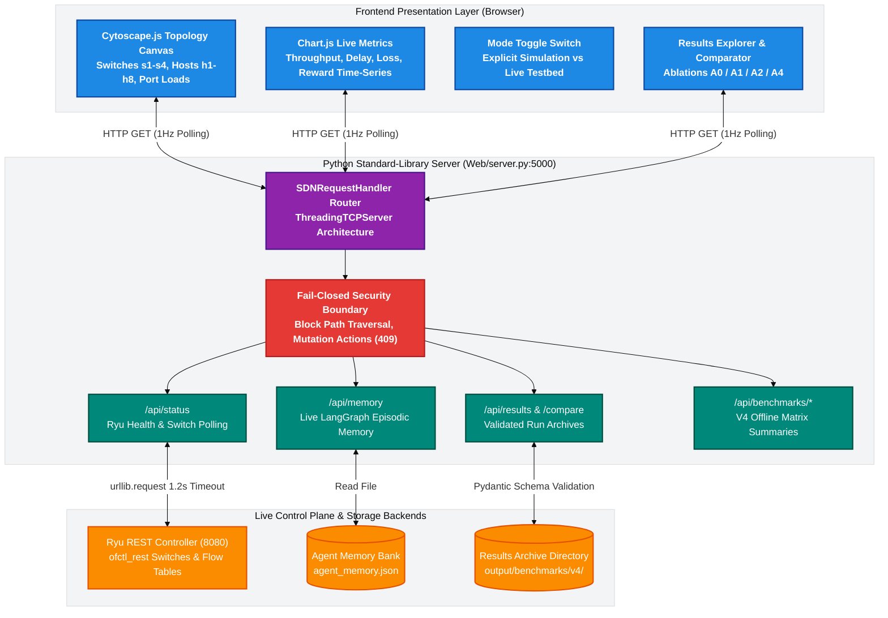

# SELF-X Public Dashboard & REST Bridge Architecture

> **Production-Grade Standard-Library REST Bridge, Telemetry Visualizer, and Immutable Experiment Results Explorer**  
> *Component Guide — EC466: Software Defined Networks | Team ID: SDN_07*  
> *Module Directory: `Web/` | Technology: Python 3 Standard Library, Cytoscape.js, Chart.js, HTML5/CSS3*

---

## 📌 Architectural Overview

The `Web/` directory contains the complete full-stack web dashboard and REST bridge for the SELF-X autonomous SDN platform. Designed for production stability and zero deployment friction, the server is implemented purely using the **Python standard library** (`http.server` and `socketserver.ThreadingTCPServer`) without requiring third-party web frameworks such as Flask, FastAPI, or Django.

### Core Architectural Principles
1. **Zero-Privilege Read-Only Safety**: To prevent accidental disruption of live network forwarding or unverified actuator commands, all network-mutating endpoints (`/api/action/reroute`, `/api/action/rate_limit`, `/api/ryu/*`) are locked down and return deterministic `HTTP 409 Conflict`.
2. **Strict Mode Separation**: The dashboard enforces complete isolation between **Simulation Mode** (client-side fluid queue models) and **Live Network Mode** (real Ryu ofctl_rest telemetry). Simulation metrics are never misrepresented as measured testbed data.
3. **Validated Result Provenance**: All benchmark runs served by `/api/results` undergo strict Pydantic/dataclass schema validation (`validate_run_metadata`, `validate_metric_record`, `validate_summary`, `validate_trace_record`). Incomplete, malformed, or corrupted runs are quarantined and reported with explicit error states.
4. **Hardened Path-Traversal Defense**: Result identifiers are strictly validated against `RUN_ID_RE = re.compile(r"^[A-Za-z0-9][A-Za-z0-9._-]{0,127}$")` and resolved against bounded directory paths to eliminate directory traversal vulnerabilities.

---

## 🎨 Colourful Architecture Mindmap



---

## 🌊 ASCII Request & Security Boundary Flow

```
====================================================================================================
                        WEB DASHBOARD REQUEST LIFECYCLE & SECURITY FLOW
====================================================================================================

 BROWSER CLIENT (localhost:5000)                PYTHON HTTP SERVER (Web/server.py)             BACKEND
       |                                                        |                                 |
       |--- 1. GET /api/status -------------------------------->|                                 |
       |                                                        |--- Probe Ryu 8080 (1.2s TO) --->|
       |                                                        |<-- 200 OK (DPID Array) ---------|
       |<-- 200 OK {"status": "online", "ryu": "connected"} ----|                                 |
       |                                                        |                                 |
       |--- 2. GET /api/memory -------------------------------->|                                 |
       |                                                        |--- Read agent_memory.json ----->|
       |<-- 200 OK {"count": 28, "entries": [...]} -------------|                                 |
       |                                                        |                                 |
       |--- 3. GET /api/results/v4_seed1900/metrics ----------->|                                 |
       |                                                        | [Security Guard Check]          |
       |                                                        | Regex check: 'v4_seed1900' OK   |
       |                                                        | Subpath resolve: inside root OK |
       |                                                        | Validate against Pydantic schema|
       |<-- 200 OK [JSONL Metric Records] ----------------------|                                 |
       |                                                        |                                 |
       |==========================================================================================|
       |                   BLOCKED NETWORK MUTATION ATTEMPT (FAIL-CLOSED)                        |
       |==========================================================================================|
       |--- 4. POST /api/action/reroute {"flow": "h2->h8"} ---->|                                 |
       |                                                        | Intercepted by Security Handler |
       |<-- 409 CONFLICT {"error": "mutations disabled"} -------| (Action discarded. ZERO impact!) |
       |                                                        |                                 |
       |==========================================================================================|
       |                   PATH TRAVERSAL ATTACK ATTEMPT (DEFENSE-IN-DEPTH)                       |
       |==========================================================================================|
       |--- 5. GET /api/results/../../etc/passwd -------------->|                                 |
       |                                                        | Regex check fails on '../'      |
       |<-- 400 BAD REQUEST {"error": "invalid run_id"} --------| (Forbidden traversal blocked!)   |
====================================================================================================
```

---

## 💻 Key Implementation Modules & Code Snippets

### 1. Fail-Closed Security & Caching Headers (`Web/server.py`)

Every HTTP response emits strict security headers to prevent clickjacking, MIME-type sniffing, and sensitive data caching. Network write endpoints are explicitly rejected with `HTTP 409 Conflict`:

```python
class SDNRequestHandler(http.server.SimpleHTTPRequestHandler):
    def __init__(self, *args, **kwargs):
        super().__init__(*args, directory=WEB_DIR, **kwargs)

    def end_headers(self):
        # Strict Security Headers
        self.send_header('Cache-Control', 'no-store')
        self.send_header('X-Content-Type-Options', 'nosniff')
        self.send_header('X-Frame-Options', 'DENY')
        self.send_header('Referrer-Policy', 'same-origin')
        super().end_headers()

    def handle_disabled_control(self, reason):
        """Network mutations are disabled by design in the public dashboard."""
        self.send_json(409, {
            "success": False,
            "error": "network_control_disabled",
            "message": f"Network mutation actions are disabled on this public dashboard ({reason}).",
            "mode": "read_only"
        })
```

### 2. Path Traversal & Schema Validation (`Web/server.py`)

Result resources are sanitized against a strict regex whitelist and verified using the evaluation harness's schema validator:

```python
RUN_ID_RE = re.compile(r"^[A-Za-z0-9][A-Za-z0-9._-]{0,127}$")

def handle_result_resource(self, path):
    parts = [p for p in path.split('/') if p]
    if len(parts) < 3:
        self.send_json(404, {"error": "not_found"})
        return
    run_id = parts[2]
    
    # 1. Regex validation to block path traversal
    if not RUN_ID_RE.match(run_id):
        self.send_json(400, {"error": "invalid run_id format"})
        return
        
    # 2. Path resolution within authorized results directory
    target_dir = (RESULTS_ROOT / run_id).resolve()
    if not str(target_dir).startswith(str(RESULTS_ROOT)):
        self.send_json(403, {"error": "access_denied"})
        return

    # 3. Read and validate run metadata
    try:
        run = read_run(target_dir)
        validate_run_metadata(run.metadata)
    except ResultValidationError as exc:
        self.send_json(422, {"error": "corrupted_run", "details": str(exc)})
        return
```

---

## 📡 REST API Endpoint Specifications

| Endpoint | Method | Response Codes | Description & Payload Schema |
| :--- | :---: | :---: | :--- |
| `/api/status` | `GET` | `200` | Real-time health check. Returns `{"status": "online", "ryu_controller": "connected", "connected_switches": ["0000000000000001", ...]}`. |
| `/api/memory` | `GET` | `200`, `404` | Retrieves stored LangGraph experience records: `{"count": 30, "entries": [{"cycle": 4, "action": "reroute", "reward": 0.118, ...}]}`. |
| `/api/ablation` | `GET` | `200` | Returns live CSV comparison rows across A0, A1, and A2 evaluation runs. |
| `/api/results` | `GET` | `200` | Lists all validated saved benchmark runs with stage (`A0`, `A1`, `A2`, `A4`), status, and timestamp. |
| `/api/results/<id>/summary` | `GET` | `200`, `400`, `404`, `422` | Returns statistical summary: mean latency, throughput, packet loss, and composite reward. |
| `/api/results/<id>/metrics` | `GET` | `200`, `400`, `404` | Returns full per-window time series (JSONL) for Canvas time-series charting. |
| `/api/results/<id>/trace` | `GET` | `200`, `404` | Diagnostic execution traces including LLM reasoning, token counts, and safety verdicts. |
| `/api/results/compare` | `GET` | `200`, `400` | Takes query `?run_ids=runA,runB` and returns aligned side-by-side comparison tables. |
| `/api/action/reroute` | `POST` | `409` | Disabled mutation endpoint. Returns fail-closed HTTP 409 Conflict. |
| `/api/action/rate_limit`| `POST` | `409` | Disabled mutation endpoint. Returns fail-closed HTTP 409 Conflict. |

---

## 🚀 Step-by-Step Running & Verification Guide

### 1. Launch the Server Locally
Run directly using the Python standard library:
```powershell
python Web/server.py
```
*The server binds to `http://localhost:5000/` (or port defined by `SDN_WEB_PORT`).*

### 2. Run Public API Validation Tests
Verify that all public routes, security headers, path-traversal guards, and read-only protections are fully intact:
```powershell
python -m unittest discover -s Web/tests -v
```

### 3. Custom Port and Controller Configuration
Override default host and Ryu backend addresses using standard environment variables:
```powershell
$env:SDN_WEB_PORT="8000"
$env:RYU_REST_BASE="http://192.168.1.100:8080"
python Web/server.py
```

---

## 🛠️ Developer Extension Guide: Building on `Web/`

### Adding a New Telemetry Panel
1. **Define Backend Endpoint in [`Web/server.py`](file:///c:/Users/RAVIPRAKASH/SDN/SDN/Web/server.py)**:
   ```python
   if path == '/api/custom_metric':
       data = {"queue_variance": compute_variance(), "active_tcam_rules": 42}
       self.send_json(200, data)
       return
   ```
2. **Add Canvas / DOM Element in [`Web/index.html`](file:///c:/Users/RAVIPRAKASH/SDN/SDN/Web/index.html)**:
   ```html
   <div class="card metric-panel">
     <h3>Queue Variance</h3>
     <canvas id="queueVarianceChart"></canvas>
   </div>
   ```
3. **Poll and Render in [`Web/js/`](file:///c:/Users/RAVIPRAKASH/SDN/SDN/Web/js/)**:
   Use standard `fetch('/api/custom_metric')` within the client-side 1Hz update timer to update the Chart.js instance.

---
*Authored by Team SDN_07 — EC466: Software Defined Networks*
