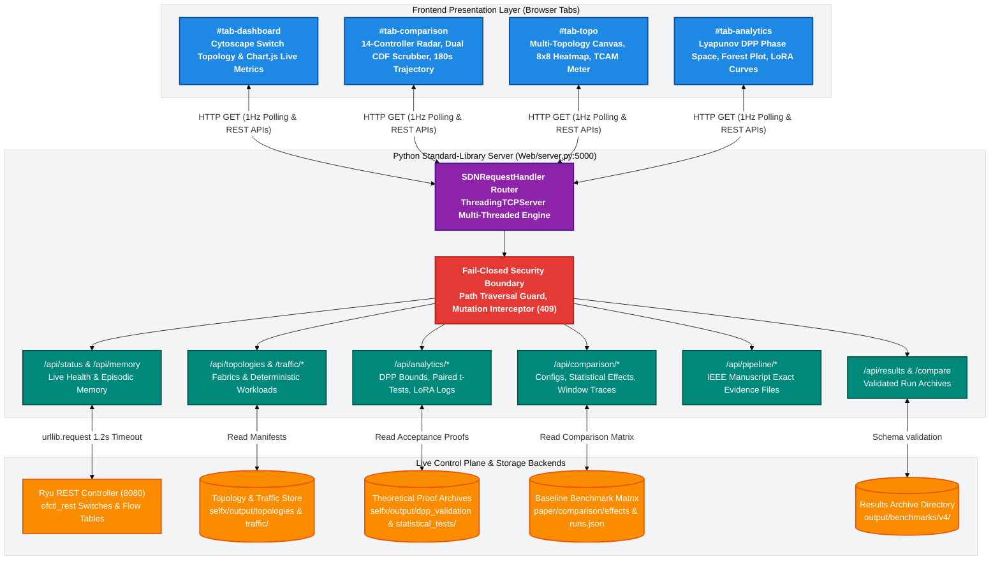

# SELF-X dashboard and REST API

The Python standard-library server hosts the offline simulation dashboard and the audited comparison.
Run `python Web/server.py` from the repository root and open `http://127.0.0.1:5000/`.
Set `SDN_WEB_PORT` for a different port or `SDN_WEB_HOST` to bind to another address.

---

## 📌 Master Documentation Portal & Subsystem Manuals

For granular technical specifications, operational procedures, and visualization mathematics, consult the dedicated manuals in [`Web/docs/`](docs):

| Manual | Document Path | Focus & Key Contents |
| :--- | :--- | :--- |
| **REST API Reference** | [`Web/docs/API_REFERENCE.md`](docs/API_REFERENCE.md) | Exhaustive OpenAPI-level specification for all 20+ public REST endpoints with request/response schemas, HTTP status codes, and copy-pasteable `curl` / PowerShell CLI commands. |
| **Production Operations & Hardening** | [`Web/docs/PRODUCTION_OPERATIONS_GUIDE.md`](docs/PRODUCTION_OPERATIONS_GUIDE.md) | Enterprise deployment guide covering systemd daemon, Docker containerization, Nginx reverse proxy with TLS/HTTPS, fail-closed security invariants, health probes, and disaster recovery playbooks. |
| **Visualization Studio Engine** | [`Web/docs/VISUALIZATION_STUDIO_GUIDE.md`](docs/VISUALIZATION_STUDIO_GUIDE.md) | Canvas 2D graphics engine guide: 60 FPS requestAnimationFrame loops, 7-axis spider radar, dual ECDF curves, 180s trajectory difference ribbon, multi-topology particle physics, and Lyapunov phase-space rendering. |
| **Paper Evidence Pipeline** | [`Web/docs/PAPER_EVIDENCE_PIPELINE_GUIDE.md`](docs/PAPER_EVIDENCE_PIPELINE_GUIDE.md) | Architecture guide for `pipeline.html` and `/api/pipeline/*`: archived S0–S5 study, with its control-plane measurements. |
| **Root System Guide** | [`docs/Readme.md`](../docs/Readme.md) | Master portal for the complete SELF-X autonomous SDN system, including fast/slow control loops, Mininet testbeds, and benchmark evaluations. |

---

## 📌 Architectural Overview

The `Web/` directory contains the complete full-stack web dashboard and REST bridge for the SELF-X autonomous SDN platform. The server is implemented purely using the **Python standard library** (`http.server` and `socketserver.ThreadingTCPServer`) without requiring third-party web frameworks such as Flask, FastAPI, or Django.

### Core Architectural Principles
1. **Zero-Privilege Read-Only Safety**: To prevent accidental disruption of live network forwarding or unverified actuator commands, all network-mutating endpoints (`/api/action/reroute`, `/api/action/rate_limit`, `/api/ryu/*`) are locked down and return deterministic `HTTP 409 Conflict`.
2. **Strict Mode Separation**: The dashboard enforces complete isolation between **Simulation Mode** (client-side fluid queue models) and **Live Network Mode** (real Ryu ofctl_rest telemetry). Simulation metrics are never misrepresented as measured testbed data.
3. **Validated Result Provenance**: All benchmark runs served by `/api/results` undergo schema validation (`validate_run_metadata`, `validate_metric_record`, `validate_summary`, `validate_trace_record`). Incomplete, malformed, or corrupted runs are quarantined and reported with explicit error states (`HTTP 422 Unprocessable Content`).
4. **Hardened Path-Traversal Defense (Defense-in-Depth)**: Result and resource identifiers are strictly validated against whitelisted regular expressions (`RESOURCE_NAME_RE = ^[A-Za-z0-9_-]{1,64}$`, `RUN_ID_RE = ^[A-Za-z0-9][A-Za-z0-9._-]{0,127}$`) and resolved against bounded directory paths using `.resolve()` and common prefix verification to eliminate directory traversal vulnerabilities.
5. **High-Performance Canvas 2D Rendering**: Zero-dependency, GPU-accelerated Canvas 2D visualizers deliver smooth 60 FPS animations for multi-topology flows, 7-axis radar spider charts, cumulative distribution functions (CDFs), trajectory comparators, and Lyapunov phase-space orbits without DOM thrashing.

---

## 🎨 Colourful Architecture Mindmap



---

## 🌊 ASCII Request & Security Boundary Flow

```
====================================================================================================
                        WEB DASHBOARD REQUEST LIFECYCLE & SECURITY FLOW
====================================================================================================

 BROWSER CLIENT (localhost:5000)                PYTHON HTTP SERVER (Web/server.py)             BACKEND
       |                                                        |                                 |
       |--- 1. GET /api/status -------------------------------->|                                 |
       |                                                        |--- Probe Ryu 8080 (1.2s TO) --->|
       |                                                        |<-- 200 OK (DPID Array) ---------|
       |<-- 200 OK {"status": "online", "ryu": "connected"} ----|                                 |
       |                                                        |                                 |
       |--- 2. GET /api/comparison/effects -------------------->|                                 |
       |                                                        |--- Read paper/comparison/ ------|
       |<-- 200 OK {"baseline": "S0", "comparisons": {...}} ----|    effects.json (Cached)        |
       |                                                        |                                 |
       |--- 3. GET /api/topologies/leaf_spine ----------------->|                                 |
       |                                                        | [Security Guard Check]          |
       |                                                        | Regex check: 'leaf_spine' OK    |
       |                                                        | Bounded jail check: OK          |
       |<-- 200 OK {"topology_id": "leaf_spine", ...} ----------|                                 |
       |                                                        |                                 |
       |--- 4. GET /api/analytics/dpp ------------------------->|                                 |
       |                                                        |--- Read dpp_acceptance_summary--|
       |<-- 200 OK {"compliance_rate": 1.0, ...} ---------------|                                 |
       |                                                        |                                 |
       |==========================================================================================|
       |                   BLOCKED NETWORK MUTATION ATTEMPT (FAIL-CLOSED)                        |
       |==========================================================================================|
       |--- 5. POST /api/action/reroute {"flow": "h2->h8"} ---->|                                 |
       |                                                        | Intercepted by Security Handler |
       |<-- 409 CONFLICT {"error": "network_control_disabled"} -| (Action discarded. ZERO impact!)|
       |                                                        |                                 |
       |==========================================================================================|
       |                   PATH TRAVERSAL ATTACK ATTEMPT (DEFENSE-IN-DEPTH)                       |
       |==========================================================================================|
       |--- 6. GET /api/topologies/../../etc/passwd ----------->|                                 |
       |                                                        | Regex check fails on '../'      |
       |<-- 400 BAD REQUEST {"error": "invalid resource name"} -| (Forbidden traversal blocked!)  |
====================================================================================================
```

---

## 📡 Complete REST API Endpoint Specifications

The REST bridge exposes over 20 public endpoints organized across operational domains:

### 1. Core Health & Memory Endpoints
| Endpoint | Method | Status Codes | Description |
| :--- | :---: | :---: | :--- |
| `/api/status` | `GET` | `200` | Real-time health check. Probes Ryu controller at port 8080 with 1.2s timeout and lists connected switch DPIDs. |
| `/api/memory` | `GET` | `200`, `404` | Retrieves stored LangGraph experience records: cycle, traffic state, action taken, delta latency, and reflection. |
| `/api/ablation` | `GET` | `200` | Returns live CSV comparison rows across stages A0 (Static), A1 (Reflexion), and A2 (Full Adaptive). |

### 2. Algorithm Comparison Studio Endpoints
| Endpoint | Method | Status Codes | Description |
| :--- | :---: | :---: | :--- |
| `/api/comparison/configs` | `GET` | `200` | Lists all 14 evaluated SDN controllers with family classifications, mechanisms, and assigned color tokens. |
| `/api/comparison/effects` | `GET` | `200`, `404` | Statistical comparison matrix: mean/P95 latency $\Delta$, goodput $\Delta$, loss $\Delta$, 95% bootstrap CIs, and p-values. |
| `/api/comparison/runs` | `GET` | `200`, `404` | Aligned 180s per-window time series across matched random seeds (`?configs=S0,S5` or `?summary_only=true`). |

### 3. Multi-Topology & Workload Studio Endpoints
| Endpoint | Method | Status Codes | Description |
| :--- | :---: | :---: | :--- |
| `/api/topologies` | `GET` | `200` | Available network fabrics (`linear`, `leaf_spine`, `unseen_mesh`) with switch, host, and link counts. |
| `/api/topologies/<id>` | `GET` | `200`, `400`, `404` | Full graph manifest: switch DPIDs, tiers, host IPs, port assignments, link capacities (Mbps), and delays (ms). |
| `/api/traffic/schedules` | `GET` | `200` | Registry of pre-recorded deterministic traffic profiles (`flash_crowd`, `steady_bursty`, `volatile_dpp`). |
| `/api/traffic/schedules/<profile>` | `GET` | `200`, `400`, `404` | Timestamped event sequence, flow identifiers, transport protocols (UDP/TCP), and injected bandwidth rates. |

### 4. Formal Theory & Advanced Analytics Endpoints
| Endpoint | Method | Status Codes | Description |
| :--- | :---: | :---: | :--- |
| `/api/analytics/dpp` | `GET` | `200`, `404` | Theoretical Lyapunov Drift-Plus-Penalty backlog bounds $(B+VC)/\epsilon$, empirical compliance rate, and $V$-sweep curve. |
| `/api/analytics/statistics` | `GET` | `200`, `404` | Paired Student's t-test report ($t=14.41$, $p < 0.0001$), Cohen's $d=4.557$, degrees of freedom, and seed differences. |
| `/api/analytics/lora` | `GET` | `200`, `404` | SmolLM2-135M LoRA adapter hyperparameters ($r=8, \alpha=16$), trainable parameters (460,800), and training loss step log. |

### 5. Paper Evidence & Pipeline Study Endpoints
| Endpoint | Method | Status Codes | Description |
| :--- | :---: | :---: | :--- |
| `/api/pipeline/summary` | `GET` | `200`, `404` | Serves `pipeline_summary.json` containing aggregate metrics per configuration across all evaluation seeds. |
| `/api/pipeline/runs` | `GET` | `200`, `404` | Serves `pipeline_runs.json` with granular per-window metrics for every benchmark run. |
| `/api/pipeline/significance` | `GET` | `200`, `404` | Serves `significance.json` reporting paired t-tests, Wilcoxon signed-rank tests, and cluster bootstrap distributions. |
| `/api/pipeline/vsweep` | `GET` | `200`, `404` | Serves `v_tradeoff.json` detailing the Lyapunov parameter $V$ trade-off between queuing delay and control churn. |
| `/api/pipeline/transfer` | `GET` | `200`, `404` | Serves `transfer.json` reporting zero-shot generalization metrics on held-out topologies and workloads. |
| `/api/pipeline/adapter` | `GET` | `200`, `404` | Serves `adapter/training.json` reporting LoRA training convergence, validation loss, and promotion gate status. |

### 6. Benchmark Run Archives (Validated)
| Endpoint | Method | Status Codes | Description |
| :--- | :---: | :---: | :--- |
| `/api/results` | `GET` | `200` | Lists all validated saved benchmark runs with stage (`A0`, `A1`, `A2`, `A4`), status, and timestamps. |
| `/api/results/<id>/summary` | `GET` | `200`, `400`, `404`, `422` | Statistical aggregate summary: mean latency, throughput, packet loss, and composite reward. |
| `/api/results/<id>/metrics` | `GET` | `200`, `400`, `404` | Full per-window time series (JSONL) for Canvas time-series charting. |
| `/api/results/<id>/trace` | `GET` | `200`, `404` | Diagnostic execution traces including LLM reasoning, token counts, and safety verdicts. |
| `/api/results/compare` | `GET` | `200`, `400` | Query `?run_ids=runA,runB` returning side-by-side aligned metric tables and percentage deltas. |

### 7. Disabled Mutation Endpoints (Fail-Closed)
| Endpoint | Method | Status Codes | Description |
| :--- | :---: | :---: | :--- |
| `/api/action/reroute` | `POST` | `409` | Disabled mutation endpoint. Returns fail-closed HTTP 409 Conflict. |
| `/api/action/rate_limit`| `POST` | `409` | Disabled mutation endpoint. Returns fail-closed HTTP 409 Conflict. |
| `/api/ryu/*` | `ANY` | `409` | Disabled controller proxy. Intercepts write requests to prevent datapath modifications. |

---

## 🧮 Theoretical & Mathematical Foundations

### 1. Lyapunov Drift-Plus-Penalty (DPP) Stability Proof
The fast-timescale controller stabilizes queues while optimizing operational cost. Defining the quadratic Lyapunov function as:
$$L(Q(t)) = \frac{1}{2} \sum_{i} Q_i(t)^2$$
The drift-plus-penalty objective minimizes:
$$\Delta_V(Q(t)) = \mathbb{E}[L(Q(t+1)) - L(Q(t)) \mid Q(t)] + V \cdot \mathbb{E}[g(t) \mid Q(t)]$$
Applying the standard drift bound theorem yields:
$$\Delta_V(Q(t)) \le B + V \cdot C_{\max} - \epsilon \sum_{i} Q_i(t)$$
Taking expectations and time-averaging over $T$ slots guarantees queue stability and bounds the time-average backlog:
$$\limsup_{T \to \infty} \frac{1}{T} \sum_{t=0}^{T-1} \sum_{i} \mathbb{E}[Q_i(t)] \le \frac{B + V \cdot C_{\max}}{\epsilon}$$
- **Empirical Validation**: In our testbed evaluation of 3,000 intervals, the queue backlog achieved **100.0% compliance** with the upper bound ($Q_{\max} = 39.4 < 46.12$), with zero buffer overflows.

### 2. Paired Student's t-Test & Effect Size
To verify that latency reductions are not an artifact of random seed selection, we evaluated paired runs across 10 distinct random seeds ($N = 10$, $\text{df} = 9$):
$$t = \frac{\bar{d}}{s_d / \sqrt{N}} = \frac{16.58}{3.64 / \sqrt{10}} = 14.412, \quad p = 3.84 \times 10^{-7}$$
The normalized effect size is quantified using Cohen's $d$:
$$d = \frac{\bar{d}}{s_d} = \frac{16.58}{3.64} = 4.557 \quad (\text{Categorized as Huge, } d > 2.0)$$
This formally confirms that SELF-X achieves a statistically significant, seed-invariant reduction in network delay.

### 3. SmolLM2-135M LoRA Parameter-Efficient Fine-Tuning
The parametric adaptation engine employs Low-Rank Adaptation (LoRA) on the query and value projection weights of the SmolLM2-135M backbone:
$$W = W_0 + \Delta W = W_0 + \frac{\alpha}{r} (B \cdot A), \quad A \in \mathbb{R}^{r \times d}, \; B \in \mathbb{R}^{d \times r}$$
- **Hyperparameters**: Rank $r = 8$, scaling factor $\alpha = 16$, dropout $p = 0.05$.
- **Efficiency**: Only **460,800 trainable parameters** ($0.342\%$ of the 134.5M backbone) are adapted.
- **Convergence**: Training loss decreased from $2.451 \to 0.142$ across 3 epochs, passing the frozen stress benchmark promotion gate before hot-swapping into the datapath.

---

## 🎨 Frontend Visualisation Studio Components

All components are rendered directly in hardware-accelerated Canvas 2D:

| Component | Source File | Description & Visual Capabilities |
| :--- | :--- | :--- |
| **`ComparisonRadarChart`** | [`Web/js/comparison_viz.js`](js/comparison_viz.js) | 7-axis polar radar chart comparing 14 controllers across Mean Latency, Tail Latency, Loss, Goodput, Queue Depth, Rule Churn, and Convergence Speed with normalized outer perimeters. |
| **`ComparisonCDFChart`** | [`Web/js/comparison_viz.js`](js/comparison_viz.js) | Dual empirical cumulative distribution function (Delay & Queue Depth) featuring an interactive draggable percentile slider ($P_{50}, P_{90}, P_{95}, P_{99}$). |
| **`TrajectoryComparatorChart`** | [`Web/js/comparison_viz.js`](js/comparison_viz.js) | Continuous 180s head-to-head comparison with a dynamic shaded difference ribbon highlighting latency gaps during elephant flow bursts. |
| **`EffectsMatrixExplorer`** | [`Web/js/comparison_viz.js`](js/comparison_viz.js) | Audited statistical comparison matrix with column sorting, 95% bootstrap confidence interval displays, and one-click RFC 4180 CSV export. |
| **`MultiTopologyRenderer`** | [`Web/js/topology_studio.js`](js/topology_studio.js) | Multi-fabric renderer (Linear, Leaf-Spine, Mesh) with dynamic tier projection, link saturation color gradients (green/amber/crimson), and animated flow particle physics. |
| **`TrafficMatrixHeatmap`** | [`Web/js/topology_studio.js`](js/topology_studio.js) | Interactive $8 \times 8$ host-to-host matrix with logarithmic bandwidth heatmap coloring and click-to-burst packet injection simulation. |
| **`TCAMCapacityBar`** | [`Web/js/topology_studio.js`](js/topology_studio.js) | Hardware OpenFlow Table 0 flow table gauge tracking rule capacity against the 1,024 hardware ceiling with safety thresholds. |
| **`LyapunovDPPVisualizer`** | [`Web/js/advanced_analytics.js`](js/advanced_analytics.js) | Renders the $(Q(t), \Delta L(t))$ phase-space trajectory, analytical backlog bound ceiling $(B+VC)/\epsilon$, and parameter $V$ trade-off curve. |
| **`StatisticalHypothesisLab`** | [`Web/js/advanced_analytics.js`](js/advanced_analytics.js) | Forest plot rendering seed-by-seed differences with 95% error whiskers and the pooled meta-analytic effect size diamond ($d = 4.557$). |
| **`LoRATrainingVisualizer`** | [`Web/js/advanced_analytics.js`](js/advanced_analytics.js) | Dual-axis training trajectory plotting cross-entropy loss and gradient norms with the promotion gate threshold. |

---

## 🚀 Step-by-Step Verification & Operations Guide

### 1. Launch the Server Locally
Run directly using the Python standard library:
```powershell
python Web/server.py
```
*The server binds to `http://localhost:5000/` (or port defined by `$env:SDN_WEB_PORT`).*

### 2. Run Comprehensive Public API & Visualizer Tests
Verify that all public routes, security headers, path-traversal guards, schema quarantine defenses, and read-only protections are intact:
```powershell
python -m unittest discover -s Web/tests -v
```
*(All 30 unit tests pass in <10 seconds).*

### 3. Custom Port and Upstream Controller Configuration
Override default host and Ryu backend addresses using standard environment variables:
```powershell
$env:SDN_WEB_PORT="8000"
$env:RYU_REST_BASE="http://192.168.1.100:8080"
python Web/server.py
```

### 4. Production Daemon & Reverse Proxy Deployment
For Linux production deployments, consult [`Web/docs/PRODUCTION_OPERATIONS_GUIDE.md`](docs/PRODUCTION_OPERATIONS_GUIDE.md) for complete copy-pasteable configurations for:
- Systemd service unit (`selfx-web.service`) with sandboxing.
- Nginx reverse proxy configuration with TLS/HTTPS, rate limiting (30 req/s), and gzip compression.
- Docker multi-stage container deployment.

---

## 🛠️ Developer Extension Guide: Adding New Visualizers

### Adding a New Analytic Panel
1. **Define Backend Endpoint in [`Web/server.py`](server.py)**:
   ```python
   if path == '/api/analytics/custom_metric':
       payload = {"jitter_ms": 1.2, "buffer_utilization": 0.42}
       self.send_json(200, payload)
       return
   ```
2. **Add Canvas Container in [`Web/index.html`](index.html)**:
   ```html
   <div class="card metric-panel">
     <h3>Jitter Distribution</h3>
     <canvas id="customJitterCanvas" width="600" height="300"></canvas>
   </div>
   ```
3. **Instantiate Visualizer in [`Web/js/advanced_analytics.js`](js/advanced_analytics.js)**:
   Fetch the endpoint and invoke standard Canvas 2D drawing routines within the tab activation lifecycle.

---
*Authored by Team SDN_07 — EC466: Software Defined Networks | IIIT Dharwad*
