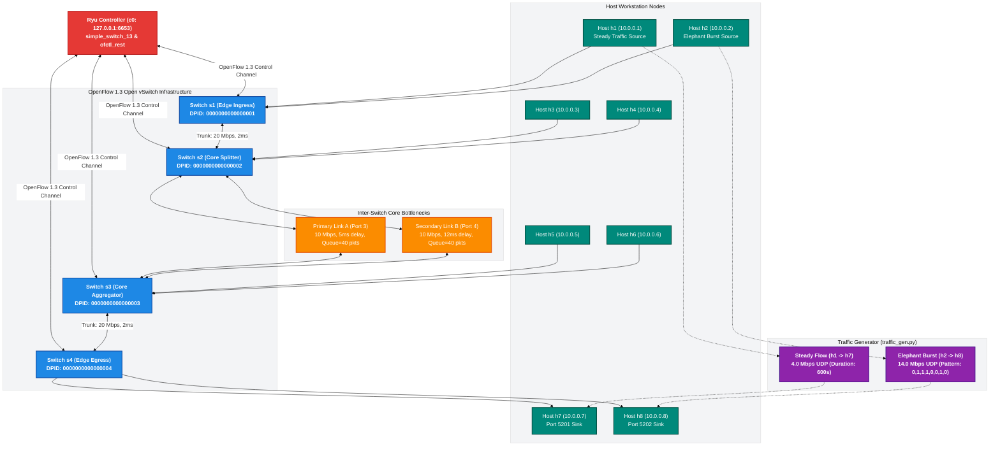

# SDN Self-Improving Agent Testbed (`sdn-self-improving-agent`)

> **Realistic Mininet Emulation Testbed, OpenFlow 1.3 Topology, and Deterministic Traffic Generator**  
> *Component Guide — EC466: Software Defined Networks | Team ID: SDN_07*  
> *Module Directory: `sdn-self-improving-agent/` | Technologies: Mininet 2.3+, Open vSwitch (OVS), Ryu SDN Controller, iperf3*

---

## 📌 Architectural Overview

The `sdn-self-improving-agent` package provides the emulation foundation and synthetic traffic generators used to evaluate autonomous flow-management agents. Implemented in Python using the Mininet and Open vSwitch (OVS) APIs, it creates an OpenFlow 1.3 linear multi-switch network featuring a **dual-link bottleneck between core switches `s2` and `s3`**.

### Key Network Invariants
1. **Core Bottleneck**: The primary link between `s2` and `s3` is capped at $10\text{ Mbps}$, $5\text{ ms}$ delay, and a maximum tail-drop queue buffer of $40\text{ packets}$ ($\approx 60\text{ KB}$).
2. **Alternate Path for Rerouting**: A parallel secondary link exists between `s2` and `s3` with $10\text{ Mbps}$ bandwidth, $12\text{ ms}$ delay, and a $40\text{ packet}$ queue buffer.
3. **Overload Traffic Dynamics**: Steady background traffic ($4.0\text{ Mbps}$) flows from `h1` to `h7`. When an elephant burst ($14.0\text{ Mbps}$) is injected from `h2` to `h8`, total offered load on the primary link reaches $18.0\text{ Mbps}$ ($180\%$ of link capacity), triggering rapid queue saturation, packet drops, and latency escalation unless the agent intervenes.

---

## 🎨 Colourful Architecture Mindmap



---

## 🌊 ASCII Network Topology & Physical Link Interfaces

```
====================================================================================================
                        MININET TESTBED INTERFACE & DPID MAPPINGS
====================================================================================================

  [h1: 10.0.0.1/24]
  (00:00:00:00:00:01)
         \ port 1 (100M, 1ms)
          \
           [s1: dpid 0x01] === port 3 === (20M, 2ms) === port 1 === [s2: dpid 0x02]
          /                                                            /       \
         / port 2 (100M, 1ms)                                         /         \
  [h2: 10.0.0.2/24]                                                  /           \
  (00:00:00:00:00:02)                       Primary Link A (Port 3) /             \ Secondary Link B (Port 4)
                                            [10 Mbps, 5ms, Q=40]   /               \ [10 Mbps, 12ms, Q=40]
  [h3: 10.0.0.3] -- port 1 --\                                    /                 \
                              [s2]                               v                   v
  [h4: 10.0.0.4] -- port 2 --/                             port 1 [s3]           port 2 [s3]
                                                                  \                 /
                                                                   \               /
                                                                    \             /
                                                              [s3: dpid 0x03]
                                                                     |
                                                                     | port 3 (Trunk: 20M, 2ms)
                                                                     |
                                                                     | port 1
                                                              [s4: dpid 0x04]
                                                              /             \
                                       port 2 (100M, 1ms)    /               \ port 3 (100M, 1ms)
                                                            /                 \
                                                  [h7: 10.0.0.7/24]      [h8: 10.0.0.8/24]
                                                 (00:00:00:00:00:07)    (00:00:00:00:00:08)
                                                  (iperf3 port 5201)     (iperf3 port 5202)
====================================================================================================
```

---

## 💻 Key Implementation Modules & Code Snippets

### 1. Topology Construction (`sdn-self-improving-agent/topo.py`)

The network is defined subclassing Mininet's `Topo` class, configuring Open vSwitch instances to communicate with the remote Ryu controller using OpenFlow 1.3:

```python
class LinearSDNTopo(Topo):
    def build(self):
        # 1. Add 4 Switches (OpenFlow 1.3)
        switches = [
            self.addSwitch(f's{i}', protocols='OpenFlow13', dpid=f'{i:016x}')
            for i in range(1, 5)
        ]
        s1, s2, s3, s4 = switches

        # 2. Add 8 Hosts (2 per switch)
        hosts = [
            self.addHost(f'h{i}', ip=f'10.0.0.{i}/24', mac=f'00:00:00:00:00:{i:02x}')
            for i in range(1, 9)
        ]

        # Host-to-switch access links (100 Mbps, 1ms delay)
        self.addLink(hosts[0], s1, bw=100, delay='1ms')
        self.addLink(hosts[1], s1, bw=100, delay='1ms')
        self.addLink(hosts[6], s4, bw=100, delay='1ms')
        self.addLink(hosts[7], s4, bw=100, delay='1ms')

        # 3. Inter-switch Links
        self.addLink(s1, s2, bw=20, delay='2ms')  # Ingress trunk

        # Dual Bottlenecks between s2 and s3:
        self.addLink(s2, s3, bw=10, delay='5ms', max_queue_size=40)   # Primary Path A
        self.addLink(s2, s3, bw=10, delay='12ms', max_queue_size=40)  # Secondary Path B

        self.addLink(s3, s4, bw=20, delay='2ms')  # Egress trunk
```

### 2. Traffic Generator & Burst Schedule (`sdn-self-improving-agent/traffic_gen.py`)

Synthetic UDP workloads are generated using isolated `iperf3` processes. The elephant burst sequence follows a deterministic bitmask pattern `[0, 1, 1, 1, 0, 0, 1, 0]`:

```python
class TrafficGenerator:
    def __init__(self, net, seed=42, steady_rate="4M", elephant_rate="14M"):
        self.net = net
        self.seed = seed
        self.steady_rate = steady_rate
        self.elephant_rate = elephant_rate
        self.running_processes = []

    def start_steady_load(self, duration_sec=600):
        """Starts background traffic: h1 -> h7 @ 4.0 Mbps."""
        h1 = self.net.get('h1')
        cmd = f"iperf3 -c 10.0.0.7 -p 5201 -u -b {self.steady_rate} -t {duration_sec}"
        proc = h1.popen(cmd, shell=True)
        self.running_processes.append(proc)
        return proc

    def trigger_elephant_burst(self, duration_sec=10):
        """Triggers an elephant burst: h2 -> h8 @ 14.0 Mbps."""
        h2 = self.net.get('h2')
        cmd = f"iperf3 -c 10.0.0.8 -p 5202 -u -b {self.elephant_rate} -t {duration_sec}"
        proc = h2.popen(cmd, shell=True)
        self.running_processes.append(proc)
        return proc

    def should_trigger_burst(self, cycle_index):
        """Deterministic pseudo-random burst schedule."""
        pattern = [0, 1, 1, 1, 0, 0, 1, 0]
        return pattern[cycle_index % len(pattern)] == 1
```

---

## 🚀 Execution & Emulation Guide (Linux / WSL2)

Running real Mininet emulation requires root privileges on Linux or WSL2:

### 1. Launch the Ryu SDN Controller
In Terminal 1:
```bash
ryu-manager --ofp-tcp-listen-port 6653 ryu.app.simple_switch_13 ryu.app.ofctl_rest
```

### 2. Start the Mininet Topology
In Terminal 2:
```bash
sudo -E python3 sdn-self-improving-agent/topo.py
```

### 3. Verify Switch Connectivity in Mininet CLI
```bash
mininet> pingall
mininet> dpctl dump-flows -O OpenFlow13
mininet> iperf h1 h7
```

### 4. Bridge to the SELF-X Autonomous Agent
In Terminal 3, activate the agent virtual environment and run the evaluation harness:
```bash
cd selfx
source .venv/bin/activate
sudo -E python3 -m eval.run_ablation --duration 600
```

---

## 📋 Addressing & Port Assignment Reference

| Entity | Role | IP Address | MAC Address | Attached Switch | Switch Port |
| :--- | :--- | :---: | :---: | :---: | :---: |
| **`h1`** | Steady Traffic Client | `10.0.0.1/24` | `00:00:00:00:00:01` | `s1` | Port 1 |
| **`h2`** | Elephant Burst Client | `10.0.0.2/24` | `00:00:00:00:00:02` | `s1` | Port 2 |
| **`h3`** | Local Host | `10.0.0.3/24` | `00:00:00:00:00:03` | `s2` | Port 1 |
| **`h4`** | Local Host | `10.0.0.4/24` | `00:00:00:00:00:04` | `s2` | Port 2 |
| **`h5`** | Local Host | `10.0.0.5/24` | `00:00:00:00:00:05` | `s3` | Port 1 |
| **`h6`** | Local Host | `10.0.0.6/24` | `00:00:00:00:00:06` | `s3` | Port 2 |
| **`h7`** | Steady Egress Server (`iperf3:5201`) | `10.0.0.7/24` | `00:00:00:00:00:07` | `s4` | Port 2 |
| **`h8`** | Elephant Egress Server (`iperf3:5202`) | `10.0.0.8/24` | `00:00:00:00:00:08` | `s4` | Port 3 |
| **`s1`** | Ingress Edge Switch | - | - | DPID: `0x01` | - |
| **`s2`** | Core Splitter Switch | - | - | DPID: `0x02` | Port 3 (Pri), Port 4 (Sec) |
| **`s3`** | Core Aggregator Switch | - | - | DPID: `0x03` | Port 1 (Pri), Port 2 (Sec) |
| **`s4`** | Egress Edge Switch | - | - | DPID: `0x04` | - |

---
*Authored by Team SDN_07 — EC466: Software Defined Networks*
