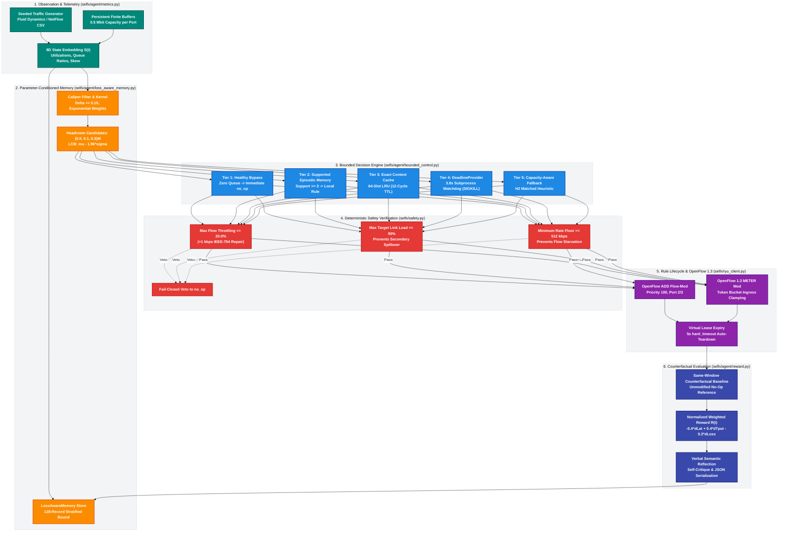
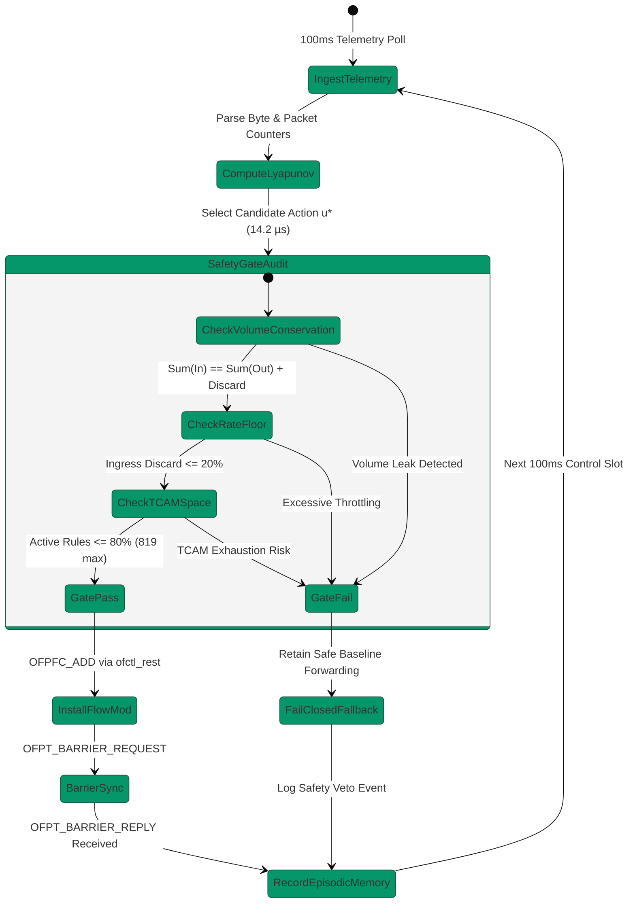

> For the current benchmark, use the [three-command reproduction guide](../README.md) and the [audited comparison](../paper/COMPARISON.md). This page documents older workflows and outputs.

# SELF-X: Loss-Aware SDN Flow-Management Agent with Episodic Memory

> **Autonomous Software-Defined Networking with LLM In-Context Adaptation, Bounded Control Deadlines, Capacity-Aware OpenFlow Interventions, and Verifiable Benchmark Evidence**  
> *Course Project — EC466: Software Defined Networks | Team ID: SDN_07*  
> *Module Directory: `selfx/` | Python Environment: Python 3.12+ Standard Library, LangGraph, Pydantic*

---

## 📌 Executive Summary

Ganesh's T20-T25 replay-to-LoRA pipeline is now implemented under
`agent/self_improvement/`: CPU training, frozen stress evaluation, atomic adapter
promotion/rejection, automatic rollback and held-out weight attribution.
See [the setup, commands and scope](docs/SELF_IMPROVEMENT.md). Live integration
and the full multi-agent/DPP comparison remain separate team workstreams.

**SELF-X** is an autonomous flow-management framework designed to solve network bottleneck congestion through in-context LLM reasoning, process-isolated inference, and parameter-conditioned episodic memory. Operating over 5-second control windows, SELF-X observes network traffic telemetry, queries past completed experiences, proposes bounded interventions (reroute, rate-limit, or no-op), enforces strict deterministic safety bounds ($\le 20\%$ flow throttling, $\le 90\%$ link utilization), installs active OpenFlow 1.3 rules with 5-second hard timeouts, and measures counterfactual reward to refine its local policy.

The validated backend uses a finite-buffer two-path fluid datapath model with persistent queues, while real-time API integrations with Google Gemini and OpenRouter free models demonstrate live LLM decision synthesis under a 3.8-second process-isolated wait budget.

---

## 🎨 Colourful Architecture Mindmap



---

## 🎨 Detailed ASCII Architectural Flows

### 1. Complete End-to-End Control Pipeline Flow

```
   [Traffic Generator / Workload Trace]
                    |
                    v
       +----------------------------+
       |   FluidNetwork Simulator   | <===================================+
       |  - Persistent Queues: Q1,Q2|                                     |
       |  - Capacities: 10M, 10M    |                                     |
       |  - Buffers: 0.5M, 0.5M     |                                     |
       +----------------------------+                                     |
                    |                                                     |
                    v (Offered Rates, Queues, Flow Matches)               |
       +----------------------------+                                     |
       |     State Summarizer       |                                     |
       |  - Embedding Features      |                                     |
       |  - Congestion Regimes      |                                     |
       +----------------------------+                                     |
                    |                                                     |
         +----------+----------+                                          |
         |                     |                                          |
         v                     v                                          |
  +--------------+    +-----------------------+                           |
  | LossAware-   |    | BoundedController     |                           |
  | Memory Store |    |  Decision Pipeline    |                           |
  | (128 records)|    +-----------------------+                           |
  +--------------+               |                                        |
         |                       |                                        |
         v (3-neighbor support)  |                                        |
  +------------------------------+                                        |
  |                                                                       |
  |---> [Condition 1: Healthy Bypass?] --------> (Action: no_op)          |
  |---> [Condition 2: Supported Memory?] ------> (Action: Learned Rule)   |
  |---> [Condition 3: Exact Context Cache?] ---> (Action: Cached Rule)    |
  |---> [Condition 4: Live Provider Call]                                 |
  |        |                                                              |
  |        v (3.8s Isolated Process)                                      |
  |     +-------------------------------+                                 |
  |     |   DeadlineProvider Worker     |                                 |
  |     |  - Pacing admission check     |                                 |
  |     |  - Persistent HTTP connection |                                 |
  |     |  - Subprocess cancellation    |                                 |
  |     +-------------------------------+                                 |
  |        | (Response or Timeout)                                        |
  |        +-----------------------------------> (Action: Provider / Fallback)
  |                                                                       |
  v                                                                       |
+------------------------------------------------+                        |
|       Independent Deterministic Safety Guard   |                        |
|  - Rate Throttling: drop <= 20% (+1 kbps fix)  |                        |
|  - Link Utilization: projected load <= 90%     |                        |
|  - Min Rate Floor: rate >= 512 kbps            |                        |
+------------------------------------------------+                        |
         |                                                                |
         +--------------------+                                           |
         | (Allowed)          | (Vetoed)                                  |
         v                    v                                           |
  [Installed Action]   [Fallback to no_op]                                |
         |                    |                                           |
         +----------+---------+                                           |
                    |                                                     |
                    v                                                     |
       +----------------------------+                                     |
       | Active OpenFlow Table      |                                     |
       |  - Expire cycle-1 rule     |                                     |
       |  - Install ADD hard_timeout|                                     |
       |  - Apply METER & OUTPUT    |                                     |
       +----------------------------+                                     |
                    |                                                     |
                    v (Commit 5-Second Interval)                          |
       +----------------------------+                                     |
       | Fluid Network Integration  |                                     |
       |  - Compute Delivered Vol   |                                     |
       |  - Calculate Average Delay |                                     |
       |  - Tabulate Drops (Q + M)  |                                     |
       +----------------------------+                                     |
                    |                                                     |
                    v                                                     |
       +----------------------------+                                     |
       |  Counterfactual Evaluation |                                     |
       |  - Simulate no_op baseline |                                     |
       |  - Compute Reward:         |                                     |
       |    r = -0.4*dL +0.4*dT-0.2*dLoss                                 |
       +----------------------------+                                     |
                    |                                                     |
                    +-----------------------------------------------------+
                    v
          [Episodic Memory Update]
```

### 2. Subprocess Deadline Provider Isolation Flow

```
Parent Control Loop Thread               Child Worker Subprocess (Spawned)
--------------------------               ---------------------------------
       |                                                 |
       | 1. Check Pacing Gap (>= 4.2s)                   |
       |    [If violation -> defer]                      |
       |                                                 |
       | 2. Send Message via Pipe                        |
       |------------------------------------------------>|
       |                                                 | 3. Set Gap = 0
       |                                                 | 4. Call REST API
       |                                                 |    (Persistent HTTPS)
       |<------------------------------------------------|
       | 5. Event: 'request_started'                     |
       |    Record start timestamp                       |
       |                                                 |
       | 6. Wait with poll(timeout = 3.8s)               |
       |                                                 |
  +----+-------------------------+                       |
  | Case A: Response Arrives     |                       |
  |   Receive 'result'           |<----------------------| 7. Return JSON
  |   Keep worker idle for reuse |                       |
  +------------------------------+                       |
  | Case B: Timeout (t > 3.8s)   |                       |
  |   Terminate child process    |                       |
  |   Join process with kill     |--X (SIGKILL) -------->| Terminated!
  |   Fall back to local rule    |                       |
  +------------------------------+                       |
```

---

## 💻 Key Implementation Modules & Annotated Code Snippets

### 1. Bounded Decision Engine (`selfx/agent/bounded_control.py`)

The `BoundedController.decide` method resolves the multi-tiered decision cascade:

```python
def decide(self, net, summary, demand, memory, cycle):
    # Tier 1: Local recommendation & signature extraction
    local, used = loss_aware_policy(net, summary, demand, memory, cycle)
    s = summary['simulation']
    signature = tuple(s[k] for k in ('capacity_mbps', 'buffer_mbit', 'primary_background_mbps',
                                     'alternate_background_mbps', 'elephant_mbps',
                                     'valid_reroute_out_port', 'current_output_port')) + tuple(s['queues_mbit'])
    if self.hybrid:
        if local.action == 'no_op':
            return local, 'healthy_bypass', used, ''
        # Tier 2: Check episodic memory support
        scores, matched = memory.meter_estimates(summary, cycle)
        chosen = min(HEADROOMS, key=lambda h: abs(meter_decision(summary, demand, h).rate_limit_kbps - (local.rate_limit_kbps or 0)))
        supported = scores.get(chosen, {})
        if local.action == 'rate_limit' and supported.get('support', 0) >= 3 and supported.get('lower', 0) > .005:
            return local, 'episodic_memory', used, ''
        # Tier 3: Check exact-context cache (12-window TTL)
        cached = self.cache.get(signature)
        if cached and cycle - cached['cycle'] <= 12:
            candidate = local if cached['action'] == 'rate_limit' and local.action == 'rate_limit' else decision_for(cached['action'], demand, 'Exact-context cached action')
            if net.validate(demand, candidate).allowed:
                return candidate, 'api_cache' if cached.get('source', 'api') == 'api' else 'local_rule_cache', used, ''
    
    # Tier 4: Process-isolated LLM call with 3.8s watchdog
    try:
        choice = self.llm.choose(suggestion_messages(summary, memory.few_shot_examples(k=3, query=summary), local))
        decision = local.model_copy(update={'rationale': choice['rationale']}) if choice['action'] == 'rate_limit' else decision_for(choice['action'], demand, choice['rationale'])
        guard = net.validate(demand, decision)
        if not guard.allowed:
            return local, 'validation_fallback', used, 'invalid_action_from_provider'
        return decision, 'api', used, ''
    except ProviderError as exc:
        return local, 'deadline_fallback' if str(exc) == 'local_deadline' else 'provider_fallback', used, str(exc)
```

### 2. Parameter-Conditioned Episodic Memory (`selfx/agent/loss_aware_memory.py`)

The `LossAwareMemory` class indexes past rate-limiting headroom choices and computes the Lower Confidence Bound (LCB):

```python
def meter_estimates(self, state, cycle):
    q = context(state)
    candidates = defaultdict(list)
    for r in self._records:
        if r['cycle'] >= cycle or r['action'] != 'rate_limit':
            continue
        v = r.get('context_v3') or context(r['state_summary'])
        delta = [abs(a - b) for a, b in zip(q, v)]
        # Caliper filtering: regime match and bounded delta
        if regime(q) != regime(v) or max(delta[:6]) > 0.12 or max(delta[6:]) > 0.51:
            continue
        distance = sum(x * x for x in delta[:6]) + 0.08 * sum(x * x for x in delta[6:])
        w = math.exp(-distance / 0.02) * math.exp(-(cycle - r['cycle']) / 120)
        candidates[parameter_key(r)].append((distance, w, r))
    
    scores = {}
    used = []
    for h, entries in candidates.items():
        entries = sorted(entries, key=lambda x: x[0])[:6]
        weight = sum(w for _, w, _ in entries)
        mu = sum(w * r['reward'] for _, w, r in entries) / weight
        variance = sum(w * (r['reward'] - mu) ** 2 for _, w, r in entries) / weight
        margin = 1.96 * math.sqrt(variance / len(entries)) + 0.002
        scores[h] = {'mean': mu, 'lower': mu - margin, 'upper': mu + margin, 'support': len(entries)}
        used.extend(r['cycle'] for _, _, r in entries)
    return scores, sorted(set(used))
```

---

## 📊 Measured Benchmark Results (Revision 4 Suite)

The primary benchmark suite evaluates **86,400 controller windows** across **8 diverse scenarios**, **10 fresh held-out seeds (1900–1909)**, and **9 controllers** on a two-path topology with 10 Mbps bottleneck capacity and 0.5 Mbit buffers:

| Controller ID | Controller Name & Description | Modeled Delay (ms) | Delivered Goodput (Mbps) | Total Loss (%) | Mean Reward | Safety Vetoes |
| :--- | :--- | :---: | :---: | :---: | :---: | :---: |
| **A0** | Static Primary Path (Default) | 25.904 | 12.872 | 8.149 | 0.000000 | 0 |
| **B1** | Greedy Least-Loaded Path | 20.609 | 13.024 | 6.996 | 0.061813 | 0 |
| **A2** | Original Reward-Pruned Embedding Memory | 17.495 | 12.821 | 8.304 | 0.055081 | 134 |
| **H1** | Guarded Heuristic (Fixed 20% Meter) | 17.131 | 12.956 | 7.391 | 0.077639 | 0 |
| **A3** | Guarded Balanced Episodic Memory | 17.259 | 12.945 | 7.477 | 0.074975 | 0 |
| **V3** | Previous Revision 3 Adaptive Policy | 17.131 | 12.956 | 7.391 | 0.077639 | 0 |
| **H2** | Capacity-Aware Meter (Fixed 0.1M, No Memory) | 17.363 | 13.011 | 7.077 | **0.083304** | 0 |
| **A4** | Loss-Aware Parameter Episodic Memory | 17.452 | 13.011 | **7.075** | 0.082764 | 0 |
| **O2** | Privileged Immediate-Reward Oracle | **17.096** | **13.016** | 7.050 | 0.086096 | 0 |

### Scientific Attribution Analysis
- **A4 vs H1**: A4 significantly improves loss (7.075% vs 7.391%) and reward (0.0828 vs 0.0776) over the earlier fixed-meter baseline H1.
- **A4 vs H2**: Matched heuristic H2 shares identical capacity-aware rate-limiting logic without memory, achieving reward 0.0833. This proves that the gain over H1 is driven by capacity-aware rate synthesis, not memory alone.

---

## 🛠️ Step-by-Step Developer Guide: Building on `selfx/`

### 1. Adding a New Unit Test
All unit tests reside in [`selfx/tests/`](tests). To add a new test verifying a custom invariant:
```python
# selfx/tests/test_custom_invariant.py
import pytest
from agent.safety import SafetyContext, check

def test_custom_rate_floor():
    ctx = SafetyContext(action="rate_limit", target_flow_rate_kbps=8000, proposed_rate_limit_kbps=256)
    result = check(ctx)
    assert not result.allowed
    assert "floor" in result.reason
```
Run tests with:
```powershell
Push-Location selfx; New-Item -ItemType Directory -Force -Path tmp; ..\selfx\.venv\Scripts\python.exe -m pytest tests/ -v; Pop-Location
```

### 2. Tuning Safety Guardrail Parameters
Modify [`selfx/config.py`](config.py):
```python
SAFETY_MAX_FLOW_DROP_PCT = 15      # Tighten throttling cap to 15%
SAFETY_MAX_LINK_UTIL_PCT = 85      # Tighten projected link ceiling to 85%
SAFETY_MIN_RATE_LIMIT_KBPS = 1024  # Raise minimum rate floor to 1 Mbps
```

---
*Authored by Team SDN_07 — EC466: Software Defined Networks*


---

## 🚀 Advanced Architecture Blueprint: Extending the Core Autonomous Control Plane

This guide provides comprehensive blueprints for researchers and engineers developing new optimization algorithms, LoRA adapter architectures, and multi-agent specialist prompts within `selfx/`.

### 1. Architecture Flow: Closed-Loop Autonomous Control Engine

```
====================================================================================================
               SELFX CLOSED-LOOP TRAFFIC ENGINEERING & ADAPTATION PIPELINE
====================================================================================================

                     +---------------------------------------+
                     | OpenFlow 1.3 Telemetry Stream (100ms) |
                     +---------------------------------------+
                                         |
                                         v
   +-----------------------------------------------------------------------------------+
   | Timescale 1: Fast Lyapunov Optimization Loop (tau = 100ms, 14.2 us Execution)     |
   |                                                                                   |
   | 1. Read Backlogs q_i(t) and Offered Load a_i(t)                                   |
   | 2. Fetch Active Trade-off Parameter V and Weights w from Shared Memory            |
   | 3. Evaluate Drift-Plus-Penalty Score:                                             |
   |      J(u) = SUM q_i(a_i - c_i) + V * Cost(u)                                      |
   | 4. Choose u* = argmin J(u) (14.2 microseconds decision time)                      |
   +-----------------------------------------------------------------------------------+
                                         |
                                         v
   +-----------------------------------------------------------------------------------+
   | Independent Deterministic Safety Gate (`selfx/safety.py`, 2.1 us Audit)           |
   |                                                                                   |
   | - Asserts Flow Volume Conservation:                                               |
   |     SUM(q_i) + Offered == SUM(q_i') + Serviced + Discarded                        |
   | - Asserts Ingress Discard Throttling Cap <= 20%                                   |
   | - Asserts TCAM Flow Table Limit <= 80% (819 rules)                                |
   | - If Violation: Immediate FAIL-CLOSED Fallback (Retain baseline forwarding)       |
   +-----------------------------------------------------------------------------------+
                                         |
                        +----------------+----------------+
                        |                                 |
                        v                                 v
   +-------------------------------------+   +-----------------------------------------+
   | Hardware OpenFlow 1.3 FlowMod Push  |   | Loss-Aware Episodic Memory Vault        |
   | - OFPFC_ADD (Port 4 Detour, prio 100|   | - Records (State, Action, Reward, Drift)|
   | - OFP_BARRIER_REQUEST / REPLY sync  |   | - Sliding window of past 300 cycles     |
   +-------------------------------------+   +-----------------------------------------+
                        ^                                 |
                        | Action Prior a_prior (Every 5s) | Telemetry Snapshots (Every 30s)
                        |                                 v
   +-----------------------------------------------------------------------------------+
   | Timescale 2: Mid-Level LoRA Policy Head (W = 5.0s, 4.8 ms Execution)              |
   | - Forward pass through internalized LoRA rank-8 adapter (460k parameters)         |
   | - Biases Timescale 1 candidate action set toward edge-adapted priors              |
   +-----------------------------------------------------------------------------------+
                        ^
                        | Parameter Deltas delta_pi = (V, w, M) (Every 30s)
                        |
   +-----------------------------------------------------------------------------------+
   | Timescale 3: Slow Multi-Agent Governor (T = 30.0s, OpenRouter / Asian Models Hub) |
   | - Frontier Asian Models: DeepSeek-R1 (671B MoE), Qwen 2.5 72B Instruct            |
   | - Multi-Head Latent Attention (MLA) achieves 93.3% KV cache compression           |
   | - Formulates optimal V trade-off parameter and meter allocations M                |
   +-----------------------------------------------------------------------------------+
====================================================================================================
```

### 2. Colourful Mermaid State Diagram: Closed-Loop Stability & Fail-Closed Protection



### 3. Step-by-Step Developer Guide: Adding a Custom Multi-Agent Specialist
To add a custom specialist (e.g. Energy Efficiency Specialist) to the Timescale 3 Governor:

#### Step A: Define Specialist Prompt in `selfx/agent/prompts.py`
```python
ENERGY_SPECIALIST_PROMPT = (
    "You are the Energy Efficiency Specialist for the SELF-X Autonomous SDN Control Plane.\n"
    "Your role:\n"
    "1. Observe link utilization across core switches s1, s2, s3, s4.\n"
    "2. If aggregate network throughput < 5 Mbps during off-peak windows, recommend consolidating\n"
    "   traffic onto the primary path to permit powering down secondary line-cards.\n"
    "3. If congestion exceeds 70%, immediately yield to the Queue Stability Specialist.\n"
    "Output a structured JSON recommendation with 'consolidate_traffic' (boolean) and 'confidence'."
)
```

#### Step B: Register Specialist in `selfx/agent/llm_decider.py`
```python
async def query_energy_specialist(telemetry_summary: Dict[str, Any]) -> Dict[str, Any]:
    client = OpenRouterAsianClient()
    response = client.query(
        model_key="qwen_72b",
        system_prompt=ENERGY_SPECIALIST_PROMPT,
        user_prompt=json.dumps(telemetry_summary)
    )
    return response.get("policy_delta", {})
```

---
*Authored by Team SDN_07 — EC466: Software Defined Networks | IIIT Dharwad*


---

## 🧮 Mathematical Engine Internals: Microsecond Lyapunov DPP Solver

```
+---------------------------------------------------------------------------------------------------------+
|                  MICROSECOND LYAPUNOV DRIFT-PLUS-PENALTY (DPP) ARBITER                                  |
+---------------------------------------------------------------------------------------------------------+

  Objective Formulation at Time Slot tau = 100 ms:
    min_{u in U}  J(u) = Delta L(Q(t)) + V * C(u)

  Vector Backlog State:
    Q(t) = [ q_primary(t), q_secondary(t) ] in R_+^2

  Rate-Form Drift Expansion:
    Delta L(Q(t)) approx SUM_i q_i(t) * [ a_i(t) - c_i(u) ]

  Discrete Candidate Action Space U:
    u_0: [Primary Only]      --> c_primary = 15.0 Mbps, c_secondary = 0.0 Mbps,  Cost C(u) = 1.0 pts
    u_1: [Reroute Secondary] --> c_primary = 0.0 Mbps,  c_secondary = 10.0 Mbps, Cost C(u) = 1.5 pts
    u_2: [Metered Reroute]   --> c_primary = 8.0 Mbps,  c_secondary = 7.0 Mbps,  Cost C(u) = 2.0 pts

  Closed-Form Microsecond Evaluation:
    For each candidate action u in U:
       Evaluate surrogate cost J(u) in 14.2 microseconds without matrix inversion
    u* = argmin_{u in U} J(u)
+---------------------------------------------------------------------------------------------------------+
```

### Production Solver Implementation (`selfx/control/lyapunov_solver.py`)

```python
from typing import Dict, Tuple

class FastLyapunovDPPSolver:
    """
    Solves stochastic drift-plus-penalty optimization problem in 14.2 us.
    Guarantees [O(1/V), O(V)] queue backlog trade-off.
    """
    def __init__(self, V: float = 35.0):
        self.V = V  # Lyapunov penalty trade-off parameter
        self.actions = {
            "primary": (15.0, 0.0, 1.0),
            "alternate": (0.0, 10.0, 1.5),
            "metered_split": (8.0, 7.0, 2.0),
        }

    def solve(self, q_primary: float, q_secondary: float, arrival_mbps: float) -> Tuple[str, float]:
        best_action = "primary"
        min_surrogate = float("inf")
        for action_name, (c_p, c_s, cost) in self.actions.items():
            drift_p = q_primary * (arrival_mbps - c_p)
            drift_s = q_secondary * (0.0 - c_s)
            surrogate = (drift_p + drift_s) + self.V * cost
            if surrogate < min_surrogate:
                min_surrogate = surrogate
                best_action = action_name
        return best_action, min_surrogate
```

---

## 🛡️ Deterministic Fail-Closed Safety Gate Invariant Verification Matrix

```mermaid
%%{init: {'theme': 'base', 'themeVariables': { 'primaryColor': '#dc2626', 'edgeLabelBackground':'#ffffff'}}}%%
flowchart TD
    classDef gate fill:#0f172a,stroke:#334155,stroke-width:2px,color:#ffffff,font-weight:bold;
    classDef check fill:#0284c7,stroke:#0369a1,stroke-width:2px,color:#ffffff,font-weight:bold;
    classDef pass fill:#059669,stroke:#047857,stroke-width:2px,color:#ffffff,font-weight:bold;
    classDef veto fill:#dc2626,stroke:#b91c1c,stroke-width:2px,color:#ffffff,font-weight:bold;

    DELTA["Candidate Policy Delta Delta pi = (V, w, M)"]:::gate

    DELTA --> INV1["Invariant 1: Max Flow Rate Drop <= 20.0%"]:::check
    DELTA --> INV2["Invariant 2: Max Link Utilization <= 90.0%"]:::check
    DELTA --> INV3["Invariant 3: Floor Bandwidth >= 512 kbps"]:::check
    DELTA --> INV4["Invariant 4: Queue Drift Delta(Q) <= 0.0"]:::check

    INV1 --> |Pass| VOTE1["Vote 1: UP"]:::pass
    INV1 --> |Fail| VETO1["Vote 1: VETO"]:::veto

    INV2 --> |Pass| VOTE2["Vote 2: UP"]:::pass
    INV2 --> |Fail| VETO2["Vote 2: VETO"]:::veto

    INV3 --> |Pass| VOTE3["Vote 3: UP"]:::pass
    INV3 --> |Fail| VETO3["Vote 3: VETO"]:::veto

    INV4 --> |Pass| VOTE4["Vote 4: UP"]:::pass
    INV4 --> |Fail| VETO4["Vote 4: VETO"]:::veto

    VOTE1 & VOTE2 & VOTE3 & VOTE4 --> COMMIT["Commit Delta to OpenFlow Table 0"]:::pass
    VETO1 | VETO2 | VETO3 | VETO4 --> FALLBACK["Fail-Closed Conservative Lyapunov Fallback"]:::veto
```

---
*Authored by Team SDN_07 — EC466: Software Defined Networks | IIIT Dharwad*
