# SELF-X: Loss-Aware SDN Flow-Management Agent with Episodic Memory

> **Autonomous Software-Defined Networking with LLM In-Context Adaptation, Bounded Control Deadlines, Capacity-Aware OpenFlow Interventions, and Verifiable Benchmark Evidence**  
> *Course Project — EC466: Software Defined Networks | Team ID: SDN_07*

---

## 📌 Executive Summary

**SELF-X** is an autonomous flow-management framework designed to solve network bottleneck congestion through in-context LLM reasoning and parameter-conditioned episodic memory. Operating over 5-second control windows, SELF-X observes network traffic telemetry, queries past completed experiences, proposes bounded interventions (reroute, rate-limit, or no-op), enforces strict deterministic safety bounds (<= 20% flow throttling, <= 90% link utilization), installs simulated OpenFlow 1.3 rules with 5-second hard timeouts, and measures counterfactual reward to refine its local policy.

The validated Windows backend uses a finite-buffer two-path fluid simulation model with persistent queues, while real-time API integrations with Google Gemini and OpenRouter free models demonstrate live LLM decision synthesis under a 3.8-second process-isolated wait budget.

---

## 🧠 Comprehensive Mindmap Flows

### 1. High-Level System Architecture Mindmap

```mermaid
flowchart TD
    ROOT["SELF-X System Architecture"]
    
    ROOT --> TELEMETRY["1. Observation & Telemetry"]
    ROOT --> MEMORY["2. Parameter-Conditioned Memory"]
    ROOT --> CONTROLLER["3. Decision Engine & Providers"]
    ROOT --> SAFETY["4. Independent Safety Guard"]
    ROOT --> SWITCHING["5. Rule Lifecycle Engine"]
    ROOT --> EVALUATION["6. Counterfactual Evaluation & Reward"]
    ROOT --> BENCHMARKS["7. Paired Multi-Scenario Benchmarks"]
    
    TELEMETRY --> TELE_DEMAND["Seeded Traffic Generator (Fluid / NetFlow CSV)"]
    TELEMETRY --> TELE_QUEUES["Persistent Finite Buffers (0.5 Mbit)"]
    TELEMETRY --> TELE_METRICS["Rate Deltas, Hot Ports & Flow Match Signatures"]
    
    MEMORY --> MEM_STORE["LossAwareMemory (128-record bound)"]
    MEMORY --> MEM_RETRIEVE["Caliper Distance & Kernel Weighting"]
    MEMORY --> MEM_HEADROOM["Headroom Candidates: 0.0, 0.1, 0.3 Mbps"]
    MEMORY --> MEM_PRUNE["Action / Parameter / Regime Cell Pruning (Max 6/cell)"]
    
    CONTROLLER --> CTRL_HYBRID["Hybrid Fast / Bounded Controller"]
    CONTROLLER --> CTRL_BYPASS["Healthy-Load Bypass (Zero Queue, Under-Capacity)"]
    CONTROLLER --> CTRL_CACHE["Exact-Context Action Cache (64-slot, 12-window TTL)"]
    CONTROLLER --> CTRL_DEADLINE["DeadlineProvider (3.8s Subprocess Isolation)"]
    CONTROLLER --> CTRL_FALLBACK["Deterministic Loss-Aware Fallback Policy"]
    
    SAFETY --> SAFE_DROP["Max Flow Throttling <= 20% (with +1 kbps Float Repair)"]
    SAFETY --> SAFE_UTIL["Max Target Link Utilization <= 90%"]
    SAFETY --> SAFE_FLOOR["Minimum Rate Limit Floor >= 512 kbps"]
    SAFETY --> SAFE_VETO["Silent Fail-Closed Veto to no_op"]
    
    SWITCHING --> SW_SIM["Simulated OpenFlow 1.3 Table"]
    SWITCHING --> SW_ADD["ADD Flow-Mod (Match, Priority 100, Port 2/3)"]
    SWITCHING --> SW_METER["METER Table (KBPS Flag, DROP Band)"]
    SWITCHING --> SW_EXPIRY["5-Second hard_timeout Automatic Teardown"]
    
    EVALUATION --> EVAL_SAME["Same-Window Counterfactual No-Op Reference"]
    EVALUATION --> EVAL_REWARD["Normalized Weighted Reward: Latency(-0.4), Tput(+0.4), Loss(-0.2)"]
    EVALUATION --> EVAL_REFLECT["Deterministic & LLM Semantic Reflection"]
    
    BENCHMARKS --> BENCH_SUITE["8 Scenarios x 10 Seeds x 9 Controllers (86,400 windows)"]
    BENCHMARKS --> BENCH_BOOTSTRAP["4,000-Draw Paired Seed Percentile Bootstrap"]
    BENCHMARKS --> BENCH_DASH["Loopback Replay Web Dashboard (Port 8766)"]
```



### 2. Cognitive Control Loop Mindmap

```
+-- [SELF-X 5-Second Cognitive Control Loop]
    |-- [1. OBSERVE]
    |   |-- Read offered traffic: Primary Background (p), Alternate Background (a), Elephant (e)
    |   |-- Query persistent queue states: [queue_primary, queue_alternate]
    |   `-- Assemble context vector: [p/C, a/C, e/C, primary_headroom, alternate_headroom, ...]
    |-- [2. RETRIEVE]
    |   |-- Filter completed episodes: cycle < current_cycle, identical congestion regime
    |   |-- Evaluate distance metric across 6 primary dimensions + 2 queue dimensions
    |   `-- Compute support count & lower confidence bound for headroom candidates (0.0, 0.1, 0.3)
    |-- [3. SUGGEST / DECIDE]
    |   |-- Tier 1: Healthy Bypass (if p + e <= Capacity and queues == 0 -> no_op)
    |   |-- Tier 2: Supported Episodic Memory (if candidate support >= 3 and lower bound > 0.005)
    |   |-- Tier 3: Validated Context Cache (if exact context seen within 12 cycles)
    |   |-- Tier 4: Deadline-Bounded LLM Call (Gemini / OpenRouter via 3.8s isolated worker)
    |   `-- Tier 5: Deterministic Fallback (Capacity-aware heuristic selection)
    |-- [4. VALIDATE]
    |   |-- Structural schema check (well-formed fields, known target dpid, exact match dict)
    |   |-- Check rate_limit: flow drop <= 20% and rate >= 512 kbps
    |   |-- Check reroute: alternate path projected utilization <= 90%
    |   `-- If invalid: reject proposal, log veto reason, fall back to local rule
    |-- [5. INSTALL & EXPIRE]
    |   |-- Expire previous 5-second rule at virtual boundary
    |   |-- Install OpenFlow ADD: cookie=cycle+1, priority=100, hard_timeout=5s
    |   `-- Set data plane instructions: METER id + OUTPUT port 2 or 3
    |-- [6. MEASURE & REFLECT]
    |   |-- Advance fluid network simulation over 5-second interval
    |   |-- Measure delivered throughput, average queue delay, overflow drops, and meter drops
    |   |-- Compare against same-window no-op counterfactual baseline
    |   `-- Calculate normalized composite reward r in [-1.0, 1.0]
    `-- [7. MEMORIZE]
        |-- Store tuple: (cycle, state_summary, action, params, reward, reflection, context_v3)
        |-- Cluster records into action / headroom / regime / density cells
        `-- Prune cells exceeding 6 records; enforce global 128-record memory bound
```

---

## 🎨 Detailed ASCII Architectural Flows

### 1. Complete End-to-End Control Pipeline Flow

```
   [Traffic Generator / Workload Trace]
                    |
                    v
       +----------------------------+
       |   FluidNetwork Simulator   | <===================================+
       |  - Persistent Queues: Q1,Q2|                                     |
       |  - Capacities: 10M, 10M    |                                     |
       |  - Buffers: 0.5M, 0.5M     |                                     |
       +----------------------------+                                     |
                    |                                                     |
                    v (Offered Rates, Queues, Flow Matches)               |
       +----------------------------+                                     |
       |     State Summarizer       |                                     |
       |  - Embedding Features      |                                     |
       |  - Congestion Regimes      |                                     |
       +----------------------------+                                     |
                    |                                                     |
         +----------+----------+                                          |
         |                     |                                          |
         v                     v                                          |
  +--------------+    +-----------------------+                           |
  | LossAware-   |    | BoundedController     |                           |
  | Memory Store |    |  Decision Pipeline    |                           |
  | (128 records)|    +-----------------------+                           |
  +--------------+               |                                        |
         |                       |                                        |
         v (3-neighbor support)  |                                        |
  +------------------------------+                                        |
  |                                                                       |
  |---> [Condition 1: Healthy Bypass?] --------> (Action: no_op)          |
  |---> [Condition 2: Supported Memory?] ------> (Action: Learned Rule)   |
  |---> [Condition 3: Exact Context Cache?] ---> (Action: Cached Rule)    |
  |---> [Condition 4: Live Provider Call]                                 |
  |        |                                                              |
  |        v (3.8s Isolated Process)                                      |
  |     +-------------------------------+                                 |
  |     |   DeadlineProvider Worker     |                                 |
  |     |  - Pacing admission check     |                                 |
  |     |  - Persistent HTTP connection |                                 |
  |     |  - Subprocess cancellation    |                                 |
  |     +-------------------------------+                                 |
  |        | (Response or Timeout)                                        |
  |        +-----------------------------------> (Action: Provider / Fallback)
  |                                                                       |
  v                                                                       |
+------------------------------------------------+                        |
|       Independent Deterministic Safety Guard   |                        |
|  - Rate Throttling: drop <= 20% (+1 kbps fix)  |                        |
|  - Link Utilization: projected load <= 90%     |                        |
|  - Min Rate Floor: rate >= 512 kbps            |                        |
+------------------------------------------------+                        |
         |                                                                |
         +--------------------+                                           |
         | (Allowed)          | (Vetoed)                                  |
         v                    v                                           |
  [Installed Action]   [Fallback to no_op]                                |
         |                    |                                           |
         +----------+---------+                                           |
                    |                                                     |
                    v                                                     |
       +----------------------------+                                     |
       | Simulated OpenFlow Table   |                                     |
       |  - Expire cycle-1 rule     |                                     |
       |  - Install ADD hard_timeout|                                     |
       |  - Apply METER & OUTPUT    |                                     |
       +----------------------------+                                     |
                    |                                                     |
                    v (Commit 5-Second Interval)                          |
       +----------------------------+                                     |
       | Fluid Network Integration  |                                     |
       |  - Compute Delivered Vol   |                                     |
       |  - Calculate Average Delay |                                     |
       |  - Tabulate Drops (Q + M)  |                                     |
       +----------------------------+                                     |
                    |                                                     |
                    v                                                     |
       +----------------------------+                                     |
       |  Counterfactual Evaluation |                                     |
       |  - Simulate no_op baseline |                                     |
       |  - Compute Reward:         |                                     |
       |    r = -0.4*dL +0.4*dT-0.2*dLoss                                 |
       +----------------------------+                                     |
                    |                                                     |
                    +-----------------------------------------------------+
                    v
          [Episodic Memory Update]
```

### 2. Dual-Path Fluid Network Queue Dynamics Flow

```
              Offered Load (Primary): Primary Background (p) + Elephant (e)
                                      |
                                      v
                             +-----------------+
                             | Rate Limiter /  | ----> [Deliberate Meter Drop]
                             | OpenFlow Meter  |       (if e > rate_limit_kbps)
                             +-----------------+
                                      |
                                      v Admitted Rate (R)
                         +-------------------------+
                         | Primary Queue Buffer    |
                         | Capacity: C = 10 Mbps   |
                         | Buffer Limit: B = 0.5Mb |
                         +-------------------------+
                          /                       \
        (If R + Q_prev/T > C):                  (If R + Q_prev/T <= C):
       Queue fills / saturates                 Queue drains to zero
                 |                                       |
                 v                                       v
      +---------------------+                  +---------------------+
      | Overflow Drop:      |                  | Delivered Goodput:  |
      | max(0, Q + net*T-B) |                  | Fully forwarded     |
      +---------------------+                  +---------------------+
                 |                                       |
                 +-------------------+-------------------+
                                     |
                                     v
                        [Delivered to Egress Switch]
```

### 3. Subprocess Deadline Provider Isolation Flow

```
Parent Control Loop Thread               Child Worker Subprocess (Spawned)
--------------------------               ---------------------------------
       |                                                 |
       | 1. Check Pacing Gap (>= 4.2s)                   |
       |    [If violation -> defer]                      |
       |                                                 |
       | 2. Send Message via Pipe                        |
       |------------------------------------------------>|
       |                                                 | 3. Set Gap = 0
       |                                                 | 4. Call REST API
       |                                                 |    (Persistent HTTPS)
       |<------------------------------------------------|
       | 5. Event: 'request_started'                     |
       |    Record start timestamp                       |
       |                                                 |
       | 6. Wait with poll(timeout = 3.8s)               |
       |                                                 |
  +----+-------------------------+                       |
  | Case A: Response Arrives     |                       |
  |   Receive 'result'           |<----------------------| 7. Return JSON
  |   Keep worker idle for reuse |                       |
  +------------------------------+                       |
  | Case B: Timeout (t > 3.8s)   |                       |
  |   Terminate child process    |                       |
  |   Join process with kill     |--X (SIGKILL) -------->| Terminated!
  |   Fall back to local rule    |                       |
  +------------------------------+                       |
```

### 4. Parameter-Conditioned Episodic Memory Lifecycle Flow

```
State Vector (Query): [ p/C, a/C, e/C, Margin_P, Margin_A, Margin_M, Q_p/B, Q_a/B ]
                                |
                                v
               +----------------------------------+
               |  Regime Check: sign(Margins)     |
               +----------------------------------+
                                |
             +------------------+------------------+
             | Matches Regime                      | Regime Mismatch
             v                                     v
+-------------------------------+             [Skip Episode]
| Caliper Filter:               |
| max(delta[:6]) <= 0.12        |
| max(delta[6:]) <= 0.51        |
+-------------------------------+
             |
             v (Admitted Candidates)
+-------------------------------------------------------------+
| Distance & Exponential Kernel Weighting:                    |
| dist = sum(delta[:6]^2) + 0.08 * sum(delta[6:]^2)           |
| w = exp(-dist / 0.02) * exp(-(current_cycle - cycle) / 120) |
+-------------------------------------------------------------+
             |
             v
+-------------------------------------------------------------+
| Parameter Clustering & Uncertainty Estimation:              |
| Group by Headroom h in {0.0, 0.1, 0.3} Mbps                 |
| Take top-6 nearest entries                                  |
| mu = sum(w * reward) / sum(w)                               |
| lower_bound = mu - 1.96 * sqrt(var / N)                     |
+-------------------------------------------------------------+
             |
      +------+------+
      |             |
      v             v
[Support < 3]   [Support >= 3]
Explore candidate   Select candidate with max(lower_bound)
```

---

## 📊 Measured Benchmark Results (Revision 4 Suite)

The primary benchmark suite evaluates **86,400 controller windows** across **8 diverse scenarios**, **10 fresh held-out seeds (1900–1909)**, and **9 controllers** on a two-path topology with 10 Mbps bottleneck capacity and 0.5 Mbit buffers.

### Primary Multi-Controller Performance Comparison

| Controller ID | Controller Name & Description | Modeled Delay (ms) | Delivered Goodput (Mbps) | Total Loss (%) | Mean Reward | Safety Vetoes |
| :--- | :--- | :---: | :---: | :---: | :---: | :---: |
| **A0** | Static Primary Path (Default) | 25.904 | 12.872 | 8.149 | 0.000000 | 0 |
| **B1** | Greedy Least-Loaded Path | 20.609 | 13.024 | 6.996 | 0.061813 | 0 |
| **A2** | Original Reward-Pruned Embedding Memory | 17.495 | 12.821 | 8.304 | 0.055081 | 134 |
| **H1** | Guarded Heuristic (Fixed 20% Meter) | 17.131 | 12.956 | 7.391 | 0.077639 | 0 |
| **A3** | Guarded Balanced Episodic Memory | 17.259 | 12.945 | 7.477 | 0.074975 | 0 |
| **V3** | Previous Revision 3 Adaptive Policy | 17.131 | 12.956 | 7.391 | 0.077639 | 0 |
| **H2** | Capacity-Aware Meter (Fixed 0.1M, No Memory) | 17.363 | 13.011 | 7.077 | **0.083304** | 0 |
| **A4** | Loss-Aware Parameter Episodic Memory | 17.452 | 13.011 | **7.075** | 0.082764 | 0 |
| **O2** | Privileged Immediate-Reward Oracle | **17.096** | **13.016** | 7.050 | 0.086096 | 0 |

### Critical Scientific Attribution
- **A4 vs H1**: A4 significantly improves loss (7.075% vs 7.391%) and reward (0.0828 vs 0.0776) over the earlier fixed-meter baseline H1.
- **A4 vs H2**: H2 shares the exact capacity-aware meter logic without episodic memory, achieving a slightly higher reward (0.0833 vs 0.0828). This proves that the performance gain over H1 stems primarily from capacity-aware meter synthesis rather than memory alone.
- **Cold-Start Exploration**: A4 retains all 15 initial cold-start exploration windows in its averages without post-hoc cherry-picking.

---

## ⏱️ Real Provider Latency & Execution Deadlines

Evaluated over seeds 1980/1981 under 5-second wall-clock observation arrivals:

| Provider / Mode | Mean Time (s) | P95 Time (s) | Max Time (s) | Answered / Requests | Timeouts | 5s Deadline Misses |
| :--- | :---: | :---: | :---: | :---: | :---: | :---: |
| **Gemini / Previous (v3)** | 0.486 | 1.087 | 2.482 | 12 / 12 | 0 | 0 / 24 |
| **Gemini / Bounded (v4)** | 0.487 | 1.511 | 1.765 | 10 / 10 | 0 | 0 / 24 |
| **OpenRouter / Previous (v3)** | 0.524 | 2.094 | 2.466 | 3 / 8 | 0 | 0 / 24 |
| **OpenRouter / Bounded (v4)** | 1.222 | 3.620 | 3.621 | 5 / 10 | 5 | 0 / 24 |

---

## 🛠️ Reproduction & Verification Guide

### 1. Environment Setup
```powershell
.\setup.ps1
```
Creates `.venv` using Python 3.12/3.13, installs pinned dependencies, and configures environment variables.

### 2. Comprehensive Test & Benchmark Execution
```powershell
# Run all unit and integration tests
.\run.ps1 test

# Execute full primary benchmark suite (86,400 windows)
.\run.ps1 benchmark

# Execute real-provider latency pilots
.\run.ps1 gemini
.\run.ps1 openrouter

# Start the interactive replay web dashboard
.\run.ps1 dashboard -Port 8766
```

### 3. Submission Verification
```powershell
.\.venv\Scripts\python.exe -m scripts.verify_v4_submission
```
Recomputes all mathematical balances, checks SHA256 hashes of synthetic traffic and figure manifests, verifies zero credential leaks, and builds the submission ZIP.
