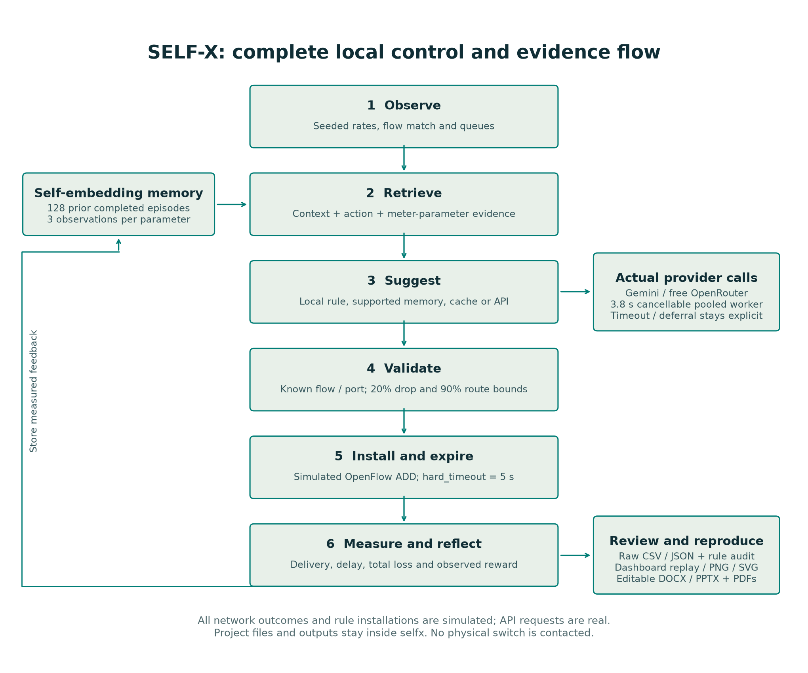

# SELF-X System Architecture and Engineering Navigation

> **Comprehensive Reference for the Autonomous SDN Flow-Management Agent, Loss-Aware Episodic Memory, Bounded Process-Isolated Control Deadlines, and Two-Path Fluid Network Simulation**  
> *Course Project — EC466: Software Defined Networks | Team ID: SDN_07*

---

## 📌 Architectural Scope and Execution Boundaries

SELF-X is an autonomous SDN flow management system that observes real-time network traffic, queries an episodic memory store of past state-action-outcome experiences, evaluates LLM proposals within strict wall-clock deadlines, validates candidate rules through an independent deterministic safety gate, installs simulated OpenFlow 1.3 flow/meter table interventions, and stores measured counterfactual rewards.

All production files, execution environments, test scripts, and benchmark outputs reside strictly within `selfx/`. The validated runtime on Windows utilizes a two-path finite-buffer fluid network simulation model. Real external calls to Google Gemini and OpenRouter free models supply live decision suggestions under a 3.8-second process-isolated wait budget. The local OpenFlow rule table is fully simulated with 5-second hard timeouts matching virtual observation cycles.

---

## 🧠 Comprehensive Mindmap Flows

### 1. System Components & Subsystem Hierarchy Mindmap

```mermaid
flowchart TD
    ROOT["SELF-X Architectural Hierarchy"]
    
    ROOT --> INGESTION["1. Telemetry Ingestion Subsystem"]
    ROOT --> EPISODIC["2. Loss-Aware Episodic Memory Subsystem"]
    ROOT --> REASONING["3. Hybrid Decision & Provider Subsystem"]
    ROOT --> SAFETY["4. Independent Deterministic Safety Gate"]
    ROOT --> SWITCHING["5. Simulated OpenFlow 1.3 Switching Engine"]
    ROOT --> SIMULATION["6. Finite-Buffer Fluid Network Simulation"]
    ROOT --> REWARD["7. Counterfactual Reward & Reflection"]
    ROOT --> BENCHMARKS["8. Paired Benchmark & Statistical Pipeline"]
    ROOT --> WEB["9. Review, Replay & Dashboard Subsystem"]
    
    INGESTION --> TELE_RATES["Offered Rates: Primary (p), Alternate (a), Elephant (e)"]
    INGESTION --> TELE_QUEUES["Persistent Queue Occupancies: Q_primary, Q_alternate"]
    INGESTION --> TELE_FEATURES["8-Dimensional Normalized Feature Embedding Vector"]
    
    EPISODIC --> MEM_REGIME["Regime Partitioning: Sign of Congestion Margins"]
    EPISODIC --> MEM_CALIPER["Caliper Filtering: Primary <= 0.12, Queues <= 0.51"]
    EPISODIC --> MEM_KERNEL["Exponential Distance & Recency Kernel Weighting"]
    EPISODIC --> MEM_CLUSTER["Headroom Parameter Clustering: 0.0, 0.1, 0.3 Mbps"]
    EPISODIC --> MEM_PRUNING["Cell-Based Stratified Retention (Max 6/cell, Limit 128)"]
    
    REASONING --> REASON_BYPASS["Tier 1: Healthy Bypass (Zero Queues, Fits Capacity)"]
    REASONING --> REASON_MEMORY["Tier 2: Supported Memory Policy (Support >= 3, Lower Bound > 0.005)"]
    REASONING --> REASON_CACHE["Tier 3: Exact-Context Action Cache (64 Slots, 12-Cycle TTL)"]
    REASONING --> REASON_DEADLINE["Tier 4: DeadlineProvider (Spawned Process, 3.8s Budget)"]
    REASONING --> REASON_FALLBACK["Tier 5: Deterministic Capacity-Aware Fallback Heuristic"]
    
    SAFETY --> SAFE_RATE["Rate Limit Rule: Flow Drop <= 20% (with +1 kbps Repair)"]
    SAFETY --> SAFE_ROUTE["Reroute Rule: Target Link Projected Load <= 90%"]
    SAFETY --> SAFE_FLOOR["Minimum Rate Limit Ceiling >= 512 kbps"]
    SAFETY --> SAFE_DISPATCH["Silent Fail-Closed Veto -> Default to no_op"]
    
    SWITCHING --> OF_ADD["ADD Flow-Mod (Match: in_port=1, dst=10.0.0.8, Priority=100)"]
    SWITCHING --> OF_METER["METER Entry (KBPS Flag, DROP Band, rate_limit_kbps)"]
    SWITCHING --> OF_TIMEOUT["hard_timeout = 5s (Synchronized with Control Cycle)"]
    SWITCHING --> OF_RESTORE["Automatic Rule Expiry & Baseline Port 2 Restoration"]
    
    SIMULATION --> FLUID_PATHS["Two Fixed-Capacity Logical Paths (C = 10 Mbps each)"]
    SIMULATION --> FLUID_BUFFERS["Two Persistent Finite Buffers (B = 0.5 Mbit each)"]
    SIMULATION --> FLUID_INTEGRAL["Piecewise-Linear Queue Area Integration"]
    SIMULATION --> FLUID_CONSERVE["Conservation Law: Q_prev + Offered = Delivered + Dropped + Q_next"]
    
    REWARD --> REWARD_PAIRED["Paired Same-Window Counterfactual no_op Baseline"]
    REWARD --> REWARD_WEIGHTS["Normalized Weights: Latency (-0.4), Tput (+0.4), Loss (-0.2)"]
    REWARD --> REWARD_REFLECT["Deterministic & Semantic LLM Reflection Engine"]
    
    BENCHMARKS --> BENCH_GRID["8 Scenarios x 10 Seeds x 9 Controllers = 86,400 Windows"]
    BENCHMARKS --> BENCH_BOOT["4,000-Draw Paired Seed Percentile Bootstrap"]
    BENCHMARKS --> BENCH_ATLAS["17-Page Benchmark Vector Figure Atlas (PNG/SVG)"]
    
    WEB --> WEB_SERVER["Standard-Library Loopback Server (app.py, Port 8766)"]
    WEB --> WEB_REPLAY["Interactive Rule Demo & Step-by-Step State Inspector"]
    WEB --> WEB_SECURITY["Same-Origin Isolation & Allowlist-Only Static Assets"]
```



### 2. Decision Routing & Fallback Taxonomy Mindmap

```
+-- [SELF-X Decision Routing & Fallback Taxonomy Mindmap]
    |-- Input Observation (Offered Rates, Buffers, Flow Signatures)
    |-- Fast Path Evaluations
    |   |-- Healthy Bypass Check
    |   |   |-- Condition: p + e <= Capacity AND max(queues) == 0.0
    |   |   `-- Action: no_op (Origin: 'healthy_bypass', Delay: < 0.1 ms)
    |   |-- Supported Episodic Memory Check
    |   |   |-- Condition: action == rate_limit, candidate support >= 3, lower bound > 0.005
    |   |   `-- Action: Rebuilt Parameter Meter (Origin: 'episodic_memory', Delay: < 0.5 ms)
    |   `-- Exact-Context Cache Check
    |       |-- Condition: Exact state match in 64-entry cache AND cycle_delta <= 12
    |       `-- Action: Cached Action (Origin: 'api_cache' | 'local_rule_cache', Delay: < 0.2 ms)
    |-- Slow Path: Live LLM Suggestion
    |   |-- Subprocess Worker Dispatch (DeadlineProvider)
    |   |   |-- Pacing Admission: Enforce >= 4.2s inter-request gap
    |   |   |-- Worker Execution: Subprocess with persistent HTTPS session
    |   |   `-- Poll Deadline: Timeout budget = 3.8 seconds
    |   |-- Provider Outcomes:
    |   |   |-- Valid JSON Response -> Synthesize flow parameters -> Safety Validate
    |   |   |-- Local Deadline Timeout -> Kill child process -> Fallback Heuristic
    |   |   |-- Pacing Deferral -> Avoid queue overload -> Fallback Heuristic
    |   |   `-- Provider HTTP Error -> Catch ProviderError -> Fallback Heuristic
    `-- Safety Gate Dispatch
        |-- Valid Action -> Install in Simulated OpenFlow Table
        `-- Invalid Action -> Safety Veto -> Fallback to no_op
```

---

## 🎨 Detailed ASCII Architectural Flows

### 1. Complete End-to-End Control and Evidence Pipeline Flow



```
====================================================================================================
                               SELF-X COMPLETE CONTROL PIPELINE FLOW
====================================================================================================

      [Traffic Demand Trace]                 [FluidNetwork Simulator]
      - Seeded 5-second windows               - Path 1: Primary (C=10M, B=0.5M)
      - p: Primary background (Mbps)          - Path 2: Alternate (C=10M, B=0.5M)
      - a: Alternate background (Mbps)        - Persistent Queues: Q1, Q2 (Mbit)
      - e: Elephant flow burst (Mbps)                    |
                 |                                       |
                 +-------------------+-------------------+
                                     |
                                     v
                       [Step 1: State Summarizer]
                       - Embedding features: [p/C, a/C, e/C, Q1/B, Q2/B, (p+e)/C]
                       - Feasibility margins: (p+e-C), (a+e-0.9C), (p+0.8e-C)
                       - Congestion regime: (Margin_p > 0, Margin_a > 0, Margin_m > 0)
                                     |
                                     v
                       [Step 2: Episodic Retrieval]
                       - LossAwareMemory (Up to 128 preserved episodes)
                       - Caliper distance filter & exponential recency weighting
                       - Candidate headroom uncertainty: 0.0, 0.1, 0.3 Mbps
                                     |
                                     v
                       [Step 3: Decision Arbiter]
                                     |
        +----------------------------+----------------------------+
        |                            |                            |
  [Healthy Bypass]          [Supported Memory]            [Cache Hit]
  p + e <= C & Q == 0       Support >= 3 & LCB > 0.005    Exact Context Match
  -> no_op                  -> Rebuilt Meter              -> Cached Action
        |                            |                            |
        +----------------------------+----------------------------+
                                     | (If all fast paths miss)
                                     v
                       [Step 4: Deadline Provider]
                       - Fork/Spawn isolated child worker
                       - Pacing check (>= 4.2s gap for Gemini, >= 3.1s for OpenRouter)
                       - 3.8-second strict poll deadline
                       - Reusable HTTPS session pool
                                     |
                                     +-------------------------------+
                                     |                               |
                             [Valid API Result]            [Timeout / Error]
                             Compact JSON action           Kill child process
                                     |                               |
                                     v                               v
                       [Step 5: Safety Verification]   [Deterministic Fallback]
                       - Rate drop <= 20% (+1 kbps)    Capacity-aware policy
                       - Link utilization <= 90%                     |
                       - Rate floor >= 512 kbps                      |
                                     |                               |
                                     +---------------+---------------+
                                                     |
                                                     v
                                      [Step 6: Simulated Switch]
                                      - Expire previous cycle's rule
                                      - Install ADD rule (Priority 100)
                                      - Instructions: METER + OUTPUT 2/3
                                      - Hard timeout = 5 seconds
                                                     |
                                                     v
                                      [Step 7: Fluid Integration]
                                      - Advance simulation by T = 5s
                                      - Compute delivered volume & delay
                                      - Measure buffer drops & meter drops
                                                     |
                                                     v
                                      [Step 8: Counterfactual Reward]
                                      - Evaluate same-window no_op baseline
                                      - r = -0.4*dL/50 + 0.4*dT/5000 - 0.2*dLoss/20
                                      - Record semantic & deterministic reflection
                                                     |
                                                     v
                                      [Step 9: Memory Update & Pruning]
                                      - Append episode tuple to memory store
                                      - Stratified cell pruning (max 6 / cell)
                                      - Persist audit to trace.jsonl
====================================================================================================
```

### 2. Parent Controller & Subprocess Reusable Worker IPC Architecture

```
+==================================================================================================+
|                                    INTER-PROCESS COMMUNICATION (IPC)                             |
|                                                                                                  |
|   PARENT CONTROLLER PROCESS (Main Control Loop)             CHILD WORKER SUBPROCESS (Spawned)    |
|   ---------------------------------------------             ---------------------------------    |
|                                                                                                  |
|   +-------------------------------------------+                                                  |
|   | 1. BoundedController.decide()             |                                                  |
|   |    - Evaluates fast-path heuristics       |                                                  |
|   |    - If miss, initiates LLM request       |                                                  |
|   +-------------------------------------------+                                                  |
|                         |                                                                        |
|   +-------------------------------------------+                                                  |
|   | 2. Pacing Admission Check                 |                                                  |
|   |    - Enforces gap: monotonic() - last >= 4.2s                                                |
|   |    - If gap > budget - 1.25s -> DEFER     |                                                  |
|   +-------------------------------------------+                                                  |
|                         |                                                                        |
|   +-------------------------------------------+                                                  |
|   | 3. Pipe Connection Dispatch               |                                                  |
|   |    - connection.send(messages)            |============ multiprocessing.Pipe() =============>|
|   +-------------------------------------------+                        |                         |
|                         |                                              v                         |
|   +-------------------------------------------+             +----------------------------------+ |
|   | 4. Monitor Loop with Strict Deadline      |             | 5. Process Request               | |
|   |    - deadline = started + 3.8 seconds     |             |    - Set Gap = 0                 | |
|   |    - poll(0.05s slice)                    |             |    - Send: 'request_started'     | |
|   +-------------------------------------------+             |    - Post HTTPS Request          | |
|                         |                                   |    - Parse ActionChoice JSON     | |
|                         |<========== 'request_started' =====+----------------------------------+ |
|                         |                                              |                         |
|       +-----------------+-----------------+                            |                         |
|       | (Case A: Result Within 3.8s)      | (Case B: Timeout)          |                         |
|       v                                   v                            v                         |
|   +-----------------------+           +-----------------------+     +--------------------------+ |
|   | 6a. Receive 'result'  |           | 6b. Timeout Exceeded  |     | 7. Return Result Payload | |
|   |     Extract decision  |           |     Terminate Child   |     |    Send: 'result'        | |
|   |     Keep worker idle  |           |     Process.kill()    |====>|    Choice & Audit Logs   | |
|   |     Preserve session  |           |     Join & Clean Up   |     +--------------------------+ |
|   +-----------------------+           |     Raise Exception   |                                  |
|                                       +-----------------------+                                  |
+==================================================================================================+
```

### 3. Finite-Buffer Fluid Simulation Queue Integral & Saturation Dynamics

```
Queue Level
  ^
B |-----------------------------------------------------+  <- Buffer Ceiling (0.5 Mbit)
  |                                 /==================/|
  |                                /  Overflow Drop    /|  <- Dropped Volume = Net * (T - t_sat)
  |                               /====================/|
  |                              /                      |
  |                             /                       |
  |                            /                        |
  |                           /                         |
  |                          /                          |  <- Piecewise Linear Growth:
  |                         /                           |     dQ/dt = Net = (Admitted - C)
  |                        /                            |
Q0|                       /                             |  <- Initial Queue from Previous Window
  |                      /                              |
  |                     /                               |
  |                    /                                |
0 +-------------------+---------------------------------+--> Time (s)
  0                   t_sat                             T (5.0s)

Mathematical Formulations:
1. Saturation Time:       t_sat = (B - Q0) / (Admitted - C)
2. Final Queue:           Q_next = min(B, max(0.0, Q0 + Net * T))
3. Buffer Overflow:       Overflow = max(0.0, Q0 + Net * T - B)
4. Delivered Volume:      Delivered = Q0 + Admitted * T - Q_next - Overflow
5. Piecewise Queue Area:  Area = Integral[0 to T] Q(t) dt
                          = 0.5 * (Q0 + B) * t_sat + B * (T - t_sat)
6. Average Queue Depth:   Q_avg = Area / T
7. Modeled Path Delay:    Delay_i = 8.0 ms + (1000.0 * Q_avg / C) ms
```

### 4. Binary Floating-Point 20% Guard Boundary Condition and +1 kbps Repair

```
====================================================================================================
                        20% FLOW-DROP GUARD BOUNDARY & REPAIR
====================================================================================================

Problem Context:
- Elephant flow rate e = 8.06 Mbps (8060 kbps).
- The maximum permissible throttling is exactly 20.0%:
    Allowed Cap = 0.80 * 8060 kbps = 6448.0 kbps.
- In binary floating-point arithmetic (IEEE 754 double precision):
    e * 1000 = 8060.0
    cap = 0.80 * 8.06 = 6.448
    ceil(cap * 1000) = 6448 kbps
- Guard dropped percentage calculation:
    dropped_pct = 100.0 * (8060.0 - 6448) / 8060.0
                = 100.0 * 1612.0 / 8060.0
                = 20.000000000000004%  (Binary subtraction precision artifact!)
- Guard Condition:
    if dropped_pct > 20.0:  --> Evaluates to TRUE! (Vetoed incorrectly as unsafe!)

Engineered Solution in `loss_aware_memory.py`:
```python
# Check if binary rounding caused dropped percentage to exceed 20%
if 100.0 * (e * 1000 - d.rate_limit_kbps) / (e * 1000) > 20.0:
    d.rate_limit_kbps += 1  # Admit exactly 1 extra kbps: 6449 kbps
```
Outcome:
- With rate_limit_kbps = 6449:
    dropped_pct = 100.0 * (8060 - 6449) / 8060 = 19.98759% <= 20.0%
- Result: Perfectly satisfies the strict, independent, unmodified safety guard!
====================================================================================================
```

---

## 🏛️ Comprehensive Subsystem Specifications

### 1. Telemetry & Ingestion Subsystem (`metrics.py`, `eval/simulator.py`)
- **Cumulative Counter Ingestion**: Interacts with OpenFlow counters via `get_state()`. Computes interval deltas divided by window length ($T = 5.0\text{ s}$).
- **Flow Key Indexing**: Uniquely indexes flows by `(dpid, match_items, priority, table_id)`. Detects resets and flow reinstalls.
- **Port Utilization Engine**: Computes normalized transmit byte rates against configured link capacity ($C = 10\text{ Mbps}$).
- **State Vector Embedding (`embedding.py`)**: Transforms raw state into an 8-dimensional normalized unit vector:
  $$\vec{v} = \left[ \frac{p}{C},\, \frac{a}{C},\, \frac{e}{C},\, \frac{p+e-C}{C},\, \frac{a+e-0.9C}{C},\, \frac{p+0.8e-C}{C},\, \frac{Q_1}{B},\, \frac{Q_2}{B} \right]$$
  Vectors are normalized by Euclidean magnitude: $\hat{v} = \frac{\vec{v}}{\|\vec{v}\|_2}$.

### 2. Loss-Aware Episodic Memory Subsystem (`loss_aware_memory.py`)
- **Storage Boundary**: Maximum capacity of 128 completed episodes. Retains parameter-conditioned records with actual headroom selection ($h \in \{0.0, 0.1, 0.3\}\text{ Mbps}$).
- **Stratified Pruning**: Buckets records into cells defined by:
  $$\text{Cell Key} = \left( \text{action},\, \text{headroom},\, \text{regime},\, \text{round}\left(\frac{\vec{v}_{[:3]}}{0.12}\right) \right)$$
  Retains the most recent 6 episodes per cell, discarding oldest entries to preserve behavioral and operational diversity.
- **Caliper Neighborhood & Kernel Distance**:
  $$\text{dist}^2 = \sum_{i=1}^6 (\Delta v_i)^2 + 0.08 \sum_{j=7}^8 (\Delta v_j)^2$$
  $$w = \exp\left(-\frac{\text{dist}^2}{0.02}\right) \times \exp\left(-\frac{\text{cycle} - \text{cycle}_{\text{ep}}}{120}\right)$$
- **Uncertainty Margin & Selection**:
  $$\text{LCB}(h) = \hat{\mu}_h - 1.96 \sqrt{\frac{\hat{\sigma}_h^2}{N_h}} - 0.002$$
  Requires $N_h \ge 3$ neighboring episodes for supported candidate selection.

### 3. Hybrid Control & Deadline Subsystem (`bounded_control.py`, `deadline_provider.py`)
- **Process Isolation**: Spawns isolated worker processes via Python `multiprocessing.get_context('spawn')` to decouple LLM network socket timeouts from the SDN controller loop.
- **Budget Allocation**: Total parent wait budget of 3.8 seconds. Allocates $\ge 1.0\text{ s}$ for network transport and $0.25\text{ s}$ for IPC termination/joining.
- **Pacing Engine**: Enforces strict inter-request pacing ($4.2\text{ s}$ for Gemini, $3.1\text{ s}$ for OpenRouter) to prevent cloud provider rate-limit throttling (HTTP 429).
- **Exact-Context Action Cache**: 64-entry LRU cache with a 12-window TTL. Validates signatures across offered rates, buffers, ports, and queue depths.

### 4. Independent Deterministic Safety Gate (`safety.py`)
- **Rate-Limit Guard**: Rejects any proposal where:
  $$\text{Drop \%} = 100 \times \frac{e - \text{rate\_limit\_kbps}}{e} > 20.0\% \quad \text{or} \quad \text{rate\_limit\_kbps} < 512\text{ kbps}$$
- **Reroute Guard**: Rejects any proposal where:
  $$\text{Projected Utilization} = 100 \times \frac{a + e}{C_{\text{alt}}} > 90.0\%$$
- **Fail-Closed Semantics**: If any check fails, the proposal is vetoed and converted to `no_op` for the cycle.

### 5. Switching & Rule Lifecycle Engine (`rule_demo.py`)
- **Rule Construction**: Generates OpenFlow 1.3 `OFPFC_ADD` messages with priority 100 and `hard_timeout = 5`.
- **Instruction Sets**:
  - `reroute`: `APPLY_ACTIONS` $\to$ `OUTPUT: port 3`
  - `rate_limit`: `METER: meter_id` $\to$ `APPLY_ACTIONS` $\to$ `OUTPUT: port 2`
  - `no_op`: Default forwarding on primary `OUTPUT: port 2` (no rule installed)
- **Automatic Teardown**: Rules expire deterministically after 5 virtual seconds, returning the switch to default behavior.

---

## 📁 Repository Directory Structure

```
selfx/
├── agent/                          # Core agent cognitive modules
│   ├── adaptive_memory.py          # Action-conditioned magnitude-preserving memory
│   ├── bounded_control.py          # Bounded controller & decision pipeline
│   ├── deadline_provider.py        # Subprocess worker isolation & deadline enforcement
│   ├── embedding.py                # Transparent state vector embeddings & cosine similarity
│   ├── fast_control.py             # Compact structured prompt controller
│   ├── graph.py                    # LangGraph state machine & single-cycle invocation
│   ├── guarded_memory.py           # Feasibility-guarded memory store
│   ├── loss_aware_memory.py        # Parameter-conditioned memory & 20% rounding repair
│   ├── memory.py                   # Flat JSON episodic memory & reward pruning
│   ├── metrics.py                  # Counter deltas, throughput, loss, & port utilizations
│   ├── prompts.py                  # Structured prompts for decision and reflection
│   ├── providers.py                # Direct REST clients for Gemini & OpenRouter
│   ├── reward.py                   # Normalized multi-objective reward calculation
│   ├── rule_demo.py                # Simulated OpenFlow 1.3 rule lifecycle & expiry engine
│   └── schemas.py                  # Pydantic v2 schemas for structured outputs
├── docs/                           # Comprehensive documentation & guides
│   ├── ARCHITECTURE.md             # Complete architectural reference & flow diagrams
│   ├── ARCHITECTURE.Rmd            # R Markdown edition of architecture reference
│   ├── BENCHMARKS.md               # Revision 2 benchmark suite & protocol
│   ├── BENCHMARKS_V3.md            # Revision 3 adaptive memory & latency evaluation
│   ├── BENCHMARKS_V4.md            # Revision 4 benchmark protocol, repairs, & results
│   ├── EXPERIMENTS.md              # Experimental design, equations, & conservation laws
│   ├── PROJECT_GUIDE.md            # Researcher, evaluator, & demonstration guide
│   └── RULE_DEMO.md                # Interactive rule demo & replay walkthrough
├── eval/                           # Evaluation harnesses & benchmark runners
│   ├── build_rule_demo.py          # 120-window offline exploration trace builder
│   ├── run_ablation.py             # Mininet live-testbed ablation harness (A0/A1/A2)
│   ├── run_adaptive_benchmarks.py  # Revision 3 held-out benchmark runner
│   ├── run_benchmarks.py           # Revision 2 multi-scenario evaluation harness
│   ├── run_simulation.py           # 5-controller portable simulation runner
│   ├── run_v4_benchmarks.py        # Revision 4 primary benchmark suite (86,400 windows)
│   ├── run_v4_latency.py           # Live provider wall-clock latency evaluation
│   └── simulator.py                # Finite-buffer two-path fluid network simulator
├── scripts/                        # Build, verification, and visual generation scripts
│   ├── build_v4_artifacts.py       # Generates charts, report, atlas, and manifest
│   ├── render_architecture.py      # Matplotlib renderer for architecture diagrams
│   └── verify_v4_submission.py     # Rigorous submission integrity & math verification
├── tests/                          # Dependency-light unit and integration test suite
│   ├── test_adaptive_control.py    # Tests for adaptive memory & decision rules
│   ├── test_benchmarks.py          # Tests for benchmark harnesses & metrics
│   ├── test_core.py                # Core tests for safety, schemas, and metrics
│   └── test_v4_control.py          # Tests for deadline provider, worker reuse, & repairs
├── web/                            # Public loopback web dashboard assets
│   ├── index.html                  # Single-page dashboard interface
│   ├── app.js                      # UI logic, chart rendering, & experiment triggers
│   └── rule-demo.js                # Interactive rule lifecycle & replay visualizer
├── app.py                          # Loopback HTTP server (ports 8765 / 8766)
├── config.py                       # Unified system configuration knobs
├── latency_probe.py                # Mininet live ping RTT probe
├── ryu_client.py                   # Ryu ofctl_rest REST API client
├── safety.py                       # Hard-coded deterministic safety check
├── topo.py                         # Mininet 4-switch 8-host topology definition
└── traffic_gen.py                  # Seeded iperf3 traffic workload generator
```
