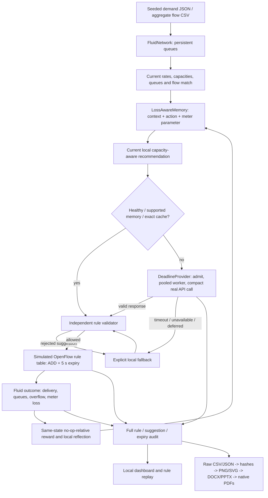

# SELF-X architecture and navigation

## Goal and execution boundary

Observe generated traffic, retrieve completed experiences, propose an action, validate a bounded rule, measure and store feedback. All code, traffic and outputs are inside selfx. The validated Windows backend is a two-path finite-buffer fluid model. Actual Gemini/free OpenRouter calls supply suggestions; the local rule table is simulated.

## Entry points

| Entry | Purpose |
|---|---|
| setup.ps1 | Create isolated .venv and install project dependencies |
| run.ps1 all | Tests, full normal project experiment and primary benchmarks |
| run.ps1 dashboard -Port 8766 | Loopback website and saved rule replay |
| eval/run_simulation.py | Five-controller normal runner, offline or named provider |
| eval/run_v4_benchmarks.py | Eight-scenario/nine-controller paired network evaluation |
| eval/run_v4_latency.py | Real API timing, rule lifecycle, traffic schedule |
| eval/build_rule_demo.py | 120-window exploration-to-memory demonstration |
| scripts/build_v4_artifacts.py | Graphs, editable report, atlas and chart data |
| scripts/build_v4_presentation.mjs | Editable native charts/tables in Artifact Session |
| scripts/verify_v4_submission.py | Data, artifact, browser and credential checks; ZIP |

## Complete flow

## Topology and rule behavior

Primary: s1 port 2 → s2 → s4. Alternate: s1 port 3 → s3 → s4. Each path: 10 Mbps and 0.5 Mbit buffer. One elephant begins on primary each five-second window. Known flow match: in_port=1, eth_type=2048, ipv4_dst=10.0.0.8. A reroute outputs port 3; a meter uses METER plus OUTPUT 2. Rules have priority 100 and hard_timeout=5. At the next virtual observation the previous intervention expires; final expiry restores default forwarding and no active intervention.

## Memory and attribution

Capacity-scaled demand, three feasibility margins and queues retain magnitude. Only completed cycles train the 128-episode memory. Meter candidates have 0/0.1/0.3 Mbps headroom, clipped to unchanged safety limits; three prior observations per candidate are needed for supported selection. Context vectors are cached and retention is diversified by action, parameter and regime. H2 has the same meter without memory; H1 has the old fixed 80% cap. The primary suite improves on H1 loss/reward, but does not establish extra reward benefit over H2.

## Provider and filesystem boundary

Keys load from ignored .env; execution uses .venv. Only configured provider endpoints receive generated traffic summaries. OpenRouter permits the free router or :free IDs. A 3.8-second parent wait budget includes pacing, worker startup, IPC and termination/join. Completed requests leave an idle reusable HTTPS worker; timeouts terminate it, and final-cycle cleanup is measured. No pending API work is moved outside timing. Provider responses and local cache/fallback origins remain distinct.

The dashboard binds loopback and serves a fixed allowlist. /api/rule-demo accepts gemini, openrouter or offline and returns saved bounded records. Replay sends no new API request. /api/run is same-origin guarded and creates bounded offline experiments. No arbitrary project files or keys are served.

## Data lineage and artifacts

Current raw data: output/benchmarks/v4. Primary seeds 1900–1909; final provider seeds 1980/1981. Diagnostics 1920/1921, 1940/1941 and 1960/1961 are retained separately. Primary traffic has SHA256 hashes and 9,600 aggregate CSV records. Graph manifest hashes CSV, JSON and runtime sources. Native DOCX and PPTX remain editable; actual Word/PowerPoint export creates their PDFs. The 17-page atlas includes every current graph. Verification produces output/verification.json and a credential-free source/evidence ZIP. Old v2/v3 evidence is preserved.

See [benchmark protocol](BENCHMARKS_V4.md), [rule demo](RULE_DEMO.md) and [README](../README.md) for results and commands. The original Linux testbed remains a separate adapter requiring independent packet/network validation.
