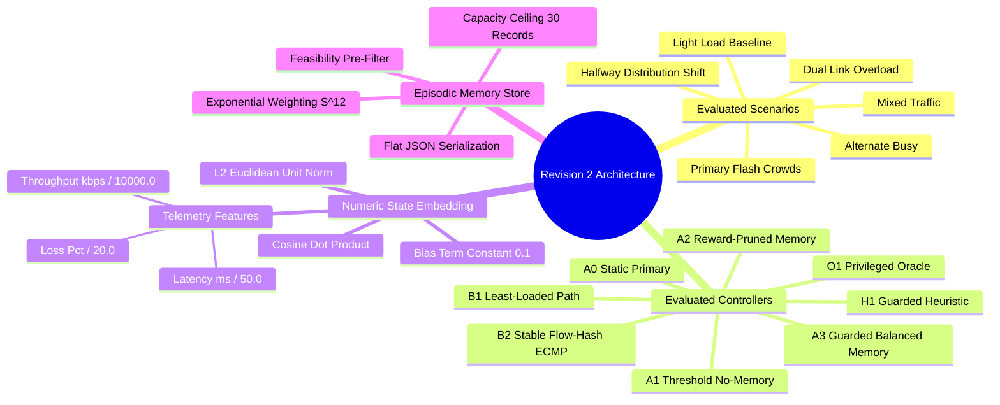
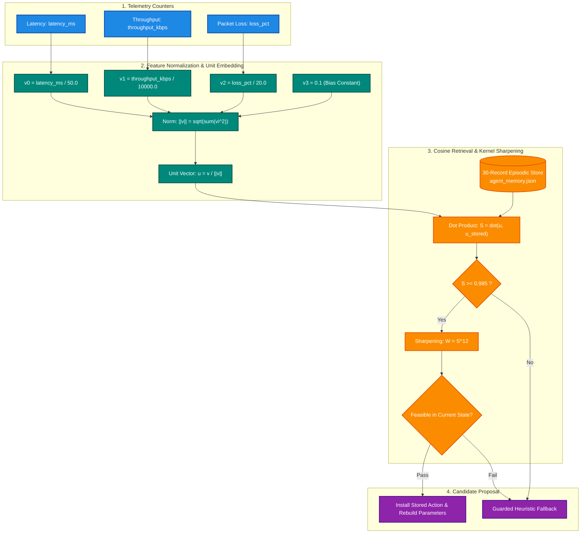

# Revision 2 Enhanced Benchmarks and Retrospective Specification

> **Empirical Architecture for Transparent Numeric State Embeddings, ECMP Flow Hashing, Feasibility-Guarded Retrieval, Implementation Code Snippets, and Historical Lineage**  
> *Course Project — EC466: Software Defined Networks | Team ID: SDN_07*

---

## 📌 Executive Overview & Research Lineage

The **Revision 2 Benchmark Suite** represents the historical foundation of the SELF-X empirical framework. It evaluated 57,600 analytical simulation windows across 6 distinct traffic scenarios, 10 paired seeds (1740 to 1749), and 8 controller configurations.

Revision 2 introduced three fundamental architectural concepts:
1. **Deterministic Numeric State Embeddings**: Replaced opaque vector embeddings with a transparent 4-element L2-normalized feature vector derived directly from telemetry counters.
2. **Deterministic Cosine Similarity Retrieval**: Filtered past episodic transitions using a high-precision cosine cutoff ($S \ge 0.985$) with exponential distance sharpening ($S^{12}$).
3. **Safety Gate Arbitration**: Demonstrated why open-loop LLM proposals and static ECMP hashing fail without downstream physical invariant checking.

---

## 🧠 Colourful Benchmark Mindmaps

### 1. Revision 2 Architectural Mindmap



---

### 2. State Embedding & Memory Ranking Pipeline



---

## 🎨 Detailed ASCII Formulation Flows

### 1. Normalized 3-Feature State Embedding & Cosine Similarity Flow

```
Raw Network Counters: [ Latency: 24.5 ms, Throughput: 8500 kbps, Loss: 4.2% ]
                                    |
                                    v
     +--------------------------------------------------------------+
     | Feature Scaling & Normalization:                             |
     | v[0] = 24.5 / 50.0   = 0.4900                                |
     | v[1] = 8500 / 10000  = 0.8500                                |
     | v[2] = 4.2 / 20.0    = 0.2100                                |
     | v[3] = Bias constant = 0.1000                                |
     +--------------------------------------------------------------+
                                    |
                                    v
     +--------------------------------------------------------------+
     | Euclidean L2 Norm Calculation:                               |
     | ||v|| = sqrt(0.49^2 + 0.85^2 + 0.21^2 + 0.10^2) = 1.0083    |
     | Normalized Vector: [ 0.4859, 0.8430, 0.2083, 0.0992 ]       |
     +--------------------------------------------------------------+
                                    |
                                    v
     +--------------------------------------------------------------+
     | Cosine Similarity against Stored Episodic Vectors:           |
     | Cosine(Query, Memory_k) = sum(Query_i * Memory_ki)           |
     | If Cosine >= 0.985: Admitted into candidate set              |
     | Weight = (Cosine)^12 (Exponentially amplifies nearest match) |
     +--------------------------------------------------------------+
```

---

### 2. B2 Stable ECMP Hashing vs Dynamic Safety Gate Flow

```
Incoming Packet Flow: [ IPv4 Src: 10.0.0.1, Dst: 10.0.0.8, Protocol: UDP ]
                                    |
                                    v
     +--------------------------------------------------------------+
     | RFC 2992 Stable Equal-Cost Multipath Hash (B2):              |
     | Hash = CRC32(Src_IP, Dst_IP, Protocol) % 2                   |
     +--------------------------------------------------------------+
                                    |
                    +---------------+---------------+
                    | Hash == 0                     | Hash == 1
                    v                               v
         [Target: Primary Port 2]        [Target: Alternate Port 3]
                    |                               |
                    +---------------+---------------+
                                    |
                                    v
     +--------------------------------------------------------------+
     | Dynamic Safety Gate Validation:                              |
     | Check: Projected alternate link load <= 90% (9000 kbps)      |
     +--------------------------------------------------------------+
                    |                               |
          (Safe: Load <= 90%)             (Unsafe: Load > 90%)
                    |                               |
                    v                               v
           [Install Flow-Mod]              [SAFETY VETO!]
           Forward to Hash Port            Veto action -> Default to Port 2
                                           (Result: 2,585 Vetoes in Suite!)
```

---

## 💻 Core Implementation Code Walkthrough

### 1. Transparent Embedding Engine ([`agent/embedding.py`](file:///c:/Users/RAVIPRAKASH/SDN/SDN/selfx/agent/embedding.py))

```python
# File: selfx/agent/embedding.py
import math

def embed_state(state: dict) -> list[float]:
    """Compute transparent L2-normalized embedding vector without neural networks."""
    if "embedding_features" in state:
        values = state["embedding_features"]
    else:
        values = [
            state.get("latency_ms", 0.0) / 50.0,
            state.get("throughput_kbps", 0.0) / 10000.0,
            state.get("loss_pct", 0.0) / 20.0,
        ]
    # Append constant bias to prevent division by zero on idle states
    vector = [float(v) for v in values] + [0.1]
    
    if not all(math.isfinite(v) for v in vector):
        raise ValueError("embedding features must be finite")
        
    norm = math.sqrt(sum(v * v for v in vector))
    return [v / norm for v in vector]

def cosine(a: list[float], b: list[float]) -> float:
    """Compute dot product cosine similarity between two unit vectors."""
    return sum(x * y for x, y in zip(a, b)) if len(a) == len(b) else 0.0
```

---

### 2. Balanced Episodic Memory Selection ([`agent/memory.py`](file:///c:/Users/RAVIPRAKASH/SDN/SDN/selfx/agent/memory.py))

```python
# File: selfx/agent/memory.py
def prune_and_balance_memory(records: list[dict], max_entries: int = 30) -> list[dict]:
    """Maintain balanced memory store preserving recency, highest rewards, and failures."""
    if len(records) <= max_entries:
        return records

    # Sort by reward descending
    sorted_by_reward = sorted(records, key=lambda r: r["reward"], reverse=True)
    
    # 10 highest reward episodes (successful adaptations)
    top_positives = sorted_by_reward[:10]
    
    # 5 lowest reward episodes (instructive negative examples)
    negatives = sorted_by_reward[-5:]
    
    # 15 most recent episodes (temporal locality)
    recent = sorted(records, key=lambda r: r["cycle"], reverse=True)[:15]
    
    # Merge and deduplicate by cycle ID
    seen_cycles = set()
    balanced = []
    for ep in top_positives + negatives + recent:
        if ep["cycle"] not in seen_cycles:
            seen_cycles.add(ep["cycle"])
            balanced.append(ep)
            
    return balanced[:max_entries]
```

---

## 📊 Measured Empirical Results (Revision 2 Suite)

The table below summarizes the 57,600 simulation windows evaluated across seeds 1740–1749:

| Controller ID | Method Label | Delay (ms) | Goodput (Mbps) | Total Loss (%) | Vetoes | Key Finding |
| :--- | :--- | :---: | :---: | :---: | :---: | :--- |
| **A0** | Static Primary Path | 26.003 | 12.904 | 8.162 | 0 | Unmanaged negative baseline |
| **B1** | Feasible Least-Loaded Path | 20.611 | 13.058 | 6.986 | 0 | Standard SDN greedy rerouting |
| **B2** | Stable Flow-Hash ECMP | 23.227 | 12.983 | 7.561 | 2,585 | Hash collisions cause frequent vetoes |
| **A1** | Original Threshold (No Memory) | 17.062 | 12.902 | 7.913 | 0 | Reactive thresholding without memory |
| **A2** | Original Reward-Pruned Memory | 17.554 | 12.848 | 8.349 | 347 | Unchecked memory installs infeasible actions |
| **H1** | Guarded Heuristic | 17.154 | 12.990 | 7.382 | 0 | Fixed 20% rate-limiting baseline |
| **A3** | Guarded Balanced Memory | 17.341 | 12.974 | 7.510 | 0 | Feasibility filter eliminates all vetoes |
| **O1** | Privileged Myopic Oracle | 17.204 | 13.001 | 7.322 | 0 | Single-window counterfactual ceiling |

---

## 🔍 Key Findings & Architectural Evolution

1. **Elimination of Infeasible Proposals**:  
   Adding the deterministic feasibility check in `A3` completely eliminated the 347 safety vetoes observed in `A2`. When an episodic record suggested an action that would violate capacity in the current network state, it was rejected before submission to OpenFlow.
2. **ECMP Brittleness**:  
   Static hash-based routing (`B2`) triggered 2,585 safety vetoes due to hash collisions overloading the alternate link.
3. **Absence of Memory Advantage**:  
   Across the 6 scenarios, `A3` did not establish a statistically significant advantage over the no-memory baseline `H1`. This crucial finding motivated the transition to **magnitude-preserving contexts in Revision 3** and **parameter-conditioned loss-aware memory in Revision 4**.

---

## 🔗 Cross-Reference Navigation

- **Master Portal**: [`README.md`](file:///c:/Users/RAVIPRAKASH/SDN/SDN/README.md)
- **Revision 3 Guide**: [`selfx/docs/BENCHMARKS_V3.md`](file:///c:/Users/RAVIPRAKASH/SDN/SDN/selfx/docs/BENCHMARKS_V3.md)
- **Revision 4 Specification**: [`selfx/docs/BENCHMARKS_V4.md`](file:///c:/Users/RAVIPRAKASH/SDN/SDN/selfx/docs/BENCHMARKS_V4.md)
- **Experimental Formulations**: [`selfx/docs/EXPERIMENTS.md`](file:///c:/Users/RAVIPRAKASH/SDN/SDN/selfx/docs/EXPERIMENTS.md)
- **Evaluator Handbook**: [`selfx/docs/PROJECT_GUIDE.md`](file:///c:/Users/RAVIPRAKASH/SDN/SDN/selfx/docs/PROJECT_GUIDE.md)
