# Revision 2 Enhanced Benchmarks and Visualization Guide

> **Empirical Architecture for Transparent Numeric State Embeddings, ECMP Flow Hashing, and Feasibility-Guarded Retrieval**  
> *Course Project — EC466: Software Defined Networks | Team ID: SDN_07*

---

## 📌 Executive Overview

The **Revision 2 Benchmark Suite** evaluates 57,600 analytical simulation windows across 6 traffic scenarios, 10 paired seeds (1740 to 1749), and 8 controllers. It established the initial foundation for transparent numeric state embeddings, cosine similarity episodic retrieval, and deterministic safety validation within the SELF-X project.

---

## 🧠 Comprehensive Mindmap Flows

### 1. Revision 2 Benchmark Architecture Mindmap

```mermaid
flowchart TD
    ROOT["Revision 2 Benchmark Architecture"]
    
    ROOT --> SCENARIOS["1. 6 Evaluated Scenarios"]
    ROOT --> CONTROLLERS["2. 8 Evaluated Controllers"]
    ROOT --> EMBEDDING["3. Numeric State Embedding"]
    ROOT --> MEMORY["4. Episodic Memory Store"]
    ROOT --> FIGURES["5. Benchmark Figure Suite"]
    
    SCENARIOS --> SC_MIX["Mixed Traffic"]
    SCENARIOS --> SC_FLASH["Primary Flash Crowds"]
    SCENARIOS --> SC_ALT["Alternate Busy"]
    SCENARIOS --> SC_SHIFT["Halfway Distribution Shift"]
    SCENARIOS --> SC_DUAL["Dual Overload"]
    SCENARIOS --> SC_LIGHT["Light Load (Control)"]
    
    CONTROLLERS --> C_A0["A0: Static Primary"]
    CONTROLLERS --> C_B1["B1: Feasible Least-Loaded"]
    CONTROLLERS --> C_B2["B2: Stable Flow-Hash ECMP"]
    CONTROLLERS --> C_A1["A1: Threshold without Memory"]
    CONTROLLERS --> C_A2["A2: Reward-Pruned Embedding Memory"]
    CONTROLLERS --> C_H1["H1: Guarded Heuristic"]
    CONTROLLERS --> C_A3["A3: Guarded Balanced Memory"]
    CONTROLLERS --> C_O1["O1: Privileged Immediate Oracle"]
    
    EMBEDDING --> EMB_VEC["State Vector: [Latency/50, Tput/10000, Loss/20, 0.1]"]
    EMBEDDING --> EMB_NORM["L2 Unit Normalization: v / ||v||"]
    EMBEDDING --> EMB_COS["Cosine Similarity: dot(q, v) >= 0.985"]
    
    MEMORY --> MEM_TOP["Flat JSON Store (Max 30 records)"]
    MEMORY --> MEM_PRUNE["Reward Pruning (Lowest Reward Dropped)"]
    MEMORY --> MEM_BAL["Balanced Selection: Recent + Top + Bottom"]
    
    FIGURES --> FIG_HEAT["Queue Shift Heatmap"]
    FIGURES --> FIG_ECDF["Empirical Delay & Loss Distributions"]
    FIGURES --> FIG_VETO["Action & Veto Breakdown"]
```



### 2. State Embedding & Memory Ranking Mindmap

```
+-- [Revision 2 State Embedding & Memory Ranking Mindmap]
    |-- Transparent State Vector Construction
    |   |-- Feature 1: Normalized latency proxy (latency_ms / 50.0)
    |   |-- Feature 2: Normalized network throughput (throughput_kbps / 10000.0)
    |   |-- Feature 3: Normalized packet loss (loss_pct / 20.0)
    |   `-- Bias Term: Constant 0.1 float to prevent zero-vector division
    |-- Metric Similarity Calculation
    |   |-- L2 Euclidean Normalization: ||v|| = sqrt(sum(v_i^2))
    |   |-- Dot-Product Cosine Similarity: S(a, b) = sum(a_i * b_i)
    |   `-- High-Confidence Threshold: Cosine similarity >= 0.985
    `-- Episodic Memory Storage & Retrieval
        |-- Storage Model: 30-entry flat JSON file
        |-- Ranking: Exponential weighting S^12 favors nearest neighbors
        `-- Feasibility Filter: Infeasible past proposals discarded before installation
```

---

## 🎨 Detailed ASCII Formulation Flows

### 1. Normalized 3-Feature State Embedding & Cosine Similarity Flow

```
Raw Network Counters: [ Latency: 24.5 ms, Throughput: 8500 kbps, Loss: 4.2% ]
                                    |
                                    v
     +--------------------------------------------------------------+
     | Feature Scaling & Normalization:                             |
     | v[0] = 24.5 / 50.0   = 0.4900                                |
     | v[1] = 8500 / 10000  = 0.8500                                |
     | v[2] = 4.2 / 20.0    = 0.2100                                |
     | v[3] = Bias constant = 0.1000                                |
     +--------------------------------------------------------------+
                                    |
                                    v
     +--------------------------------------------------------------+
     | Euclidean L2 Norm Calculation:                               |
     | ||v|| = sqrt(0.49^2 + 0.85^2 + 0.21^2 + 0.10^2) = 1.0083    |
     | Normalized Vector: [ 0.4859, 0.8430, 0.2083, 0.0992 ]       |
     +--------------------------------------------------------------+
                                    |
                                    v
     +--------------------------------------------------------------+
     | Cosine Similarity against Stored Episodic Vectors:           |
     | Cosine(Query, Memory_k) = sum(Query_i * Memory_ki)           |
     | If Cosine >= 0.985: Admitted into candidate set              |
     | Weight = (Cosine)^12 (Exponentially amplifies nearest match) |
     +--------------------------------------------------------------+
```

### 2. B2 Stable ECMP Hashing vs Dynamic Safety Gate Flow

```
Incoming Packet Flow: [ IPv4 Src: 10.0.0.1, Dst: 10.0.0.8, Protocol: UDP ]
                                    |
                                    v
     +--------------------------------------------------------------+
     | RFC 2992 Stable Equal-Cost Multipath Hash (B2):              |
     | Hash = CRC32(Src_IP, Dst_IP, Protocol) % 2                   |
     +--------------------------------------------------------------+
                                    |
                    +---------------+---------------+
                    | Hash == 0                     | Hash == 1
                    v                               v
         [Target: Primary Port 2]        [Target: Alternate Port 3]
                    |                               |
                    +---------------+---------------+
                                    |
                                    v
     +--------------------------------------------------------------+
     | Dynamic Safety Gate Validation:                              |
     | Check: Projected alternate link load <= 90% (9000 kbps)      |
     +--------------------------------------------------------------+
                    |                               |
          (Safe: Load <= 90%)             (Unsafe: Load > 90%)
                    |                               |
                    v                               v
           [Install Flow-Mod]              [SAFETY VETO!]
           Forward to Hash Port            Veto action -> Default to Port 2
                                           (Result: 2,585 Vetoes in Suite!)
```

---

## 📊 Measured Empirical Results (Revision 2 Suite)

Evaluated across seeds 1740–1749 over 6 traffic scenarios:

| Controller ID | Method Label | Delay (ms) | Goodput (Mbps) | Total Loss (%) | Vetoes |
| :--- | :--- | :---: | :---: | :---: | :---: |
| **A0** | Static Primary Path | 26.003 | 12.904 | 8.162 | 0 |
| **B1** | Feasible Least-Loaded Path | 20.611 | 13.058 | 6.986 | 0 |
| **B2** | Stable Flow-Hash ECMP | 23.227 | 12.983 | 7.561 | 2585 |
| **A1** | Original Threshold (No Memory) | 17.062 | 12.902 | 7.913 | 0 |
| **A2** | Original Reward-Pruned Memory | 17.554 | 12.848 | 8.349 | 347 |
| **H1** | Guarded Heuristic | 17.154 | 12.990 | 7.382 | 0 |
| **A3** | Guarded Balanced Memory | 17.341 | 12.974 | 7.510 | 0 |
| **O1** | Privileged Myopic Oracle | 17.204 | 13.001 | 7.322 | 0 |

---

## 🔍 Key Findings from Revision 2
1. **Elimination of Infeasible Proposals**: Adding the deterministic feasibility guard in `A3` completely eliminated the 347 safety vetoes observed in `A2`.
2. **ECMP Brittleness**: Static hash-based routing (`B2`) triggered 2,585 safety vetoes due to hash collisions overloading the alternate link.
3. **Absence of Memory Advantage**: Across the 6 scenarios, `A3` did not establish a statistically significant advantage over the no-memory baseline `H1`, establishing the research imperative for parameter-conditioned memory in Revision 4.
