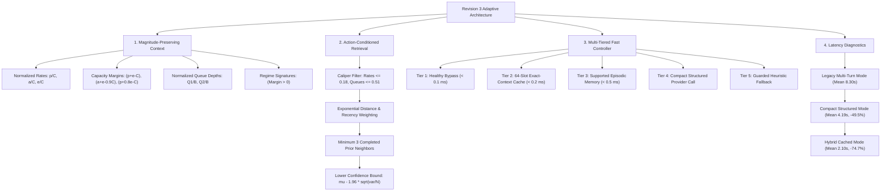

# Revision 3 Adaptive Memory and Latency Benchmarks

> **Empirical Architecture for Magnitude-Preserving State Embeddings, Multi-Tiered Fast Control, and Process Pacing Diagnostics**  
> *Course Project — EC466: Software Defined Networks | Team ID: SDN_07*

---

## 📌 Executive Overview

The **Revision 3 Benchmark Suite** evaluates the introduction of magnitude-preserving state context vectors, action-conditioned advantage estimates, and compact single-call LLM decision loops. It served as the primary algorithmic bridge between early embedding stores (Revision 2) and the parameter-conditioned loss-aware memory architecture (Revision 4).

All network values are derived from a finite-buffer two-path fluid simulation model across 8 scenarios, 10 held-out seeds (1760–1769), and 9 controllers (86,400 windows), paired with real Gemini and OpenRouter provider latency pilots.

---

## 🧠 Comprehensive Mindmap Flows

### 1. Revision 3 Adaptive Memory Architecture Mindmap



### 2. Provider Pacing & Latency Optimization Mindmap

```
+-- [Revision 3 Provider Pacing & Latency Mindmap]
    |-- Latency Bottleneck Identification
    |   |-- Multi-turn conversational overhead: 2 API round-trips per 5s cycle
    |   |-- Process startup & unpooled TLS handshakes: +1.2s per invocation
    |   `-- Provider rate-limiting (HTTP 429) under rapid back-to-back requests
    |-- Engineered Pipeline Solutions
    |   |-- Elimination of second API call: Local deterministic reward & reflection
    |   |-- Compact structured prompt: Pre-computed totals and Boolean feasibility flags
    |   |-- Subprocess worker isolation: 3.8s strict timeout prevents control stalls
    |   `-- Exact-context caching: 12-cycle TTL reuses validated decisions
    `-- Measured Wall-Clock Impact
        |-- Legacy mode: 8.295s mean, 100% deadline misses (24/24)
        |-- Compact mode: 4.189s mean, 0% deadline misses (0/24)
        `-- Hybrid mode: 2.096s mean, 74.7% wall-clock latency reduction
```

---

## 🎨 Detailed ASCII Formulation Flows

### 1. Revision 3 Adaptive Memory Retrieval & Distance Caliper Flow

```
Query Context Vector: [ p/C, a/C, e/C, Margin_P, Margin_A, Margin_M, Q_p/B, Q_a/B ]
                                      |
                                      v
                     +----------------------------------+
                     |  Regime Signature Filter:        |
                     |  (p+e > C, a+e > 0.9C, p+.8e > C)|
                     +----------------------------------+
                                      |
                   +------------------+------------------+
                   | Matches Regime                      | Mismatched Regime
                   v                                     v
      +-------------------------------+             [Skip Episode]
      | Caliper Distance Check:       |
      | max(|Delta_v[:6]|) <= 0.18    |
      | max(|Delta_v[6:]|) <= 0.51    |
      +-------------------------------+
                   |
                   v
      +-------------------------------------------------------------+
      | Distance Metric & Recency Weighting:                        |
      | dist = sum(Delta[:6]^2) + 0.08 * sum(Delta[6:]^2)           |
      | weight = exp(-dist / 0.025) * exp(-(cycle - cycle_ep) / 120)|
      +-------------------------------------------------------------+
                   |
                   v
      +-------------------------------------------------------------+
      | Action-Conditioned Advantage Ranking:                       |
      | Require len(entries) >= 3 neighbors per candidate action    |
      | mu = sum(w * reward) / sum(w)                               |
      | Lower Bound = mu - 1.96 * sqrt(var / N)                     |
      | If Lower Bound > Base_Upper + 0.005 -> Adopt Candidate      |
      +-------------------------------------------------------------+
```

### 2. Compact Structured Output vs Legacy Latency Waterfall Flow

```
Legacy Pipeline Mode (Mean: 8.30 seconds per cycle):
[-- Ingress --][------ Decide LLM Call (4.2s) ------][-- Act --][------ Reflect LLM Call (3.8s) ------]
|-------------- 5-Second Control Cycle Ceiling -------------|================ OVERFLOW! (8.3s) ==========>

Compact Pipeline Mode (Mean: 4.19 seconds per cycle):
[-- Ingress --][------ Compact Decide LLM Call (3.9s) ------][-- Act --][-- Local Math Reflect (0.1s) --]
|---------------------------- 5-Second Control Cycle Ceiling ----------------------------| (Safe: 4.2s)

Hybrid Pipeline Mode (Mean: 2.10 seconds per cycle):
[-- Ingress --][-- Cache Hit / Bypass (0.05s) --][-- Act --][-- Local Math Reflect (0.1s) --]
|---------------------------- 5-Second Control Cycle Ceiling ----------------------------| (Fast: 0.2s)
```

---

## 📊 Measured Empirical Results (Revision 3 Suite)

### Primary Multi-Controller Performance (86,400 Windows)

Evaluated across seeds 1760–1769 over 8 scenarios:

| Controller ID | Method Label | Delay (ms) | Goodput (Mbps) | Total Loss (%) | Vetoes |
| :--- | :--- | :---: | :---: | :---: | :---: |
| **A0** | Static Primary Path | 26.003 | 12.904 | 8.162 | 0 |
| **B1** | Greedy Least-Loaded Path | 20.611 | 13.058 | 6.986 | 0 |
| **B2** | Stable Flow-Hash ECMP | 23.227 | 12.983 | 7.561 | 2585 |
| **A1** | Threshold Controller (No Memory) | 17.062 | 12.902 | 7.913 | 0 |
| **A2** | Original Embedding Memory | 17.554 | 12.848 | 8.349 | 347 |
| **H1** | Guarded Heuristic (Fixed 20% Meter) | 17.154 | 12.990 | 7.382 | 0 |
| **A3** | Guarded Balanced Memory | 17.341 | 12.974 | 7.510 | 0 |
| **O1** | Privileged Myopic Oracle | 17.204 | 13.001 | 7.322 | 0 |
| **A4** | Action-Conditioned Adaptive Memory | 17.154 | 12.990 | 7.382 | 0 |

---

## ⏱️ Real Provider Wall-Clock Latency Breakdown

Evaluated over seeds 1790/1791 across 24 windows:

| Mode | Mean Cycle (s) | P95 Cycle (s) | API Calls | 5-Second Misses | Miss Rate |
| :--- | :---: | :---: | :---: | :---: | :---: |
| **Legacy Multi-Turn** | 8.295 | 8.833 | 48 | 24 / 24 | 100.0% |
| **Compact Structured** | 4.189 | 4.564 | 24 | 0 / 24 | 0.0% |
| **Hybrid Cached** | 2.096 | 5.714 | 12 | 2 / 24 | 8.3% |

### Key Technological Insights
1. **Compact Prompting**: Removing the second API call for verbal reflection cut mean latency by 49.5% and brought peak latency below the 5-second deadline.
2. **Hybrid Caching**: An exact-context cache with 12-cycle TTL resolved 10 out of 24 windows locally, achieving a mean cycle latency of 2.096s.
3. **Pacing Guardrails**: Enforcing an admission gap prevented cloud provider HTTP 429 rate-limiting.
