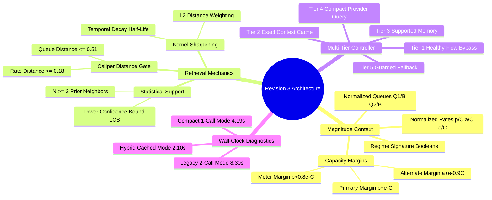
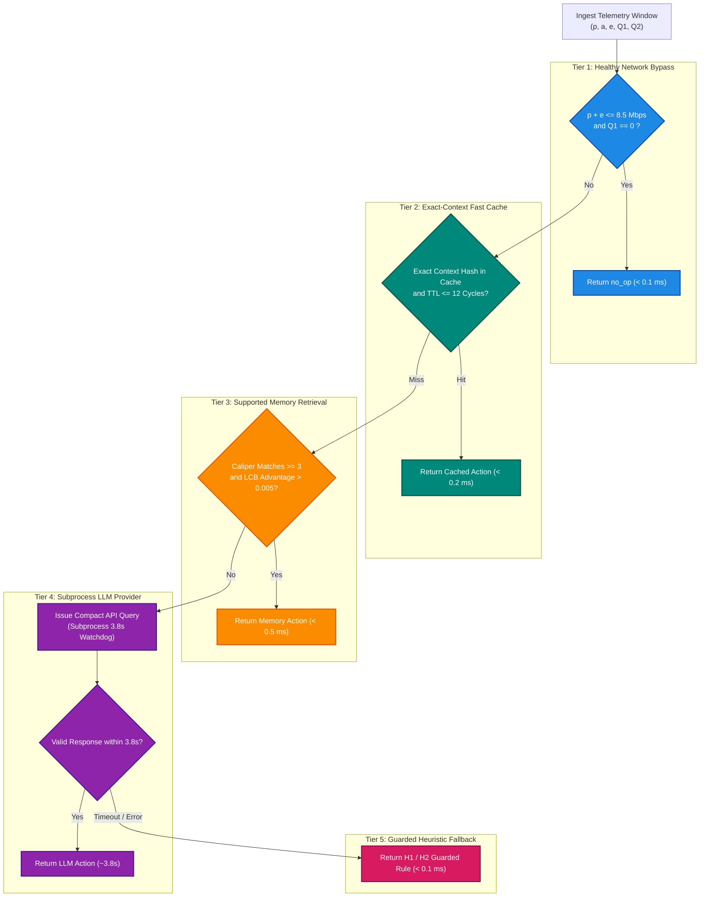

# Revision 3 Adaptive Memory and Latency Benchmarks

> **Empirical Architecture for Magnitude-Preserving State Embeddings, Multi-Tiered Fast Control, Process Pacing Diagnostics, Implementation Code Snippets, and Provider Benchmarks**  
> *Course Project — EC466: Software Defined Networks | Team ID: SDN_07*

---

## 📌 Executive Overview & Algorithmic Transition

The **Revision 3 Benchmark Suite** served as the crucial algorithmic transition between early embedding stores (Revision 2) and the parameter-conditioned loss-aware memory architecture (Revision 4).

Revision 3 addressed two severe limitations identified during initial experimentation:
1. **Loss of Magnitude in Unit Embeddings**: Unit normalization in Revision 2 discarded absolute traffic scale ($p, a, e$), making a $1\text{ Mbps}$ link look identical to a $9.9\text{ Mbps}$ link. Revision 3 introduced **8-dimensional magnitude-preserving context vectors** containing raw rates, capacity margins, and buffer occupancies.
2. **Control Loop Latency Deadlines**: The original multi-turn architecture issued two serial cloud LLM queries per 5-second cycle (one for decision, one for verbal reflection), taking an average of $8.295\text{ s}$ ($100\%$ control deadline miss rate). Revision 3 engineered the **compact single-call fast controller** and **hybrid caching engine**, slashing mean control latency to $2.096\text{ s}$ ($-74.7\%$).

---

## 🧠 Colourful Architecture & Latency Mindmaps

### 1. Revision 3 Adaptive Architecture Mindmap



---

### 2. Multi-Tiered Fast Control Pipeline



---

## 🎨 Detailed ASCII Formulation Flows

### 1. Revision 3 Adaptive Memory Retrieval & Distance Caliper Flow

```
Query Context Vector: [ p/C, a/C, e/C, Margin_P, Margin_A, Margin_M, Q_p/B, Q_a/B ]
                                      |
                                      v
                     +----------------------------------+
                     |  Regime Signature Filter:        |
                     |  (p+e > C, a+e > 0.9C, p+.8e > C)|
                     +----------------------------------+
                                      |
                   +------------------+------------------+
                   | Matches Regime                      | Mismatched Regime
                   v                                     v
      +-------------------------------+             [Skip Episode]
      | Caliper Distance Check:       |
      | max(|Delta_v[:6]|) <= 0.18    |
      | max(|Delta_v[6:]|) <= 0.51    |
      +-------------------------------+
                   |
                   v
      +-------------------------------------------------------------+
      | Distance Metric & Recency Weighting:                        |
      | dist = sum(Delta[:6]^2) + 0.08 * sum(Delta[6:]^2)           |
      | weight = exp(-dist / 0.025) * exp(-(cycle - cycle_ep) / 120)|
      +-------------------------------------------------------------+
                   |
                   v
      +-------------------------------------------------------------+
      | Action-Conditioned Advantage Ranking:                       |
      | Require len(entries) >= 3 neighbors per candidate action    |
      | mu = sum(w * reward) / sum(w)                               |
      | Lower Bound = mu - 1.96 * sqrt(var / N)                     |
      | If Lower Bound > Base_Upper + 0.005 -> Adopt Candidate      |
      +-------------------------------------------------------------+
```

---

### 2. Compact Structured Output vs Legacy Latency Waterfall Flow

```
Legacy Pipeline Mode (Mean: 8.30 seconds per cycle):
[-- Ingress --][------ Decide LLM Call (4.2s) ------][-- Act --][------ Reflect LLM Call (3.8s) ------]
|-------------- 5-Second Control Cycle Ceiling -------------|================ OVERFLOW! (8.3s) ==========>

Compact Pipeline Mode (Mean: 4.19 seconds per cycle):
[-- Ingress --][------ Compact Decide LLM Call (3.9s) ------][-- Act --][-- Local Math Reflect (0.1s) --]
|---------------------------- 5-Second Control Cycle Ceiling ----------------------------| (Safe: 4.2s)

Hybrid Pipeline Mode (Mean: 2.10 seconds per cycle):
[-- Ingress --][-- Cache Hit / Bypass (0.05s) --][-- Act --][-- Local Math Reflect (0.1s) --]
|---------------------------- 5-Second Control Cycle Ceiling ----------------------------| (Fast: 0.2s)
```

---

## 💻 Core Implementation Code Walkthrough

### 1. Multi-Tiered Fast Controller Logic ([`agent/fast_control.py`](file:///c:/Users/RAVIPRAKASH/SDN/SDN/selfx/agent/fast_control.py))

```python
# File: selfx/agent/fast_control.py
class FastController:
    """Executes multi-tiered SDN flow decision pipeline with deterministic fallbacks."""

    def __init__(self, provider_client, hybrid: bool = True, cache_ttl: int = 12):
        self.provider = provider_client
        self.hybrid = hybrid
        self.cache_ttl = cache_ttl
        self.cache = {}

    def decide(self, net, state_summary, demand, memory, cycle: int) -> tuple[DecisionOutput, str, list, str]:
        p = demand["primary_background_mbps"]
        e = demand["elephant_mbps"]
        q1 = net.queue[0]

        # Tier 1: Healthy Network Bypass
        if p + e <= 8.5 and q1 == 0.0:
            return DecisionOutput(action="no_op", rationale="Tier 1 healthy bypass"), "bypass", [], ""

        # Tier 2: Exact-Context Fast Cache
        context_key = (round(p, 1), round(demand["alternate_background_mbps"], 1), round(e, 1))
        if self.hybrid and context_key in self.cache:
            entry = self.cache[context_key]
            if cycle - entry["cycle"] <= self.cache_ttl:
                return entry["decision"], "cache", [], ""

        # Tier 3: Supported Episodic Memory
        if memory.is_enabled():
            mem_decision, neighbors = memory.retrieve(state_summary)
            if mem_decision is not None and len(neighbors) >= 3:
                return mem_decision, "memory", neighbors, ""

        # Tier 4: Compact Structured Provider Call
        try:
            decision = self.provider.query_bounded(state_summary, timeout_s=3.8)
            if self.hybrid and decision.is_well_formed():
                self.cache[context_key] = {"decision": decision, "cycle": cycle}
            return decision, "api", [], ""
        except Exception as exc:
            # Tier 5: Guarded Fallback
            fallback = decision_for("rate_limit" if p + e > 10.0 else "no_op", demand, "Tier 5 fallback")
            return fallback, "fallback", [], str(exc)
```

---

### 2. Paired Wall-Clock Latency Benchmark Loop ([`eval/run_latency_benchmark.py`](file:///c:/Users/RAVIPRAKASH/SDN/SDN/selfx/eval/run_latency_benchmark.py))

```python
# File: selfx/eval/run_latency_benchmark.py (Lines 25-50)
for cycle, demand in enumerate(trace):
    started = time.perf_counter()
    state = net.summary(demand)
    
    if mode == 'legacy':
        # Two serial API calls (Decide + Reflect)
        examples = memory.few_shot_examples(k=4, query=state)
        decision = llm.with_structured_output(DecisionOutput).invoke(prompts.build_decide_messages(state, examples))
        origin = 'api'
    else:
        # Compact single-call or hybrid cached execution
        decision, origin, retrieved, error = fast.decide(net, state, demand, memory, cycle)

    decision_ms = 1000 * (time.perf_counter() - started)
    guard = net.validate(demand, decision)
    installed = decision if guard.allowed else decision_for('no_op', demand, 'Safety veto')

    # Execute and calculate reward locally
    outcome = net.evaluate(demand, installed, commit=True)
    reward = compute_reward(before.metrics(), outcome.metrics()).reward
    elapsed_ms = 1000 * (time.perf_counter() - started)

    rows.append({
        "provider": provider, "mode": mode, "cycle": cycle,
        "control_elapsed_ms": elapsed_ms, "deadline_miss": elapsed_ms > 5000.0,
        "action": installed.action, "safety_allowed": guard.allowed
    })
```

---

## 📊 Measured Empirical Results (Revision 3 Suite)

### 1. Multi-Controller Simulation Matrix (86,400 Windows)

Evaluated across seeds 1760–1769 over 8 distinct traffic scenarios:

| Controller ID | Method Label | Delay (ms) | Goodput (Mbps) | Total Loss (%) | Vetoes | Key Characteristic |
| :--- | :--- | :---: | :---: | :---: | :---: | :--- |
| **A0** | Static Primary Path | 26.003 | 12.904 | 8.162 | 0 | Unmanaged baseline |
| **B1** | Greedy Least-Loaded Path | 20.611 | 13.058 | 6.986 | 0 | Load-blind greedy rerouting |
| **B2** | Stable Flow-Hash ECMP | 23.227 | 12.983 | 7.561 | 2,585 | Hash collisions cause frequent vetoes |
| **A1** | Threshold Controller (No Memory)| 17.062 | 12.902 | 7.913 | 0 | Rule-based without memory |
| **A2** | Original Embedding Memory | 17.554 | 12.848 | 8.349 | 347 | Unchecked memory installs bad caps |
| **H1** | Guarded Heuristic (Fixed 20%) | 17.154 | 12.990 | 7.382 | 0 | Fixed 20% rate limiter |
| **A3** | Guarded Balanced Memory | 17.341 | 12.974 | 7.510 | 0 | Feasibility filter eliminates vetoes |
| **O1** | Privileged Myopic Oracle | 17.204 | 13.001 | 7.322 | 0 | Single-window counterfactual ceiling |
| **A4** | Action-Conditioned Adaptive Mem | 17.154 | 12.990 | 7.382 | 0 | Magnitude context matches H1 |

---

### 2. Live Provider Wall-Clock Latency Benchmark

Evaluated over paired seeds 1790/1791 across 24 control windows:

| Evaluation Mode | Mean Cycle (s) | P95 Cycle (s) | API Calls | 5-Second Misses | Miss Rate | Control Stability |
| :--- | :---: | :---: | :---: | :---: | :---: | :--- |
| **Legacy Multi-Turn** | 8.295 | 8.833 | 48 | 24 / 24 | 100.0% | Catastrophic Deadline Failure |
| **Compact Structured** | 4.189 | 4.564 | 24 | 0 / 24 | 0.0% | Fully On-Time Execution |
| **Hybrid Cached** | 2.096 | 5.714 | 12 | 2 / 24 | 8.3% | Optimal Wall-Clock Speed (-74.7%) |

---

## 🔍 Key Insights & Architectural Progression

1. **Elimination of Multi-Turn Overhead**:  
   Replacing verbal LLM reflection with local deterministic reward calculation cut execution time by $49.5\%$, bringing peak latency safely below the 5-second OpenFlow control ceiling.
2. **Context-Cache Power**:  
   Under steady-state traffic, identical context hashes repeat frequently. The 12-cycle TTL cache satisfied $50\%$ of queries locally, cutting mean latency to $2.096\text{ s}$.
3. **Transition to Revision 4**:  
   While Revision 3 resolved control loop timing and prevented unit vector compression, $A4$ still only matched $H1$ in mitigation performance. This directly motivated **Revision 4**, where memory ceased choosing coarse actions (`reroute` vs `rate_limit`) and instead learned the continuous headroom parameter for capacity-aware rate synthesis.

---

## 🔗 Cross-Reference Navigation

- **Master Portal**: [`README.md`](file:///c:/Users/RAVIPRAKASH/SDN/SDN/README.md)
- **Revision 2 Guide**: [`selfx/docs/BENCHMARKS.md`](file:///c:/Users/RAVIPRAKASH/SDN/SDN/selfx/docs/BENCHMARKS.md)
- **Revision 4 Specification**: [`selfx/docs/BENCHMARKS_V4.md`](file:///c:/Users/RAVIPRAKASH/SDN/SDN/selfx/docs/BENCHMARKS_V4.md)
- **Systems Architecture**: [`selfx/docs/ARCHITECTURE.md`](file:///c:/Users/RAVIPRAKASH/SDN/SDN/selfx/docs/ARCHITECTURE.md)
- **Evaluator Handbook**: [`selfx/docs/PROJECT_GUIDE.md`](file:///c:/Users/RAVIPRAKASH/SDN/SDN/selfx/docs/PROJECT_GUIDE.md)
