# Revision 4 Benchmark Protocol and Comprehensive Empirical Results

> **Rigorous Paired Network Evaluation across 86,400 Windows, 8 Scenarios, 9 Controllers, Process-Isolated Provider Timing, and Verified Arithmetic Repairs**  
> *Course Project — EC466: Software Defined Networks | Team ID: SDN_07*

---

## Executive Summary

The **Revision 4 Benchmark Suite** represents the primary empirical evaluation of the SELF-X autonomous SDN framework. It establishes a multi-controller, multi-scenario evaluation designed to answer two foundational research questions:
1. *Does in-context episodic memory improve network quality (delay, goodput, loss, and composite reward) compared to a matched, capacity-aware baseline without memory?*
2. *Can real-world LLM decision synthesis operate reliably within a 5-second wall-clock SDN control cycle without missing deadlines or causing controller queue starvation?*

The suite executes **86,400 controller windows** across **10 fresh held-out seeds (1900–1909)**, **8 complex traffic scenarios**, and **9 distinct controllers**. All network metrics are generated using a deterministic, finite-buffer fluid simulation model, while authenticated live-provider evaluations measure true cloud latency against Google Gemini and OpenRouter free models.

---

##  Comprehensive Mindmap Flows

### 1. V4 Benchmark Suite Architecture Mindmap

```mermaid
flowchart TD
    ROOT["Revision 4 Benchmark Suite"]
    
    ROOT --> SCENARIOS["1. 8 Traffic Scenarios"]
    ROOT --> CONTROLLERS["2. 9 Evaluated Controllers"]
    ROOT --> PROTOCOL["3. Evaluation Protocol"]
    ROOT --> METRICS["4. Evaluated Metrics"]
    ROOT --> STATISTICS["5. Bootstrap Statistics"]
    ROOT --> PROVIDERS["6. Live Provider Latency"]
    
    SCENARIOS --> SC_MIX["Mixed Traffic (Standard Workload)"]
    SCENARIOS --> SC_FLASH["Primary Flash Crowds"]
    SCENARIOS --> SC_ALT["Alternate Busy (Path B Saturated)"]
    SCENARIOS --> SC_SHIFT["Distribution Shift (Halfway Step)"]
    SCENARIOS --> SC_DUAL["Dual Overload (Both Paths Saturated)"]
    SCENARIOS --> SC_LIGHT["Light Load (Negative Control)"]
    SCENARIOS --> SC_REC["Recurring Contexts (Repeated Archetypes)"]
    SCENARIOS --> SC_VOL["Volatile Dynamics (High-Variance Noise)"]
    
    CONTROLLERS --> C_A0["A0: Static Primary Path (Default)"]
    CONTROLLERS --> C_B1["B1: Greedy Least-Loaded Route"]
    CONTROLLERS --> C_A2["A2: Original Embedding Memory"]
    CONTROLLERS --> C_H1["H1: Guarded Heuristic (Fixed 20% Meter)"]
    CONTROLLERS --> C_A3["A3: Guarded Balanced Memory"]
    CONTROLLERS --> C_V3["V3: Revision 3 Adaptive Policy"]
    CONTROLLERS --> C_H2["H2: Capacity-Aware Meter (No Memory)"]
    CONTROLLERS --> C_A4["A4: Loss-Aware Parameter Memory"]
    CONTROLLERS --> C_O2["O2: Privileged Immediate-Reward Oracle"]
    
    PROTOCOL --> PR_SEEDS["Held-Out Seeds: 1900 to 1909 (10 Seeds)"]
    PROTOCOL --> PR_WINDOWS["120 Windows per Run (600 Simulated Seconds)"]
    PROTOCOL --> PR_PARALLEL["Identical Offered Bytes across Conditions"]
    PROTOCOL --> PR_REPAIR["Post-Run 1-kbps Floating Point Repair"]
    
    METRICS --> M_DELAY["Modeled Delay (ms, Weighted Queue Area + 8ms)"]
    METRICS --> M_TPUT["Delivered Goodput (Mbps)"]
    METRICS --> M_LOSS["Total Loss (%: Buffer Drops + Meter Drops)"]
    METRICS --> M_REWARD["Normalized Composite Reward [-1.0, 1.0]"]
    METRICS --> M_VETO["Safety Veto Count (Proposal Rejections)"]
    
    STATISTICS --> ST_SEED["Seed Means as Units of Inference"]
    STATISTICS --> ST_BOOT["4,000-Draw Paired Seed Percentile Bootstrap"]
    STATISTICS --> ST_CI["95% Confidence Intervals (RNG Seed 4099)"]
```



### 2. Evaluated Controllers & Scientific Lineage Mindmap

```
+-- [SELF-X Controller Hierarchy & Scientific Lineage]
    |-- Unmanaged & Classic Baselines
    |   |-- A0 (Static Primary): Standard OpenFlow forwarding, port 2 default
    |   `-- B1 (Greedy Least-Loaded): Reroutes whenever primary load > 10 Mbps
    |-- Early Episodic Implementations
    |   |-- A2 (Original Embedding): Reward-pruned JSON store, transparent state vector
    |   `-- A3 (Guarded Balanced): Guarded base policy + recent/positive/negative records
    |-- Revision 3 Adaptive Baseline
    |   `-- V3 (Previous A4): Magnitude-preserving adaptive memory, fixed 20% meter cap
    |-- Revision 4 Matched Ablation Core
    |   |-- H1 (Guarded Fixed Meter): Fixed 20% cap (0.80 * elephant), no memory
    |   |-- H2 (Capacity-Aware Heuristic): Capacity-aware meter, fixed 0.1M headroom, NO memory
    |   `-- A4 (Loss-Aware Memory): Parameter-conditioned memory, learns headroom in {0.0, 0.1, 0.3}M
    `-- Upper Reference Bound
        `-- O2 (Privileged Immediate Oracle): Simulates all candidates before committing; not deployable
```

---

##  Detailed ASCII Benchmark Flows

### 1. 86,400-Window Matrix Execution Pipeline Flow

```
====================================================================================================
                        86,400-WINDOW BENCHMARK EXECUTION MATRIX
====================================================================================================

  8 Traffic Scenarios x 10 Held-Out Seeds (1900-1909) x 9 Controllers x 120 Windows
  ----------------------------------------------------------------------------------

  Scenarios:
  [1: mixed]   [2: flash]   [3: alternate] [4: shift]   [5: overload] [6: light]   [7: recurring] [8: volatile]
      |            |              |            |              |           |              |              |
      +------------+--------------+------------+--------------+-----------+--------------+--------------+
                                               |
                                               v (For each Scenario)
                                [Seeds 1900, 1901, ..., 1909]
                                               |
                     +-------------------------+-------------------------+
                     |                         |                         |
               (Seed 1900)               (Seed 1901)               (Seed 1909)
                     |                         |                         |
                     v                         v                         v
       +-------------------------------------------------------------------------------+
       | Generate byte-for-byte identical traffic trace: traffic_{scenario}_{seed}.json|
       | Compute SHA256 digest: verified and locked in summary.json                    |
       +-------------------------------------------------------------------------------+
                                               |
                                               v (Execute all 9 Controllers)
       +-------------------------------------------------------------------------------+
       | A0 | B1 | A2 | H1 | A3 | V3 | H2 | A4 | O2                                     |
       +-------------------------------------------------------------------------------+
                                               |
                                               v (Per 5-Second Window: 120 Windows)
       +-------------------------------------------------------------------------------+
       | 1. Query State -> 2. Propose Action -> 3. Safety Guard -> 4. OpenFlow Mod     |
       | 5. Advance Fluid Simulation -> 6. Measure Deliv/Loss -> 7. Compute Reward    |
       | 8. Update Episodic Memory (A4 only)                                           |
       +-------------------------------------------------------------------------------+
                                               |
                                               v
       [Output Dataset: 86,400 Rows in output/benchmarks/v4/metrics.csv]
====================================================================================================
```

### 2. Paired Seed Percentile Bootstrap Resampling Flow

```
+--------------------------------------------------------------------------------------------------+
|                                PAIRED SEED BOOTSTRAP RESAMPLING                                  |
|                                                                                                  |
|   1. Aggregate raw window data into seed-level mean values:                                      |
|      For each Seed s in {1900..1909}:                                                            |
|          Mean_A4[s] = mean(metric for seed s)                                                    |
|          Mean_H2[s] = mean(metric for seed s)                                                    |
|          Delta[s]   = Mean_A4[s] - Mean_H2[s]                                                    |
|                                                                                                  |
|   2. Bootstrap Resampling Loop (4,000 Draws, RNG Seed 4099):                                     |
|      For b = 1 to 4000:                                                                          |
|          Sample 10 seeds WITH REPLACEMENT from {1900..1909}                                      |
|          Calculate sample mean difference: Delta_b = (1/10) * sum(Delta[sampled_s])              |
|                                                                                                  |
|   3. Percentile Confidence Interval Derivation:                                                  |
|      Sort resampled means: Delta_(1) <= Delta_(2) <= ... <= Delta_(4000)                          |
|      Lower 95% Bound: 2.5th percentile  = Delta_(100)                                            |
|      Upper 95% Bound: 97.5th percentile = Delta_(3900)                                           |
|                                                                                                  |
|   Result: Unbiased, non-parametric 95% confidence intervals honoring paired seed structure       |
+--------------------------------------------------------------------------------------------------+
```

### 3. Realtime Pooled-Worker 5-Second Wall-Clock Flow

```
Wall-Clock Time:  0s             5s             10s            15s            20s
Schedule Ticks:   T=0s           T=5s           T=10s          T=15s          T=20s
----------------------------------------------------------------------------------------------------
Idle Observation: [Wait 0.0s]    [Wait 2.9s]    [Wait 3.1s]    [Wait 1.2s]    [Wait 3.4s]
Work Window:      |== Work ==|   |== Work ==|   |== Work ==|   |== Work ==|   |== Work ==|
Elapsed Work:     2.10 s         1.88 s         3.78 s         1.56 s         1.42 s
Deadline Limit:   [< 5.0s OK]    [< 5.0s OK]    [< 5.0s OK]    [< 5.0s OK]    [< 5.0s OK]
----------------------------------------------------------------------------------------------------
Worker State:     [Active]       [Active]       [Active]       [Active]       [Active]
Session Pooling:  Reuse HTTPS    Reuse HTTPS    Reuse HTTPS    Reuse HTTPS    Reuse HTTPS
Missed Deadlines: 0 / 24         0 / 24         0 / 24         0 / 24         0 / 24
```

---

## 📊 Comprehensive Empirical Results

### Primary Multi-Controller Performance (86,400 Windows)

All statistics represent grand means across 10 held-out seeds (1900–1909) and 8 scenarios:

| Controller | Method Label | Delay (ms) | Goodput (Mbps) | Total Loss (%) | Mean Reward | Vetoes |
| :--- | :--- | :---: | :---: | :---: | :---: | :---: |
| **A0** | Static Primary Path | 25.904 | 12.872 | 8.149 | 0.000000 | 0 |
| **B1** | Greedy Least-Loaded Path | 20.609 | 13.024 | 6.996 | 0.061813 | 0 |
| **A2** | Original Embedding Memory | 17.495 | 12.821 | 8.304 | 0.055081 | 134 |
| **H1** | Guarded Heuristic (Fixed 20% Meter) | 17.131 | 12.956 | 7.391 | 0.077639 | 0 |
| **A3** | Guarded Balanced Episodic Memory | 17.259 | 12.945 | 7.477 | 0.074975 | 0 |
| **V3** | Previous Revision 3 Adaptive Policy | 17.131 | 12.956 | 7.391 | 0.077639 | 0 |
| **H2** | Capacity-Aware Meter (Fixed 0.1M, No Memory) | 17.363 | 13.011 | 7.077 | **0.083304** | 0 |
| **A4** | Loss-Aware Parameter Episodic Memory | 17.452 | 13.011 | **7.075** | 0.082764 | 0 |
| **O2** | Privileged Immediate-Reward Oracle | **17.096** | **13.016** | 7.050 | 0.086096 | 0 |

---

##  Critical Scientific Attribution & Discussion

### 1. The True Source of Performance Gains: A4 vs H1 vs H2
- **Comparison against H1**: Controller `A4` achieves substantial gains over the baseline heuristic `H1` (total loss dropped from 7.391% to 7.075%; reward improved from 0.0776 to 0.0828).
- **Comparison against H2**: When compared against `H2`—which uses the identical capacity-aware rate-limiter but with fixed 0.1 Mbps headroom and **no episodic memory**—`H2` achieves a slightly higher composite reward (0.0833 vs 0.0828).
- **Attribution Conclusion**: The empirical advantage over legacy SDN baselines is driven by **capacity-aware rate synthesis**, not by episodic in-context memory alone. Episodic memory successfully learns valid parameters, but does not outperform a well-tuned heuristic.

### 2. Cold-Start Exploration Integrity
`A4` begins every run with an empty memory store. In the first 15 windows of each scenario, it systematically explores candidates $h \in \{0.0, 0.1, 0.3\}\text{ Mbps}$. These cold-start exploration windows are fully retained in the published averages, providing an honest accounting of learning overhead.

### 3. Verification of Binary Rounding Repair
The floating point rounding fix (+1 kbps) eliminated spurious vetoes on exact 20% boundaries (e.g. 8.06 Mbps flows). The entire 86,400-window suite was re-executed, confirming zero safety vetoes for `A4` and perfect compliance with the unchanged safety gate.

---

##  Real Provider Wall-Clock Latency Evaluation

Evaluated over held-out seeds 1980/1981 under 5-second wall-clock observation pacing:

| Provider / Pipeline Mode | Mean Latency (s) | P95 Latency (s) | Max Latency (s) | Answered / Requests | Timeouts | 5s Deadline Misses |
| :--- | :---: | :---: | :---: | :---: | :---: | :---: |
| **Gemini / Previous (v3)** | 0.486 | 1.087 | 2.482 | 12 / 12 | 0 | 0 / 24 |
| **Gemini / Bounded (v4)** | 0.487 | 1.511 | 1.765 | 10 / 10 | 0 | 0 / 24 |
| **OpenRouter / Previous (v3)** | 0.524 | 2.094 | 2.466 | 3 / 8 | 0 | 0 / 24 |
| **OpenRouter / Bounded (v4)** | 1.222 | 3.620 | 3.621 | 5 / 10 | 5 | 0 / 24 |

### Pipeline Highlights
- **Subprocess Worker Reuse**: Child processes remain idle between completed calls, reusing existing HTTPS connection pools and saving up to $1.2\text{ s}$ of TLS handshake latency.
- **Strict Budget**: All requests exceeding the 3.8-second wait budget are terminated cleanly, guaranteeing zero 5-second control deadline misses.
