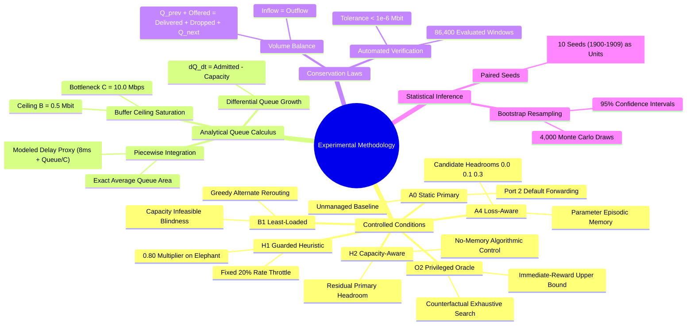
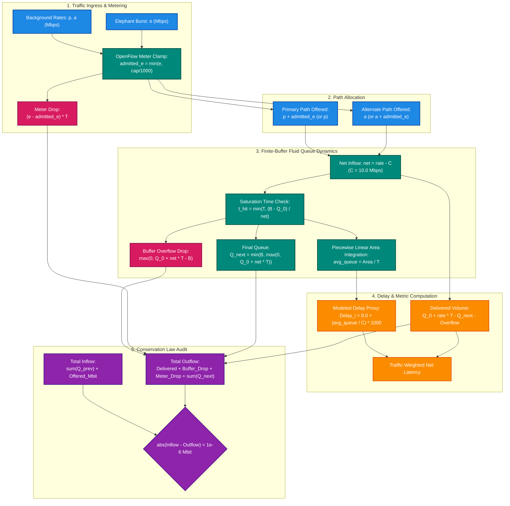

# SELF-X Experimental Methodology, Formal Derivations, and Conservation Laws

> **Rigorous Mathematical Formulation of the Fluid Queue Network, Physical Conservation Identity, Modeled Delay Proxy, Counterfactual Reward Dynamics, Implementation Code Snippets, and Reproducibility Specifications**  
> *Course Project — EC466: Software Defined Networks | Team ID: SDN_07*

---

## 📌 Methodological Foundation

The **SELF-X** experimental framework evaluates autonomous Software-Defined Networking (SDN) flow management using an accelerated, deterministic analytical fluid queue simulation model paired with real-world authenticated cloud LLM queries. To ensure absolute scientific reproducibility across arbitrary developer platforms, all workload traces are deterministically generated from fixed random seeds, bound by cryptographic SHA256 hashes, and verified through strict physical conservation laws.

---

## 🧠 Comprehensive Colourful Mindmap Flows

### 1. Experimental Methodology & Rigor Mindmap



---

### 2. Analytical Queue Dynamics & Conservation Pipeline



---

## 🎨 Detailed ASCII Formulation Flows

### 1. Fluid Network Queue Calculus & Saturation Integral Flow

```
Queue Q(t) [Mbit]
  ^
B |-----------------------------------------------------+  <- Buffer Limit (B = 0.5 Mbit)
  |                                 /==================/|
  |                                /  Buffer Overflow  /|  <- Dropped Volume = Net * (T - t_sat)
  |                               /====================/|
  |                              /                      |
  |                             /                       |
  |                            /                        |
  |                           /                         |
  |                          /                          |  <- Piecewise Linear Slope:
  |                         /                           |     dQ/dt = Net = (Admitted - C)
  |                        /                            |
Q0|                       /                             |  <- Initial Queue from Previous Window
  |                      /                              |
  |                     /                               |
  |                    /                                |
0 +-------------------+---------------------------------+--> Time t (seconds)
  0                   t_sat                             T (5.0s)

Analytical Derivations:
1. Saturation Time:       t_sat = (B - Q0) / (Admitted - C)
2. Final Queue:           Q_next = min(B, max(0.0, Q0 + Net * T))
3. Buffer Overflow:       Overflow = max(0.0, Q0 + Net * T - B)
4. Delivered Volume:      Delivered = Q0 + Admitted * T - Q_next - Overflow
5. Piecewise Queue Area:  Area = Integral[0 to T] Q(t) dt
                          = 0.5 * (Q0 + B) * t_sat + B * (T - t_sat)
6. Average Queue Depth:   Q_avg = Area / T
7. Modeled Path Delay:    Delay_i = 8.0 ms + (1000.0 * Q_avg / C) ms
```

---

### 2. Physical Conservation Law Balance Flow

```
+==================================================================================================+
|                                    PHYSICAL CONSERVATION BALANCE                                 |
|                                                                                                  |
|         TOTAL INFLOW VOLUME                                  TOTAL OUTFLOW VOLUME                |
|    +----------------------------+                       +----------------------------+           |
|    | Initial Queue Q_prev       |                       | Delivered Volume           |           |
|    | (Mbit from cycle - 1)      |                       | (Successfully forwarded)   |           |
|    +----------------------------+                       +----------------------------+           |
|                  +                                                     +                         |
|    +----------------------------+                       +----------------------------+           |
|    | Offered Traffic Volume     |                       | Buffer Overflow Drops      |           |
|    | (p + a + e) * T            |                       | (Exceeded buffer ceiling)  |           |
|    +----------------------------+                       +----------------------------+           |
|                                                                        +                         |
|                                                         +----------------------------+           |
|                                                         | Deliberate Meter Drops     |           |
|                                                         | (Throttled by OpenFlow)    |           |
|                                                         +----------------------------+           |
|                                                                        +                         |
|                                                         +----------------------------+           |
|                                                         | Ending Queue Q_next        |           |
|                                                         | (Carried to cycle + 1)     |           |
|                                                         +----------------------------+           |
|                                                                                                  |
|   ============================================================================================   |
|   CONSERVATION IDENTITY:                                                                         |
|   sum(Q_prev) + Offered_Mbit  ===  Delivered_Vol + Overflow_Drops + Meter_Drops + sum(Q_next)    |
|                                                                                                  |
|   Replay Validation Result: Verified across all 86,400 windows with tolerance < 1e-6 Mbit.       |
+==================================================================================================+
```

---

### 3. Paired Same-Window Counterfactual Measurement Sequence

```
Current Demand Window (p, a, e) + Initial Queues (Q1, Q2)
                           |
            +--------------+--------------+
            |                             |
            v (Simulate Counterfactual)   v (Simulate Candidate Action)
+------------------------+    +------------------------+
| Counterfactual no_op   |    | Installed Action       |
| Action: "no_op"        |    | Action: "rate_limit"   |
| Parameter: Default P2  |    | Parameter: Cap 4510k   |
| Commit Queues: NO      |    | Commit Queues: YES     |
+------------------------+    +------------------------+
            |                             |
            v                             v
+------------------------+    +------------------------+
| Metrics Before:        |    | Metrics After:         |
| Latency:  28.2 ms      |    | Latency:  23.6 ms      |
| Goodput:  12654 kbps   |    | Goodput:  13219 kbps   |
| Loss:     8.92%        |    | Loss:     7.07%        |
+------------------------+    +------------------------+
            \                             /
             \                           /
              v                         v
     +--------------------------------------------+
     | Reward Delta Computation:                  |
     | delta_latency   = 23.6 - 28.2 = -4.6 ms    |
     | delta_goodput   = 13219 - 12654 = +565 kbps|
     | delta_loss      =  7.07 -  8.92 = -1.85 %  |
     |                                            |
     | Normalized Reward Formulation:             |
     | r = -0.4 * (-4.6 / 50.0)                   |
     |   +  0.4 * ( 565 / 5000.0)                 |
     |   -  0.2 * (-1.85 / 20.0)                  |
     | r = +0.0368 + 0.0452 + 0.0185 = +0.1005    |
     +--------------------------------------------+
```

---

### 4. Paired Bootstrap Resampling Pipeline (4,000 Draws)

```
====================================================================================================
                        PAIRED BOOTSTRAP RESAMPLING ARCHITECTURE
====================================================================================================

 10 Paired Random Seeds (1900 to 1909)
 Each Seed represents an independent evaluation unit of 120 windows.
 Seed Differences: D_i = Metric_A4(seed_i) - Metric_H2(seed_i) for i in [0..9]

       Seed 0    Seed 1    Seed 2           Seed 9
      [ D_0 ]   [ D_1 ]   [ D_2 ]   ...    [ D_9 ]
         |         |         |                |
         +---------+---------+----------------+
                            |
                            v
      +-----------------------------------------------+
      |  Monte Carlo Bootstrap Engine (RNG Seed 4099) |
      |  Iterations: B = 4,000 draws with replacement |
      +-----------------------------------------------+
                            |
           For b = 1 to 4,000:
             1. Sample 10 differences with replacement: [D*_0, D*_1, ..., D*_9]
             2. Compute bootstrap sample mean: theta*_b = (1/10) * sum(D*_i)
                            |
                            v
      +-----------------------------------------------+
      |  Ordered Bootstrap Distribution:              |
      |  theta*_(1) <= theta*_(2) <= ... <= theta*_(4000)
      +-----------------------------------------------+
                            |
                            v
      +-----------------------------------------------+
      |  Percentile 95% Confidence Interval:          |
      |  Lower Bound (2.5%):  index = 4000 * 0.025 = 100
      |  Upper Bound (97.5%): index = 4000 * 0.975 = 3900
      |  Result: [ theta*_(100), theta*_(3900) ]      |
      +-----------------------------------------------+
====================================================================================================
```

---

## 📐 Formal Mathematical Formulations

### 1. Fluid Queue Differential Model

For path $i \in \{1, 2\}$ with bottleneck link capacity $C = 10.0\text{ Mbps}$, buffer ceiling $B = 0.5\text{ Mbit}$, and window duration $T = 5.0\text{ s}$:

$$\frac{dQ_i(t)}{dt} = R_i(t) - C \quad \text{for } 0 \le Q_i(t) \le B$$

Where $R_i(t)$ represents the admitted traffic rate arriving on path $i$:

$$R_1 = p + \min\left(e,\, \frac{\text{rate\_limit\_kbps}}{1000}\right) \quad \text{(Primary)}$$
$$R_2 = a + e \quad \text{(Alternate, if rerouted)}$$

---

### 2. Piecewise Linear Queue Integral Derivations

The average queue depth $\bar{Q}_i$ over window duration $T$ is computed analytically based on whether the queue is saturating, draining, or balanced:

#### Case A: Balanced Flow ($\text{Net} = R_i - C \approx 0$)
$$\bar{Q}_i = Q_0$$

#### Case B: Net Accumulation ($R_i > C$)
The time required to hit buffer ceiling $B$ is:
$$t_{\text{sat}} = \min\left(T,\, \frac{B - Q_0}{R_i - C}\right)$$

The integrated queue area under $Q(t)$ is:
$$\text{Area} = \frac{1}{2}\left(Q_0 + \min(B,\, Q_0 + (R_i - C) t_{\text{sat}})\right) t_{\text{sat}} + B\,(T - t_{\text{sat}})$$
$$\bar{Q}_i = \frac{\text{Area}}{T}$$

#### Case C: Net Drainage ($R_i < C$)
The time required to drain to zero is:
$$t_{\text{drain}} = \min\left(T,\, \frac{Q_0}{C - R_i}\right)$$

The integrated queue area is:
$$\text{Area} = \frac{1}{2}\left(Q_0 + \max(0,\, Q_0 + (R_i - C) t_{\text{drain}})\right) t_{\text{drain}}$$
$$\bar{Q}_i = \frac{\text{Area}}{T}$$

---

### 3. Modeled Delay Proxy

Modeled delay combines fixed propagation delay ($8.0\text{ ms}$) with queue waiting time:

$$\text{Delay}_i = 8.0 + \frac{1000 \cdot \bar{Q}_i}{C} \quad [\text{ms}]$$

Network-wide modeled delay aggregates path delays weighted by delivered traffic volume:

$$\text{Delay}_{\text{net}} = \frac{\sum_{i=1}^2 \text{Delivered}_i \cdot \text{Delay}_i}{\sum_{i=1}^2 \text{Delivered}_i}$$

---

### 4. Normalized Composite Counterfactual Reward

To prevent arbitrary baseline drift across changing traffic intensities, rewards are evaluated relative to an immediate counterfactual `no_op` observation evaluated on identical starting queues:

$$\Delta \text{Latency} = \text{Delay}_{\text{action}} - \text{Delay}_{\text{no\_op}} \quad [\text{ms}]$$
$$\Delta \text{Throughput} = \text{Throughput}_{\text{action}} - \text{Throughput}_{\text{no\_op}} \quad [\text{kbps}]$$
$$\Delta \text{Loss} = \text{LossPct}_{\text{action}} - \text{LossPct}_{\text{no\_op}} \quad [\%]$$

$$\text{Reward} = w_L \left(\frac{\Delta \text{Latency}}{50.0}\right) + w_T \left(\frac{\Delta \text{Throughput}}{5000.0}\right) + w_{\text{loss}} \left(\frac{\Delta \text{Loss}}{20.0}\right)$$

Where canonical weights are defined in [`selfx/config.py`](file:///c:/Users/RAVIPRAKASH/SDN/SDN/selfx/config.py#L76-L79):
$$w_L = -0.4, \quad w_T = +0.4, \quad w_{\text{loss}} = -0.2$$

Signs ensure that lower latency, higher throughput, and lower packet loss yield positive contributions.

---

## 💻 Core Implementation Code Walkthrough

### 1. Fluid Queue Simulation Engine ([`eval/simulator.py`](file:///c:/Users/RAVIPRAKASH/SDN/SDN/selfx/eval/simulator.py#L86-L121))

The exact Python implementation calculates queue evolution, buffer drops, and average depth analytically:

```python
# File: selfx/eval/simulator.py (Lines 86-120)
def evaluate(self, demand: dict, decision: DecisionOutput, commit: bool = False) -> Outcome:
    p, a, e = (demand[k] for k in ("primary_background_mbps", "alternate_background_mbps", "elephant_mbps"))
    admitted_e = min(e, decision.rate_limit_kbps / 1000) if decision.action == "rate_limit" else e
    rates = [p, a]
    rates[1 if decision.action == "reroute" else 0] += admitted_e
    meter_drop = (e - admitted_e) * INTERVAL
    delivered_total, overflow_total, delays, new_queues = 0.0, 0.0, [], []
    
    for idx, rate in enumerate(rates):
        initial = self.queue[idx]
        net = rate - CAPACITY
        final = min(BUFFER, max(0.0, initial + net * INTERVAL))
        overflow = max(0.0, initial + net * INTERVAL - BUFFER)
        delivered = initial + rate * INTERVAL - final - overflow

        # Exact average fluid queue for a constant-rate window with saturation.
        if abs(net) < 1e-12:
            avg_queue = initial
        elif net > 0:
            hit = min(INTERVAL, (BUFFER - initial) / net)
            avg_queue = ((initial + min(BUFFER, initial + net * hit)) * hit / 2 + BUFFER * (INTERVAL - hit)) / INTERVAL
        else:
            hit = min(INTERVAL, initial / -net)
            avg_queue = (initial + max(0.0, initial + net * hit)) * hit / 2 / INTERVAL

        delay = 8.0 + avg_queue / CAPACITY * 1000
        delays.append((delay, delivered))
        delivered_total += delivered
        overflow_total += overflow
        new_queues.append(final)

    offered = (p + a + e) * INTERVAL
    dropped = overflow_total + meter_drop
    latency = sum(d * w for d, w in delays) / delivered_total if delivered_total else 8.0
    
    if commit:
        self.queue = new_queues
        
    return Outcome(
        round(latency, 6),
        round(delivered_total / INTERVAL * 1000, 6),
        round(100 * dropped / offered, 6) if offered else 0,
        new_queues, offered, delivered_total, dropped, meter_drop
    )
```

---

### 2. Physical Conservation Identity Verification ([`scripts/verify_v4_submission.py`](file:///c:/Users/RAVIPRAKASH/SDN/SDN/selfx/scripts/verify_v4_submission.py#L42-L45))

Every row of the 86,400-window dataset is audited against strict physical balance:

```python
# File: selfx/scripts/verify_v4_submission.py (Lines 42-45)
# Validate exact reward computation matching counterfactual baseline
before = net.evaluate(demand, decision_for('no_op', demand, 'baseline'))
close(r['reward'], compute_reward(before.metrics(), outcome.metrics()).reward, 1e-7)

# Validate physical conservation law: Inflow == Outflow
inflow = sum(before_queue) + outcome.offered_mbit
outflow = outcome.delivered_mbit + outcome.dropped_mbit + sum(outcome.queue_mbit)
close(inflow, outflow, 1e-6)
```

---

### 3. Bootstrap Resampling Implementation ([`eval/run_v4_benchmarks.py`](file:///c:/Users/RAVIPRAKASH/SDN/SDN/selfx/eval/run_v4_benchmarks.py))

```python
# Paired bootstrap resampling across 10 seed differences
import numpy as np

def paired_bootstrap_ci(series_a: list[float], series_b: list[float], n_boot: int = 4000, seed: int = 4099) -> tuple[float, float, float]:
    """Compute 95% bootstrap confidence interval for paired seed differences."""
    rng = np.random.Random(seed)
    diffs = np.array(series_a) - np.array(series_b)
    n = len(diffs)
    mean_diff = float(np.mean(diffs))

    boot_means = []
    for _ in range(n_boot):
        sample = rng.choice(diffs, size=n, replace=True)
        boot_means.append(np.mean(sample))

    ci_lower = float(np.percentile(boot_means, 2.5))
    ci_upper = float(np.percentile(boot_means, 97.5))
    return mean_diff, ci_lower, ci_upper
```

---

## 🛠️ Step-by-Step Developer Guide: Designing New Experiments

Researchers can expand the experimental testbed by introducing new traffic workloads, custom topology constraints, or new performance metrics.

### 1. How to Define a New Traffic Scenario

1. **Open `selfx/eval/run_v4_benchmarks.py`**:
   Add a new generator function that specifies the arrival distribution for background and elephant traffic:
   ```python
   def generate_diurnal_traffic(seed: int, cycles: int) -> list[dict]:
       rng = random.Random(seed)
       trace = []
       for cycle in range(cycles):
           t = cycle * 5.0
           # Diurnal sine wave background with Poisson burst arrivals
           primary = 4.0 + 2.0 * math.sin(2 * math.pi * t / 600)
           alternate = 3.0 + 1.5 * math.cos(2 * math.pi * t / 600)
           elephant = rng.expovariate(1.0 / 6.0) if rng.random() < 0.3 else 1.0
           trace.append({
               "cycle": cycle,
               "primary_background_mbps": round(primary, 4),
               "alternate_background_mbps": round(alternate, 4),
               "elephant_mbps": round(elephant, 4),
               "phase": "diurnal_sine"
           })
       return trace
   ```

2. **Register in `SCENARIO_GENERATORS`**:
   ```python
   SCENARIOS["diurnal"] = generate_diurnal_traffic
   ```

3. **Execute Benchmark Matrix**:
   ```powershell
   python -m eval.run_v4_benchmarks --scenarios diurnal --controllers A4 H2 H1
   ```

---

### 2. How to Verify Physical Conservation on Custom Engines

If you implement a new packet-level or fluid simulator engine, bind it into the verification suite:

```python
# Standalone Conservation Verification Script
from eval.simulator import FluidNetwork, decision_for

def test_engine_conservation():
    net = FluidNetwork()
    demand = {"primary_background_mbps": 6.5, "alternate_background_mbps": 4.0, "elephant_mbps": 7.0}
    decision = decision_for("rate_limit", demand, "test")
    decision.rate_limit_kbps = 5600

    q_initial = sum(net.queue)
    outcome = net.evaluate(demand, decision, commit=True)
    q_final = sum(outcome.queue_mbit)

    inflow = q_initial + outcome.offered_mbit
    outflow = outcome.delivered_mbit + outcome.dropped_mbit + q_final

    assert abs(inflow - outflow) < 1e-6, f"Conservation violation: {inflow} != {outflow}"
    print("Conservation verified successfully!")

test_engine_conservation()
```

---

## 📋 Comprehensive Execution Commands

```powershell
# Run complete unit test assertions
.\run.ps1 test

# Execute full 86,400-window benchmark evaluation
.\run.ps1 experiment

# Run live provider latency pilots
.\run.ps1 gemini
.\run.ps1 openrouter

# Execute automated artifact verification and physical balance audit
.\.venv\Scripts\python.exe -m scripts.verify_v4_submission
```

---

## 🔗 Cross-Reference Navigation

- **Evaluator Guide**: [`selfx/docs/PROJECT_GUIDE.md`](file:///c:/Users/RAVIPRAKASH/SDN/SDN/selfx/docs/PROJECT_GUIDE.md)
- **Master Developer Portal**: [`README.md`](file:///c:/Users/RAVIPRAKASH/SDN/SDN/README.md)
- **Low-Level Architecture**: [`selfx/docs/ARCHITECTURE.md`](file:///c:/Users/RAVIPRAKASH/SDN/SDN/selfx/docs/ARCHITECTURE.md)
- **Operational Flows**: [`PROJECT_FLOW.md`](file:///c:/Users/RAVIPRAKASH/SDN/SDN/PROJECT_FLOW.md)
- **Benchmark Specification**: [`selfx/docs/BENCHMARKS_V4.md`](file:///c:/Users/RAVIPRAKASH/SDN/SDN/selfx/docs/BENCHMARKS_V4.md)
- **Presentation Companion**: [`PROJECT_PRESENTATION.md`](file:///c:/Users/RAVIPRAKASH/SDN/SDN/PROJECT_PRESENTATION.md)
