# SELF-X Experimental Methodology, Formal Derivations, and Conservation Laws

> **Rigorous Mathematical Formulation of the Fluid Queue Network, Conservation Identity, Modeled Delay Proxy, Counterfactual Reward Dynamics, and Reproducibility Specifications**  
> *Course Project — EC466: Software Defined Networks | Team ID: SDN_07*

---

## 📌 Methodological Foundation

The SELF-X experimental framework evaluates autonomous flow management using a combination of accelerated analytical fluid simulation and real-world authenticated cloud LLM queries. To ensure absolute scientific reproducibility, all workload traces are deterministically generated from fixed random seeds, bound by cryptographic SHA256 hashes, and verified through strict physical conservation laws.

---

## 🧠 Comprehensive Mindmap Flows

### 1. Experimental Methodology & Rigor Mindmap

```mermaid
flowchart TD
    ROOT["Experimental Methodology"]
    
    ROOT --> CONDITIONS["1. Controlled Conditions"]
    ROOT --> WORKLOAD["2. Workload & Ingress Dynamics"]
    ROOT --> CALCULUS["3. Fluid Queue Calculus"]
    ROOT --> REWARD_SYS["4. Counterfactual Reward System"]
    ROOT --> STATS["5. Statistical Inference"]
    ROOT --> INTEGRITY["6. Conservation Verification"]
    
    CONDITIONS --> COND_A0["A0: Static Primary Baseline"]
    CONDITIONS --> COND_B1["B1: Greedy Least-Loaded Heuristic"]
    CONDITIONS --> COND_H1["H1: Guarded Heuristic (Fixed 20% Meter)"]
    CONDITIONS --> COND_H2["H2: Capacity-Aware Meter (No Memory)"]
    CONDITIONS --> COND_A4["A4: Loss-Aware Episodic Memory"]
    CONDITIONS --> COND_O2["O2: Privileged Immediate Oracle"]
    
    WORKLOAD --> WL_SEEDS["Held-Out Seed Range: 1900 to 1909"]
    WORKLOAD --> WL_PHASES["Phase Cycles: Light, Primary Burst, Alternate Busy, Both Busy"]
    WORKLOAD --> WL_HASHES["SHA256 Trace Verification in summary.json"]
    
    CALCULUS --> CALC_DIFF["Differential Queue Growth: dQ/dt = Admitted - C"]
    CALCULUS --> CALC_SAT["Buffer Ceiling Saturation: B = 0.5 Mbit"]
    CALCULUS --> CALC_AREA["Piecewise Linear Area Integration for Q_avg"]
    CALCULUS --> CALC_DELAY["Propagation + Queue Delay Proxy Formulation"]
    
    REWARD_SYS --> R_SAME["Same-Window Counterfactual no_op Reference"]
    REWARD_SYS --> R_DELTA["Normalized Metric Deltas: dL, dT, dLoss"]
    REWARD_SYS --> R_WEIGHTS["Objective Weights: -0.4 Latency, +0.4 Tput, -0.2 Loss"]
    
    STATS --> S_PAIRED["Paired Seed Means as Independent Units"]
    STATS --> S_BOOT["4,000-Draw Percentile Bootstrap (RNG Seed 4099)"]
    STATS --> S_CI["95% Confidence Intervals with No Cherry-Picking"]
    
    INTEGRITY --> INT_LAW["Conservation: Q_prev + Offered = Delivered + Dropped + Q_next"]
    INTEGRITY --> INT_AUTO["verify_v4_submission Automated Math Verification"]
```



### 2. Analytical Queue Dynamics & Conservation Mindmap

```
+-- [SELF-X Analytical Queue Dynamics & Conservation Mindmap]
    |-- Fluid Input Processing
    |   |-- Primary path offered rate: p + e (or p if rerouted)
    |   |-- Alternate path offered rate: a (or a + e if rerouted)
    |   `-- OpenFlow Meter: clamps e to rate_limit_kbps (deliberate meter drop)
    |-- Buffer Dynamics (Capacities: C = 10 Mbps, Buffers: B = 0.5 Mbit)
    |   |-- Unsaturated growth: 0 <= Q(t) <= B
    |   |-- Saturation point: t_sat = (B - Q_prev) / (Admitted - C)
    |   `-- Buffer overflow: Dropped = (Admitted - C) * (T - t_sat)
    |-- Delay Formulation
    |   |-- Exact average queue depth: Q_avg = (Integral Q(t) dt) / T
    |   |-- Path delay: Delay_i = 8.0 ms + (1000 * Q_avg / C) ms
    |   `-- Weighted path aggregation across delivered volumes
    `-- Strict Conservation Identity
        |-- Inflow: Q_prev + Offered_Volume
        |-- Outflow: Delivered_Volume + Buffer_Drops + Meter_Drops + Q_next
        `-- Verification: abs(Inflow - Outflow) < 1e-6 Mbit across all 86,400 windows
```

---

## 🎨 Detailed ASCII Formulation Flows

### 1. Fluid Network Queue Calculus & Saturation Integral Flow

```
Queue Q(t) [Mbit]
  ^
B |-----------------------------------------------------+  <- Buffer Limit (0.5 Mbit)
  |                                 /==================/|
  |                                /  Overflow Drop    /|  <- Dropped Volume = Net * (T - t_sat)
  |                               /====================/|
  |                              /                      |
  |                             /                       |
  |                            /                        |
  |                           /                         |
  |                          /                          |  <- Piecewise Linear Growth:
  |                         /                           |     dQ/dt = Net = (Admitted - C)
  |                        /                            |
Q0|                       /                             |  <- Initial Queue from Previous Window
  |                      /                              |
  |                     /                               |
  |                    /                                |
0 +-------------------+---------------------------------+--> Time t (seconds)
  0                   t_sat                             T (5.0s)

Mathematical Formulations:
1. Saturation Time:       t_sat = (B - Q0) / (Admitted - C)
2. Final Queue:           Q_next = min(B, max(0.0, Q0 + Net * T))
3. Buffer Overflow:       Overflow = max(0.0, Q0 + Net * T - B)
4. Delivered Volume:      Delivered = Q0 + Admitted * T - Q_next - Overflow
5. Piecewise Queue Area:  Area = Integral[0 to T] Q(t) dt
                          = 0.5 * (Q0 + B) * t_sat + B * (T - t_sat)
6. Average Queue Depth:   Q_avg = Area / T
7. Modeled Path Delay:    Delay_i = 8.0 ms + (1000.0 * Q_avg / C) ms
```

### 2. System Conservation Law Balance Diagram

```
+==================================================================================================+
|                                    PHYSICAL CONSERVATION BALANCE                                 |
|                                                                                                  |
|         TOTAL INFLOW VOLUME                                  TOTAL OUTFLOW VOLUME                |
|    +----------------------------+                       +----------------------------+           |
|    | Initial Queue Q_prev       |                       | Delivered Volume           |           |
|    | (Mbit from cycle - 1)      |                       | (Successfully forwarded)   |           |
|    +----------------------------+                       +----------------------------+           |
|                  +                                                     +                         |
|    +----------------------------+                       +----------------------------+           |
|    | Offered Traffic Volume     |                       | Buffer Overflow Drops      |           |
|    | (p + a + e) * T            |                       | (Exceeded buffer ceiling)  |           |
|    +----------------------------+                       +----------------------------+           |
|                                                                        +                         |
|                                                         +----------------------------+           |
|                                                         | Deliberate Meter Drops     |           |
|                                                         | (Throttled by OpenFlow)    |           |
|                                                         +----------------------------+           |
|                                                                        +                         |
|                                                         +----------------------------+           |
|                                                         | Ending Queue Q_next        |           |
|                                                         | (Carried to cycle + 1)     |           |
|                                                         +----------------------------+           |
|                                                                                                  |
|   ============================================================================================   |
|   CONSERVATION IDENTITY:                                                                         |
|   Q_prev + Offered_Volume  ===  Delivered_Vol + Overflow_Drops + Meter_Drops + Q_next            |
|                                                                                                  |
|   Replay Validation Result: Verified across all 86,400 windows with tolerance < 1e-6 Mbit.       |
+==================================================================================================+
```

### 3. Paired Same-Window Counterfactual Measurement Sequence

```
Current Demand Window (p, a, e) + Initial Queues (Q1, Q2)
                           |
            +--------------+--------------+
            |                             |
            v (Simulate Counterfactual)   v (Simulate Candidate Action)
+------------------------+    +------------------------+
| Counterfactual no_op   |    | Installed Action       |
| Action: "no_op"        |    | Action: "rate_limit"   |
| Parameter: Default P2  |    | Parameter: Cap 4900k   |
| Commit Queues: NO      |    | Commit Queues: YES     |
+------------------------+    +------------------------+
            |                             |
            v                             v
+------------------------+    +------------------------+
| Metrics Before:        |    | Metrics After:         |
| Latency:  24.8 ms      |    | Latency:  17.3 ms      |
| Goodput:  12.8 Mbps    |    | Goodput:  13.0 Mbps    |
| Loss:     8.3%         |    | Loss:     7.1%         |
+------------------------+    +------------------------+
            \                             /
             \                           /
              v                         v
     +--------------------------------------------+
     | Reward Delta Computation:                  |
     | delta_latency   = 17.3 - 24.8 = -7.5 ms    |
     | delta_goodput   = 13.0 - 12.8 = +0.2 Mbps  |
     | delta_loss      =  7.1 -  8.3 = -1.2 %     |
     |                                            |
     | Normalized Reward Formulation:             |
     | r = -0.4 * (-7.5 / 50.0)                   |
     |   +  0.4 * ( 200 / 5000.0)                 |
     |   -  0.2 * (-1.2 / 20.0)                   |
     | r = +0.0600 + 0.0160 + 0.0120 = +0.0880    |
     +--------------------------------------------+
```

---

## 📐 Formal Mathematical Formulations

### 1. Fluid Queue Differential Model
For path $i \in \{1, 2\}$ with bottleneck link capacity $C = 10\text{ Mbps}$, buffer ceiling $B = 0.5\text{ Mbit}$, and window duration $T = 5.0\text{ s}$:
$$\frac{dQ_i(t)}{dt} = R_i(t) - C \quad \text{for } 0 \le Q_i(t) \le B$$
Where $R_i(t)$ represents the admitted traffic rate arriving on path $i$:
$$R_1 = p + \min(e,\, \text{rate\_limit\_kbps} / 1000) \quad \text{(Primary)}$$
$$R_2 = a + e \quad \text{(Alternate, if rerouted)}$$

### 2. Average Queue Area Derivation
When $R_i > C$ and the queue saturates at $t_{\text{sat}} = \frac{B - Q_0}{R_i - C} < T$:
$$\text{Area} = \int_0^T Q_i(t)\,dt = \frac{1}{2}(Q_0 + B)\,t_{\text{sat}} + B\,(T - t_{\text{sat}})$$
$$\bar{Q}_i = \frac{\text{Area}}{T}$$

When the queue drains to zero at $t_{\text{drain}} = \frac{Q_0}{C - R_i} < T$:
$$\text{Area} = \frac{1}{2} Q_0\, t_{\text{drain}}$$
$$\bar{Q}_i = \frac{\text{Area}}{T}$$

### 3. Modeled Delay Proxy
Modeled delay combines fixed propagation delay ($8.0\text{ ms}$) with queue waiting time:
$$\text{Delay}_i = 8.0 + \frac{1000 \cdot \bar{Q}_i}{C} \quad [\text{ms}]$$
Network-wide modeled delay aggregates path delays weighted by delivered traffic volume:
$$\text{Delay}_{\text{net}} = \frac{\text{Delivered}_1 \cdot \text{Delay}_1 + \text{Delivered}_2 \cdot \text{Delay}_2}{\text{Delivered}_1 + \text{Delivered}_2}$$

### 4. Normalized Composite Reward
$$\Delta \text{Latency} = \text{Delay}_{\text{after}} - \text{Delay}_{\text{before}}$$
$$\Delta \text{Goodput} = \text{Goodput}_{\text{after}} - \text{Goodput}_{\text{before}}$$
$$\Delta \text{Loss} = \text{LossPct}_{\text{after}} - \text{LossPct}_{\text{before}}$$

$$\text{Reward} = -0.4 \left(\frac{\Delta \text{Latency}}{50.0}\right) + 0.4 \left(\frac{\Delta \text{Goodput}}{5000.0}\right) - 0.2 \left(\frac{\Delta \text{Loss}}{20.0}\right)$$
Signs ensure that lower delay, higher goodput, and lower loss yield higher rewards.

---

## 🔬 Reproducibility & Execution Specifications

### Full Test and Benchmark Suite
```powershell
# Run complete test verification
.\run.ps1 test

# Execute portable simulation benchmarks
.\run.ps1 experiment

# Run live provider latency pilots
.\run.ps1 gemini
.\run.ps1 openrouter

# Execute automated artifact verification
.\.venv\Scripts\python.exe -m scripts.verify_v4_submission
```
All experimental traces, figures, and summary JSON files are strictly verified to ensure identical results across platforms.
