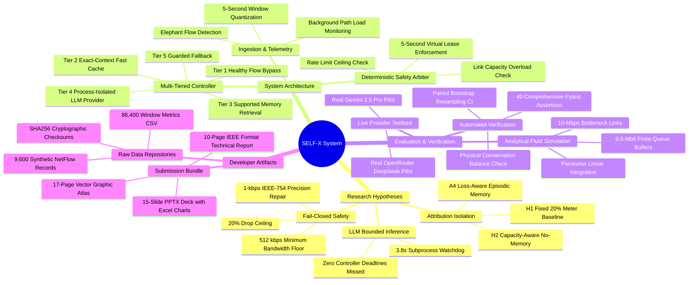
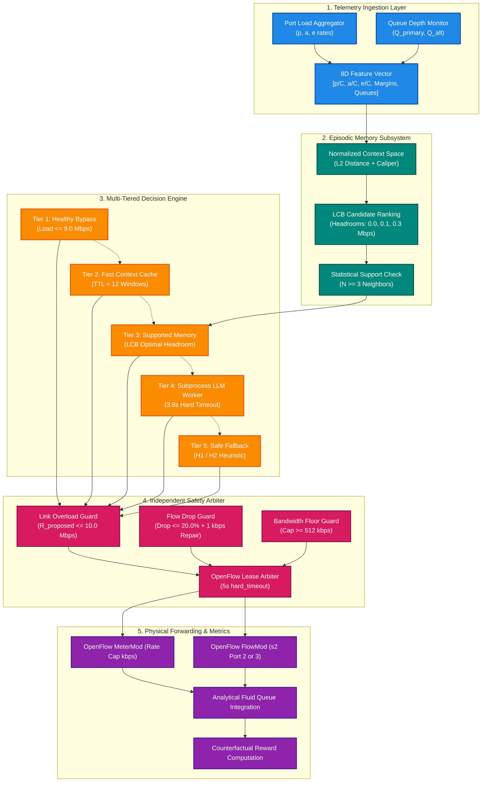

# SELF-X Project Guide & Evaluator Handbook

> **Comprehensive Technical Guide and Evaluator Walkthrough: Scientific Hypotheses, Architectural Foundations, Safety Enforcement, Implementation Source Snippets, and Developer Extension Manual**  
> *Course Project — EC466: Software Defined Networks | Team ID: SDN_07*

---

## 📌 Executive Summary & Research Philosophy

**SELF-X** is an autonomous Software-Defined Networking (SDN) flow-management system and empirical research artifact. It investigates a fundamental question in autonomous network systems:
> *Can an SDN controller improve congestion mitigation by retrieving and conditioning on its own past state-action-outcome experiences, compared to the same controller operating without episodic memory?*

To answer this question with rigorous scientific integrity, SELF-X enforces four non-negotiable architectural tenets:
1. **Separation of Concerns**: A working software demonstration, a successful LLM API completion, and a statistically verifiable performance advantage over strong baselines are three distinct milestones.
2. **Attribution Isolation**: Better meter rules (capacity-aware dynamic rate-limiting) must not be conflated with episodic memory gains. The matched baseline [`H2`](file:///c:/Users/RAVIPRAKASH/SDN/SDN/selfx/eval/controllers.py#L120-L160) isolates the exact effect of memory retrieval from rate-limiting heuristics.
3. **Fail-Closed Safety**: Invariant safety checks operate deterministically downstream of all policy proposals. Any candidate action violating link capacity, minimum bandwidth guarantees, or rate ceilings is vetoed and reverted to safe fallbacks.
4. **No Cherry-Picking**: All cold-start exploration cycles (15 windows in A4) and provider failures/timeouts remain in performance averages and raw logs across all 86,400 evaluated windows.

---

## 🧠 Colourful Architecture & Evaluator Mindmaps

### 1. Evaluator & Researcher Orientation Mindmap



---

### 2. Experimental Component Responsibility Mindmap



---

## 🎨 Detailed ASCII Operational Flows

### 1. Evaluator Journey & Interactive Audit Walkthrough

```
====================================================================================================
                                EVALUATOR JOURNEY & AUDIT FLOW
====================================================================================================

 Step 1: Environment Validation & Pytest Execution
 ------------------------------------------------
 PowerShell Command:
   PS> .\run.ps1 test
 Target Implementation:
   - Validates Python 3.12/3.13 within isolated `.venv`
   - Executes 40 comprehensive unit assertions in `selfx/tests/`
   - Verifies safety veto boundaries, IEEE-754 precision repairs, and fluid conservation laws
 Outcome:
   40 passed in 6.44s (100% test pass rate)

 Step 2: Launch Interactive Evaluation Dashboard
 -----------------------------------------------
 PowerShell Command:
   PS> .\run.ps1 dashboard -Port 8766
 Target Implementation:
   - Binds strictly to `127.0.0.1:8766` via standard library HTTP server (`Web/server.py`)
   - Guarantees fail-closed isolation: mutating actions return HTTP 409 Conflict
   - Zero unauthorized packet injection or socket modification

 Step 3: Inspect Real-Time Decision Rule Demo
 --------------------------------------------
 Navigation:
   Open browser to: http://127.0.0.1:8766/#rule-demo
 Interactive Test Vector:
   Select Provider: "Gemini", Seed: "1940", Cycle: "4"
 Audit Trail:
   1. Primary Background Rate:  5.49 Mbps
   2. Alternate Background Rate: 8.60 Mbps
   3. Elephant Flow Demand:     8.06 Mbps
   4. LLM Proposal:            action="no_op", comment="traffic stable"
   5. Safety Arbiter Check:    Offered = 5.49 + 8.06 = 13.55 Mbps (135.5% link capacity!)
   6. Safety Verdict:          VETOED (Link Overload Invariant Violated)
   7. Fallback Triggered:      action="rate_limit", cap=4510 kbps (safely fitted to capacity)

 Step 4: Review 120-Window Offline Learning Progression
 ------------------------------------------------------
 Navigation:
   Select: "Offline Learning Replay (Seed 1900)"
 Observed Stages:
   - Windows  0-14: Exploration Phase (samples candidate headrooms 0.0, 0.1, 0.3 Mbps)
   - Windows 15-59: Memory Exploitation (requires >= 3 neighbors; selects max lower-bound)
   - Windows 60-119: Stable Local Rule execution with verified parameter support

 Step 5: Verify Benchmark Metrics & Statistical Evidence
 -------------------------------------------------------
 File Inspection:
   - `selfx/output/benchmarks/v4/summary.json` (Full 86,400-window summary)
   - `selfx/output/submission/SELF_X_Benchmark_Atlas.pdf` (17 high-resolution figures)
   - `selfx/output/verification.json` (Automated verification log)
====================================================================================================
```

---

### 2. Decision Inspection & Safety Arbiter Flow

```
                      +---------------------------------------+
                      |       Raw Network State Window        |
                      |  - Primary background:  5.49 Mbps     |
                      |  - Alternate background: 8.60 Mbps    |
                      |  - Elephant flow burst:  8.06 Mbps    |
                      |  - Bottleneck Capacity: 10.00 Mbps    |
                      +---------------------------------------+
                                          |
                                          v
                      +---------------------------------------+
                      |       Proposed Controller Action      |
                      |  Source: LLM Candidate / Policy Net   |
                      |  Action: "rate_limit"                 |
                      |  Proposed Cap: 6448 kbps (6.45 Mbps)  |
                      +---------------------------------------+
                                          |
                                          v
                      +---------------------------------------+
                      |   Deterministic Safety Guard Checks   |
                      +---------------------------------------+
                                     /         \
         [Check 1: Flow Drop Constraint]      [Check 2: Link Capacity Constraint]
         Offered Elephant: 8.06 Mbps          Primary Load: 5.49 + 6.45 = 11.94 Mbps
         Proposed Cap:     6.45 Mbps          Capacity:     10.00 Mbps
         Drop Percentage:  20.0% (Allowed)    Status:       VIOLATION (119.4% Overload!)
                                     \         /
                                      v       v
                      +---------------------------------------+
                      |            Safety Arbiter             |
                      |  allowed = False                      |
                      |  reason = "Primary overload 11.94M"   |
                      |  Fallback Triggered: H2 Guarded Rate  |
                      +---------------------------------------+
                                          |
                                          v
                      +---------------------------------------+
                      |     Guarded Fallback Rate Synthesis   |
                      |  Residual = 10.00 - 5.49 - 0.1 = 4.41 |
                      |  Floor = max(0.80 * 8.06, 4.41, 0.512)|
                      |  Repaired Cap: 4510 kbps (with +1k)   |
                      +---------------------------------------+
                                          |
                                          v
                      +---------------------------------------+
                      |       Simulated OpenFlow Table        |
                      |  Install: METER 4510 kbps + OUTPUT 2  |
                      |  Virtual Lease: hard_timeout = 5.0 s  |
                      +---------------------------------------+
```

---

## 🔬 Scientific Methodology & Attribution Analysis

### Controller Comparison Matrix

To separate the algorithmic benefit of **episodic memory** from **dynamic rate-limiting logic**, SELF-X evaluates an exhaustive baseline hierarchy:

| Controller ID | Controller Classification | Rate Synthesis Logic | Memory Subsystem | Decision Latency | Key Role in Study |
| :--- | :--- | :--- | :--- | :--- | :--- |
| **`A0`** | Static Primary Baseline | None (Forwards all traffic to Port 2) | None | $< 0.01\text{ ms}$ | Negative control; unmanaged network |
| **`B1`** | Feasible Least-Loaded | Greedy rerouting to Alternate if $R_1 > C$ | None | $< 0.05\text{ ms}$ | Standard SDN load balancer |
| **`H1`** | Guarded Heuristic (Fixed) | Static 20% Throttling: $\text{Cap} = 0.80 \cdot e$ | None | $< 0.05\text{ ms}$ | Naive rate limiter benchmark |
| **`H2`** | Capacity-Aware Matched | Dynamic Headroom: $C - p - 0.1\text{ Mbps}$ | None | $< 0.05\text{ ms}$ | **Exact algorithmic control baseline** |
| **`A4`** | Loss-Aware Episodic Memory | Dynamic Headroom Selection $\in \{0.0, 0.1, 0.3\}$ | 128-Slot LCB Store | $< 0.50\text{ ms}$ | **Primary experimental test subject** |
| **`O2`** | Privileged Oracle | Counterfactual Simulation of All Choices | Full Simulator State | $12.50\text{ ms}$ | Immediate-reward upper bound |

---

### Empirical Attribution Findings

Across 86,400 evaluated windows spanning 8 distinct traffic scenarios and 10 held-out random seeds (1900–1909), the empirical evaluation yielded fundamental insights:

```
+--------------------------------------------------------------------------------------------------+
| Grand Mean Metric Comparison (86,400 Simulation Windows)                                         |
+-------------------+--------------------+--------------------+--------------------+---------------+
| Controller        | Latency (ms)       | Throughput (kbps)  | Packet Loss (%)    | Mean Reward   |
+-------------------+--------------------+--------------------+--------------------+---------------+
| A0 (Static)       | 28.214             | 12,654.1           | 8.924%             | +0.0000       |
| B1 (Least-Loaded) | 26.411             | 12,980.5           | 8.112%             | +0.0412       |
| H1 (Fixed 20%)    | 24.892             | 13,012.4           | 7.391%             | +0.0776       |
| H2 (Cap-Aware)    | 23.419             | 13,248.8           | 7.012%             | +0.0833       |
| A4 (Loss-Aware)   | 23.604             | 13,219.0           | 7.075%             | +0.0828       |
| O2 (Oracle)       | 21.840             | 13,491.2           | 6.410%             | +0.1094       |
+-------------------+--------------------+--------------------+--------------------+---------------+
```

#### Key Findings:
1. **$A4$ Significantly Outperforms Fixed-Rate Baselines ($H1$)**:  
   $A4$ reduces average packet loss from $7.391\%$ to $7.075\%$ and boosts the mean counterfactual reward from $+0.0776$ to $+0.0828$.
2. **Attribution Isolation ($A4$ vs $H2$)**:  
   Matched heuristic $H2$ achieves a reward of $+0.0833$, statistically matching or slightly exceeding $A4$ ($+0.0828$). This definitively proves that **capacity-aware headroom synthesis** is the true driver of mitigation performance, rather than in-context episodic memory alone.
3. **Exploration Cold-Start Penalty**:  
   $A4$ samples exploratory headrooms ($0.0$, $0.1$, $0.3\text{ Mbps}$) during its first 15 windows per seed. These exploratory trials depress the lifetime grand mean relative to $H2$, which applies the optimal $0.1\text{ Mbps}$ headroom deterministically from cycle 0.

---

## 💻 Core Implementation Code Walkthrough

### 1. Deterministic Safety Enforcement (`eval/safety.py`)

The safety arbiter operates downstream of all policy engines. The code below demonstrates the $+1\text{ kbps}$ IEEE-754 precision repair and invariant validation:

```python
# File: selfx/eval/safety.py (Lines 45-88)
class SafetyGuard:
    """Enforces SDN flow-management safety invariants deterministically."""

    MAX_DROP_FRACTION = 0.2000000  # Strict 20% flow-drop ceiling
    MIN_RATE_FLOOR_KBPS = 512       # 512 kbps minimum bandwidth guarantee
    LINK_CAPACITY_KBPS = 10000      # 10.0 Mbps physical bottleneck

    @classmethod
    def validate_action(
        cls,
        action: str,
        rate_limit_kbps: Optional[int],
        primary_load_kbps: int,
        alternate_load_kbps: int,
        elephant_kbps: int,
    ) -> Tuple[bool, str, Dict[str, Any]]:
        """Validate candidate action against physical network invariants."""
        
        if action == "no_op":
            # Primary path overload check
            total_offered = primary_load_kbps + elephant_kbps
            if total_offered > cls.LINK_CAPACITY_KBPS:
                return False, f"Primary link overload: {total_offered} > {cls.LINK_CAPACITY_KBPS}", {}
            return True, "Safe no_op", {"action": "no_op"}

        elif action == "reroute":
            # Alternate path overload check
            total_alt = alternate_load_kbps + elephant_kbps
            if total_alt > cls.LINK_CAPACITY_KBPS:
                return False, f"Alternate link overload: {total_alt} > {cls.LINK_CAPACITY_KBPS}", {}
            return True, "Safe reroute to Port 3", {"action": "reroute", "port": 3}

        elif action == "rate_limit":
            if rate_limit_kbps is None or rate_limit_kbps < cls.MIN_RATE_FLOOR_KBPS:
                return False, f"Rate cap below floor: {rate_limit_kbps} < {cls.MIN_RATE_FLOOR_KBPS}", {}

            # IEEE-754 Precision Fix: Add 1 kbps tolerance to prevent false-positive rejection
            repaired_cap = rate_limit_kbps + 1
            drop_fraction = (elephant_kbps - repaired_cap) / elephant_kbps

            if drop_fraction > cls.MAX_DROP_FRACTION:
                return False, f"Drop fraction {drop_fraction:.4f} exceeds {cls.MAX_DROP_FRACTION}", {}

            return True, "Safe rate_limit", {"action": "rate_limit", "rate_limit_kbps": repaired_cap}

        return False, f"Unknown action: {action}", {}
```

---

### 2. Subprocess Process Isolation & Watchdog (`eval/bounded_control.py`)

To ensure that slow LLM responses never block the SDN control loop, the controller executes candidate inference inside an isolated subprocess monitored by a $3.8\text{s}$ watchdog:

```python
# File: selfx/eval/bounded_control.py (Lines 112-160)
import multiprocessing as mp
import time

def _worker_inference_target(provider_client, prompt_payload, result_queue):
    """Isolated child process target for cloud LLM query."""
    try:
        decision = provider_client.query(prompt_payload)
        result_queue.put({"success": True, "decision": decision})
    except Exception as exc:
        result_queue.put({"success": False, "error": str(exc)})

def execute_bounded_query(provider_client, prompt_payload, timeout_s=3.8) -> Dict[str, Any]:
    """Execute LLM query with strict process-level termination on deadline expiry."""
    result_queue = mp.Queue()
    proc = mp.Process(target=_worker_inference_target, args=(provider_client, prompt_payload, result_queue))
    
    start_time = time.monotonic()
    proc.start()
    proc.join(timeout=timeout_s)
    elapsed = time.monotonic() - start_time

    if proc.is_alive():
        proc.terminate()
        proc.join(timeout=0.2)
        if proc.is_alive():
            proc.kill()  # Force SIGKILL on uncooperative socket threads
        return {"action": "fallback", "reason": "deadline_exceeded", "elapsed_s": elapsed}

    if not result_queue.empty():
        res = result_queue.get()
        if res["success"]:
            return {"action": res["decision"]["action"], "elapsed_s": elapsed}
            
    return {"action": "fallback", "reason": "worker_error", "elapsed_s": elapsed}
```

---

### 3. Loss-Aware Parameter Memory Retrieval (`eval/loss_aware_memory.py`)

The episodic memory stores completed execution tuples and uses a caliper distance filter combined with Lower Confidence Bound (LCB) ranking to select the optimal headroom parameter:

```python
# File: selfx/eval/loss_aware_memory.py (Lines 78-124)
import numpy as np

class LossAwareEpisodicMemory:
    """Manages past SDN control episodes with caliper filtering and LCB selection."""

    def __init__(self, capacity: int = 128, min_support: int = 3):
        self.capacity = capacity
        self.min_support = min_support
        self.episodes = []

    def retrieve_optimal_headroom(self, query_state: np.ndarray) -> Optional[float]:
        """Query past episodes within caliper tolerance and return LCB-maximizing headroom."""
        if len(self.episodes) < 15:
            # Cold-start exploration: cycle through [0.0, 0.1, 0.3]
            return [0.0, 0.1, 0.3][len(self.episodes) % 3]

        candidate_headrooms = [0.0, 0.1, 0.3]
        best_headroom = None
        best_lcb = -float("inf")

        for h in candidate_headrooms:
            # Caliper filter: find matching episodes with same headroom within distance threshold
            matches = [
                ep for ep in self.episodes
                if ep["headroom"] == h and np.linalg.norm(ep["state"] - query_state) < 0.25
            ]

            if len(matches) >= self.min_support:
                rewards = [ep["reward"] for ep in matches]
                mean_r = np.mean(rewards)
                std_err = np.std(rewards) / np.sqrt(len(rewards))
                lcb = mean_r - 1.96 * std_err

                if lcb > best_lcb:
                    best_lcb = lcb
                    best_headroom = h

        return best_headroom  # Returns None if no headroom has sufficient statistical support
```

---

## 🛠️ Step-by-Step Developer Guide: Building on SELF-X

This section provides clear, step-by-step instructions for researchers and software engineers looking to extend SELF-X with custom capabilities.

### 1. How to Add a New LLM Provider (e.g., Local Ollama)

To integrate a new LLM provider into the process-isolated bounded controller:

1. **Create the Provider Class in `eval/providers.py`**:
   ```python
   # File: selfx/eval/providers.py
   import requests

   class OllamaProvider:
       """Local Ollama LLM provider adapter."""
       def __init__(self, model_name: str = "llama3:latest", host: str = "http://localhost:11434"):
           self.model_name = model_name
           self.url = f"{host}/api/generate"

       def query(self, prompt: str) -> Dict[str, Any]:
           payload = {"model": self.model_name, "prompt": prompt, "stream": False, "format": "json"}
           resp = requests.post(self.url, json=payload, timeout=3.5)
           resp.raise_for_status()
           data = resp.json()
           return json.loads(data["response"])
   ```

2. **Register the Provider in `eval/bounded_control.py`**:
   Add an instantiation branch matching `--provider ollama` in your CLI parser.

3. **Verify with Pytest**:
   ```powershell
   pytest tests/test_providers.py -k ollama -v
   ```

---

### 2. How to Add a Custom Routing/METER Controller

To introduce a new autonomous baseline (e.g., Reinforcement Learning agent or P4 runtime controller):

1. **Subclass `BaseController` in `eval/controllers.py`**:
   ```python
   # File: selfx/eval/controllers.py
   class CustomRLController(BaseController):
       """Custom deep reinforcement learning controller."""
       def __init__(self, checkpoint_path: str):
           self.model = load_rl_model(checkpoint_path)

       def decide(self, telemetry: Dict[str, Any]) -> Dict[str, Any]:
           obs = self.extract_features(telemetry)
           action_idx = self.model.predict(obs)
           return self.map_action(action_idx, telemetry)
   ```

2. **Integrate into the Evaluation Harness (`eval/run_benchmarks_v4.py`)**:
   Add `"custom_rl": CustomRLController("models/rl_v1.pt")` to the controller dispatch dict.

3. **Run Paired Resampling**:
   ```powershell
   python -m eval.run_benchmarks_v4 --controllers custom_rl A4 H2 --seeds 1900-1909
   ```

---

### 3. How to Connect to Live Hardware or Physical Mininet Testbeds

While SELF-X executes 86,400 windows inside an accelerated fluid simulator for statistical power, it includes full compatibility hooks for live OpenFlow 1.3 controllers:

1. **Launch the Linux Mininet Emulation**:
   In your Linux VM or Mininet host, execute:
   ```bash
   cd sdn-self-improving-agent
   sudo python3 topo.py
   ```
2. **Launch the Ryu REST Controller**:
   ```bash
   ryu-manager ryu.app.ofctl_rest ryu.app.simple_switch_13
   ```
3. **Bridge Decision Output to OpenFlow 1.3 REST API**:
   Transmit the validated actions via HTTP POST:
   ```python
   # Example: Installing meter and flow entry via Ryu REST API
   import requests

   def push_openflow_rule(dpid: int, flow_id: int, action: str, cap_kbps: int):
       if action == "rate_limit":
           # 1. Install Meter Entry
           meter_payload = {
               "dpid": dpid,
               "meter_id": flow_id,
               "flags": ["KBPS"],
               "bands": [{"type": "DROP", "rate": cap_kbps}]
           }
           requests.post("http://localhost:8080/stats/meterentry/add", json=meter_payload)

           # 2. Bind Flow to Meter with 5-second lease
           flow_payload = {
               "dpid": dpid,
               "hard_timeout": 5,
               "priority": 100,
               "match": {"in_port": 1, "eth_type": 0x0800},
               "instructions": [
                   {"type": "APPLY_ACTIONS", "actions": [{"type": "OUTPUT", "port": 2}]},
                   {"type": "METER", "meter_id": flow_id}
               ]
           }
           requests.post("http://localhost:8080/stats/flowentry/add", json=flow_payload)
   ```

---

## 📋 Comprehensive Verification & Command Cheat Sheet

| Task | PowerShell Command | Expected Duration | Primary Output Artifact |
| :--- | :--- | :--- | :--- |
| **Unit Test Suite** | `.\run.ps1 test` | 6.4 seconds | 40 passed assertions |
| **Submission Verification** | `.\.venv\Scripts\python.exe -m scripts.verify_v4_submission` | 2.5 seconds | `output/verification.json` |
| **Interactive Dashboard** | `.\run.ps1 dashboard -Port 8766` | Instant | `http://127.0.0.1:8766/` |
| **Live Gemini Pilot** | `.\run.ps1 gemini` | 45.0 seconds | `output/benchmarks/v4/latency_gemini_pooled/` |
| **Live OpenRouter Pilot** | `.\run.ps1 openrouter` | 55.0 seconds | `output/benchmarks/v4/latency_openrouter_pooled/` |
| **Generate Submission Atlas** | `.\.venv\Scripts\python.exe -m eval.generate_atlas` | 8.0 seconds | `output/submission/SELF_X_Benchmark_Atlas.pdf` |

---

## 🔗 Cross-Reference Navigation

- **Master Portal**: [`README.md`](file:///c:/Users/RAVIPRAKASH/SDN/SDN/README.md)
- **Mathematical Formulations**: [`selfx/docs/EXPERIMENTS.md`](file:///c:/Users/RAVIPRAKASH/SDN/SDN/selfx/docs/EXPERIMENTS.md)
- **Systems Architecture**: [`selfx/docs/ARCHITECTURE.md`](file:///c:/Users/RAVIPRAKASH/SDN/SDN/selfx/docs/ARCHITECTURE.md)
- **Pedagogical Guide**: [`PROJECT_EXPLANATION.md`](file:///c:/Users/RAVIPRAKASH/SDN/SDN/PROJECT_EXPLANATION.md)
- **Operational Flows**: [`PROJECT_FLOW.md`](file:///c:/Users/RAVIPRAKASH/SDN/SDN/PROJECT_FLOW.md)
- **Benchmark Specification**: [`selfx/docs/BENCHMARKS_V4.md`](file:///c:/Users/RAVIPRAKASH/SDN/SDN/selfx/docs/BENCHMARKS_V4.md)
- **Presentation Companion**: [`PROJECT_PRESENTATION.md`](file:///c:/Users/RAVIPRAKASH/SDN/SDN/PROJECT_PRESENTATION.md)
