# SELF-X Project Guide & Evaluator Walkthrough

> **Comprehensive Orientation for Researchers, Evaluators, and Course Evaluators: Hypotheses, Implementation Scope, Verification Protocols, and Artifact Lineage**  
> *Course Project — EC466: Software Defined Networks | Team ID: SDN_07*

---

## 📌 Purpose and Research Philosophy

**SELF-X** is an autonomous Software-Defined Networking (SDN) flow-management demonstrator and research artifact. It investigates a fundamental question in autonomous network operations:
> *Can an SDN controller improve congestion mitigation by retrieving and conditioning on its own past state-action-outcome experiences, compared to the same controller operating without episodic memory?*

In answering this question, SELF-X enforces rigorous scientific honesty:
1. **Separation of Concerns**: A working software demo, a successful API response, and a verifiable performance advantage over strong baselines are three distinct milestones.
2. **Attribution Isolation**: Better meter rules (capacity-aware dynamic rate-limiting) must not be conflated with episodic memory gains. The matched baseline **`H2`** isolates the exact effect of memory.
3. **No Cherry-Picking**: All cold-start exploration cycles (15 windows in A4) and provider failures/timeouts remain in performance averages and raw logs.

---

## 🧠 Comprehensive Mindmap Flows

### 1. Evaluator & Researcher Mindmap

```mermaid
flowchart TD
    ROOT["SELF-X Evaluator Guide"]
    
    ROOT --> QUESTIONS["1. Core Research Questions"]
    ROOT --> DEMO["2. Demonstration & Inspection"]
    ROOT --> BOUNDARIES["3. Execution Boundaries"]
    ROOT --> ATTRIBUTION["4. Scientific Attribution"]
    ROOT --> ARTIFACTS["5. Evidence Lineage"]
    
    QUESTIONS --> Q1["Can LLMs suggest safe SDN control actions under strict deadlines?"]
    QUESTIONS --> Q2["Does episodic memory improve metrics over matched non-memory baselines?"]
    QUESTIONS --> Q3["How does an independent safety gate prevent catastrophic hallucinations?"]
    
    DEMO --> DEMO_UI["Interactive Loopback Dashboard (Port 8766)"]
    DEMO --> DEMO_REPLAY["Rule Demo: Step-by-Step Verification"]
    DEMO --> DEMO_OFFLINE["Offline Replay: Deterministic Experiment Execution"]
    
    BOUNDARIES --> BND_SIM["Windows Runtime: 2-Path Finite-Buffer Fluid Simulation"]
    BOUNDARIES --> BND_API["Live Cloud APIs: Real Authenticated Gemini & OpenRouter Calls"]
    BOUNDARIES --> BND_LINUX["Linux Testbed: Separate Mininet + Ryu ofctl_rest Adapter"]
    
    ATTRIBUTION --> ATTR_H1["H1: Baseline Guarded Heuristic (Fixed 20% Meter)"]
    ATTRIBUTION --> ATTR_H2["H2: Capacity-Aware Meter without Memory"]
    ATTRIBUTION --> ATTR_A4["A4: Loss-Aware Parameter Episodic Memory"]
    ATTR_A4 -.->|Superior to| ATTR_H1
    ATTR_A4 -.->|Equivalent to| ATTR_H2
    
    ARTIFACTS --> ART_CSV["Raw Metrics CSV (86,400 Rows) & Traces"]
    ARTIFACTS --> ART_DOCS["Editable Submission: Report (.docx), Slides (.pptx)"]
    ARTIFACTS --> ART_ATLAS["17-Page Benchmark Vector Figure Atlas (.pdf)"]
```



### 2. Experimental Hypothesis & Component Responsibility Mindmap

```
+-- [SELF-X Experimental Hypotheses & Responsibilities]
    |-- Core Architectural Components
    |   |-- Telemetry Ingestion: Summarizes rates, port loads, and buffer occupancy
    |   |-- Episodic Memory Store: Embeds state vectors, clusters parameter outcomes
    |   |-- Bounded Controller: Multi-tiered decision engine with 3.8s process deadline
    |   |-- Independent Safety Guard: Enforces 20% flow-drop & 90% link-utilization ceilings
    |   `-- Simulated OpenFlow Engine: Installs 5-second hard_timeout flow & meter entries
    |-- Primary Research Findings
    |   |-- Finding 1: LLM suggestions alone are brittle without deterministic validation
    |   |-- Finding 2: Capacity-aware meter synthesis significantly outperforms fixed 20% drops
    |   |-- Finding 3: Parameter episodic memory reliably learns optimal headroom over 120 windows
    |   `-- Finding 4: In-context memory does not outperform matched fixed-headroom heuristics (H2)
    `-- Verification & Evidence Integrity
        |-- Deterministic reproducibility across seeds 1900-1909
        |-- SHA256 cryptographic binding for all synthetic traffic traces
        `-- Zero API secrets or credentials committed to submission packages
```

---

## 🎨 Detailed ASCII Operational Flows

### 1. Step-by-Step Evaluator Walkthrough Flow

```
====================================================================================================
                               EVALUATOR JOURNEY & AUDIT FLOW
====================================================================================================

 Step 1: Environment & Virtual Setup
 -----------------------------------
 Run in PowerShell:
   PS> .\setup.ps1
   PS> .\run.ps1 test
 Outcome:
   - Validates Python 3.12/3.13 in isolated `.venv`
   - Executes all unit tests in `tests/` and `eval/tests/`
   - Confirms deterministic safety guards and 1-kbps floating point repair

 Step 2: Launch Interactive Dashboard
 ------------------------------------
 Run:
   PS> .\run.ps1 dashboard -Port 8766
 Action:
   - Open browser to: http://127.0.0.1:8766
   - Binds strictly to loopback (127.0.0.1); safe for multi-tenant evaluation

 Step 3: Inspect Rule Demo & Live Telemetry
 -----------------------------------------
 Navigate to:
   http://127.0.0.1:8766/#rule-demo
 Procedure:
   - Select Provider: "Gemini", Seed: "1980"
   - Step through cycles 0 to 12:
     * Cycle 0 (Healthy): Primary fits capacity -> no_op (Port 2 default)
     * Cycle 1 (Primary Burst): Alternate link has headroom -> reroute (Port 3)
     * Cycle 2 (Both Busy): Alternate link congested -> rate_limit (Meter + Port 2)
   - Inspect raw LLM prompt, verbatim response, safety verdict, and rule expiry

 Step 4: Review 120-Window Offline Learning Progression
 ------------------------------------------------------
 Select:
   "Offline Learning Replay (Seed 1900)"
 Observation:
   - Windows 0-14: Exploration Phase (samples headroom 0.0, 0.1, 0.3 Mbps)
   - Windows 15-59: Memory Exploitation (requires >= 3 neighbors; selects max lower-bound)
   - Windows 60-119: Stable Local Rule execution with verified parameter support

 Step 5: Verify Benchmark Metrics & Statistical Evidence
 -------------------------------------------------------
 Inspect:
   - `output/benchmarks/v4/summary.json` (Full 86,400-window summary)
   - `output/submission/SELF_X_Benchmark_Atlas.pdf` (17 high-resolution figures)
   - `output/verification.json` (Automated verification log)
====================================================================================================
```

### 2. Decision Inspection & Safety Arbiter Flow

```
                      +---------------------------------------+
                      |       Raw Network State Window        |
                      |  - Primary background:  5.0 Mbps      |
                      |  - Alternate background: 8.0 Mbps     |
                      |  - Elephant flow burst:  5.2 Mbps     |
                      |  - Link Capacity:       10.0 Mbps     |
                      +---------------------------------------+
                                          |
                                          v
                      +---------------------------------------+
                      |         Candidate Proposal            |
                      |  Action: "rate_limit"                 |
                      |  Proposed Cap: 4900 kbps (4.9 Mbps)   |
                      +---------------------------------------+
                                          |
                                          v
                      +---------------------------------------+
                      |   Deterministic Safety Guard Checks   |
                      +---------------------------------------+
                                     /         \
                 [Check 1: Dropped Percentage]   [Check 2: Minimum Floor]
                 (5200 - 4900) / 5200 = 5.77%    4900 kbps >= 512 kbps
                 Constraint: <= 20.0%            Constraint: >= 512 kbps
                 Status: ALLOWED (5.77% <= 20%)  Status: ALLOWED
                                     \         /
                                      v       v
                      +---------------------------------------+
                      |            Safety Verdict             |
                      |  allowed = True                       |
                      |  safe_action = "rate_limit"           |
                      |  installed_cap = 4900 kbps            |
                      +---------------------------------------+
                                          |
                                          v
                      +---------------------------------------+
                      |       Simulated OpenFlow Table        |
                      |  Install: METER 4900 kbps + OUTPUT 2  |
                      |  Timeout: hard_timeout = 5 seconds    |
                      +---------------------------------------+
```

---

## 🔬 Scientific Methodology & Attribution Analysis

### Controller Comparison Matrix

To separate the algorithmic benefit of **episodic memory** from **dynamic rate-limiting logic**, SELF-X establishes a rigorous baseline hierarchy:

1. **`A0` (Static Primary)**:
   - Forwards all traffic to switch `s2` port 2 without intervention. Represents the unmanaged SDN baseline.
2. **`B1` (Least-Loaded)**:
   - Classic greedy traffic engineering. Reroutes to the alternate path whenever primary load exceeds capacity, ignoring downstream alternate congestion.
3. **`H1` (Guarded Heuristic - Fixed 20% Meter)**:
   - Throttles congested elephant flows by an arbitrary fixed 20% reduction factor (`rate_limit_kbps = 0.80 * elephant_kbps`).
4. **`H2` (Capacity-Aware Meter - No Memory)**:
   - Calculates the exact residual headroom on the primary link:
     $$\text{Cap} = \max(0.80 \cdot e,\, C - p - 0.1\text{ Mbps},\, 512\text{ kbps})$$
     Uses a fixed 0.1 Mbps headroom margin. **Contains zero episodic memory.**
5. **`A4` (Loss-Aware Episodic Memory)**:
   - Maintains up to 128 completed episodes. Dynamically selects among candidate headrooms $\{0.0, 0.1, 0.3\}\text{ Mbps}$ using Lower Confidence Bound (LCB) ranking derived from similar past episodes.
6. **`O2` (Privileged Counterfactual Reference)**:
   - Evaluates all candidate actions inside the simulator before committing. Serves as an immediate-reward upper bound.

### Summary of Primary Findings
- **A4 vs H1**: A4 lowers total loss from 7.391% to 7.075% and boosts reward from 0.0776 to 0.0828.
- **A4 vs H2**: H2 achieves a reward of 0.0833, statistically matching or slightly exceeding A4 (0.0828). This confirms that **capacity-aware meter synthesis** is the primary driver of performance improvements, rather than memory alone.
- **Cold-Start Preservation**: A4's performance reflects its entire lifecycle, including early exploration phases.

---

## 📦 Submission Deliverables & Evidence Lineage

All project deliverables are compiled and verified through automated scripts:

| Deliverable | File Path | Format | Description |
| :--- | :--- | :--- | :--- |
| **Project Report** | `output/submission/SELF_X_Report.docx` | Editable Word (.docx) | Complete 10-page IEEE/ACM style technical report |
| **Report PDF** | `output/submission/SELF_X_Report.pdf` | Adobe PDF (.pdf) | Native print-ready PDF export of the project report |
| **Presentation Deck** | `output/submission/SELF_X_Presentation.pptx`| Editable PPTX (.pptx)| 15-slide editable slide deck with native embedded Excel charts |
| **Presentation PDF**| `output/submission/SELF_X_Presentation.pdf` | Adobe PDF (.pdf) | Slide export for conference/viva presentation |
| **Benchmark Atlas** | `output/submission/SELF_X_Benchmark_Atlas.pdf`| Vector PDF (.pdf) | 17-page figure atlas containing all benchmark plots |
| **Source & Data ZIP**| `output/submission/SELF_X_Submission.zip` | Compressed ZIP (.zip)| Clean, credential-free code, traces, and verification logs |
| **Checksum Manifest**| `output/submission/SHA256SUMS.txt` | Plain Text (.txt) | SHA256 cryptographic digests for all submission deliverables |
