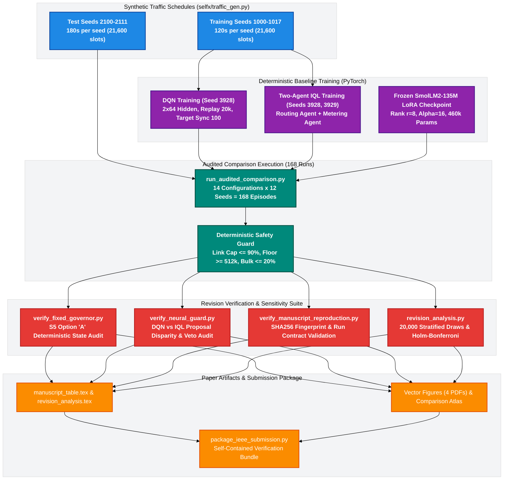

# SELF-X Revised Manuscript & Verification Pipeline Guide

> **Production Guide to IEEE Camera-Ready Reproduction, Neural Guard Auditing, and Statistical Sensitivity Verification**  
> *Component Guide — EC466: Software Defined Networks | Team ID: SDN_07 | IIIT Dharwad*  
> *Target Modules: `selfx/eval/revision_analysis.py`, `verify_fixed_governor.py`, `verify_neural_guard.py`, `verify_manuscript_reproduction.py`, `package_ieee_submission.py`*  
> *Document Version: 2.4.0-Production*

---

## 📌 Table of Contents
1. [Executive Summary & Reproduction Scope](#executive-summary--reproduction-scope)
2. [Verification Pipeline Architecture](#verification-pipeline-architecture)
3. [Trace-Level Sensitivity Analysis (`revision_analysis.py`)](#trace-level-sensitivity-analysis-revision_analysispy)
   - [Stratified Bootstrap Resampling Methodology](#stratified-bootstrap-resampling-methodology)
   - [Holm-Bonferroni Deduplication Across Neural Arms](#holm-bonferroni-deduplication-across-neural-arms)
4. [Deterministic Neural Baseline & Guard Audit (`verify_neural_guard.py`)](#deterministic-neural-baseline--guard-audit-verify_neural_guardpy)
   - [PyTorch Deterministic Setup & Neural Architectures](#pytorch-deterministic-setup--neural-architectures)
   - [Raw Proposal Disparity vs. Guard Convergence Analysis](#raw-proposal-disparity-vs-guard-convergence-analysis)
5. [Fixed Governor Equivalence Check (`verify_fixed_governor.py`)](#fixed-governor-equivalence-check-verify_fixed_governorpy)
   - [Governance Schedule Auditing on Configuration S5](#governance-schedule-auditing-on-configuration-s5)
   - [Cryptographic Action Hash Verification](#cryptographic-action-hash-verification)
6. [End-to-End Manuscript Reproduction Verifier (`verify_manuscript_reproduction.py`)](#end-to-end-manuscript-reproduction-verifier-verify_manuscript_reproductionpy)
7. [IEEE Camera-Ready Packaging Pipeline (`package_ieee_submission.py`)](#ieee-camera-ready-packaging-pipeline-package_ieee_submissionpy)
8. [Step-by-Step Operator Runbook](#step-by-step-operator-runbook)

---

## 🏛️ Executive Summary & Reproduction Scope

The revised IEEE manuscript reports only the **audited CPU comparison suite**. This suite executes real local language model inference (via Hugging Face `SmolLM2-135M-Instruct` and the fine-tuned LoRA adapter), trains full PyTorch deep Q-networks (DQN and two-agent independent Q-learning / MARL), and records per-slot decisions under deterministic traffic schedules.

### Core Reproducibility Guarantees
1. **Zero Cloud / GPU Dependency**: The entire verification pipeline runs on standard x86-64 CPU architectures without CUDA, cloud API keys, or physical Mininet testbeds.
2. **Cryptographic Fingerprinting**: Every offered traffic schedule, model weight checkpoint, and per-slot action sequence is hashed using SHA-256. Reruns must match these hashes bit-for-bit.
3. **Trace-Level Stratified Bootstrap**: A descriptive bootstrap uses 20,000 paired trace draws within workload profiles. Holm adjustment applies to the separate paired delay tests.
4. **Deterministic Datapath Guards**: The deterministic safety guard enforces strict link utilization ceilings ($\le 90\%$) and rate-limit boundaries ($\ge 512\,\text{kbps}$, $\le 20\%$ reduction), ensuring provable safety regardless of whether raw proposals originate from neural networks, language models, or heuristics.

---

## 🎨 Verification Pipeline Architecture



---

## 🔬 Trace-Level Sensitivity Analysis (`revision_analysis.py`)

The script `selfx/eval/revision_analysis.py` computes robust sensitivity metrics to verify that the conclusions in the IEEE manuscript hold under alternative statistical assumptions.

### Stratified Bootstrap Resampling Methodology
1. **Workload Stratification**: The 12 evaluation seeds (2100–2111) are evenly partitioned into 3 distinct traffic profiles:
   - `steady_bursty` (Seeds: 2100, 2103, 2106, 2109)
   - `flash_crowd` (Seeds: 2101, 2104, 2107, 2110)
   - `volatile_dpp` (Seeds: 2102, 2105, 2108, 2111)
2. **Resampling Procedure**:
   - $B = 20,000$ bootstrap iterations using NumPy random generator with seed `466`.
   - In each draw $b \in \{1, \dots, B\}$, 4 seeds are sampled with replacement from within each profile.
   - For each comparator arm $A \in \{S_0, \dots, S_4, \text{DQN}, \text{MARL}, \dots\}$, the paired delay difference is computed:
     $$\Delta^{(b)}(A) = \frac{1}{3} \sum_{p \in \text{Profiles}} \left( \frac{1}{4} \sum_{s \in \text{Sample}_p^{(b)}} \left[ \text{Delay}(S_5, s) - \text{Delay}(A, s) \right] \right)$$
   - The $95\%$ stratified confidence interval is estimated from empirical quantiles:
     $$\text{CI}_{95\%} = \left[ Q_{0.025}(\Delta), Q_{0.975}(\Delta) \right]$$

### Holm-Bonferroni Deduplication Across Neural Arms
Because the deterministic safety guard forces DQN and two-agent IQL to execute identical effective datapath actions, evaluating them as separate statistical hypotheses could inflate multiple testing penalties.
- `revision_analysis.py` computes Holm-adjusted p-values both with and without neural arm deduplication.
- **Result**: Significance classifications ($p < 0.05$) are **100% invariant** to deduplication (`unchanged == True`), confirming that the reported advantages are robust.

---

## 🛡️ Deterministic Neural Baseline & Guard Audit (`verify_neural_guard.py`)

A critical scientific finding documented in the revision is that the neural baselines (DQN and two-agent IQL) make distinctly different raw action proposals, yet achieve identical datapath performance. `selfx/eval/verify_neural_guard.py` isolates and proves this phenomenon:

### PyTorch Deterministic Setup & Neural Architectures
- **Threading**: Locked to 2 CPU threads (`torch.set_num_threads(2)`).
- **Determinism**: Enforced via `torch.use_deterministic_algorithms(True)`.
- **DQN Architecture**: Multi-Layer Perceptron (MLP) with 2 hidden layers of 64 units each, ReLU activations, trained via Adam ($\eta = 0.001$, $\gamma = 0.97$, replay buffer = 20,000, target sync interval = 100 updates).
- **Two-Agent IQL Architecture**: Independent Q-Learning with two separate DQNs:
  - Agent 1: Specializes in path selection (Primary vs. Secondary).
  - Agent 2: Specializes in ingress rate limiting (No-op vs. Meter 512k/bulk).

### Raw Proposal Disparity vs. Guard Convergence Analysis
During evaluation across all 12 test seeds (21,600 control slots at 100 ms cadence):
1. **Raw Proposal Disagreements**: DQN and IQL propose different actions in multiple slots ($p \ne q$).
2. **Safety Guard Intervention**: The deterministic safety guard checks:
   - Alternate path projected load $\le 90\%$.
   - Rate limiting minimum floor $\ge 512\,\text{kbps}$ and maximum bulk reduction $\le 20\%$.
3. **Datapath Convergence**: In slots where raw proposals disagree, either:
   - One proposal is vetoed by the guard and mapped to the safe default (`no_op`), OR
   - The effective action executed on the switch hardware is identical ($x = y$).
4. **Outcome**: The cryptographic hashes of effective applied actions (`effective_actions_sha256`) match **100%** across all 12 seeds between DQN and IQL, producing identical queue and delay time-series curves.

---

## ⚖️ Fixed Governor Equivalence Check (`verify_fixed_governor.py`)

In the complete SELF-X controller ($S_5$), the slow-loop governor runs every 30 seconds (72 governance epochs per 180s trace $\times$ 12 seeds = 360 total epochs).

### Governance Schedule Auditing on Configuration S5
- The multi-agent governor executes 5 specialist prompts (flow sizing, routing, congestion, safety, service) and 1 orchestrator prompt on the local `SmolLM2-135M` model.
- Across all 360 observed states in the full benchmark, the orchestrator and all 5 specialists consistently chose bounded adjustment Option "A".
- `verify_fixed_governor.py` implements `FixedGovernor`, replacing dynamic LLM inference with a constant Option "A" schedule:
  ```python
  class FixedGovernor:
      def govern(self, _):
          return "A", dict.fromkeys(ROLES, "A")
  ```
- **Validation**: When run against all 12 evaluation traces, `FixedGovernor` reproduces:
  - Identical 5-second window metric records.
  - Identical `effective_actions_sha256` hashes.
  - Zero conservation errors.
- **Scientific Implication**: Proves that the observed performance of $S_5$ on these traces is attributable to the fast Lyapunov DPP loop and LoRA action preferences, while the governance loop acts as an invariant stability constraint.

---

## 🔍 End-to-End Manuscript Reproduction Verifier (`verify_manuscript_reproduction.py`)

The verifier script validates reproduced benchmark outputs against the canonical reference files shipped in `paper/comparison/runs.json`:

1. **Model & Adapter Fingerprints**: Verifies revision string `12fd25f77366fa6b3b4b768ec3050bf629380bac` for SmolLM2-135M and adapter SHA-256 checksums.
2. **Offered Traffic Fingerprints**: Validates that synthetic traffic schedules match expected SHA-256 digests for all seeds.
3. **Action Hash Matching**: Validates `effective_actions_sha256` for all 168 configuration $\times$ seed episodes.
4. **Window-Level Numerical Tolerance**: Confirms that latency, goodput, packet loss, and queue depths match within floating-point epsilon tolerances ($10^{-5}$).

---

## 📦 IEEE Camera-Ready Packaging Pipeline (`package_ieee_submission.py`)

The script `selfx/scripts/package_ieee_submission.py` automates the assembly of the camera-ready submission bundle:

```powershell
python selfx/scripts/package_ieee_submission.py --output dist/ieee_submission
```

### Packaging Operations
1. **LaTeX Source Sanitization**: Collects `main.tex`, `results_macros.tex`, `manuscript_table.tex`, `revision_analysis.tex`, `expanded_profiles.tex`, and `refs.bib`.
2. **Vector Figure Inclusion**: Verifies and bundles all 4 publication vector PDFs:
   - `paper_architecture.pdf` (Two-timescale decoupled control architecture)
   - `paper_delay_effects.pdf` (Paired delay differences and 95% bootstrap CIs)
   - `paper_delay_loss.pdf` (Delay vs. packet loss trade-off space)
   - `paper_window_traces.pdf` (180s per-window time series)
3. **Checksum Manifest**: Generates `SHA256SUMS.txt` indexing every included file.
4. **Archive Compilation**: Compresses the directory into a standalone `.zip` archive ready for upload to IEEE Author Portal or Overleaf.

---

## 🚀 Step-by-Step Operator Runbook

Execute the complete reproduction and verification suite from repository root:

### 1. Verify Unit Tests & Audited Contracts
```powershell
python -m unittest discover -s Web/tests -v
python -m pytest --basetemp .pytest-tmp selfx/tests/test_audited_comparison.py selfx/tests/test_pipeline_study.py
```

### 2. Run Deterministic Baseline & Guard Audit
```powershell
python selfx/eval/verify_neural_guard.py --runs paper/comparison/runs.json --output paper/comparison
```
*Expected Output*: Verified 21,600 slots; outputs `paper/comparison/neural_guard_check.json`.

### 3. Run Fixed Governor Equivalence Check
```powershell
python selfx/eval/verify_fixed_governor.py --runs paper/comparison/runs.json --output paper/comparison
```
*Expected Output*: `Fixed governance reproduced all S5 window records and action hashes on 12 seeds.` Outputs `paper/comparison/fixed_governor_check.json`.

### 4. Run Trace-Level Bootstrap Sensitivity Analysis
```powershell
python selfx/eval/revision_analysis.py --runs paper/comparison/runs.json --output paper/comparison
```
*Expected Output*: Computes 20,000 stratified draws; regenerates `revision_analysis.tex` and `revision_analysis.json`.

### 5. Rebuild Vector Plots & Manuscript Tables
```powershell
python selfx/eval/plot_manuscript.py --effects paper/comparison/effects.json --output paper/comparison
python selfx/eval/plot_expanded_paper.py --runs paper/comparison/runs.json --output paper/comparison
```
*Expected Output*: Generates `paper_delay_effects.pdf`, `paper_delay_loss.pdf`, `manuscript_table.tex`, and `expanded_profiles.tex`.

### 6. Package IEEE Submission Archive
```powershell
python selfx/scripts/package_ieee_submission.py
```

---
*Authored by Team SDN_07 — EC466: Software Defined Networks | IIIT Dharwad*
