# SELF-X Complete Simulated Rule-Change & Replay Demonstration

> **Interactive OpenFlow 1.3 Flow-Mod Lifecycle, Dynamic Meter Tables, 5-Second Rule Expiry, and Real-Time Safety Veto Demonstrations**  
> *Course Project — EC466: Software Defined Networks | Team ID: SDN_07*

---

## 📌 Executive Overview

The **SELF-X Rule Demo** provides an interactive, auditable, step-by-step inspection tool to evaluate how autonomous LLM decisions, cached actions, episodic memory selections, and deterministic safety checks manifest as concrete OpenFlow 1.3 interventions. 

Accessible via the local dashboard at `http://127.0.0.1:8766/#rule-demo`, the demo allows users to inspect raw LLM proposals verbatim, observe how the independent safety guard filters dangerous actions, track the installation of OpenFlow flow-mod and meter table entries, and verify that all rules expire deterministically after 5 seconds to restore default network forwarding.

---

## 🧠 Comprehensive Mindmap Flows

### 1. Interactive Rule Demo Capabilities Mindmap

```mermaid
flowchart TD
    ROOT["Rule Demo Demonstration Suite"]
    
    ROOT --> MODES["1. Operating Modes"]
    ROOT --> TRACE["2. Saved Evidence Traces"]
    ROOT --> LIFECYCLE["3. Rule Table Lifecycle"]
    ROOT --> AUDIT["4. Full Decision Audit"]
    
    MODES --> MODE_GEMINI["Live / Saved Gemini 3.5 Flash Lite"]
    MODES --> MODE_OR["OpenRouter Free Models Router"]
    MODES --> MODE_OFFLINE["120-Window Offline Learning Replay"]
    
    TRACE --> TR_SEEDS["Held-Out Demonstration Seeds (1980, 1981, 1900)"]
    TRACE --> TR_DIAG["Diagnostic Preserved Traces (Seeds 1920, 1940, 1960)"]
    TRACE --> TR_PROMPT["Exact User & System Prompts with Telemetry"]
    
    LIFECYCLE --> LC_MATCH["Exact OpenFlow Match: in_port=1, dst=10.0.0.8"]
    LIFECYCLE --> LC_METER["OpenFlow Meter Table: rate_limit_kbps, DROP Band"]
    LIFECYCLE --> LC_TIMEOUT["hard_timeout = 5s (Synchronized to Cycle)"]
    LIFECYCLE --> LC_EXPIRY["Boundary Expiry: Automatic Default Restoration (Port 2)"]
    
    AUDIT --> AU_ORIGIN["Action Origin Taxonomy ('api', 'memory', 'cache', ...)"]
    AUDIT --> AU_SAFETY["Safety Guard Checks (20% Drop, 90% Utilization)"]
    AUDIT --> AU_VETO["Preserved Negative Examples (e.g., 140.9% Overload Veto)"]
    AUDIT --> AU_REWARD["Same-Window Counterfactual Reward Calculation"]
```



### 2. Action Origin & Source Taxonomy Mindmap

```
+-- [SELF-X Action Origin Taxonomy Mindmap]
    |-- Fast Path Origins (< 1 ms latency)
    |   |-- 'healthy_bypass': Load fits capacity, queues empty -> no_op
    |   |-- 'episodic_memory': Headroom supported by >= 3 past episodes -> meter rule
    |   |-- 'api_cache': Reused exact-context decision from prior API call
    |   `-- 'local_rule_cache': Reused exact-context decision from local fallback
    |-- Live Provider Origins (100 ms to 3.8s latency)
    |   |-- 'api': Successful live LLM proposal, verified by safety guard
    |   `-- 'api_structured': Compact JSON response with validated action choice
    `-- Fallback Origins (Deterministic Safe Interventions)
        |-- 'deadline_fallback': LLM exceeded 3.8s budget -> local heuristic installed
        |-- 'provider_fallback': HTTP 429/500/connection error -> local heuristic installed
        `-- 'validation_fallback': LLM proposed illegal action -> guard veto -> no_op / local meter
```

---

## 🎨 Detailed ASCII Operational Flows

### 1. OpenFlow 1.3 Rule Installation and 5-Second Expiry Timeline Flow

```
Virtual Time:  0s             5s             10s            15s            20s
Cycle Index:   [Cycle 0]      [Cycle 1]      [Cycle 2]      [Cycle 3]      [Cycle 4]
Traffic State: Healthy Load   Primary Burst  Both Paths Busy Healthy Load  Primary Burst
----------------------------------------------------------------------------------------------------
Installed Rule:+------------+ +------------+ +------------+ +------------+ +------------+
               | NO_OP      | | REROUTE    | | RATE_LIMIT | | NO_OP      | | REROUTE    |
               | (Default)  | | (Port 3)   | | (Meter+P2) | | (Default)  | | (Port 3)   |
               +------------+ +------------+ +------------+ +------------+ +------------+
                     |              |              |              |              |
                     |              v              v              |              v
Instructions:    (None)        APPLY_ACTIONS: METER: 4900     (None)        APPLY_ACTIONS:
                              OUTPUT: port 3  APPLY_ACTIONS:                OUTPUT: port 3
                                              OUTPUT: port 2
                     |              |              |              |              |
                     |              v              v              |              v
Rule Lifetime:       -        [0s ---- 5s]   [5s --- 10s]         -        [15s --- 20s]
                     |              |              |              |              |
                     v              v              v              v              v
Expiry Event:        -        EXPIRES at 5s  EXPIRES at 10s       -        EXPIRES at 20s
                              Restore Port 2 Restore Port 2                 Restore Port 2
```

### 2. Live Safety Veto Case Study: Gemini Seed 1940 Cycle 4 (140.9% Overload)

```
====================================================================================================
                        SAFETY VETO CASE STUDY: SEED 1940 CYCLE 4
====================================================================================================

1. Ingress Telemetry Snapshot:
   - Primary Background Traffic (p):   7.14 Mbps
   - Alternate Background Traffic (a): 6.03 Mbps
   - Elephant Flow Burst (e):          8.06 Mbps
   - Alternate Path Capacity (C_alt):  10.00 Mbps
   - Primary Path State:               CONGESTED (p + e = 15.20 Mbps > 10.00 Mbps)

2. Raw LLM Proposal from Gemini:
   - Action: "reroute"
   - Target Out Port: 3 (Alternate Path)
   - Verbatim Rationale: "Primary link is congested; rerouting elephant flow to alternate path."

3. Independent Deterministic Safety Guard Evaluation:
   - Formula: Projected Load = (Current Alternate Load + Elephant Flow Rate) / Capacity
   - Calculation:
       Projected Load = (6.03 Mbps + 8.06 Mbps) / 10.00 Mbps
                      = 14.09 Mbps / 10.00 Mbps
                      = 140.9% Utilization!
   - Safety Threshold: Max Permissible Utilization <= 90.0%
   - Verdict: VETOED! (140.9% > 90.0%)

4. Installed Action and Data Plane Behavior:
   - Safe Fallback Installed: Capacity-Aware Meter on Port 2 (rate_limit_kbps = 6449)
   - Alternate Path Protected: Avoided catastrophic packet drop and buffer collapse on Path B
   - Audit Log Entry:
       "origin": "validation_fallback",
       "safety_allowed": false,
       "safety_reason": "reroute would push the target link to 140.9% utilization (> 90.0% limit)"
====================================================================================================
```

### 3. Step-by-Step UI Replay State Machine Flow

```
+--------------------------------------------------------------------------------------------------+
|                                    RULE DEMO WEB INTERFACE                                       |
|                                                                                                  |
|   Provider: [ Gemini 3.5 Flash Lite v ]    Seed: [ 1980 v ]    Mode: [ Bounded Controller v ]    |
|                                                                                                  |
|   Step Controls:  [ |< First ]   [ < Step Back ]   [ Play / Pause ]   [ Step Forward > ]  [ >| ] |
|   Current Window: Cycle 2 / 12  (Virtual Time: 10.0s - 15.0s)                                    |
|                                                                                                  |
|   +---------------------------------------+  +-------------------------------------------------+ |
|   | 1. Observed Ingress Demand            |  | 2. Candidate Proposal & Origin                  | |
|   | - Primary Background:   5.12 Mbps     |  | - Raw Action:      rate_limit                   | |
|   | - Alternate Background: 7.84 Mbps     |  | - Proposed Rate:   4900 kbps (4.90 Mbps)        | |
|   | - Elephant Flow:        5.20 Mbps     |  | - Decision Origin: episodic_memory              | |
|   | - Primary Queue:        0.00 Mbit     |  | - Parameter Evid:  Headroom 0.1M (Support: 3)   | |
|   | - Alternate Queue:      0.12 Mbit     |  | - Rationale:       "Capacity-aware meter"       | |
|   +---------------------------------------+  +-------------------------------------------------+ |
|                         |                                          |                             |
|                         v                                          v                             |
|   +---------------------------------------+  +-------------------------------------------------+ |
|   | 3. Safety Verification Verdict        |  | 4. Installed OpenFlow Rule Instructions         | |
|   | - Flow Drop:      5.77% (<= 20% limit)|  | - OpenFlow Command: OFPFC_ADD (Cookie: 3)       | |
|   | - Floor Check:    4900 >= 512 kbps    |  | - Priority:         100                         | |
|   | - Verdict:        ALLOWED (Safe)      |  | - Hard Timeout:     5 seconds                   | |
|   | - Safe Action:    rate_limit          |  | - Instructions:     [METER: 3, OUTPUT: port 2]  | |
|   +---------------------------------------+  +-------------------------------------------------+ |
|                         |                                          |                             |
|                         v                                          v                             |
|   +--------------------------------------------------------------------------------------------+ |
|   | 5. Virtual Expiry & Measured Outcome Comparison                                            | |
|   | - Prior Rule:     ADD cookie=2 expired cleanly at virtual time 10.0s                       | |
|   | - Current Rule:   Active until 15.0s, then expires automatically                           | |
|   | - Measured Goodput: 13.01 Mbps  | Modeled Delay: 17.3 ms  | Loss: 7.08%                    | |
|   | - Counterfactual No-Op Reward: +0.0842 (Latency delta: -2.1 ms, Loss delta: -3.4%)         | |
|   +--------------------------------------------------------------------------------------------+ |
+--------------------------------------------------------------------------------------------------+
```

---

## 🔍 Demonstration Script for Evaluators

When evaluating SELF-X during a project viva or technical review, follow this five-step walkthrough:

### Step 1: Open the Interactive Replay Panel
Launch the dashboard and navigate directly to the rule demo tab:
```powershell
.\run.ps1 dashboard -Port 8766
```
Open your browser to: `http://127.0.0.1:8766/#rule-demo`.

### Step 2: Demonstrate Reroute Validation (Gemini Seed 1980)
1. Select **Gemini** and seed **1980**.
2. Click **Step Forward** to advance to **Cycle 1** (Primary Burst).
3. Point out that the LLM proposed `reroute`.
4. Show that the alternate path load is only $2.1\text{ Mbps}$, meaning the projected utilization is:
   $$\frac{2.1 + 5.2}{10.0} = 73.0\% \le 90.0\%$$
5. Verify that the safety guard approved the action and installed an OpenFlow flow-mod directing traffic to **Port 3**.

### Step 3: Demonstrate Capacity-Aware Rate-Limiting (Cycle 2)
1. Step forward to **Cycle 2** (Both Paths Busy).
2. Point out that the alternate path is now carrying $7.84\text{ Mbps}$. Rerouting here would push the alternate path to:
   $$\frac{7.84 + 5.20}{10.00} = 130.4\% > 90.0\%$$
3. Show that the controller selected `rate_limit` with a cap of $4900\text{ kbps}$, admitting traffic up to the primary path's exact residual capacity.
4. Highlight that deliberate meter drops are distinguished from buffer overflow drops.

### Step 4: Verify 5-Second Expiry and Clean Teardown
1. Inspect the **Install and Expire** panel on Cycle 2.
2. Note that the Cycle 1 rule expired at exactly $10.0\text{ s}$ virtual time.
3. Advance to Cycle 3 (Healthy Load).
4. Verify that the Cycle 2 meter rule expired at $15.0\text{ s}$ and that default forwarding to **Port 2** was seamlessly restored without leaving stale rules in the switch table.

### Step 5: Inspect the 120-Window Offline Learning Progression
1. Switch the provider dropdown to **Offline Learning Replay (Seed 1900)**.
2. Step through the first 15 cycles: notice how the controller systematically explores candidate headrooms ($0.0, 0.1, 0.3\text{ Mbps}$).
3. Advance past cycle 20: observe that later repeated traffic contexts retrieve at least 3 matching past episodes and select the headroom that maximizes the lower confidence bound.
4. Total breakdown across 120 windows: **15 exploration windows**, **45 supported memory windows**, and **60 local-rule windows**.
