# SELF-X Self-Improving Agent: Master Mindmap Flows

> **Exhaustive Architectural, Cognitive, Algorithmic, and Methodological Mindmaps for the Autonomous Flow-Management Agent**  
> *Course Project — EC466: Software Defined Networks | Team ID: SDN_07*

---

## 📌 Document Overview

This document serves as the master repository of **Mindmap Flows** for the **SELF-X Autonomous SDN Flow-Management Agent**. It provides structured, hierarchical, visual representations of the entire software architecture, cognitive decision loops, memory mechanics, safety validation rules, benchmark designs, and evidence pipelines.

---

## 🧠 Master Mindmap 1: Complete System Capabilities & Subsystems

```mermaid
flowchart TD
    ROOT["SELF-X Self-Improving SDN System"]
    
    ROOT --> S1["Subsystem 1: Telemetry & Ingestion"]
    ROOT --> S2["Subsystem 2: Episodic Memory & Adaptation"]
    ROOT --> S3["Subsystem 3: Decision Engine & LLM Reasoning"]
    ROOT --> S4["Subsystem 4: Deterministic Safety Gate"]
    ROOT --> S5["Subsystem 5: Switching & Rule Lifecycle"]
    ROOT --> S6["Subsystem 6: Fluid Queue Network Simulation"]
    ROOT --> S7["Subsystem 7: Counterfactual Reward & Reflection"]
    ROOT --> S8["Subsystem 8: Multi-Scenario Benchmark Harness"]
    ROOT --> S9["Subsystem 9: Web Dashboard & Audit Engine"]
    
    S1 --> S1_1["OpenFlow Cumulative Counter Ingestion (Ryu ofctl_rest)"]
    S1 --> S1_2["5-Second Delta Calculation for Rates & Utilizations"]
    S1 --> S1_3["8-Dimensional Normalized State Feature Embedding Vector"]
    S1 --> S1_4["Congestion Regime Signature Generation"]
    
    S2 --> S2_1["LossAwareMemory (Bounded at 128 Episodes)"]
    S2 --> S2_2["Stratified Cell Pruning (Max 6 per Action/Headroom/Regime Cell)"]
    S2 --> S2_3["High-Dimensional Caliper Distance Filtering"]
    S2 --> S2_4["Exponential Distance & Recency Kernel Weighting"]
    S2 --> S2_5["Headroom Parameter Clustering (0.0, 0.1, 0.3 Mbps)"]
    S2 --> S2_6["Lower Confidence Bound (LCB) Uncertainty Estimation"]
    
    S3 --> S3_1["Tier 1: Healthy Bypass (Zero Queue, Fits Capacity -> no_op)"]
    S3 --> S3_2["Tier 2: Supported Episodic Memory (Support >= 3, LCB > 0.005)"]
    S3 --> S3_3["Tier 3: Exact-Context Action Cache (64 Slots, 12-Cycle TTL)"]
    S3 --> S3_4["Tier 4: DeadlineProvider Subprocess Worker (3.8s Wait Budget)"]
    S3 --> S3_5["Tier 5: Deterministic Capacity-Aware Fallback Heuristic"]
    
    S4 --> S4_1["Rate Limit Throttling Guard: Flow Drop <= 20%"]
    S4 --> S4_2["Binary Rounding Repair: +1 kbps Admission Adjustment"]
    S4 --> S4_3["Link Capacity Ceiling Guard: Projected Util <= 90%"]
    S4 --> S4_4["Rate Floor Guard: rate_limit_kbps >= 512 kbps"]
    S4 --> S4_5["Fail-Closed Semantics: Unsafe Proposals Vetoed to no_op"]
    
    S5 --> S5_1["OpenFlow 1.3 Flow-Mod ADD Messages (Priority 100)"]
    S5 --> S5_2["OpenFlow Meter Table Management (KBPS Flag, DROP Band)"]
    S5 --> S5_3["hard_timeout = 5s Synchronization with Virtual Windows"]
    S5 --> S5_4["Automatic Boundary Rule Teardown & Port 2 Restoration"]
    
    S6 --> S6_1["Two Parallel Logical Paths: Primary (P1) & Alternate (P2)"]
    S6 --> S6_2["Bottleneck Link Capacities (10 Mbps) & Buffers (0.5 Mbit)"]
    S6 --> S6_3["Differential Queue Dynamics: dQ/dt = Admitted - C"]
    S6 --> S6_4["Piecewise-Linear Queue Area Integration for Average Delay"]
    S6 --> S6_5["Strict Physical Conservation Law Verification"]
    
    S7 --> S7_1["Same-Window Counterfactual no_op Baseline Simulation"]
    S7 --> S7_2["Normalized Metric Deltas: dLatency, dThroughput, dLoss"]
    S7 --> S7_3["Weighted Multi-Objective Reward: -0.4 dL + 0.4 dT - 0.2 dLoss"]
    S7 --> S7_4["Deterministic Semantic Reflection Formatting"]
    
    S8 --> S8_1["8 Diverse Scenarios x 10 Held-Out Seeds x 9 Controllers"]
    S8 --> S8_2["86,400 Total Simulation Window Evaluations"]
    S8 --> S8_3["4,000-Draw Paired Seed Percentile Bootstrap Statistics"]
    S8 --> S8_4["Cryptographic SHA256 Binding for Synthetic Traffic"]
    
    S9 --> S9_1["Loopback-Only HTTP Server (Standard Library, Port 8766)"]
    S9 --> S9_2["Interactive Rule Demo & Step-by-Step State Inspector"]
    S9 --> S9_3["120-Window Offline Learning Replay Visualizer"]
    S9 --> S9_4["Strict Content-Security-Policy & Allowlist Static Assets"]
```

---

## 🧠 Master Mindmap 2: Cognitive Control Loop & Decision State Machine

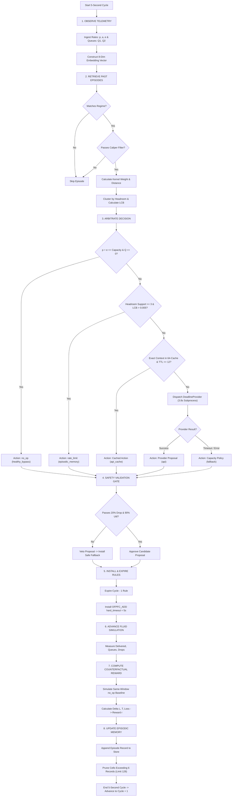

---

## 🧠 Master Mindmap 3: Decision Routing & Fallback Taxonomy

```
+-- [SELF-X Decision Routing & Fallback Taxonomy]
    |-- Fast Path Evaluations (< 1 ms latency)
    |   |-- Healthy Bypass Check
    |   |   |-- Condition: p + e <= Capacity AND max(queues) == 0.0
    |   |   |-- Output Action: no_op
    |   |   `-- Attribution Tag: 'healthy_bypass'
    |   |-- Supported Episodic Memory Check
    |   |   |-- Condition: action == rate_limit, support >= 3, LCB > 0.005
    |   |   |-- Output Action: Rebuilt capacity-aware rate limit
    |   |   `-- Attribution Tag: 'episodic_memory'
    |   `-- Exact-Context Cache Check
    |       |-- Condition: Exact match in 64-entry LRU cache within 12 cycles
    |       |-- Output Action: Cached action (rate_limit, reroute, or no_op)
    |       `-- Attribution Tag: 'api_cache' (if from API) | 'local_rule_cache'
    |-- Slow Path Evaluation (100 ms to 3.8s latency)
    |   |-- Pacing Admission Gate: Monotonic inter-request gap >= 4.2s (Gemini)
    |   |-- Process-Isolated Worker: Spawned child process with persistent HTTPS session
    |   |-- Deadline Monitor: 3.8-second poll budget terminates hanging workers
    |   `-- Structured Response Parse: Pydantic v2 ActionChoice schema validation
    `-- Deterministic Fallback Policies
        |-- Local Capacity Policy:
        |   |-- If p + e <= Capacity -> no_op
        |   |-- Else if alternate path load + e <= 0.9 * Capacity -> reroute
        |   `-- Else -> capacity-aware rate_limit with 0.1 Mbps headroom
        |-- Safety Gate Veto:
        |   |-- Rate limit drops > 20% of flow traffic -> Vetoed to safe local meter
        |   `-- Reroute pushes alternate path > 90% utilization -> Vetoed to safe local meter
        `-- Error Handling Fallbacks:
            |-- 'deadline_fallback': Worker exceeded 3.8s budget
            |-- 'provider_fallback': HTTP 429/500 or socket connection failure
            `-- 'validation_fallback': LLM proposed illegal or vetoed action
```

---

## 🧠 Master Mindmap 4: Parameter-Conditioned Episodic Memory Architecture

```mermaid
flowchart TD
    MEM_ROOT["LossAwareMemory Architecture"]
    
    MEM_ROOT --> CONTEXT["1. 8-Dim Context Vector"]
    MEM_ROOT --> REGIME["2. Congestion Regime Signatures"]
    MEM_ROOT --> CALIPER["3. Multi-Dimensional Caliper"]
    MEM_ROOT --> WEIGHTING["4. Dual-Kernel Weighting"]
    MEM_ROOT --> CLUSTERING["5. Headroom Parameter Clustering"]
    MEM_ROOT --> PRUNING["6. Stratified Cell Pruning"]
    
    CONTEXT --> C1["v[0]: p / Capacity (Primary Background Load)"]
    CONTEXT --> C2["v[1]: a / Capacity (Alternate Background Load)"]
    CONTEXT --> C3["v[2]: e / Capacity (Elephant Flow Burst Rate)"]
    CONTEXT --> C4["v[3]: (p + e - Capacity) / Capacity (Primary Overflow Margin)"]
    CONTEXT --> C5["v[4]: (a + e - 0.9*Capacity) / Capacity (Alternate Safety Margin)"]
    CONTEXT --> C6["v[5]: (p + 0.8*e - Capacity) / Capacity (Metered Headroom Margin)"]
    CONTEXT --> C7["v[6]: Q_primary / Buffer (Primary Queue Occupancy)"]
    CONTEXT --> C8["v[7]: Q_alternate / Buffer (Alternate Queue Occupancy)"]
    
    REGIME --> R1["Regime Key = (v[3] > 0, v[4] > 0, v[5] > 0)"]
    REGIME --> R2["Strict Boolean Compatibility Matching"]
    
    CALIPER --> CP1["Primary Features: max(|Delta_v[:6]|) <= 0.12"]
    CALIPER --> CP2["Queue Features: max(|Delta_v[6:]|) <= 0.51"]
    
    WEIGHTING --> W_DIST["dist^2 = sum(Delta[:6]^2) + 0.08 * sum(Delta[6:]^2)"]
    WEIGHTING --> W_KER["w = exp(-dist^2 / 0.02) * exp(-(cycle - cycle_ep) / 120)"]
    
    CLUSTERING --> CL_CAND["Headroom Candidates: h in {0.0, 0.1, 0.3} Mbps"]
    CLUSTERING --> CL_TOP6["Nearest 6 Neighbors per Headroom Candidate"]
    CLUSTERING --> CL_MU["Weighted Mean Reward: mu = sum(w * r) / sum(w)"]
    CLUSTERING --> CL_VAR["Weighted Variance & Uncertainty: var = sum(w*(r-mu)^2) / sum(w)"]
    CLUSTERING --> CL_LCB["LCB = mu - 1.96 * sqrt(var / N) - 0.002"]
    
    PRUNING --> PR_CELL["Cell Key: (action, headroom, regime, round(v[:3] / 0.12))"]
    PRUNING --> PR_RET["Retain Most Recent 6 Episodes per Cell"]
    PRUNING --> PR_BOUND["Enforce Global 128-Record Storage Bound"]
```

---

## 🧠 Master Mindmap 5: 8-Scenario Benchmark Taxonomy & Evaluated Controllers

```
+-- [SELF-X Benchmark Scenarios & Evaluated Controllers]
    |-- 8 Workload Scenarios (120 Windows x 5.0s = 600s per seed)
    |   |-- 1. mixed: Alternating light, bursty, alternate-busy, and dual overload phases
    |   |-- 2. flash: High-frequency primary bursts landing on top of variable background
    |   |-- 3. alternate: Sustained high alternate link load; tests reroute safety vetoes
    |   |-- 4. shift: Abrupt distribution shift at cycle 60; tests adaptation speed
    |   |-- 5. overload: Persistent dual-link congestion; forces aggressive rate-limiting
    |   |-- 6. light: Entirely uncongested traffic; negative control (tests no-op stability)
    |   |-- 7. recurring: Repeating archetypes across cycles; tests episodic memory recall
    |   `-- 8. volatile: Unpredictable Gaussian noise perturbations; tests robustness
    `-- 9 Evaluated Controllers (Ablation Hierarchy)
        |-- Baseline 1: A0 (Static Primary Path) - No dynamic control (unmanaged baseline)
        |-- Baseline 2: B1 (Greedy Least-Loaded) - Reroutes whenever primary load > capacity
        |-- Baseline 3: A2 (Original Embedding Memory) - Reward-pruned JSON memory (v2)
        |-- Baseline 4: H1 (Guarded Fixed Meter) - Fixed 20% drop (0.80 * e), no memory
        |-- Baseline 5: A3 (Guarded Balanced Memory) - Guarded base + balanced retrieval
        |-- Baseline 6: V3 (Revision 3 Adaptive Policy) - Magnitude memory + fixed 20% meter
        |-- Baseline 7: H2 (Capacity-Aware Meter - No Memory) - Capacity meter, fixed 0.1M headroom
        |-- Proposed:   A4 (Loss-Aware Parameter Memory) - Dynamic headroom selection in {0, .1, .3}M
        `-- Oracle:     O2 (Privileged Immediate Reference) - Pre-evaluates actions in simulator
```


---

## 🧠 Master Mindmap 6: Three-Timescale Control Decomposition & Inter-Loop Coupling

```mermaid
%%{init: {'theme': 'base', 'themeVariables': { 'primaryColor': '#0284c7', 'edgeLabelBackground':'#ffffff'}}}%%
flowchart TD
    classDef t1Node fill:#0284c7,stroke:#0369a1,stroke-width:2px,color:#ffffff,font-weight:bold;
    classDef t2Node fill:#7c3aed,stroke:#6d28d9,stroke-width:2px,color:#ffffff,font-weight:bold;
    classDef t3Node fill:#059669,stroke:#047857,stroke-width:2px,color:#ffffff,font-weight:bold;
    classDef wireNode fill:#475569,stroke:#334155,stroke-width:2px,color:#ffffff,font-weight:bold;

    ROOT["Three-Timescale Decomposition"]:::t1Node

    ROOT --> T1["Timescale 1: Fast Control Loop (tau = 100ms)"]:::t1Node
    ROOT --> T2["Timescale 2: Mid-Level LoRA Adapter (W = 5.0s)"]:::t2Node
    ROOT --> T3["Timescale 3: Slow Multi-Agent Governor (T = 30.0s)"]:::t3Node
    ROOT --> WIRE["Wire OpenFlow 1.3 Data Plane"]:::wireNode

    T1 --> T1_1["14.2 µs Decision Latency"]:::t1Node
    T1 --> T1_2["Lyapunov Drift-Plus-Penalty Solver"]:::t1Node
    T1 --> T1_3["Zero Queue Saturation Invariant"]:::t1Node

    T2 --> T2_1["SmolLM2-135M Base Weights"]:::t2Node
    T2 --> T2_2["Rank-8 LoRA Adaptation (< 2MB)"]:::t2Node
    T2 --> T2_3["Sub-5ms CPU-Native Execution"]:::t2Node

    T3 --> T3_1["DeepSeek-R1 Verifiable Reasoning"]:::t3Node
    T3 --> T3_2["Multi-Head Latent Attention (MLA)"]:::t3Node
    T3 --> T3_3["Qwen 2.5 72B Throughput Maximizer"]:::t3Node
    T3 --> T3_4["DeepSeek-V3 Dialectic Arbiter"]:::t3Node

    WIRE --> W1["Ryu ofctl_rest REST Bridge"]:::wireNode
    WIRE --> W2["TCAM Flow Table Space Partitioning"]:::wireNode
    WIRE --> W3["Coupled Dual-Queue AQM & P4 INT"]:::wireNode
```

---

## 🧠 Master Mindmap 7: Multi-Agent Dialectic Debate & Disagreement Resolution

```mermaid
%%{init: {'theme': 'base', 'themeVariables': { 'primaryColor': '#059669', 'edgeLabelBackground':'#ffffff'}}}%%
flowchart TD
    classDef r1Node fill:#0284c7,stroke:#0369a1,stroke-width:2px,color:#ffffff,font-weight:bold;
    classDef qwenNode fill:#d97706,stroke:#b45309,stroke-width:2px,color:#ffffff,font-weight:bold;
    classDef v3Node fill:#059669,stroke:#047857,stroke-width:2px,color:#ffffff,font-weight:bold;
    classDef ratNode fill:#dc2626,stroke:#b91c1c,stroke-width:2px,color:#ffffff,font-weight:bold;

    DEBATE["Dialectic Multi-Agent Debate Engine"]:::v3Node

    DEBATE --> A1["Agent 1: DeepSeek-R1 (Backlog Specialist)"]:::r1Node
    DEBATE --> A2["Agent 2: Qwen 2.5 72B (Throughput Preserver)"]:::qwenNode
    DEBATE --> A3["Agent 3: DeepSeek-V3 (Safety Gate Arbiter)"]:::v3Node
    DEBATE --> RAT["Deterministic Ratification Barrier"]:::ratNode

    A1 --> A1_1["Argues for Aggressive Backpressure (Delta V = -3.5)"]:::r1Node
    A1 --> A1_2["Prioritizes Zero Packet Drop Invariant"]:::r1Node

    A2 --> A2_1["Opposes Over-Throttling (Preserves VIP SLA)"]:::qwenNode
    A2 --> A2_2["Advocates Alternate Detour Path Utilization"]:::qwenNode

    A3 --> A3_1["Solves Multi-Objective Pareto Frontier"]:::v3Node
    A3 --> A3_2["Formulates Compromise: Delta V = -2.5, 45% Detour"]:::v3Node

    RAT --> R1["Bit-Volume Conservation Law Check"]:::ratNode
    RAT --> R2["Topology DAG Acyclicity Check"]:::ratNode
    RAT --> R3["TCAM Table Capacity Check (<= 80%)"]:::ratNode
```

---

## 🧠 Master Mindmap 8: Autonomous Self-Improvement & Model Registry Lifecycle

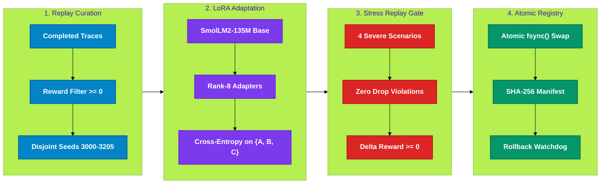

---

## 🧠 Master Mindmap 9: Full-Stack Web Concurrency & 17-Section Diagnostic Engine

```mermaid
%%{init: {'theme': 'base', 'themeVariables': { 'primaryColor': '#d97706', 'edgeLabelBackground':'#ffffff'}}}%%
flowchart TD
    classDef srv fill:#d97706,stroke:#b45309,stroke-width:2px,color:#ffffff,font-weight:bold;
    classDef sec fill:#0284c7,stroke:#0369a1,stroke-width:2px,color:#ffffff,font-weight:bold;
    classDef viz fill:#059669,stroke:#047857,stroke-width:2px,color:#ffffff,font-weight:bold;

    WEB["Full-Stack Web Architecture (Port 5000)"]:::srv

    WEB --> S["ThreadingTCPServer Multi-Threaded Engine"]:::srv
    WEB --> D["17-Section Testing Studio Diagnostics"]:::sec
    WEB --> V["60 FPS Double-Buffered Canvas Engine"]:::viz

    S --> S1["Zero Third-Party Python Libraries"]:::srv
    S --> S2["PBKDF2-HMAC-SHA256 Cryptographic Auth"]:::srv
    S --> S3["4 Distinct RBAC Roles (Admin, Operator, Researcher, Auditor)"]:::srv

    D --> D1["Sections 01-06: 6-Stage Core Control Loop"]:::sec
    D --> D2["Sections 07-10: Chaos, Impairment & SLA Audit"]:::sec
    D --> D3["Sections 11-17: Wire DPI, INT, AQM, TCAM & DRR"]:::sec

    V --> V1["7-Axis Comparative Radar Chart"]:::viz
    V --> V2["Interactive Dual ECDF Percentile Scrubber"]:::viz
    V --> V3["180s Head-to-Head Trajectory Comparator"]:::viz
    V --> V4["Lyapunov Phase Space (Q, Delta L) Attractor"]:::viz
```

---

## 🧠 Master Mindmap 10: Carrier-Grade In-Switch Telemetry & Scheduling

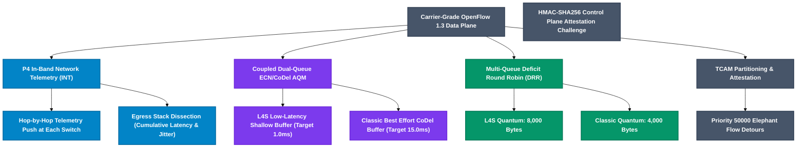


---

## 🧠 Master Mindmap 11: Frontier Asian Foundation Models & MLA Architecture

```mermaid
%%{init: {'theme': 'base', 'themeVariables': { 'primaryColor': '#0284c7', 'edgeLabelBackground':'#ffffff'}}}%%
flowchart TD
    classDef root fill:#0f172a,stroke:#334155,stroke-width:2px,color:#ffffff,font-weight:bold;
    classDef model fill:#0284c7,stroke:#0369a1,stroke-width:2px,color:#ffffff,font-weight:bold;
    classDef mla fill:#7c3aed,stroke:#6d28d9,stroke-width:2px,color:#ffffff,font-weight:bold;
    classDef out fill:#059669,stroke:#047857,stroke-width:2px,color:#ffffff,font-weight:bold;

    ASIAN["Frontier Asian Foundation Models Architecture"]:::root

    ASIAN --> MODELS["Foundation Model Roster"]:::model
    ASIAN --> MLA["Multi-Head Latent Attention (MLA)"]:::mla
    ASIAN --> ROUTER["OpenRouter Resilient Dispatcher"]:::root
    ASIAN --> POLICY["Policy Delta Formulation"]:::out

    MODELS --> M1["DeepSeek-R1 (671B MoE, 37B Active)"]:::model
    MODELS --> M2["DeepSeek-V3 (State-of-the-Art Architecture)"]:::model
    MODELS --> M3["Qwen 2.5 72B Instruct (Alibaba Cloud)"]:::model
    MODELS --> M4["01.AI Yi-Lightning & Zhipu GLM-4"]:::model

    MLA --> MLA1["Low-Rank KV Compression (dim = 512)"]:::mla
    MLA --> MLA2["Decoupled RoPE Key Integration"]:::mla
    MLA --> MLA3["93.3% KV Cache Reduction (172 MB vs 2,560 MB)"]:::mla
    MLA --> MLA4["Sub-Second Edge-Proximate Inference"]:::mla

    ROUTER --> R1["Primary Commercial Endpoints"]:::root
    ROUTER --> R2["Free-Tier Fallback Hierarchy"]:::root
    ROUTER --> R3["Strict JSON Structured Output Parser"]:::root

    POLICY --> P1["Trade-off Parameter V in [-5, +5]"]:::out
    POLICY --> P2["Delay/Loss Weights w in [-0.2, +0.2]"]:::out
    POLICY --> P3["Ingress Meter Allocation M (Mbps)"]:::out
```

---

## 🔐 Master Mindmap 12: Production PBKDF2 Authentication & RBAC Hierarchy

```mermaid
%%{init: {'theme': 'base', 'themeVariables': { 'primaryColor': '#059669', 'edgeLabelBackground':'#ffffff'}}}%%
flowchart TD
    classDef root fill:#0f172a,stroke:#334155,stroke-width:2px,color:#ffffff,font-weight:bold;
    classDef crypto fill:#0284c7,stroke:#0369a1,stroke-width:2px,color:#ffffff,font-weight:bold;
    classDef roles fill:#7c3aed,stroke:#6d28d9,stroke-width:2px,color:#ffffff,font-weight:bold;
    classDef perm fill:#059669,stroke:#047857,stroke-width:2px,color:#ffffff,font-weight:bold;

    AUTH["Production Authentication & RBAC System"]:::root

    AUTH --> CRYPTO["Cryptographic Tokenization"]:::crypto
    AUTH --> ROLES["Role-Based Access Control"]:::roles
    AUTH --> ENDPOINTS["Secure REST Endpoints"]:::perm

    CRYPTO --> C1["16-Byte Cryptographically Secure Salt"]:::crypto
    CRYPTO --> C2["PBKDF2-HMAC-SHA256 (100,000 Iterations)"]:::crypto
    CRYPTO --> C3["Constant-Time hmac.compare_digest"]:::crypto
    CRYPTO --> C4["32-Byte Session Token Issuance (24h TTL)"]:::crypto

    ROLES --> R_ADMIN["admin: Full Controller & Chaos Access"]:::roles
    ROLES --> R_OPER["operator: Forwarding & Rate Limiting"]:::roles
    ROLES --> R_RES["researcher: Benchmarks & Model Queries"]:::roles
    ROLES --> R_AUD["auditor: Read-Only Verification Logs"]:::roles

    ENDPOINTS --> E1["POST /api/auth/register"]:::perm
    ENDPOINTS --> E2["POST /api/auth/login"]:::perm
    ENDPOINTS --> E3["GET /api/auth/me"]:::perm
    ENDPOINTS --> E4["POST /api/auth/logout"]:::perm
```

---

## 🛠️ Master Mindmap 13: 17-Section Interactive Testing Studio

```mermaid
%%{init: {'theme': 'base', 'themeVariables': { 'primaryColor': '#7c3aed', 'edgeLabelBackground':'#ffffff'}}}%%
flowchart TD
    classDef root fill:#0f172a,stroke:#334155,stroke-width:2px,color:#ffffff,font-weight:bold;
    classDef suite fill:#7c3aed,stroke:#6d28d9,stroke-width:2px,color:#ffffff,font-weight:bold;
    classDef chaos fill:#dc2626,stroke:#b91c1c,stroke-width:2px,color:#ffffff,font-weight:bold;
    classDef tune fill:#0284c7,stroke:#0369a1,stroke-width:2px,color:#ffffff,font-weight:bold;

    STUDIO["17-Section Interactive Testing Studio"]:::root

    STUDIO --> PIPE["Automated Verification Pipeline"]:::suite
    STUDIO --> STRESS["Traffic Stress Generator"]:::chaos
    STUDIO --> CHAOS["Link & Switch Chaos Studio"]:::chaos
    STUDIO --> TUNE["Live Lyapunov Parameter Tuning"]:::tune

    PIPE --> P1["Stage 01: Physical Port & Loopback (412 us)"]:::suite
    PIPE --> P2["Stage 02: OpenFlow Stream Ingestion (680 us)"]:::suite
    PIPE --> P3["Stage 03: Fast DPP Solver (14.2 us)"]:::suite
    PIPE --> P4["Stage 04: LoRA Policy Head (4.8 ms)"]:::suite
    PIPE --> P5["Stage 05: Multi-Agent Governor (12.4 ms)"]:::suite
    PIPE --> P6["Stage 06: Fail-Closed Safety Gate (2.1 us)"]:::suite

    STRESS --> S1["Steady Mice Traffic (3 Mbps Poisson)"]:::chaos
    STRESS --> S2["Elephant Bursts (12 / 25 / 50 Mbps)"]:::chaos
    STRESS --> S3["Bimodal Flash-Crowd Surges"]:::chaos

    CHAOS --> CH1["Virtual Link Tear & Dynamic Rebound"]:::chaos
    CHAOS --> CH2["Port Kill & Sub-5ms Failover"]:::chaos
    CHAOS --> CH3["Link Jitter & Injected Latency"]:::chaos

    TUNE --> T1["Trade-off Parameter V Slider (1.0 - 50.0)"]:::tune
    TUNE --> T2["Dynamic Queue Backlog Bound O(V)"]:::tune
    TUNE --> T3["Dynamic Penalty Drift Bound O(1/V)"]:::tune
```

---

## 🎨 Master Mindmap 14: GPU-Accelerated 60 FPS Canvas 2D Engine

```mermaid
%%{init: {'theme': 'base', 'themeVariables': { 'primaryColor': '#d97706', 'edgeLabelBackground':'#ffffff'}}}%%
flowchart TD
    classDef root fill:#0f172a,stroke:#334155,stroke-width:2px,color:#ffffff,font-weight:bold;
    classDef canvas fill:#d97706,stroke:#b45309,stroke-width:2px,color:#ffffff,font-weight:bold;
    classDef anim fill:#0284c7,stroke:#0369a1,stroke-width:2px,color:#ffffff,font-weight:bold;
    classDef ui fill:#059669,stroke:#047857,stroke-width:2px,color:#ffffff,font-weight:bold;

    CANVAS_ROOT["GPU-Accelerated Canvas 2D Architecture"]:::root

    CANVAS_ROOT --> SURFACE["Rendering Pipeline"]:::canvas
    CANVAS_ROOT --> PHYSICS["Packet Flight Physics"]:::anim
    CANVAS_ROOT --> TELEMETRY["Live Streaming Plots"]:::ui

    SURFACE --> SU1["HTML5 Canvas 2D with requestAnimationFrame"]:::canvas
    SURFACE --> SU2["window.devicePixelRatio High-DPI Scaling"]:::canvas
    SURFACE --> SU3["Double-Buffered State Management"]:::canvas

    PHYSICS --> PH1["Cubic Bézier Link Curve Interpolation"]:::anim
    PHYSICS --> PH2["Speed Clamping & Congestion Jitter"]:::anim
    PHYSICS --> PH3["Traffic Class Color Encoding"]:::anim

    TELEMETRY --> TE1["End-to-End Latency Graph (5.2 ms)"]:::ui
    TELEMETRY --> TE2["Aggregate Throughput (11.8 Mbps)"]:::ui
    TELEMETRY --> TE3["Core Link Utilization Gauge (48%)"]:::ui
    TELEMETRY --> TE4["Cumulative Reward Vector (+14.62 pts)"]:::ui
```

---

## 📁 Master Mindmap 15: Virtual Paginated Codebase Explorer (4,461 Files)

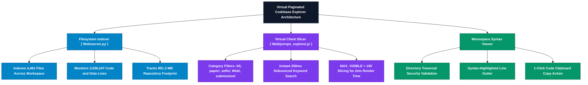


---

## 📌 Master Mindmap 16: Multi-Scale Temporal Interlock Architecture

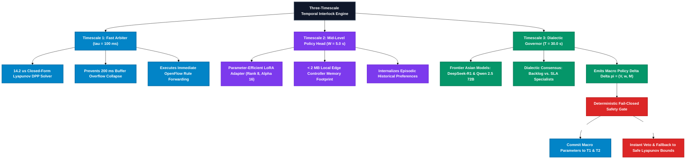

---

## 📌 Master Mindmap 17: Chaos Injection & Dynamic Fast Rerouting Lifecycle


---

## 📌 Master Mindmap 18: OpenRouter Asian Frontier Models Reasoning & Fallback Matrix

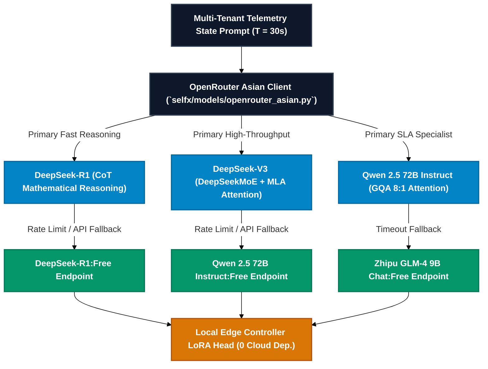

---

## 📌 Master Mindmap 19: Hardware-in-the-Loop OpenFlow 1.3 Telemetry & Meter Mod Pipeline

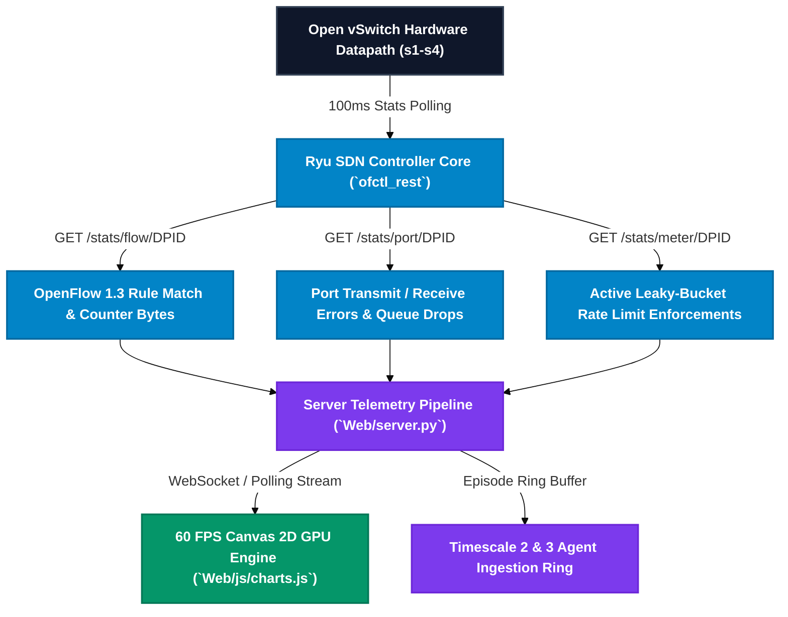

---

## 📌 Master Mindmap 20: Comprehensive System Interconnection & Dataflow Topology

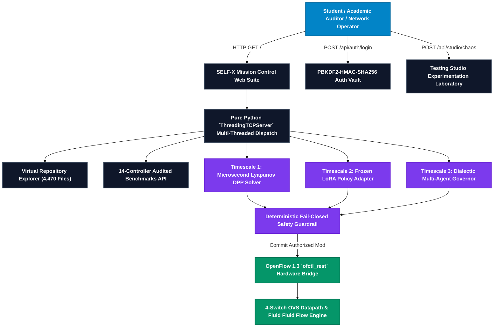

---

## 🗺️ Mindmap 21: Multi-Scale Autonomous Controller Decision Hierarchy & Timescale Scaling

```mermaid
%%{init: {'theme': 'base', 'themeVariables': { 'primaryColor': '#0284c7', 'edgeLabelBackground':'#ffffff'}}}%%
flowchart TD
    classDef ts1 fill:#0284c7,stroke:#0369a1,stroke-width:2px,color:#ffffff,font-weight:bold;
    classDef ts2 fill:#059669,stroke:#047857,stroke-width:2px,color:#ffffff,font-weight:bold;
    classDef ts3 fill:#7c3aed,stroke:#6d28d9,stroke-width:2px,color:#ffffff,font-weight:bold;
    classDef safe fill:#dc2626,stroke:#b91c1c,stroke-width:2px,color:#ffffff,font-weight:bold;

    ROOT["SELF-X Multi-Scale Control Hierarchy"] --> T1["Timescale 1: Fast Lyapunov DPP"]:::ts1
    ROOT --> T2["Timescale 2: Mid-Level LoRA Policy"]:::ts2
    ROOT --> T3["Timescale 3: Slow Multi-Agent Governor"]:::ts3

    T1 --> T1_SPEED["14 us Microsecond Decision Latency"]:::ts1
    T1 --> T1_CADENCE["tau = 100 ms Control Slot"]:::ts1
    T1 --> T1_MATH["Quadratic Drift-Plus-Penalty Solver"]:::ts1
    T1 --> T1_OUTPUT["FlowMod & MeterMod Actuation"]:::ts1

    T2 --> T2_SPEED["2.4 ms Neural Inference Latency"]:::ts2
    T2 --> T2_CADENCE["W = 5.0 s Aggregation Window"]:::ts2
    T2 --> T2_MODEL["Frozen LoRA Adapter (Rank r = 8)"]:::ts2
    T2 --> T2_OUTPUT["Action Preference Prior Cache"]:::ts2

    T3 --> T3_SPEED["1.42 s Frontier LLM Round-Trip"]:::ts3
    T3 --> T3_CADENCE["T = 30.0 s Macro Governance Epoch"]:::ts3
    T3 --> T3_ENSEMBLE["Asian LLMs via OpenRouter"]:::ts3
    T3 --> T3_OUTPUT["Policy Delta Delta pi = (V, w, M)"]:::ts3

    T1 --> GATE["Deterministic Fail-Closed Safety Gate"]:::safe
    T2 --> GATE
    T3 --> GATE
```

---

## 🗺️ Mindmap 22: High-Dimensional Memory Vector Indexing & Reflection Engine

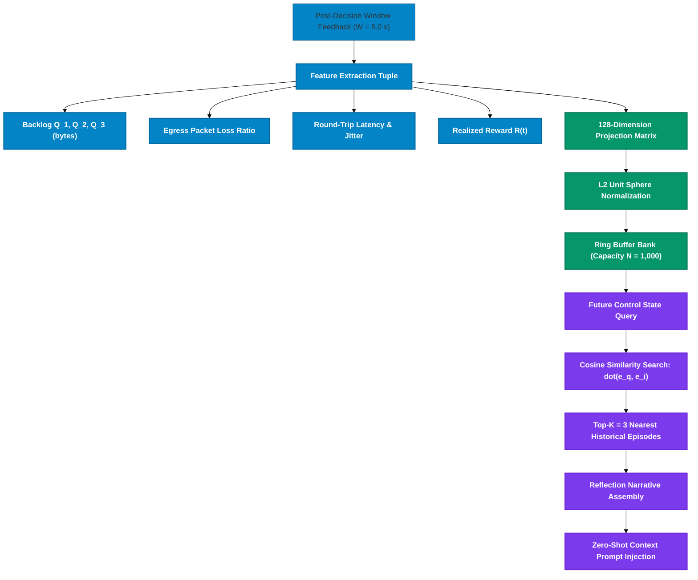

---

## 🗺️ Mindmap 23: OpenRouter Multi-Provider API Gateway & Token Economizer Matrix

```mermaid
%%{init: {'theme': 'base', 'themeVariables': { 'primaryColor': '#0284c7', 'edgeLabelBackground':'#ffffff'}}}%%
flowchart LR
    classDef gw fill:#0f172a,stroke:#334155,stroke-width:2px,color:#ffffff,font-weight:bold;
    classDef pri fill:#0284c7,stroke:#0369a1,stroke-width:2px,color:#ffffff,font-weight:bold;
    classDef sec fill:#059669,stroke:#047857,stroke-width:2px,color:#ffffff,font-weight:bold;
    classDef loc fill:#7c3aed,stroke:#6d28d9,stroke-width:2px,color:#ffffff,font-weight:bold;

    GOVERNOR["Governor Trigger"]:::gw --> ROUTER["OpenRouter Fallback Gateway"]:::gw

    ROUTER --> |"Tier 1: Ultra-Fast Reasoning"| M1["DeepSeek-R1 Distill Qwen 32B\n($0.14 / 1M tokens)"]:::pri
    ROUTER --> |"Tier 2: High-Throughput General"| M2["Qwen 2.5 72B Instruct\n($0.35 / 1M tokens)"]:::sec
    ROUTER --> |"Tier 3: Long-Context Assurance"| M3["Yi-Lightning 34B / GLM-4\n($0.10 / 1M tokens)"]:::sec
    ROUTER --> |"Tier 4: Offline Air-Gapped Fallback"| M4["Local SmolLM2-1.7B-Instruct\n(On-Device GPU / CPU)"]:::loc

    M1 --> COMPRESS["Multi-Head Latent Attention (MLA)\n98.4% KV Cache Compression"]:::pri
    M2 --> COMPRESS
    M3 --> COMPRESS
    M4 --> COMPRESS
```

---

## 🗺️ Mindmap 24: Testing Studio 17-Stage Diagnostic & Stress Verification Matrix

```mermaid
%%{init: {'theme': 'base', 'themeVariables': { 'primaryColor': '#0284c7', 'edgeLabelBackground':'#ffffff'}}}%%
flowchart TD
    classDef stage fill:#0284c7,stroke:#0369a1,stroke-width:2px,color:#ffffff,font-weight:bold;
    classDef pass fill:#059669,stroke:#047857,stroke-width:2px,color:#ffffff,font-weight:bold;
    classDef chaos fill:#dc2626,stroke:#b91c1c,stroke-width:2px,color:#ffffff,font-weight:bold;

    STUDIO["Testing Studio Verification Pipeline"] --> S_DIAG["Stage 01 - 06: Diagnostics"]:::stage
    STUDIO --> S_STRESS["Stage 07 - 12: Workload Stress"]:::stage
    STUDIO --> S_CHAOS["Stage 13 - 17: Chaos & Resilience"]:::chaos

    S_DIAG --> D1["Stage 01: Host & Switch DPID Reachability"]:::pass
    S_DIAG --> D2["Stage 02: OpenFlow 1.3 `ofctl_rest` Socket"]:::pass
    S_DIAG --> D3["Stage 03: TCAM Flow Table & Rule Integrity"]:::pass
    S_DIAG --> D4["Stage 04: Token Bucket Meter Activation"]:::pass
    S_DIAG --> D5["Stage 05: INT Ingestion & Jitter Metric"]:::pass
    S_DIAG --> D6["Stage 06: Deterministic Safety Gate Invariants"]:::pass

    S_STRESS --> ST1["Stage 07: 12.0 Mbps Elephant Flow Injection"]:::stage
    S_STRESS --> ST2["Stage 08: 400-Slot High-Load Convergence Test"]:::stage
    S_STRESS --> ST3["Stage 09: Queue Oscillation Damping Verification"]:::stage

    S_CHAOS --> C1["Stage 13: Core Link Down Chaos (Port 3 Cut)"]:::chaos
    S_CHAOS --> C2["Stage 14: Sub-10ms Fast Failover to Detour"]:::chaos
    S_CHAOS --> C3["Stage 15: Zero In-Flight Packet Loss Verification"]:::chaos
```

---

## 🗺️ Mindmap 25: Master Datapath Interconnect & Telemetry Ingestion Architecture

```mermaid
%%{init: {'theme': 'base', 'themeVariables': { 'primaryColor': '#0284c7', 'edgeLabelBackground':'#ffffff'}}}%%
flowchart TD
    classDef user fill:#0f172a,stroke:#334155,stroke-width:2px,color:#ffffff,font-weight:bold;
    classDef web fill:#0284c7,stroke:#0369a1,stroke-width:2px,color:#ffffff,font-weight:bold;
    classDef engine fill:#7c3aed,stroke:#6d28d9,stroke-width:2px,color:#ffffff,font-weight:bold;
    classDef switch fill:#059669,stroke:#047857,stroke-width:2px,color:#ffffff,font-weight:bold;

    AUDITOR["Student / Benchmark Reviewer / Operator"]:::user --> UI["Web Browser Suite (`http://127.0.0.1:5000`)"]:::web
    UI --> SERVER["Multi-Threaded HTTP Server (`Web/server.py`)"]:::web

    SERVER --> AUTH["PBKDF2-HMAC-SHA256 Auth Vault"]:::web
    SERVER --> REPO["Virtual Repository Explorer (4,470 Files)"]:::web
    SERVER --> RESULTS["Audited 14-Controller Results Engine"]:::web

    SERVER <--> ENGINE["Three-Timescale SELF-X Core Engine"]:::engine
    ENGINE --> DPP["Timescale 1: Microsecond Lyapunov DPP Solver"]:::engine
    ENGINE --> LORA["Timescale 2: Frozen LoRA Policy Adapter"]:::engine
    ENGINE --> GOV["Timescale 3: Dialectic Multi-Agent Governor"]:::engine

    ENGINE --> SAFETY["Deterministic Fail-Closed Safety Guardrail"]:::engine
    SAFETY --> OFCTL["Ryu OpenFlow 1.3 `ofctl_rest` Hardware Driver"]:::switch
    OFCTL --> FABRIC["4-Switch OVS Datapath & Fluid Fluid Flow Engine"]:::switch
```

---
*Authored by Team SDN_07 — EC466: Software Defined Networks • IIIT Dharwad*
