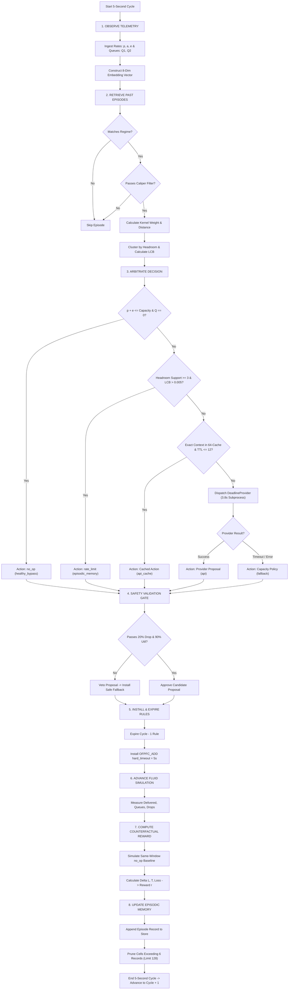

# SELF-X Self-Improving Agent: Master Mindmap Flows

> **Exhaustive Architectural, Cognitive, Algorithmic, and Methodological Mindmaps for the Autonomous Flow-Management Agent**  
> *Course Project — EC466: Software Defined Networks | Team ID: SDN_07*

---

## 📌 Document Overview

This document serves as the master repository of **Mindmap Flows** for the **SELF-X Autonomous SDN Flow-Management Agent**. It provides structured, hierarchical, visual representations of the entire software architecture, cognitive decision loops, memory mechanics, safety validation rules, benchmark designs, and evidence pipelines.

---

## 🧠 Master Mindmap 1: Complete System Capabilities & Subsystems

```mermaid
flowchart TD
    ROOT["SELF-X Self-Improving SDN System"]
    
    ROOT --> S1["Subsystem 1: Telemetry & Ingestion"]
    ROOT --> S2["Subsystem 2: Episodic Memory & Adaptation"]
    ROOT --> S3["Subsystem 3: Decision Engine & LLM Reasoning"]
    ROOT --> S4["Subsystem 4: Deterministic Safety Gate"]
    ROOT --> S5["Subsystem 5: Switching & Rule Lifecycle"]
    ROOT --> S6["Subsystem 6: Fluid Queue Network Simulation"]
    ROOT --> S7["Subsystem 7: Counterfactual Reward & Reflection"]
    ROOT --> S8["Subsystem 8: Multi-Scenario Benchmark Harness"]
    ROOT --> S9["Subsystem 9: Web Dashboard & Audit Engine"]
    
    S1 --> S1_1["OpenFlow Cumulative Counter Ingestion (Ryu ofctl_rest)"]
    S1 --> S1_2["5-Second Delta Calculation for Rates & Utilizations"]
    S1 --> S1_3["8-Dimensional Normalized State Feature Embedding Vector"]
    S1 --> S1_4["Congestion Regime Signature Generation"]
    
    S2 --> S2_1["LossAwareMemory (Bounded at 128 Episodes)"]
    S2 --> S2_2["Stratified Cell Pruning (Max 6 per Action/Headroom/Regime Cell)"]
    S2 --> S2_3["High-Dimensional Caliper Distance Filtering"]
    S2 --> S2_4["Exponential Distance & Recency Kernel Weighting"]
    S2 --> S2_5["Headroom Parameter Clustering (0.0, 0.1, 0.3 Mbps)"]
    S2 --> S2_6["Lower Confidence Bound (LCB) Uncertainty Estimation"]
    
    S3 --> S3_1["Tier 1: Healthy Bypass (Zero Queue, Fits Capacity -> no_op)"]
    S3 --> S3_2["Tier 2: Supported Episodic Memory (Support >= 3, LCB > 0.005)"]
    S3 --> S3_3["Tier 3: Exact-Context Action Cache (64 Slots, 12-Cycle TTL)"]
    S3 --> S3_4["Tier 4: DeadlineProvider Subprocess Worker (3.8s Wait Budget)"]
    S3 --> S3_5["Tier 5: Deterministic Capacity-Aware Fallback Heuristic"]
    
    S4 --> S4_1["Rate Limit Throttling Guard: Flow Drop <= 20%"]
    S4 --> S4_2["Binary Rounding Repair: +1 kbps Admission Adjustment"]
    S4 --> S4_3["Link Capacity Ceiling Guard: Projected Util <= 90%"]
    S4 --> S4_4["Rate Floor Guard: rate_limit_kbps >= 512 kbps"]
    S4 --> S4_5["Fail-Closed Semantics: Unsafe Proposals Vetoed to no_op"]
    
    S5 --> S5_1["OpenFlow 1.3 Flow-Mod ADD Messages (Priority 100)"]
    S5 --> S5_2["OpenFlow Meter Table Management (KBPS Flag, DROP Band)"]
    S5 --> S5_3["hard_timeout = 5s Synchronization with Virtual Windows"]
    S5 --> S5_4["Automatic Boundary Rule Teardown & Port 2 Restoration"]
    
    S6 --> S6_1["Two Parallel Logical Paths: Primary (P1) & Alternate (P2)"]
    S6 --> S6_2["Bottleneck Link Capacities (10 Mbps) & Buffers (0.5 Mbit)"]
    S6 --> S6_3["Differential Queue Dynamics: dQ/dt = Admitted - C"]
    S6 --> S6_4["Piecewise-Linear Queue Area Integration for Average Delay"]
    S6 --> S6_5["Strict Physical Conservation Law Verification"]
    
    S7 --> S7_1["Same-Window Counterfactual no_op Baseline Simulation"]
    S7 --> S7_2["Normalized Metric Deltas: dLatency, dThroughput, dLoss"]
    S7 --> S7_3["Weighted Multi-Objective Reward: -0.4 dL + 0.4 dT - 0.2 dLoss"]
    S7 --> S7_4["Deterministic Semantic Reflection Formatting"]
    
    S8 --> S8_1["8 Diverse Scenarios x 10 Held-Out Seeds x 9 Controllers"]
    S8 --> S8_2["86,400 Total Simulation Window Evaluations"]
    S8 --> S8_3["4,000-Draw Paired Seed Percentile Bootstrap Statistics"]
    S8 --> S8_4["Cryptographic SHA256 Binding for Synthetic Traffic"]
    
    S9 --> S9_1["Loopback-Only HTTP Server (Standard Library, Port 8766)"]
    S9 --> S9_2["Interactive Rule Demo & Step-by-Step State Inspector"]
    S9 --> S9_3["120-Window Offline Learning Replay Visualizer"]
    S9 --> S9_4["Strict Content-Security-Policy & Allowlist Static Assets"]
```



---

## 🧠 Master Mindmap 2: Cognitive Control Loop & Decision State Machine



---

## 🧠 Master Mindmap 3: Decision Routing & Fallback Taxonomy

```
+-- [SELF-X Decision Routing & Fallback Taxonomy]
    |-- Fast Path Evaluations (< 1 ms latency)
    |   |-- Healthy Bypass Check
    |   |   |-- Condition: p + e <= Capacity AND max(queues) == 0.0
    |   |   |-- Output Action: no_op
    |   |   `-- Attribution Tag: 'healthy_bypass'
    |   |-- Supported Episodic Memory Check
    |   |   |-- Condition: action == rate_limit, support >= 3, LCB > 0.005
    |   |   |-- Output Action: Rebuilt capacity-aware rate limit
    |   |   `-- Attribution Tag: 'episodic_memory'
    |   `-- Exact-Context Cache Check
    |       |-- Condition: Exact match in 64-entry LRU cache within 12 cycles
    |       |-- Output Action: Cached action (rate_limit, reroute, or no_op)
    |       `-- Attribution Tag: 'api_cache' (if from API) | 'local_rule_cache'
    |-- Slow Path Evaluation (100 ms to 3.8s latency)
    |   |-- Pacing Admission Gate: Monotonic inter-request gap >= 4.2s (Gemini)
    |   |-- Process-Isolated Worker: Spawned child process with persistent HTTPS session
    |   |-- Deadline Monitor: 3.8-second poll budget terminates hanging workers
    |   `-- Structured Response Parse: Pydantic v2 ActionChoice schema validation
    `-- Deterministic Fallback Policies
        |-- Local Capacity Policy:
        |   |-- If p + e <= Capacity -> no_op
        |   |-- Else if alternate path load + e <= 0.9 * Capacity -> reroute
        |   `-- Else -> capacity-aware rate_limit with 0.1 Mbps headroom
        |-- Safety Gate Veto:
        |   |-- Rate limit drops > 20% of flow traffic -> Vetoed to safe local meter
        |   `-- Reroute pushes alternate path > 90% utilization -> Vetoed to safe local meter
        `-- Error Handling Fallbacks:
            |-- 'deadline_fallback': Worker exceeded 3.8s budget
            |-- 'provider_fallback': HTTP 429/500 or socket connection failure
            `-- 'validation_fallback': LLM proposed illegal or vetoed action
```

---

## 🧠 Master Mindmap 4: Parameter-Conditioned Episodic Memory Architecture

```mermaid
flowchart TD
    MEM_ROOT["LossAwareMemory Architecture"]
    
    MEM_ROOT --> CONTEXT["1. 8-Dim Context Vector"]
    MEM_ROOT --> REGIME["2. Congestion Regime Signatures"]
    MEM_ROOT --> CALIPER["3. Multi-Dimensional Caliper"]
    MEM_ROOT --> WEIGHTING["4. Dual-Kernel Weighting"]
    MEM_ROOT --> CLUSTERING["5. Headroom Parameter Clustering"]
    MEM_ROOT --> PRUNING["6. Stratified Cell Pruning"]
    
    CONTEXT --> C1["v[0]: p / Capacity (Primary Background Load)"]
    CONTEXT --> C2["v[1]: a / Capacity (Alternate Background Load)"]
    CONTEXT --> C3["v[2]: e / Capacity (Elephant Flow Burst Rate)"]
    CONTEXT --> C4["v[3]: (p + e - Capacity) / Capacity (Primary Overflow Margin)"]
    CONTEXT --> C5["v[4]: (a + e - 0.9*Capacity) / Capacity (Alternate Safety Margin)"]
    CONTEXT --> C6["v[5]: (p + 0.8*e - Capacity) / Capacity (Metered Headroom Margin)"]
    CONTEXT --> C7["v[6]: Q_primary / Buffer (Primary Queue Occupancy)"]
    CONTEXT --> C8["v[7]: Q_alternate / Buffer (Alternate Queue Occupancy)"]
    
    REGIME --> R1["Regime Key = (v[3] > 0, v[4] > 0, v[5] > 0)"]
    REGIME --> R2["Strict Boolean Compatibility Matching"]
    
    CALIPER --> CP1["Primary Features: max(|Delta_v[:6]|) <= 0.12"]
    CALIPER --> CP2["Queue Features: max(|Delta_v[6:]|) <= 0.51"]
    
    WEIGHTING --> W_DIST["dist^2 = sum(Delta[:6]^2) + 0.08 * sum(Delta[6:]^2)"]
    WEIGHTING --> W_KER["w = exp(-dist^2 / 0.02) * exp(-(cycle - cycle_ep) / 120)"]
    
    CLUSTERING --> CL_CAND["Headroom Candidates: h in {0.0, 0.1, 0.3} Mbps"]
    CLUSTERING --> CL_TOP6["Nearest 6 Neighbors per Headroom Candidate"]
    CLUSTERING --> CL_MU["Weighted Mean Reward: mu = sum(w * r) / sum(w)"]
    CLUSTERING --> CL_VAR["Weighted Variance & Uncertainty: var = sum(w*(r-mu)^2) / sum(w)"]
    CLUSTERING --> CL_LCB["LCB = mu - 1.96 * sqrt(var / N) - 0.002"]
    
    PRUNING --> PR_CELL["Cell Key: (action, headroom, regime, round(v[:3] / 0.12))"]
    PRUNING --> PR_RET["Retain Most Recent 6 Episodes per Cell"]
    PRUNING --> PR_BOUND["Enforce Global 128-Record Storage Bound"]
```



---

## 🧠 Master Mindmap 5: 8-Scenario Benchmark Taxonomy & Evaluated Controllers

```
+-- [SELF-X Benchmark Scenarios & Evaluated Controllers]
    |-- 8 Workload Scenarios (120 Windows x 5.0s = 600s per seed)
    |   |-- 1. mixed: Alternating light, bursty, alternate-busy, and dual overload phases
    |   |-- 2. flash: High-frequency primary bursts landing on top of variable background
    |   |-- 3. alternate: Sustained high alternate link load; tests reroute safety vetoes
    |   |-- 4. shift: Abrupt distribution shift at cycle 60; tests adaptation speed
    |   |-- 5. overload: Persistent dual-link congestion; forces aggressive rate-limiting
    |   |-- 6. light: Entirely uncongested traffic; negative control (tests no-op stability)
    |   |-- 7. recurring: Repeating archetypes across cycles; tests episodic memory recall
    |   `-- 8. volatile: Unpredictable Gaussian noise perturbations; tests robustness
    `-- 9 Evaluated Controllers (Ablation Hierarchy)
        |-- Baseline 1: A0 (Static Primary Path) - No dynamic control (unmanaged baseline)
        |-- Baseline 2: B1 (Greedy Least-Loaded) - Reroutes whenever primary load > capacity
        |-- Baseline 3: A2 (Original Embedding Memory) - Reward-pruned JSON memory (v2)
        |-- Baseline 4: H1 (Guarded Fixed Meter) - Fixed 20% drop (0.80 * e), no memory
        |-- Baseline 5: A3 (Guarded Balanced Memory) - Guarded base + balanced retrieval
        |-- Baseline 6: V3 (Revision 3 Adaptive Policy) - Magnitude memory + fixed 20% meter
        |-- Baseline 7: H2 (Capacity-Aware Meter - No Memory) - Capacity meter, fixed 0.1M headroom
        |-- Proposed:   A4 (Loss-Aware Parameter Memory) - Dynamic headroom selection in {0, .1, .3}M
        `-- Oracle:     O2 (Privileged Immediate Reference) - Pre-evaluates actions in simulator
```
