# SELF-X Benchmark Directory Navigation & Artifact Lineage

> **Directory Layout, Provenance Rules, SHA256 Checksums, Python Data Analysis Snippets, and Replay File Mapping**  
> *Course Project — EC466: Software Defined Networks | Team ID: SDN_07*

---

## 📌 Benchmark Architecture Overview

The `output/benchmarks/` directory houses the raw experimental records, synthetic traffic traces, cryptographic checksums, and figure manifests generated across all iterations of the SELF-X project.

All benchmark results conform to strict scientific provenance:
- **`v4/` (Current Canonical Submission Suite)**: Contains the full 86,400-window dataset evaluated across 8 scenarios, 10 seeds (1900–1909), and 9 controllers, incorporating the $+1\text{ kbps}$ precision repair, pooled LLM workers, and paired bootstrap statistical intervals.
- **`v3/` (Historical Revision 3 Archive)**: Retains the 86,400-window evaluation for magnitude-preserving context embeddings and early provider latency diagnostics (seeds 1760–1769).
- **`v2/` (Historical Revision 2 Archive)**: Retains the 57,600-window evaluation for unit-normalized embeddings and ECMP hashing (seeds 1740–1749).

---

## 🧠 Colourful Benchmark Hierarchy Mindmaps

### 1. Benchmark Directory Hierarchy Mindmap

```mermaid
flowchart TD
    classDef rootNode fill:#1E88E5,stroke:#0D47A1,stroke-width:3px,color:#FFFFFF;
    classDef v4Node fill:#00897B,stroke:#004D40,stroke-width:2px,color:#FFFFFF;
    classDef v3Node fill:#FB8C00,stroke:#E65100,stroke-width:2px,color:#FFFFFF;
    classDef v2Node fill:#8E24AA,stroke:#4A148C,stroke-width:2px,color:#FFFFFF;
    classDef dataNode fill:#D81B60,stroke:#880E4F,stroke-width:2px,color:#FFFFFF;

    ROOT["output/benchmarks/"]:::rootNode
    
    ROOT --> V4["v4/ (Canonical Current Submission Suite)"]:::v4Node
    ROOT --> V3["v3/ (Historical Revision 3 Archive)"]:::v3Node
    ROOT --> V2["v2/ (Historical Revision 2 Archive)"]:::v2Node
    
    V4 --> V4_METRICS["metrics.csv (86,400 Rows)"]:::dataNode
    V4 --> V4_SUMMARY["summary.json (Benchmark Metadata & CIs)"]:::dataNode
    V4 --> V4_CHART["chart_data.json (Embedded Slide Workbooks)"]:::dataNode
    V4 --> V4_TRAFFIC["traffic/simulated_netflow.csv (9,600 Records)"]:::dataNode
    V4 --> V4_FIGS["figures/ (17 PNG & SVG Vector Graphs)"]:::dataNode
    V4 --> V4_LAT_G["latency_gemini_pooled/ (Real Gemini Pilots)"]:::dataNode
    V4 --> V4_LAT_O["latency_openrouter_pooled/ (Real OpenRouter Pilots)"]:::dataNode
    V4 --> V4_REPLAY["rule_demo_offline/ (120-Window Replay Trace)"]:::dataNode
    V4 --> V4_REPAIR["pre_numeric_repair/ (Pre-Fix Verification Audit)"]:::dataNode
    
    V3 --> V3_SUMMARY["v3/summary.json & metrics.csv (86,400 Windows)"]:::dataNode
    V3 --> V3_FIGS["v3/figures/ (15 PNG & SVG Figures)"]:::dataNode
    
    V2 --> V2_SUMMARY["v2/summary.json & metrics.csv (57,600 Windows)"]:::dataNode
```



---

### 2. Evidence Trace & Checksum Lineage Mindmap

```mermaid
mindmap
  root((Benchmark Evidence))
    :::evRoot
    Primary Dataset Integrity
      :::dsStyle
      metrics.csv
        86,400 Simulation Rows
        Exact OpenFlow Actions
        Fluid Queue Depths
      traffic_*.json
        80 Individual Trace Files
        SHA256 Cryptographic Digests
      simulated_netflow.csv
        9,600 Aggregated Records
        5-Second Sampling Windows
    Figure & Asset Manifest
      :::figStyle
      figures/manifest.json
        Exact Data Checksums
        Deterministic Matplotlib Generation
      Vector Formats
        Dual PNG (170 DPI) and SVG
    Version Isolation
      :::isoStyle
      Revision 4 Current
        Loss-Aware Parameter Memory
        1-kbps Precision Repair
      Revision 3 Archive
        Magnitude Context Vectors
        Wall-Clock Latency Diagnostics
      Revision 2 Archive
        Cosine Similarity Retrieval
        30-Entry Flat JSON Store

classDef evRoot fill:#1E88E5,stroke:#0D47A1,stroke-width:3px,color:#FFFFFF;
classDef dsStyle fill:#00897B,stroke:#004D40,stroke-width:2px,color:#FFFFFF;
classDef figStyle fill:#FB8C00,stroke:#E65100,stroke-width:2px,color:#FFFFFF;
classDef isoStyle fill:#8E24AA,stroke:#4A148C,stroke-width:2px,color:#FFFFFF;
```

---

## 🎨 Detailed ASCII Directory Flows

### 1. Benchmark Data and Evidence Pipeline Flow

```
====================================================================================================
                        BENCHMARK DATA & EVIDENCE PIPELINE FLOW
====================================================================================================

 [eval/run_v4_benchmarks.py]        [eval/run_v4_latency.py]        [eval/build_rule_demo.py]
              |                                |                                |
              v                                v                                v
   +----------------------+        +-----------------------+        +-----------------------+
   | Primary Benchmark    |        | Real Provider Pilots  |        | 120-Window Learning   |
   | - 8 Scenarios        |        | - Gemini Pooled       |        | - 15 Exploration      |
   | - 10 Seeds (1900-09) |        | - OpenRouter Pooled   |        | - 45 Supported Memory |
   | - 9 Controllers      |        | - 3.8s Subprocess     |        | - 60 Local Rules      |
   +----------------------+        +-----------------------+        +-----------------------+
              |                                |                                |
              v                                v                                v
   +----------------------+        +-----------------------+        +-----------------------+
   | output/benchmarks/v4/|        | latency_*_pooled/     |        | rule_demo_offline/    |
   | - metrics.csv        |        | - trace.jsonl         |        | - trace.jsonl         |
   | - summary.json       |        | - summary.json        |        | - rule_expiry.json    |
   | - traffic_*.json     |        | - rule_expiry.json    |        | - summary.json        |
   +----------------------+        +-----------------------+        +-----------------------+
              |                                |                                |
              +--------------------------------+--------------------------------+
                                               |
                                               v
                             +-----------------------------------+
                             | scripts/build_v4_artifacts.py     |
                             | - Recomputes paired CIs           |
                             | - Generates 17 PNG & SVG graphs   |
                             | - Updates chart_data.json         |
                             | - Compiles 17-page Atlas PDF      |
                             +-----------------------------------+
                                               |
                                               v
                             +-----------------------------------+
                             | scripts/verify_v4_submission.py   |
                             | - Verifies conservation laws      |
                             | - Confirms zero credential leaks  |
                             | - Generates SHA256SUMS.txt        |
                             | - Packages SELF_X_Submission.zip  |
                             +-----------------------------------+
====================================================================================================
```

---

## 📁 File Manifest & Description

| Path | File Type | Records / Size | Description |
| :--- | :--- | :--- | :--- |
| **[`v4/metrics.csv`](file:///c:/Users/RAVIPRAKASH/SDN/SDN/selfx/output/benchmarks/v4/metrics.csv)** | CSV Data | 86,400 rows | Raw per-window metrics across all scenarios, seeds, and controllers |
| **[`v4/summary.json`](file:///c:/Users/RAVIPRAKASH/SDN/SDN/selfx/output/benchmarks/v4/summary.json)** | JSON Metadata | ~2,200 lines | Seed-level bootstrap means, 95% CIs, traffic digests, and limits |
| **[`v4/chart_data.json`](file:///c:/Users/RAVIPRAKASH/SDN/SDN/selfx/output/benchmarks/v4/chart_data.json)** | JSON Data | ~2,400 lines | Tabular data feeding native editable PowerPoint charts |
| **[`v4/traffic/simulated_netflow.csv`](file:///c:/Users/RAVIPRAKASH/SDN/SDN/selfx/output/benchmarks/v4/traffic/simulated_netflow.csv)**| CSV Data | 9,600 rows | 5-second interval synthetic NetFlow traffic aggregations |
| **[`v4/figures/`](file:///c:/Users/RAVIPRAKASH/SDN/SDN/selfx/output/benchmarks/v4/figures/)** | PNG / SVG Images | 17 figures | High-resolution figures and `manifest.json` source hashes |
| **`v4/latency_gemini_pooled/`** | JSON / JSONL | 48 windows | Real-world Gemini 3.5 Flash Lite latency pilot traces |
| **`v4/latency_openrouter_pooled/`**| JSON / JSONL | 48 windows | Real-world OpenRouter free-model latency pilot traces |
| **`v4/rule_demo_offline/`** | JSON / JSONL | 120 windows | Offline learning demonstration trace (exploration to memory) |
| **`v4/pre_numeric_repair/`** | CSV / JSON | 86,400 rows | Historical benchmark outputs prior to the 1-kbps rounding repair |

---

## 💻 Developer Code: Analyzing Benchmark Results in Python

Researchers can inspect, query, and plot benchmark outputs using pandas:

```python
import json
import pandas as pd
from pathlib import Path

BENCHMARK_DIR = Path("selfx/output/benchmarks/v4")

def analyze_benchmarks():
    """Load canonical metrics and compute grand mean statistics per controller."""
    # 1. Load 86,400 rows of raw window execution data
    df = pd.read_csv(BENCHMARK_DIR / "metrics.csv")
    print(f"Loaded {len(df):,} simulation rows.")

    # 2. Compute Grand Mean across all 86,400 windows
    summary_table = df.groupby("condition").agg(
        mean_latency=("latency_ms", "mean"),
        mean_throughput=("throughput_kbps", "mean"),
        mean_loss=("loss_pct", "mean"),
        mean_reward=("reward", "mean"),
        total_vetoes=("safety_allowed", lambda s: (~s).sum())
    ).reset_index()

    print("\n=== Grand Mean Performance Comparison ===")
    print(summary_table.to_string(index=False))

    # 3. Load summary.json and verify bootstrap confidence intervals
    with open(BENCHMARK_DIR / "summary.json", "r", encoding="utf-8") as f:
        meta = json.load(f)

    print("\nVerified paired comparisons across scenarios:")
    for sc in list(meta["paired_comparisons"].keys())[:2]:
        comp = meta["paired_comparisons"][sc]["A4_vs_H2"]["loss_pct"]
        print(f"Scenario [{sc}] A4 vs H2 Loss Diff: {comp['mean_difference']:.4f}% (95% CI: {comp['ci95']})")

if __name__ == "__main__":
    analyze_benchmarks()
```

---

## 🔗 Cross-Reference Navigation

- **Revision 4 Specification**: [`selfx/docs/BENCHMARKS_V4.md`](file:///c:/Users/RAVIPRAKASH/SDN/SDN/selfx/docs/BENCHMARKS_V4.md)
- **Revision 3 Guide**: [`selfx/docs/BENCHMARKS_V3.md`](file:///c:/Users/RAVIPRAKASH/SDN/SDN/selfx/docs/BENCHMARKS_V3.md)
- **Revision 2 Guide**: [`selfx/docs/BENCHMARKS.md`](file:///c:/Users/RAVIPRAKASH/SDN/SDN/selfx/docs/BENCHMARKS.md)
- **Master Developer Portal**: [`README.md`](file:///c:/Users/RAVIPRAKASH/SDN/SDN/README.md)
