# SELF-X Benchmark Directory Navigation & Artifact Lineage

> **Directory Layout, Provenance Rules, SHA256 Checksums, and Replay File Mapping**  
> *Course Project — EC466: Software Defined Networks | Team ID: SDN_07*

---

## 📌 Benchmark Architecture Overview

The `output/benchmarks/` directory houses the raw experimental records, synthetic traffic traces, cryptographic checksums, and figure manifests generated across all iterations of the SELF-X project.

---

## 🧠 Comprehensive Mindmap Flows

### 1. Benchmark Directory Hierarchy Mindmap

```mermaid
flowchart TD
    ROOT["output/benchmarks/"]
    
    ROOT --> V4["v4/ (Canonical Current Submission Suite)"]
    ROOT --> V3["v3/ (Historical Revision 3 Archive)"]
    ROOT --> V2["v2/ (Historical Revision 2 Archive)"]
    
    V4 --> V4_METRICS["metrics.csv (86,400 Rows)"]
    V4 --> V4_SUMMARY["summary.json (Benchmark Metadata & CIs)"]
    V4 --> V4_CHART["chart_data.json (Embedded Slide Workbooks)"]
    V4 --> V4_TRAFFIC["traffic/simulated_netflow.csv (9,600 Records)"]
    V4 --> V4_FIGS["figures/ (17 PNG & SVG Vector Graphs)"]
    V4 --> V4_LAT_G["latency_gemini_pooled/ (Real Gemini Pilots)"]
    V4 --> V4_LAT_O["latency_openrouter_pooled/ (Real OpenRouter Pilots)"]
    V4 --> V4_REPLAY["rule_demo_offline/ (120-Window Replay Trace)"]
    V4 --> V4_REPAIR["pre_numeric_repair/ (Pre-Fix Verification Audit)"]
    
    V3 --> V3_SUMMARY["v3/summary.json & metrics.csv (86,400 Windows)"]
    V3 --> V3_FIGS["v3/figures/ (15 PNG & SVG Figures)"]
    
    V2 --> V2_SUMMARY["v2/summary.json & metrics.csv (57,600 Windows)"]
```



### 2. Evidence Trace & Checksum Lineage Mindmap

```
+-- [SELF-X Benchmark Evidence & Lineage Mindmap]
    |-- Primary Dataset Integrity
    |   |-- Raw Execution Metrics: metrics.csv (86,400 simulation windows)
    |   |-- Cryptographic Binding: SHA256 hashes of all 80 traffic JSON files
    |   `-- Synthetic NetFlow: 9,600 5-second aggregated flow records
    |-- Figure & Asset Manifest
    |   |-- Manifest File: figures/manifest.json
    |   |-- Content Hashes: Source data checksums for all 17 graphs
    |   `-- Vector Exports: Dual PNG (170 DPI) and SVG formats
    `-- Version Isolation & Historical Preservation
        |-- Revision 4: Loss-aware memory, pooled workers, 1-kbps rounding repair
        |-- Revision 3: Adaptive memory, compact prompts, process pacing
        `-- Revision 2: State embedding memory, balanced retrieval, ECMP hashing
```

---

## 🎨 Detailed ASCII Directory Flows

### 1. Benchmark Data and Evidence Pipeline Flow

```
====================================================================================================
                        BENCHMARK DATA & EVIDENCE PIPELINE FLOW
====================================================================================================

 [eval/run_v4_benchmarks.py]        [eval/run_v4_latency.py]        [eval/build_rule_demo.py]
              |                                |                                |
              v                                v                                v
   +----------------------+        +-----------------------+        +-----------------------+
   | Primary Benchmark    |        | Real Provider Pilots  |        | 120-Window Learning   |
   | - 8 Scenarios        |        | - Gemini Pooled       |        | - 15 Exploration      |
   | - 10 Seeds (1900-09) |        | - OpenRouter Pooled   |        | - 45 Supported Memory |
   | - 9 Controllers      |        | - 3.8s Subprocess     |        | - 60 Local Rules      |
   +----------------------+        +-----------------------+        +-----------------------+
              |                                |                                |
              v                                v                                v
   +----------------------+        +-----------------------+        +-----------------------+
   | output/benchmarks/v4/|        | latency_*_pooled/     |        | rule_demo_offline/    |
   | - metrics.csv        |        | - trace.jsonl         |        | - trace.jsonl         |
   | - summary.json       |        | - summary.json        |        | - rule_expiry.json    |
   | - traffic_*.json     |        | - rule_expiry.json    |        | - summary.json        |
   +----------------------+        +-----------------------+        +-----------------------+
              |                                |                                |
              +--------------------------------+--------------------------------+
                                               |
                                               v
                             +-----------------------------------+
                             | scripts/build_v4_artifacts.py     |
                             | - Recomputes paired CIs           |
                             | - Generates 17 PNG & SVG graphs   |
                             | - Updates chart_data.json         |
                             | - Compiles 17-page Atlas PDF      |
                             +-----------------------------------+
                                               |
                                               v
                             +-----------------------------------+
                             | scripts/verify_v4_submission.py   |
                             | - Verifies conservation laws      |
                             | - Confirms zero credential leaks  |
                             | - Generates SHA256SUMS.txt        |
                             | - Packages SELF_X_Submission.zip  |
                             +-----------------------------------+
====================================================================================================
```

---

## 📁 File Manifest & Description

| Path | File Type | Records / Size | Description |
| :--- | :--- | :--- | :--- |
| **`v4/metrics.csv`** | CSV Data | 86,400 rows | Raw per-window metrics across all scenarios, seeds, and controllers |
| **`v4/summary.json`** | JSON Metadata | ~2,200 lines | Seed-level bootstrap means, 95% CIs, traffic digests, and limits |
| **`v4/chart_data.json`** | JSON Data | ~2,400 lines | Tabular data feeding native editable PowerPoint charts |
| **`v4/traffic/simulated_netflow.csv`**| CSV Data | 9,600 rows | 5-second interval synthetic NetFlow traffic aggregations |
| **`v4/figures/`** | PNG / SVG Images | 17 figures | High-resolution figures and `manifest.json` source hashes |
| **`v4/latency_gemini_pooled/`** | JSON / JSONL | 48 windows | Real-world Gemini 3.5 Flash Lite latency pilot traces |
| **`v4/latency_openrouter_pooled/`**| JSON / JSONL | 48 windows | Real-world OpenRouter free-model latency pilot traces |
| **`v4/rule_demo_offline/`** | JSON / JSONL | 120 windows | Offline learning demonstration trace (exploration to memory) |
| **`v4/pre_numeric_repair/`** | CSV / JSON | 86,400 rows | Historical benchmark outputs prior to the 1-kbps rounding repair |
