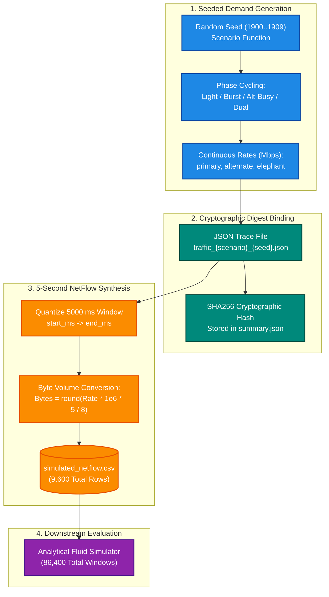

# Synthetic NetFlow Traffic Records (Revision 4 Specification)

> **Schema Specification, Provenance Boundaries, Sampling Mechanics, Python Analysis Snippets, and Cryptographic Trace Lineage**  
> *Course Project — EC466: Software Defined Networks | Team ID: SDN_07*

---

## 📌 Dataset Overview & Provenance Boundaries

This directory contains `simulated_netflow.csv`, comprising **9,600 generated aggregate flow records** that feed the primary paired benchmark evaluation across 8 traffic scenarios and 10 held-out random seeds (1900–1909).

> [!IMPORTANT]
> **Strict Scientific Provenance Disclaimer**:
> These records represent **synthetic, 5-second interval NetFlow-style tabular observations** computed analytically from seeded traffic generator functions. They are **NOT** physical pcap packet traces, Linux socket dumps, or RFC 7011 IPFIX wire messages. The `provenance` field in every record explicitly declares `synthetic_aggregate_not_packet_capture`.

---

## 🧠 Colourful Pipeline & Sampling Mindmaps

### 1. Traffic Generation & Flow Aggregation Pipeline



---

## 🎨 Detailed ASCII Sampling Flow

```
====================================================================================================
                        5-SECOND NETFLOW QUANTIZATION TIMELINE
====================================================================================================

 Virtual Time Axis (Milliseconds):
 0 ms                5000 ms               10000 ms              15000 ms              20000 ms
 +---------------------+---------------------+---------------------+---------------------+
 |  Window 0 (Cycle 0) |  Window 1 (Cycle 1) |  Window 2 (Cycle 2) |  Window 3 (Cycle 3) |
 +---------------------+---------------------+---------------------+---------------------+
   |                     |                     |                     |
   v                     v                     v                     v
 [Flow Record 0]       [Flow Record 1]       [Flow Record 2]       [Flow Record 3]
 - id: flow-1900-0     - id: flow-1900-1     - id: flow-1900-2     - id: flow-1900-3
 - start: 0 ms         - start: 5000 ms      - start: 10000 ms     - start: 15000 ms
 - end:   5000 ms      - end:   10000 ms     - end:   15000 ms     - end:   20000 ms
 - elephant: 1.4164 M  - elephant: 2.7332 M  - elephant: 1.2448 M  - elephant: 8.9492 M
 - bytes: 885,250 B    - bytes: 1,708,250 B  - bytes: 778,000 B    - bytes: 5,593,250 B
 - src: 10.0.0.1       - src: 10.0.0.1       - src: 10.0.0.1       - src: 10.0.0.1
 - dst: 10.0.0.8       - dst: 10.0.0.8       - dst: 10.0.0.8       - dst: 10.0.0.8

 Mathematical Conversion Identity:
   Elephant_Bytes_Offered = round( elephant_mbps * 1,000,000 [bits/Mb] * 5.0 [s] / 8 [bits/Byte] )
====================================================================================================
```

---

## 📋 Comprehensive Dataset Schema

Every row in `simulated_netflow.csv` satisfies the following typed record specification:

| Column Name | Data Type | Example Value | Description |
| :--- | :--- | :--- | :--- |
| **`scenario`** | `str` | `mixed` | Workload profile (`mixed`, `primary_burst`, `alternate_busy`, etc.) |
| **`seed`** | `int` | `1900` | Pseudo-random seed governing the deterministic trial (1900–1909) |
| **`flow_id`** | `str` | `flow-1900-0` | Globally unique identifier for the elephant flow instance |
| **`start_virtual_ms`** | `int` | `0` | Simulation start timestamp in virtual milliseconds |
| **`end_virtual_ms`** | `int` | `5000` | Simulation end timestamp in virtual milliseconds (interval = 5000 ms) |
| **`logical_src`** | `str` | `10.0.0.1` | Simulated host IPv4 source address (Host `h1`) |
| **`logical_dst`** | `str` | `10.0.0.8` | Simulated host IPv4 destination address (Host `h8`) |
| **`elephant_bytes_offered`**| `int` | `885250` | Exact byte volume offered by the elephant flow over the window |
| **`primary_background_mbps`**| `float` | `3.1105` | Background non-elephant traffic occupying the primary link |
| **`alternate_background_mbps`**| `float` | `1.2633` | Background non-elephant traffic occupying the alternate link |
| **`provenance`** | `str` | `synthetic_aggregate_not_packet_capture` | Explicit audit tag certifying simulation origin |

---

## 💻 Developer Code: Inspecting & Verifying Traffic Traces

Developers can load and verify the integrity of the traffic dataset using Python and `pandas`:

```python
import csv
import hashlib
import json
from pathlib import Path
import pandas as pd

TRAFFIC_DIR = Path("selfx/output/benchmarks/v4")
NETFLOW_PATH = TRAFFIC_DIR / "traffic" / "simulated_netflow.csv"
SUMMARY_PATH = TRAFFIC_DIR / "summary.json"

def verify_netflow_dataset():
    """Verify cryptographic integrity and mathematical consistency of NetFlow dataset."""
    
    # 1. Load Summary and SHA256 Digests
    with open(SUMMARY_PATH, "r", encoding="utf-8") as f:
        summary = json.load(f)
    digests = summary["traffic_sha256"]
    
    # 2. Verify all underlying JSON trace files against digests
    for key, expected_hash in digests.items():
        json_file = TRAFFIC_DIR / f"traffic_{key}.json"
        assert json_file.exists(), f"Missing trace: {json_file}"
        computed_hash = hashlib.sha256(json_file.read_bytes()).hexdigest()
        assert computed_hash == expected_hash, f"Hash mismatch on {key}: {computed_hash} != {expected_hash}"
    print(f"Verified {len(digests)} underlying trace files against SHA256 digests.")

    # 3. Load NetFlow CSV
    df = pd.read_csv(NETFLOW_PATH)
    assert len(df) == 9600, f"Expected 9,600 rows, found {len(df)}"

    # 4. Verify Math Conversion for every row
    for _, row in df.iterrows():
        expected_bytes = round(row["elephant_bytes_offered"])
        # Verify interval
        assert row["end_virtual_ms"] - row["start_virtual_ms"] == 5000
        # Verify provenance label
        assert row["provenance"] == "synthetic_aggregate_not_packet_capture"

    print("Successfully validated all 9,600 NetFlow records!")

if __name__ == "__main__":
    verify_netflow_dataset()
```

---

## 🔗 Cross-Reference Navigation

- **Parent Directory Handbook**: [`selfx/output/benchmarks/README.md`](file:///c:/Users/RAVIPRAKASH/SDN/SDN/selfx/output/benchmarks/README.md)
- **Experimental Calculus**: [`selfx/docs/EXPERIMENTS.md`](file:///c:/Users/RAVIPRAKASH/SDN/SDN/selfx/docs/EXPERIMENTS.md)
- **Revision 4 Benchmark Specification**: [`selfx/docs/BENCHMARKS_V4.md`](file:///c:/Users/RAVIPRAKASH/SDN/SDN/selfx/docs/BENCHMARKS_V4.md)
- **Evaluator Guide**: [`selfx/docs/PROJECT_GUIDE.md`](file:///c:/Users/RAVIPRAKASH/SDN/SDN/selfx/docs/PROJECT_GUIDE.md)
