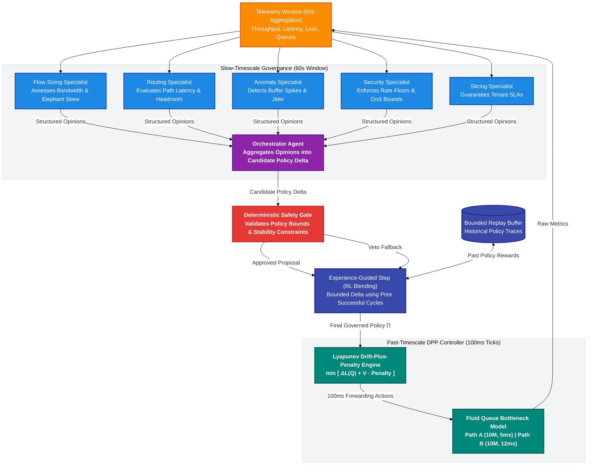

# SELF-X Slow-Loop Architecture: Governed Drift-Plus-Penalty (DPP) Controller

> **Two-Timescale Policy Governance with Multi-Specialist LLM Consensus, Lyapunov Queue Stability, and Bounded Experience Replay**  
> *Component Guide — EC466: Software Defined Networks | Team ID: SDN_07*  
> *Module Directory: `slow-loop/` | Execution: Standalone Python 3.11+ Standard Library (Zero External Dependencies)*

---

## 📌 Architectural Overview

The `slow-loop/` module implements the **two-timescale governance and Lyapunov Drift-Plus-Penalty (DPP) control loop** designed to regulate fast-timescale OpenFlow data-plane dynamics. Unlike standard single-loop controllers that attempt to make instantaneous decisions using heavyweight LLMs at millisecond intervals, SELF-X decouples control into two distinct temporal regimes:

1. **Slow Timescale ($\Delta T \approx 60\text{ seconds}$)**: An LLM Governor orchestrates five specialist agents (`flow_sizing`, `routing`, `anomaly`, `security`, `slicing`). The specialists inspect aggregate telemetry windows, synthesize opinions, and propose a constrained policy update:
   $$\Delta\Pi = (V, \mathbf{w}, \text{action\_mask})$$
   where $V \ge 0$ is the Lyapunov tradeoff parameter, $\mathbf{w} \in \mathbb{R}^5$ are objective weights for latency, throughput, loss, energy, and resource consumption, and $\text{action\_mask} \subseteq \{\text{reroute}, \text{rate\_limit}, \text{drop}, \text{no\_op}\}$.
2. **Fast Timescale ($\Delta t = 100\text{ ms}$)**: A deterministic DPP controller executes continuous queue drainage and packet scheduling on the switch bottleneck links without invoking external APIs or machine learning models. Every $100\text{ ms}$, the controller evaluates queue backlog $Q(t)$ and chooses an action from the allowed mask that minimizes the drift-plus-penalty objective:
   $$\min_{a \in \text{action\_mask}} \left[ \Delta L(Q) + V \cdot \text{Penalty}(a) \right]$$

---

## 🎨 Colourful Architecture Mindmap



---

## 🌊 Complete ASCII Control & Dataflow

```
====================================================================================================
                        TWO-TIMESCALE GOVERNED CONTROL LIFECYCLE
====================================================================================================

      SLOW TIMESCALE: 60-Second Epoch                      FAST TIMESCALE: 100-ms Ticks
 +----------------------------------------+              +------------------------------+
 | Telemetry Aggregation (600 Ticks)      |              | Queue Backlogs Q_a, Q_b      |
 | - Mean / P95 Latency (ms)              |              | Inflow Rates λ_a, λ_b        |
 | - Link Delivered Throughput (Mbps)     |              +------------------------------+
 | - Dropped Bytes & Packet Loss (%)      |                             |
 | - Energy & Resource Utilization        |                             v
 +----------------------------------------+              +------------------------------+
                     |                                   | Evaluate Drift-Plus-Penalty  |
                     v                                   | For each action a in mask:   |
 +----------------------------------------+              |   Drift = 0.5*(ΔQ_a² + ΔQ_b²)|
 | Multi-Specialist Consultation:         |              |   Penalty = w · metrics      |
 | 1. Flow-Sizing: [λ_arr, Elephant bursts|              |   Score = Drift + V*Penalty  |
 | 2. Routing:     [Path A vs Path B]     |              +------------------------------+
 | 3. Anomaly:     [Bufferbloat risk]     |                             |
 | 4. Security:    [DoS & Rate floors]    |                             v
 | 5. Slicing:     [Tenant SLA margins]   |              +------------------------------+
 +----------------------------------------+              | Apply ArgMin Action:         |
                     |                                   | - reroute (split traffic)    |
                     v                                   | - rate_limit (cap ingress)   |
 +----------------------------------------+              | - drop (tail drop)           |
 | Orchestrator Opinion Synthesis         |              | - no_op (hold state)         |
 | Proposed ΔΠ = (V, w_lat, w_tp, mask)   |              +------------------------------+
 +----------------------------------------+                             |
                     |                                                  v
                     v                                   +------------------------------+
 +----------------------------------------+              | Update Fluid Queues:         |
 | Deterministic Safety Gate Verification |              | Q(t+1) = max(0, Q + (λ-C)Δt) |
 | - Check V >= 0 and V <= V_max          |              +------------------------------+
 | - Ensure weights sum to 1.0            |                             |
 | - Invariant: action_mask non-empty     |                             | (Repeat 600 times)
 +----------------------------------------+                             |
        /                       \                                       v
    APPROVED                  VETO                       +------------------------------+
       /                         \                       | Produce 60s Telemetry Window |
      v                           v                      +------------------------------+
 +------------------+    +----------------------+                       |
 | Blend with Prior |    | Retain Previous Safe |                       |
 | Experience Buffer|    | Policy / RL Baseline |                       |
 +------------------+    +----------------------+                       |
          \                         /                                   |
           \                       /                                    |
            v                     v                                     |
    +-------------------------------------+                             |
    | Deploy Policy Update to Fast DPP:   | <---------------------------+
    | Π = (V, w, action_mask)             |
    +-------------------------------------+
====================================================================================================
```

---

## 💻 Key Implementation Modules & Code Snippets

### 1. Slow-Loop Governor Step (`slow-loop/agentic/governor.py`)

The `Governor` orchestrates multi-agent consultations, invokes the deterministic safety gate, and applies policy blending with the experience replay buffer:

```python
class Governor:
    def __init__(self, client: ModelClient, buffer: ReplayBuffer) -> None:
        self.client = client
        self.buffer = buffer

    def step(self, telemetry: TelemetryWindow, policy: Policy, mode: str = "multi") -> CycleResult:
        started = time.perf_counter()
        proposal, valid_json = self._propose(telemetry, policy, mode)
        estimate = estimate_latency_delta(self.buffer, telemetry)
        decision = check(policy, proposal, telemetry, estimate)

        if decision.accepted and proposal is not None:
            # Policy blending with historical experience replay
            blended = blend(policy, proposal, telemetry, self.buffer)
            blended_decision = check(policy, blended, telemetry, estimate)
            if blended_decision.accepted:
                chosen = blended_decision.policy
                reason = decision.reason
                accepted = True
            else:
                chosen = proposal
                reason = decision.reason
                accepted = True
        else:
            # Deterministic fallback to RL baseline on safety veto or model failure
            baseline = propose_baseline(policy, telemetry, self.buffer)
            baseline_decision = check(policy, baseline, telemetry, estimate)
            changed = baseline_decision.policy.to_dict() != policy.to_dict()
            if baseline_decision.accepted and changed:
                chosen = baseline_decision.policy
                reason = f"llm proposal rejected ({decision.reason}); applied rl baseline"
                accepted = True
            else:
                chosen = policy
                reason = decision.reason
                accepted = False

        elapsed = time.perf_counter() - started
        return CycleResult(
            accepted=accepted,
            reason=reason,
            policy_before=policy,
            policy_after=chosen,
            proposal=proposal,
            governor_seconds=elapsed,
            valid_json=valid_json,
            mode=mode,
        )
```

### 2. Fast Drift-Plus-Penalty Action Selection (`slow-loop/agentic/simulator.py`)

Every $100\text{ ms}$, the simulator evaluates every permitted action in the policy mask, computes Lyapunov queue drift $\Delta L(Q)$ and the weighted multi-objective penalty, and selects the action that minimizes overall cost:

```python
def predict_action(policy: Policy, action: str, q_a: float, q_b: float, offered_mbps: float) -> ActionEffect:
    # 1. Calculate incoming rates and explicit drop under candidate action
    arr_a, arr_b, explicit_drop = _split(action, offered_mbps, q_a)
    
    # 2. Advance fluid queue state
    next_a, over_a = _step_queue(q_a, arr_a, PATH_A_MBPS)
    next_b, over_b = _step_queue(q_b, arr_b, PATH_B_MBPS)
    
    # 3. Compute Lyapunov Queue Drift: ΔL(Q) = 0.5 * ( ||Q(t+1)||^2 - ||Q(t)||^2 )
    drift = 0.5 * ((next_a ** 2 + next_b ** 2) - (q_a ** 2 + q_b ** 2))
    
    # 4. Multi-objective weighted penalty
    norm_lat = max(0.0, (latency - SLA_LATENCY_MS) / SLA_LATENCY_MS)
    norm_loss = max(0.0, (loss_pct - SLA_LOSS_PCT) / max(SLA_LOSS_PCT, 1e-6))
    penalty = (
        policy.w_lat * norm_lat
        + policy.w_loss * norm_loss
        + policy.w_energy * energy
        + policy.w_res * resource
    )
    
    # 5. Composite DPP Score: Drift + V * Penalty
    score = drift + policy.V * penalty
    return ActionEffect(action=action, drift=drift, penalty=penalty, score=score, ...)
```

---

## 🔬 Mathematical Formulations

### 1. Lyapunov Function & Drift
Let $\mathbf{Q}(t) = [Q_A(t), Q_B(t)]^T$ be the vector of fluid queue backlogs at time $t$. The Lyapunov quadratic potential function is:
$$L(\mathbf{Q}(t)) = \frac{1}{2} \left( Q_A(t)^2 + Q_B(t)^2 \right)$$
The one-step Lyapunov queue drift $\Delta L(\mathbf{Q}(t))$ measures the expected rate of queue growth:
$$\Delta L(\mathbf{Q}(t)) = L(\mathbf{Q}(t+1)) - L(\mathbf{Q}(t)) = \frac{1}{2} \left[ Q_A(t+1)^2 + Q_B(t+1)^2 - Q_A(t)^2 - Q_B(t)^2 \right]$$

### 2. Drift-Plus-Penalty Objective
To balance system stability (preventing bufferbloat and packet drops) with quality-of-service optimization (latency, throughput, energy), the controller minimizes:
$$\min_{a(t) \in \mathcal{A}_{\text{mask}}} \left\{ \Delta L(\mathbf{Q}(t)) + V \cdot \sum_{k} w_k \cdot g_k(a(t)) \right\}$$
where:
- $V \ge 0$ parameterizes the tradeoff between queue backlog bound $\mathcal{O}(V)$ and proximity to optimal performance $\mathcal{O}(1/V)$.
- $w_k$ are the policy weights governed by the slow-timescale specialist LLM consensus.
- $g_k$ are the normalized penalty functions for latency, throughput deficits, loss, energy, and link occupancy.

---

## 🚀 Execution & Verification Guide

### 1. Run Seeded Benchmark in Deterministic Mock Mode
The mock model uses scripted specialist reasoning without making remote network calls:
```powershell
python slow-loop/run_benchmark.py --mock --episodes 10 --mode multi --seed 1729
```

### 2. Run with Local OpenAI-Compatible Server (vLLM / Ollama / Local AI)
To evaluate real LLM inference with local models:
```powershell
python slow-loop/run_benchmark.py --episodes 10 --mode multi --base-url http://127.0.0.1:8081/v1 --model "meta-llama/Llama-3-8B-Instruct"
```

### 3. Run Unit Test Suite
Verify all specialist agents, governor transitions, safety gates, and Lyapunov simulation invariants:
```powershell
python -m unittest discover -s slow-loop/tests -v
```

---

## 🛠️ Developer Extension Guide: Building on `slow-loop`

### Adding a New Specialist Agent
To add a new specialist (e.g., `carbon_aware_specialist`):
1. Define the role in [`slow-loop/agentic/config.py`](file:///c:/Users/RAVIPRAKASH/SDN/SDN/slow-loop/agentic/config.py):
   ```python
   ROLES = ("flow_sizing", "routing", "anomaly", "security", "slicing", "carbon_aware")
   ```
2. Add the system prompt in [`slow-loop/agentic/prompts.py`](file:///c:/Users/RAVIPRAKASH/SDN/SDN/slow-loop/agentic/prompts.py):
   ```python
   CARBON_AWARE_PROMPT = "Assess grid carbon intensity and favor low-energy paths when intensity > 400 gCO2/kWh."
   ```
3. Update opinion synthesis in [`slow-loop/agentic/agents.py`](file:///c:/Users/RAVIPRAKASH/SDN/SDN/slow-loop/agentic/agents.py) to parse and merge the specialist's structured recommendations into candidate policy $\Delta\Pi$.

---
*Authored by Team SDN_07 — EC466: Software Defined Networks*
