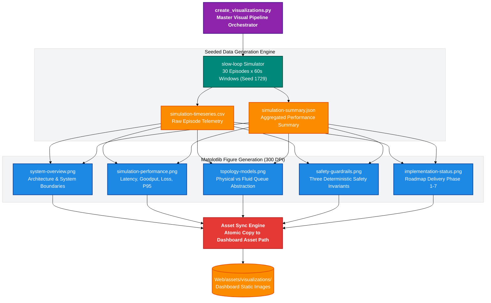

# SELF-X Visualizations & Scientific Artifact Pipeline

> **Automated Figure Generation, Empirical Asset Synchronization, and Publication-Quality Visual Analytics**  
> *Component Guide — EC466: Software Defined Networks | Team ID: SDN_07*  
> *Module Directory: `visualizations/` | Technology: Matplotlib, NumPy, Python Standard Library*

---

## 📌 Architectural Overview

The `visualizations/` module houses the automated asset pipeline responsible for generating publication-quality figures, benchmark comparison charts, topology diagrams, and telemetry summaries. Generated artifacts are rendered here and automatically synchronized into the public dashboard's asset directory (`Web/assets/visualizations/`), ensuring full visual parity across written reports, slide decks, and the live web UI.

### Core Visual Deliverables
1. **`system-overview.png`**: High-level structural architecture delineating the boundaries between the single-agent LangGraph MVP, the two-timescale Lyapunov slow-loop simulator, and the read-only web dashboard.
2. **`simulation-performance.png`**: Four-quadrant performance comparison (Mean Latency, P95 Latency, Delivered Throughput, Packet Loss %) comparing the governed mock controller against the frozen initial policy over 30 simulated minutes.
3. **`topology-models.png`**: Dual-view comparative topology diagram presenting the 4-switch/8-host linear Mininet chain alongside the slow-loop simulator's abstract two-path bottleneck abstraction.
4. **`safety-guardrails.png`**: Visual representation of the three deterministic safety invariants: 90% link capacity ceiling, 20% max flow throttling limit, and the 512 kbps rate floor.
5. **`implementation-status.png`**: Multi-phase project delivery roadmap detailing verified vs planned components across Phases 1 through 7.

---

## 🎨 Colourful Architecture Mindmap



---

## 🌊 ASCII Asset Pipeline & Data Synchronization Flow

```
====================================================================================================
                        VISUALIZATION ASSET GENERATION & SYNC PIPELINE
====================================================================================================

  1. CLI EXECUTION TRIGGER:
     python visualizations/create_visualizations.py --episodes 30 --seed 1729
                          |
                          v
  2. SIMULATION GENERATION:
     Execute slow-loop/agentic/benchmark.py (Seed 1729, Profile: Default)
     - Policy A: Governed Mock Model (Multi-Specialist Opinions)
     - Policy B: Frozen Initial Policy (Static Default Weights)
                          |
                          +-------------------------------+
                          |                               |
                          v                               v
     [simulation-timeseries.csv]              [simulation-summary.json]
     (Per-minute measurements)                (Aggregated window averages)
                          |                               |
                          +---------------+---------------+
                                          |
                                          v
  3. MATPLOTLIB PLOTTING ENGINE (DPI=300, Publication Palette):
     +---------------------------------------------------------------------------------+
     | - Render system-overview.png       (Architecture boundaries & modules)          |
     | - Render simulation-performance.png (4-panel: Latency, Loss, Throughput, P95)   |
     | - Render topology-models.png       (Mininet Linear Chain vs 2-Path Fluid Queue) |
     | - Render safety-guardrails.png     (90% link cap, 20% drop limit, 512k floor)   |
     | - Render implementation-status.png (Phases 1 through 7 completion scorecard)    |
     +---------------------------------------------------------------------------------+
                          |
                          v
  4. ATOMIC ASSET SYNCHRONIZATION:
     shutil.copy2(src_png, "Web/assets/visualizations/")
                          |
                          v
  5. WEB DASHBOARD INTEGRATION:
     Dashboard 'Project Visualizations' Tab displays synchronized PNGs instantly!
====================================================================================================
```

---

## 💻 Key Implementation Code Snippets (`visualizations/create_visualizations.py`)

### 1. Multi-Metric Performance Plotting
The script formats high-resolution subplots comparing governed vs frozen policies across latency, goodput, and packet loss:

```python
def plot_performance(timeseries_csv, output_path):
    df = pd.read_csv(timeseries_csv)
    fig, axes = plt.subplots(2, 2, figsize=(12, 8), dpi=300)
    
    # 1. Mean Latency Comparison
    axes[0, 0].plot(df['episode'], df['governed_lat'], label='Governed Agent', color='#1E88E5', lw=2)
    axes[0, 0].plot(df['episode'], df['frozen_lat'], label='Frozen Policy', color='#E53935', lw=2, linestyle='--')
    axes[0, 0].set_title('Mean Latency (ms)', fontweight='bold')
    axes[0, 0].grid(True, linestyle=':', alpha=0.6)
    
    # 2. Delivered Throughput (Goodput)
    axes[0, 1].plot(df['episode'], df['governed_tput'], label='Governed Agent', color='#00897B', lw=2)
    axes[0, 1].plot(df['episode'], df['frozen_tput'], label='Frozen Policy', color='#FB8C00', lw=2, linestyle='--')
    axes[0, 1].set_title('Delivered Throughput (Mbps)', fontweight='bold')
    axes[0, 1].grid(True, linestyle=':', alpha=0.6)
    
    # 3. Packet Loss Percentage
    axes[1, 0].plot(df['episode'], df['governed_loss'], label='Governed Agent', color='#8E24AA', lw=2)
    axes[1, 0].plot(df['episode'], df['frozen_loss'], label='Frozen Policy', color='#D81B60', lw=2, linestyle='--')
    axes[1, 0].set_title('Packet Loss (%)', fontweight='bold')
    axes[1, 0].grid(True, linestyle=':', alpha=0.6)
    
    # 4. P95 Tail Latency
    axes[1, 1].plot(df['episode'], df['governed_p95'], label='Governed Agent', color='#3949AB', lw=2)
    axes[1, 1].plot(df['episode'], df['frozen_p95'], label='Frozen Policy', color='#757575', lw=2, linestyle='--')
    axes[1, 1].set_title('P95 Tail Latency (ms)', fontweight='bold')
    axes[1, 1].grid(True, linestyle=':', alpha=0.6)
    
    plt.tight_layout()
    plt.savefig(output_path, dpi=300)
    plt.close()
```

### 2. Synchronization to Web Asset Directory
All generated PNGs are synced to the dashboard folder with atomic file copying:

```python
def sync_to_web(visualizations_dir, web_assets_dir):
    os.makedirs(web_assets_dir, exist_ok=True)
    for fname in os.listdir(visualizations_dir):
        if fname.endswith('.png'):
            src = os.path.join(visualizations_dir, fname)
            dst = os.path.join(web_assets_dir, fname)
            shutil.copy2(src, dst)
            print(f"[Sync] Copied {fname} -> {web_assets_dir}")
```

---

## 🚀 Execution & Regeneration Commands

### 1. Regenerate All Visual Artifacts
Run from the repository root:
```powershell
python visualizations/create_visualizations.py
```

### 2. Custom Seed and Duration Simulation
Generate figures using custom episode counts or traffic seeds:
```powershell
python visualizations/create_visualizations.py --episodes 50 --seed 2026
```

### 3. Verify Static Web Asset Parity
Confirm that files in `Web/assets/visualizations/` match those in `visualizations/`:
```powershell
Get-ChildItem visualizations/*.png | Select-Object Name, Length
Get-ChildItem Web/assets/visualizations/*.png | Select-Object Name, Length
```

---

## 🛠️ Developer Extension Guide: Building on `visualizations/`

### Adding a New Comparative Chart
1. **Add Plot Function in [`visualizations/create_visualizations.py`](file:///c:/Users/RAVIPRAKASH/SDN/SDN/visualizations/create_visualizations.py)**:
   ```python
   def plot_energy_efficiency(csv_path, output_path):
       df = pd.read_csv(csv_path)
       plt.figure(figsize=(8, 5), dpi=300)
       plt.plot(df['episode'], df['governed_energy'], color='#43A047', lw=2, label='Governed')
       plt.title('Energy Consumption over Time (Joules)', fontweight='bold')
       plt.savefig(output_path)
       plt.close()
   ```
2. **Invoke in Master Generation Routine**:
   Call the function inside `main()` and append the filename to the asset sync list.
3. **Display in Dashboard HTML**:
   Add an `` tag pointing to `assets/visualizations/energy-efficiency.png` in [`Web/index.html`](file:///c:/Users/RAVIPRAKASH/SDN/SDN/Web/index.html).

---
*Authored by Team SDN_07 — EC466: Software Defined Networks*
